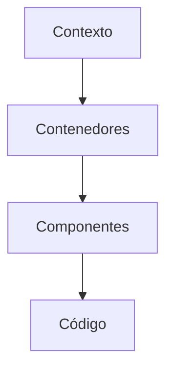

# Modelo C4

El modelo C4 propone cuatro niveles de zoom para comunicar arquitectura sin perder a nadie
en el camino. Combínalo con [SOLID](/docs/solid) cuando bajes al detalle del código.

## Niveles

## Contexto

Muestra el sistema como una caja dentro de su ecosistema: usuarios y sistemas externos.
Es el diagrama que enseñas primero a negocio.

## Contenedores

Descompón el sistema en aplicaciones, servicios y almacenes de datos desplegables de forma
independiente.

## Componentes

Detalla las piezas dentro de un contenedor y sus responsabilidades. Aquí aparecen las
interfaces que aplican inversión de dependencias.

## Código

El último nivel suele delegarse a herramientas: diagramas de clases, tipos y
documentación generada directamente del repositorio.

<Callout tone="info" title="Diagramas como código">
  Guarda los diagramas Mermaid junto al contenido para que evolucionen con el repositorio y pasen
  las mismas revisiones que el código.
</Callout>
