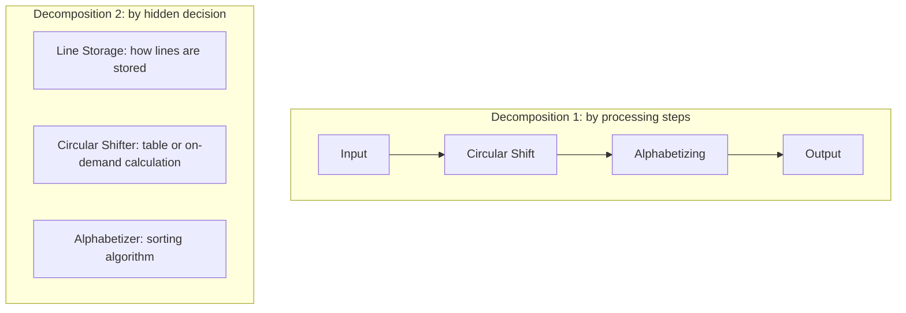
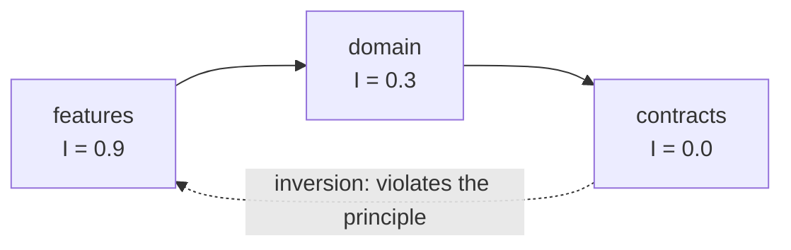

# Coupling and cohesion: the foundation of design

Almost every piece of design advice boils down to two questions: **what should live together?** and **how much should one part know about the others?** The first is cohesion; the second is coupling. Larry Constantine formulated them in the late 1960s, and they spread through the article "Structured design" by Stevens, Myers and Constantine (IBM Systems Journal, 1974) and the book _Structured Design_ by Yourdon and Constantine (1979).

[SOLID](/docs/solid) and [clean code](/docs/clean-code) take them for granted: the single responsibility principle is, at heart, a demand for cohesion, and the open/closed, interface segregation and dependency inversion principles are ways of managing coupling. This article goes back to the foundation: it defines each level precisely, shows the shape of the problem before and after, introduces the metrics and vocabulary (instability, connascence) that let you measure them, and ends with the tools to enforce them in CI.

<Callout tone="info" title="Cutoff date">
  Tool versions are from October 2026 and come from official registries (npm, GitHub). The concepts
  have been stable for decades; version numbers have not.
</Callout>

## Cohesion: what should go together

**Cohesion** measures how much the parts of a module have in common. This is the classic scale, from worst to best, as Wikipedia summarizes it from Constantine, Yourdon and McConnell:

| Level                    | The parts are together because…                                   | Typical example                                  |
| ------------------------ | ----------------------------------------------------------------- | ------------------------------------------------ |
| **Coincidental** (worst) | There is no relationship; they only share a file                  | A `utils` module with a bit of everything        |
| **Logical**              | They belong to the same category, though they do different things | A class with all the input and output operations |
| **Temporal**             | They run at the same moment                                       | The cleanup steps after an exception             |
| **Procedural**           | They always run in a fixed order                                  | A script that does A, then B, then C             |
| **Communicational**      | They operate on the same data                                     | Functions that read and write one record         |
| **Sequential**           | One's output feeds the next                                       | A chain of transformations                       |
| **Functional** (best)    | All of them contribute to one well-defined task                   | A `Money` module with addition and formatting    |

According to the studies that same source cites, the first two levels are inferior, communicational and sequential are very good, and functional is superior. It is a heuristic scale, not a theorem: use it to **spot smells**, not to score modules.

The most frequent case is the junk drawer. A `utils.ts` with `formatPrice`, `slugify` and `daysBetween` has coincidental cohesion: they do not change for the same reason and the same code does not use them. The redesign decision is to **group by reason for change**, not by kind of function: what changes together lives together, and the folder name is the concept, not "helpers".

```text
Before: a junk drawer             After: one module per concept
src/utils.ts                      src/money/   (Money, formatMoney, addMoney)
                                  src/slug/    (slugify)
                                  src/dates/   (daysBetween)
```

A `money` module with its type and the operations on it has functional cohesion: everything revolves around a single idea, and if rounding or currency rules change, the change stays in one place. The cost is real: more folders and more entry points to maintain. It pays off when the concept has rules of its own; there is no need to split out a three-line function nobody else uses.

A practical test: if you need the word "and" to describe the module ("formats prices **and** generates slugs **and** computes dates"), it is probably not cohesive.

## Coupling: how much one part knows about another

**Coupling** measures how much a module depends on the details of another. Wikipedia ranks it from strongest to weakest:

| Type                | What it means                                                               |
| ------------------- | --------------------------------------------------------------------------- |
| **Content** (worst) | One module uses another's internal code; it violates information hiding     |
| **Common**          | Several modules access the same global data                                 |
| **External**        | They share a data format, protocol or interface imposed from outside        |
| **Control**         | One directs the other's flow by passing it instructions (a what-to-do flag) |
| **Stamp**           | They share a composite data structure but each uses only part of it         |
| **Data** (best)     | They share only elementary data, usually through parameters                 |

The goal is not zero: without coupling there is no system. The goal is for it to be **the minimum necessary and of the weakest possible type**. Two conversions come up constantly.

**From control to data.** A parameter that decides which branch to run forces the caller to know the function's internals. The alternative is to hand over a collaborator (a strategy) instead of the flag: the function stops branching and the caller decides _who_ sends, not _how_ it branches inside. It costs one more type (`Notifier`) and a place where someone picks the implementation; it pays off when there are or will be more than two variants, not for a single, stable `if`.

**From stamp to data.** Receiving the whole object when only a part is used couples the function to its entire structure and complicates tests, because you must build a full order to test a label. The naming rule: the signature should ask for exactly what it uses.

```typescript
type User = { readonly email: string; readonly phone: string };
type Address = { readonly street: string; readonly city: string };
type Order = { readonly id: string; readonly address: Address };

// Control → data: instead of a flag, hand over the collaborator
declare function notifyBefore(user: User, kind: 'email' | 'sms', message: string): Promise<void>;
type Notifier = { send(user: User, message: string): Promise<void> };
declare function welcome(user: User, notifier: Notifier): Promise<void>;

// Stamp → data: ask for the address, not the whole order
declare function labelBefore(order: Order): string;
declare function label(address: Address): string;
```

**Common** coupling (mutable global state) and **content** coupling (reaching into private or internal fields) are fixed the same way: pass what is needed as an argument and expose an interface instead of the implementation.

## Information hiding: where it all starts

David Parnas set it out in 1972 in "On the Criteria To Be Used in Decomposing Systems into Modules" (Communications of the ACM, 15(12), pp. 1053–1058). His example is a KWIC index (_Key Word In Context_), which compares two decompositions of the same system. The first follows the flowchart: input, circular shift, alphabetizing, output and control. The second is organized around **design decisions that might change**: the line storage, the circular shifter and the alphabetizer (plus input, output and control in both).



Two passages from the paper condense the principle:

- "Every module in the second decomposition is characterized by its knowledge of a design decision which it hides from all others. Its interface or definition was chosen to reveal as little as possible about its inner workings."
- "We propose instead that one begins with a list of difficult design decisions or design decisions which are likely to change. Each module is then designed to hide such a decision from the others."

The corollary is uncomfortable: it is almost always incorrect to **decompose by processing steps**, because the decisions that change cut across execution time. Notice that information hiding is, to a large extent, what produces both cohesion and low coupling at once: a cohesive module is usually one that encapsulates a decision, and a loosely coupled one is one whose inside nobody needs to know.

## Deep and shallow modules

John Ousterhout picks the idea up in _A Philosophy of Software Design_ (2nd edition, July 2021). In his Stanford course notes he defines a module's **interface** as "anything about that module that must be known to other modules". It includes the formal (method signatures, public variables) and the informal (side effects, algorithms that affect behavior). There he talks about "thick" classes: "Lots of functionality, yet simple interface"; "thin" ones have little functionality and "don't hide much information". The book calls that same idea **deep** and **shallow** modules. The goal, according to the notes, is to maximize functionality divided by interface complexity. His example is Unix I/O: all devices share the same access structure (`open`, `read`, `write`, `seek`, `close`) and device-specific operations go through one additional call.

Example: a cache with expiration, `TtlCache`. The deep version exposes **a single operation**, `getOrLoad(key, load)`. Behind it, it hides three decisions: how entries are stored, how they expire, and that concurrent loads of the same key share a single result (and that a failure is not cached). The shallow version would expose its internal structure and leave those decisions to every caller:

|                                        | Deep module                        | Shallow module                                        |
| -------------------------------------- | ---------------------------------- | ----------------------------------------------------- |
| Interface                              | One method: `getOrLoad(key, load)` | The public structure: `entries`, `ttl`, `expiresAt`   |
| Who decides expiration and concurrency | The module                         | Every caller repeats "read, check, load, store"       |
| Switching to an LRU policy             | Touches no caller                  | Touches every caller that knows the shape of an entry |

Ousterhout criticizes excessive fragmentation into many tiny classes and methods, which book reviews call _classitis_; that stance contrasts with advice about small sizes that is sometimes associated with [clean code](/docs/clean-code). The practical reconciliation is to measure by **hiding**, not by lines: a small class that hides nothing is a cost; a long function with a minimal interface can be a good module.

## The Law of Demeter

The Law of Demeter was proposed in the fall of 1987 at Northeastern University by Ian Holland, within the Demeter Project. Its motto, according to the project's page at Northeastern, is "Only talk to your friends." The formal wording that Wikipedia records says that a method `m` of an object `a` may only invoke methods of: `a` itself, `m`'s parameters, objects instantiated within `m`, `a`'s attributes and global variables accessible by `a`.

The usual symptom is chains that reach through other objects' structure. Whoever writes `order.customer.address.city` becomes coupled to an order having a customer, the customer having an address and that having a city. The alternative is to ask your immediate friend: `order.shippingCity()`. The order is the only one that knows the path; if tomorrow the city comes from somewhere else, only `Order` changes.

The cost is documented: following the law to the letter can require many wrapper methods that only forward calls. As a practical criterion (not part of the law): apply it where the internal structure **may change**; it is not needed for pure, stable data or for fluent APIs, which do not reveal internal structure.

## Instability and stable dependencies

At the package or module level there is a simple metric attributed to Robert C. Martin. For a package, **afferent coupling** (Ca) counts the classes outside it that depend on it, and **efferent coupling** (Ce) counts the classes inside it that depend on something outside. **Instability** is `I = Ce / (Ca + Ce)`. The result ranges from 0 (maximum stability: others depend on it and it depends on nothing) to 1 (unstable: it depends on others and nobody depends on it). A package with Ca = 3 and Ce = 1 has I = 0.25; one with Ca = 0 and Ce = 4 has I = 1. "Stable" means **hard to change without breaking others**, not "good".

That metric underpins the **stable dependencies** principle: "The dependencies between software packages should be in the direction of the stability of the packages. That is, a given package should depend only on more stable packages" (in the wording DevIQ records). What changes often should point toward what changes rarely, never the other way around.



The dotted arrow is the mistake the metric catches: a stable module (`contracts`) depending on an unstable one (`features`). A caveat from the sources: each tool counts at a different granularity (classes, types or modules), so always compare with the same tool and do not extrapolate thresholds (the "Ce above 20" that circulates is one author's rule of thumb, not part of the metric).

## Coupling at the architecture level

The same thing happens between services. Wikipedia records Gregor Hohpe's eight dimensions of coupling (2004): technology, location, topology, data format, semantic, conversation, order and temporal. Four common forms, with our own examples:

| Form            | What it couples                                   | How to weaken it                                         |
| --------------- | ------------------------------------------------- | -------------------------------------------------------- |
| **Synchronous** | Availability and latency: if B goes down, A fails | Asynchronous communication, queues, bounded retries      |
| **Deployment**  | Two services that must be released together       | Backward-compatible contracts, versioning                |
| **Temporal**    | One action only works if another happened before  | Idempotent operations, explicit state                    |
| **Shared data** | Two services read and write the same tables       | Each service owns its data and exposes it through an API |

The costliest is the last one: a shared database is **common** coupling in disguise, because any schema change affects everyone. These boundaries are what the [C4 model](/docs/c4-model) decides when it names containers and what domain-driven design ([DDD](/docs/domain-driven-design)) tries to draw where concepts change meaning; [hexagonal architecture](/docs/arquitectura-hexagonal) protects them with ports.

## Connascence: a vocabulary for measuring

Meilir Page-Jones proposed **connascence** as a taxonomy of coupling types and a quality metric: according to Wikipedia, it quantifies the degree and type of dependency between components. According to connascence.io, there are **static** forms (detectable without running the code): name, type, meaning, position and algorithm; and **dynamic** ones: execution, timing, value and identity. Each instance is assessed on three axes:

- **Strength:** how much it costs to refactor. Stronger forms are harder to discover and to change.
- **Degree:** how many entities it affects. Being coupled to many is worse than to a few.
- **Locality:** how far apart the elements are. Close is better than far.

The use is practical: it lets you decide **when to accept** a coupling and when to refactor. A strong connascence between two adjacent lines is tolerable; the same one between two services is debt. The typical transformation is turning a strong form into a weak one, for example from position and meaning to name and type:

```typescript
// Before: connascence of position and meaning (what is each boolean?)
declare function createUserBefore(
  name: string,
  email: string,
  isAdmin: boolean,
  sendWelcome: boolean,
): void;

// After: connascence of name and type
type NewUser = { name: string; email: string; isAdmin: boolean; sendWelcome: boolean };
declare function createUser(input: NewUser): void;
```

The same goes for connascence of meaning: a magic literal like `'draft'` scattered through the code becomes a type with named values (`'draft'`, `'published'`, `'archived'`), and the compiler flags every place that does not respect it.

Connascence of name is not something to eliminate: renaming is cheap because the compiler and the editor check it for you.

## How to detect and enforce it

Three objective signals, from least to most effort:

1. **Dependency cycles.** If A imports B and B imports A, neither can be understood, tested or released on its own.
2. **Direction of dependencies.** The instability metric and layer rules check that what is volatile points toward what is stable.
3. **Logical or change coupling.** It mines git history: two files are coupled if they are modified in the same commit or by the same person within a short period. CodeScene's documentation makes clear that this coupling is "neither good nor bad" in itself: it depends on which files they are and why they co-evolve.

With dependency-cruiser, the first two are expressed as rules in the `forbidden` section of its configuration (generated with `npx dependency-cruiser --init`):

```text
forbidden: [
  { name: 'no-circular', severity: 'error', from: {}, to: { circular: true } },
  { name: 'stable-dependencies', severity: 'warn', from: {}, to: { moreUnstable: true } },
  { name: 'atoms-only-atoms', severity: 'error',
    from: { path: '^src/components/atoms' },
    to: { path: '^src/components/(molecules|organisms|templates)' } },
]
```

The second rule uses `moreUnstable`, which according to its documentation matches "any dependency that has a higher Instability than the module that depends on it". The original metric is per package, so start with `warn` severity and compare it with the per-folder metrics. The third expresses a layer rule: atoms may only depend on atoms. It is validated with `npx dependency-cruiser src`, which exits with a code equal to the number of `error`-severity violations, and per-folder metrics come from `--output-type metrics`.

This is a [fitness function](/docs/fitness-functions): the rule lives where it runs. This very repository does it with `import-x/no-restricted-paths` in ESLint, which forbids, for example, an atom importing a molecule. When a coupling decision matters (for example, "the domain does not depend on infrastructure"), record it in an [ADR](/docs/adr) and automate the check.

## Tools

| Tool                   | What it does                                                                                                    | Maturity (Oct. 2026)                                                             | Use it when…                                         | Do not use it when…                                        |
| ---------------------- | --------------------------------------------------------------------------------------------------------------- | -------------------------------------------------------------------------------- | ---------------------------------------------------- | ---------------------------------------------------------- |
| **dependency-cruiser** | Validates JS and TS dependencies with your own rules; cycles, `moreUnstable`, graphs (dot, mermaid) and metrics | 18.6.0 (Oct. 11, 2026), MIT license                                              | You want to enforce layers and detect cycles in CI   | Your project is not JavaScript or TypeScript               |
| **madge**              | Dependency graph, cycles (`--circular`) and orphan modules (`--orphans`)                                        | 8.0.0 (Aug. 5, 2024), MIT license; the maintainer works on it in their free time | You want a quick view or a simple cycle check        | You need layer rules or instability metrics                |
| **Knip**               | Finds unused files, dependencies and exports                                                                    | 6.41.0 (Oct. 9, 2026), ISC license                                               | You want to shrink each module's real public surface | You expect it to measure coupling or cohesion: it does not |
| **ArchUnit**           | Architecture rules as unit tests in Java: layers, slices, cycles                                                | 1.5.1 according to its repository, Apache 2.0 license                            | Your code is Java and you want executable rules      | Your code is not Java                                      |
| **CodeScene**          | Change coupling from git history, even across repositories                                                      | Current documentation at codescene.io; check its plans                           | You suspect hidden coupling the code does not show   | Your history is short or commits are huge                  |

## Common mistakes

- **Chasing zero coupling.** Without dependencies there is no system. Aim for the minimum and the weakest type.
- **Confusing cohesion with size.** A small module can be incoherent and a large one cohesive. Measure by reasons to change.
- **A `utils` that grows without limit.** It is the classic symptom of coincidental cohesion.
- **Abstracting too early.** A new interface with a single implementation that hides no decision adds coupling to the abstraction with no benefit.
- **Decomposing by processing steps.** Parnas warned about it in 1972: the decisions that change cut across execution time.
- **Sharing tables between services.** It is common coupling, and the costliest to undo.
- **Leaving the rule only in a document.** An agreement without an automatic check erodes over time.
- **Applying Demeter blindly.** It produces empty wrappers. Use it where the internal structure is volatile.

## Checklist

- [ ] Each module can be described in one sentence without "and".
- [ ] You can say which design decision each module hides.
- [ ] There are no dependency cycles between modules or packages (checked in CI).
- [ ] Dependencies point toward the more stable (instability reviewed at least in the core modules).
- [ ] Functions ask only for the data they use, not whole objects.
- [ ] No boolean parameter decides the internal flow of a public function.
- [ ] Calls with many positional arguments use an object with names.
- [ ] Services do not share tables; each one owns its data.
- [ ] Layer rules are automated and the hard decisions are recorded in ADRs.

## Sources

Consulted in October 2026. Parnas's text was read from the original PDF; Ousterhout's from his Stanford course notes; Martin's metric from secondary summaries (his original publication was not accessed).

- [Parnas (1972): On the Criteria To Be Used in Decomposing Systems into Modules](https://wstomv.win.tue.nl/edu/2ip30/references/criteria_for_modularization.pdf)
- [Information hiding (Wikipedia), with Parnas's full reference](https://en.wikipedia.org/wiki/Information_hiding)
- [Cohesion (Wikipedia)](<https://en.wikipedia.org/wiki/Cohesion_(computer_science)>)
- [Coupling (Wikipedia)](<https://en.wikipedia.org/wiki/Coupling_(computer_programming)>)
- [Ousterhout: Stanford course notes on modular design](https://web.stanford.edu/~ouster/cgi-bin/cs190-spring16/lecture.php?topic=modularDesign)
- [Ousterhout: A Philosophy of Software Design](https://web.stanford.edu/~ouster/cgi-bin/book.php)
- [Law of Demeter (Northeastern University)](https://www.ccs.neu.edu/home/lieber/LoD.html) and [Law of Demeter (Wikipedia)](https://en.wikipedia.org/wiki/Law_of_Demeter)
- [Stable Dependencies Principle (DevIQ)](https://deviq.com/principles/stable-dependencies/)
- [Object-oriented metrics by Robert Martin (summary)](https://kariera.future-processing.pl/blog/object-oriented-metrics-by-robert-martin/)
- [Connascence](https://connascence.io/) and [Connascence (Wikipedia)](https://en.wikipedia.org/wiki/Connascence)
- [dependency-cruiser](https://github.com/sverweij/dependency-cruiser), its [rules reference](https://github.com/sverweij/dependency-cruiser/blob/main/doc/rules-reference.md) and its [CLI reference](https://github.com/sverweij/dependency-cruiser/blob/main/doc/cli.md)
- [madge](https://github.com/pahen/madge), [Knip](https://knip.dev/) and [ArchUnit](https://www.archunit.org/)
- [CodeScene: Change Coupling](https://codescene.io/docs/guides/technical/change-coupling.html)
