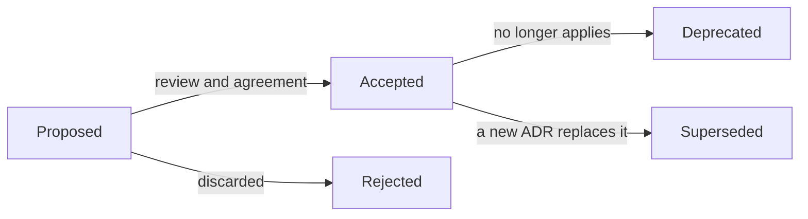

# ADRs: document architecture decisions

A system is the sum of its decisions, yet the **why** behind them is almost never written down.
The code shows what was chosen; it does not show which alternatives were discarded, which
constraints applied, or which costs were knowingly accepted. An **ADR** (_Architecture Decision
Record_) is the short document that keeps that why next to the code.

This article explains what problem an ADR solves, when to write one and when not to, the three
most common templates, a complete example, the lifecycle of a record, where to store it and how
it fits with AI agents. At the end there are common mistakes and a checklist.

<Callout tone="info" title="Cutoff date">
  The data is from October 2026. MADR 4.0.0 dates from September 2024. The Thoughtworks Technology
  Radar entry "Lightweight Architecture Decision Records" was in the _Adopt_ ring at its last update
  (May 2018) and no longer appears on the current radar. Check the sources at the end before fixing
  a process.
</Callout>

## What an ADR is and what problem it solves

The adr.github.io site defines an **architectural decision** as a justified design choice that
addresses an architecturally significant functional or non-functional requirement. An **ADR**
captures a single decision and its rationale, and the set of ADRs in a project forms the
**decision log**.

Michael Nygard popularized the format in his November 2011 post. His diagnosis still holds: large
architecture documents are never kept up to date, and what gets lost is not the design but the
reasoning. Whoever arrives later has two bad options:

- **Accept the decision without understanding it**, and entrench a choice that no longer makes
  sense.
- **Reverse it without knowing what it supported**, and break something that depended on it.

An ADR turns that implicit memory into a short, versioned, reviewable file. Microsoft sums it up in
its Well-Architected Framework guide: your architecture is the accumulation of its decisions, so
the ADR is effectively a record of how and why the system came to be its current shape. It adds a
practical consequence: a decision that is made but never recorded will likely be forgotten,
leading to repeated debates or later changes that unknowingly contradict the original intent.

## When to write one (and when not)

Nygard's rule is to write ADRs only for **architecturally significant** decisions: those affecting
structure, non-functional characteristics, dependencies, interfaces or construction techniques.
Microsoft's guide narrows it with a useful criterion: include only choices that affect the
system's structure, key quality attributes, or that are hard to reverse.

| Write an ADR when                                                | Do not write one when                                     |
| ---------------------------------------------------------------- | --------------------------------------------------------- |
| You pick a structural pattern (modular monolith, events, layers) | You rename a variable or move a file                      |
| You adopt or drop a key technology (database, framework)         | The decision can be reversed in an afternoon at no cost   |
| You define a public contract (API, data format)                  | There is only one reasonable option and nobody debates it |
| The decision trades one quality attribute for another            | It is a style preference already covered by a linter      |
| You doubt your future self will remember the reason              | The reason fits in a commit message                       |

A good test: **was there a reasonable alternative?** If there was, and someone could propose it
again a year from now, it deserves an ADR. AWS's guide adds that an ADR should focus on **why**
something was chosen, not how it is implemented; for the how, there are the code and the
[C4 diagrams](/docs/c4-model).

## Anatomy of an ADR

All templates share the essentials: **context**, **decision** and **consequences**. They differ
in how much structure they add around them.

### Nygard's template

This is the original and smallest format. Five parts:

1. **Title:** a short noun phrase, such as "ADR 9: LDAP for Multitenant Integration".
2. **Status:** _proposed_ or _accepted_; if the decision changes later, _deprecated_ or
   _superseded_, with a reference to its replacement.
3. **Context:** the forces at play (technological, political, social, project), described
   neutrally and as facts. If forces conflict, say so.
4. **Decision:** the team's response, in active voice and full sentences starting with "We will…".
5. **Consequences:** the resulting situation, with positive, negative and neutral effects.

His practical rules: ADRs live in the repository (he proposes `doc/arch/adr-NNN.md`), numbering is
sequential and **never reused**, the format is Markdown or another lightweight markup, and each
record takes one or two pages. The tone is that of a conversation with a future developer.

### MADR

MADR (_Markdown Architectural Decision Records_) is a Markdown template maintained by the
community at adr.github.io. Its 4.0.0 version dates from September 2024. The title and three
sections are mandatory; the rest is optional:

| Section                       | Mandatory? |
| ----------------------------- | ---------- |
| Title (H1)                    | Yes        |
| Context and Problem Statement | Yes        |
| Considered Options            | Yes        |
| Decision Outcome              | Yes        |
| Decision Drivers              | No         |
| Consequences                  | No         |
| Confirmation                  | No         |
| Pros and Cons of the Options  | No         |
| More Information              | No         |

It supports optional metadata in the front matter: `status`, `date`, `decision-makers`,
`consulted` and `informed`. Files follow the pattern `NNNN-title-with-dashes.md` inside a
`decisions/` folder (usually `docs/decisions`). Its contribution over Nygard is that it forces you
to list the **considered options**, which is exactly what gets lost most over time.

### Y-statements

Olaf Zimmermann proposed a compressed form: **a single sentence** in six parts whose shape
resembles the letter "Y" (for _why_). According to the sources consulted, its parts are the
context, the concern (a non-functional requirement or desired quality), the chosen option, the
neglected alternatives, the benefits and the accepted drawbacks:

```text
In the context of [use case or component],
facing [concern or desired quality],
we decided for [chosen option] and neglected [alternatives],
to achieve [benefit],
accepting that [drawback or cost].
```

It is ideal for small decisions or as the summary at the top of a long ADR. Zimmermann suggests
that, if needed, you can add a half sentence starting with "because…" for extra justifications.

### Which one to choose

| Template    | Size         | Strength                              | Use it when                                        |
| ----------- | ------------ | ------------------------------------- | -------------------------------------------------- |
| Nygard      | 1 to 2 pages | Minimal and narrative                 | You are starting out and want the simplest         |
| MADR        | Medium       | Explicit considered options, metadata | Several people decide and options must be compared |
| Y-statement | 1 sentence   | Compact, fits in a commit or a table  | Small decisions or an executive summary            |

Microsoft's guide insists on what matters more than the template: **be consistent**. Design one
anatomy and follow the same one in every record.

## A complete example

First, the **shape**: a minimal template with the MADR structure and a hint of what goes in each
part.

```markdown
---
status: accepted # proposed | accepted | superseded by ADR-NNNN
date: YYYY-MM-DD
decision-makers: who decided
---

# ADR NNNN: short noun phrase

## Context and problem statement <!-- facts and constraints, without defending an option -->

## Considered options <!-- at least two, including the conservative one -->

## Decision outcome <!-- "We choose…", in active voice -->

### Consequences <!-- the good and the bad -->
```

And an example filled with content. It is reconstructed from a real decision of this site,
documented in its `AGENTS.md`: the generated content index is committed. The alternatives and the
ADR number are illustrative.

| Part             | Content in the example                                                                                                                                                                                                     |
| ---------------- | -------------------------------------------------------------------------------------------------------------------------------------------------------------------------------------------------------------------------- |
| Title            | ADR 0004: Commit the generated content index                                                                                                                                                                               |
| Context          | Listings, search and the sitemap come from a generated index (`index.gen.json`). The typecheck imports it, so on a clean clone it fails if it does not exist. CI must detect content edited without regenerating the index |
| Drivers          | Typecheck green on a clean clone, with no prior steps; an outdated index does not reach production; diffs stay reviewable                                                                                                  |
| Options          | 1) Generate it only at build time and do not version it. 2) Commit it and validate it in the audit. 3) Compute it at runtime in the browser                                                                                |
| Decision         | Option 2: commit the index and make the audit fail (code E-INDEX) if it is out of date                                                                                                                                     |
| Consequences     | Good: the typecheck works on a clean clone and CI catches stale indexes. Bad: every content change adds noise to the diff; you must remember to index (the audit watches for it)                                           |
| More information | It does not supersede any earlier decision; it will be revisited if the index diff becomes unmanageable                                                                                                                    |

Notice three things: the context states **facts and constraints**, not the solution; the discarded
options are written down; and the consequences include the **bad**. A consequences section with
only advantages is a red flag.

## States and lifecycle

An ADR has a short lifecycle and one firm rule: **once accepted or rejected, it is not edited**. If
the decision changes, you write a new ADR that supersedes the old one and link them. That is what
Nygard says ("we will keep the old one around, but mark it as superseded"), AWS (once approved or
rejected, the ADR is treated as immutable) and Microsoft (an append-only log: do not edit accepted
records).



What you can touch in an accepted record: fix a typo or add the link "superseded by ADR-0012". What
you cannot: change the decision, the context or the consequences so they "match" what was done
later. The history of what was thought at the time is precisely the value of the record. Microsoft
adds a useful practice: note the **confidence level** when a significant decision was made with
low certainty, because that guides when to reconsider it.

If a decision is carried out in phases (short, medium and long term), record each phase as its own
ADR.

## Where to store them and how to review them

Store them **in the repository, next to the code**. Thoughtworks notes that they often end up in a
wiki, but that they prefer source control with simple markup; Microsoft asks for the log to be
stored openly with the workload's documentation.

- **Location and name:** a folder such as `docs/decisions/` and files named
  `NNNN-title-with-dashes.md`. Numbering is sequential and not reused, even if the ADR is
  rejected.
- **Review by pull request:** the ADR arrives as a PR. The PR conversation is the deliberation, and
  the merge is the acceptance. That leaves traceability without new tools.
- **Anyone can propose:** AWS recommends that any team member can create an ADR and fosters a
  sense of ownership over each one, and that it is reviewed at least once before acceptance.
- **Write the context before arguing for an option**, so reviewers debate the same problem. This
  is a recommendation from a third-party summary of AWS's process, not from the original
  document.
- **Retroactive records:** in an existing (_brownfield_) system, Microsoft recommends starting the
  log anyway and, if data is available, reconstructing past decisions.

## ADRs and AI agents

A repository with ADRs is a repository that is **easier to harness**: the why of decisions stops
living in someone's head and becomes context an agent can read. Three practices:

1. **Give it the context.** Mention the decisions folder in your `CLAUDE.md` or `AGENTS.md`
   ("before changing the architecture, read `docs/decisions/`"). Claude Code reads `CLAUDE.md`
   and can read `AGENTS.md` in its place; `@path` imports let you link an ADR index, but they load
   their content into context, so link the index and not every record.
2. **Let it draft, not decide.** An agent is good at gathering context from the code, listing
   alternatives and summarizing consequences. The **decision** is human: someone must be able to
   defend it and answer for it. The human reviews and accepts in the PR.
3. **Turn them into sensors when possible.** An ADR that says "components do not import routes"
   can be translated into an executable rule. That is a _fitness function_: the ADR records why,
   the rule enforces it (see [fitness functions](/docs/fitness-functions)).

All of this fits the idea of [harness engineering](/docs/harness-engineering-claude-code): guides
steer before acting and sensors check afterwards, and ADRs are a long-term guide. It also fits
[SOLID](/docs/solid) and [clean code](/docs/clean-code): it pays to remember why a responsibility
was split or a dependency inverted. And choosing a [language and framework](/docs/lenguajes-era-ia)
is the ideal candidate for an ADR.

## Common mistakes

- **Writing them afterwards and from memory.** Writing the ADR on the day of the decision is cheap;
  months later it is reconstructed badly. If you must, do it retroactively, but label it.
- **An ADR without alternatives.** If it only describes the chosen option, it explains nothing.
  Write down at least the ones discussed and why they were discarded.
- **Only positive consequences.** Every decision costs something. If you do not see it, you are not
  done.
- **Editing accepted records.** Rewriting the past destroys the value of the log. Supersede, do not
  edit.
- **Turning the ADR into a design document.** It must be short and readable without the supporting
  material; link the detailed design if needed.
- **ADRs for everything.** If the log fills up with trivial decisions, nobody reads it. Apply the
  reasonable-alternative test.
- **Storing them where the code is not.** A disconnected wiki ages. Version them with the repo.
- **An ADR nobody can find.** Numbering, an index and a mention in `CLAUDE.md` or `AGENTS.md`.

## Checklist for your next ADR

- [ ] The decision is architecturally significant and a reasonable alternative existed.
- [ ] The context describes facts and constraints, without yet defending an option.
- [ ] There are at least two considered options, including the conservative one.
- [ ] The decision is written in active voice and is a single one.
- [ ] The consequences include costs and risks, not just advantages.
- [ ] It has a status, a date and the people who decided.
- [ ] It arrives by pull request and someone else reviews it before it is accepted.
- [ ] The file is numbered, with no reused numbers, in the repo's decisions folder.
- [ ] If it supersedes another, both are linked and the old one is marked superseded.
- [ ] If the decision can be checked automatically, a rule or test watches it.

## Sources

Consulted in October 2026; check each fact against the official source before fixing a process. The
Y-statement details come from search results about Zimmermann's work, not from a full reading of
his original publication.

- [Documenting Architecture Decisions (Michael Nygard, 2011)](https://www.cognitect.com/blog/2011/11/15/documenting-architecture-decisions)
- [Architectural Decision Records (adr.github.io)](https://adr.github.io/)
- [MADR: Markdown Architectural Decision Records](https://adr.github.io/madr/)
- [Maintain an architecture decision record (Microsoft Azure Well-Architected Framework)](https://learn.microsoft.com/en-ca/azure/well-architected/architect-role/architecture-decision-record)
- [Architectural decision records (AWS Prescriptive Guidance)](https://docs.aws.amazon.com/prescriptive-guidance/latest/architectural-decision-records/introduction.html)
- [Master architecture decision records: best practices (AWS Architecture Blog)](https://aws.amazon.com/blogs/architecture/master-architecture-decision-records-adrs-best-practices-for-effective-decision-making/)
- [Lightweight architecture decision records (Thoughtworks Technology Radar)](https://www.thoughtworks.com/radar/techniques/lightweight-architecture-decision-records)
- [Architectural Decisions: The Making Of (Olaf Zimmermann)](https://www.ozimmer.ch/practices/2020/04/27/ArchitectureDecisionMaking.html)
