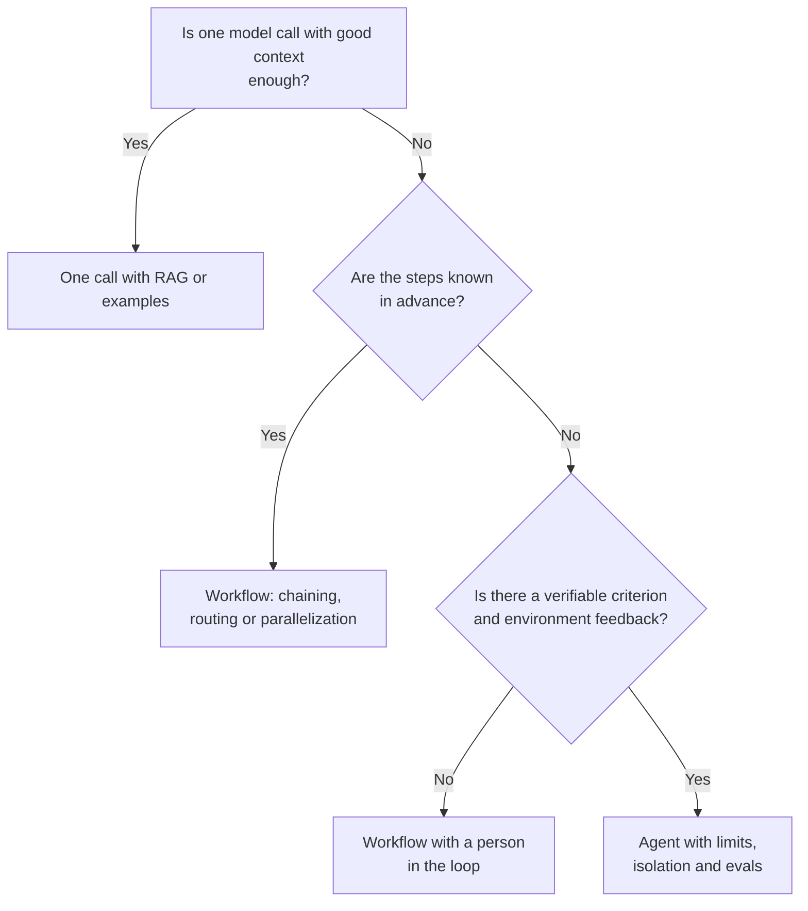
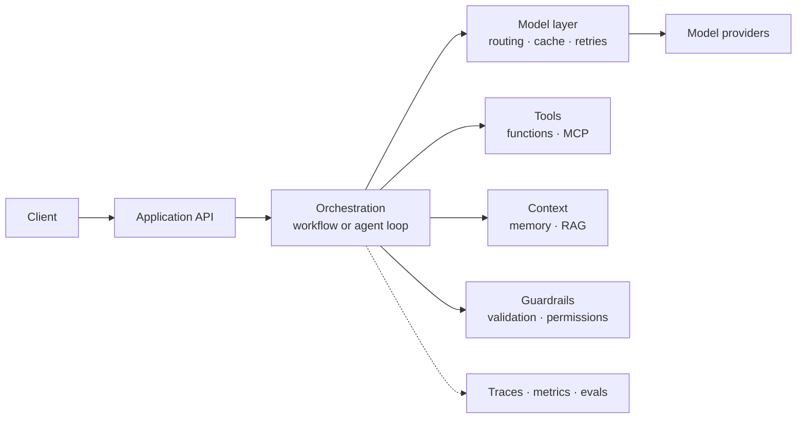

# Architecture of LLM and agent applications

Calling a model is easy. The hard part is everything around it once that call becomes one piece
of a system that must be reliable, affordable, secure and maintainable for years. That work is
architecture, not prompt engineering: which components exist, where each boundary is drawn, what
is delegated to the model and what stays in deterministic code.

This article is the architect's view of an LLM application: the spectrum between workflows and
agents, the components that almost always show up, the latency and cost trade-offs, security and
the most common mistakes. It complements the article on the
[Claude Code harness](/docs/harness-engineering-claude-code), which covers how to harness one
specific coding agent; here the focus is the system you build.

<Callout tone="info" title="Cutoff date">
  The data is from October 2026. Anthropic's "Building effective agents" article dates from December
  2024 and its own page warns that some of the tooling it describes has changed; the patterns are
  still useful, but check the current state of each API and protocol before deciding.
</Callout>

## Workflows and agents: the spectrum

Anthropic groups these systems as "agentic" and distinguishes two types:

- **Workflows:** the model and the tools are orchestrated through predefined code paths.
- **Agents:** the model dynamically directs its own process and tool usage, and keeps control
  over how it accomplishes the task.

The central recommendation of the article is to find the simplest solution possible and only
increase complexity when needed. For many applications, a single well-optimized call, with
retrieval and in-context examples, is already enough. Agentic systems often trade latency and
cost for better performance, and that trade should be a conscious one.

The base building block is the **augmented LLM**: a model with retrieval, tools and memory, able
to generate its own queries, choose tools and decide what to retain. On top of it, the article
describes five workflow patterns:

| Pattern                  | How it works                                                                      | Use it when                                                           |
| ------------------------ | --------------------------------------------------------------------------------- | --------------------------------------------------------------------- |
| **Prompt chaining**      | Each call processes the previous output, with checks between steps                | The task splits cleanly into fixed subtasks                           |
| **Routing**              | The input is classified and sent to a specialized prompt or process               | Distinct categories are better handled separately                     |
| **Parallelization**      | Independent subtasks at once (sectioning) or the same task several times (voting) | You want speed, or more confidence through multiple attempts          |
| **Orchestrator-workers** | A central model breaks the task down, delegates to workers and synthesizes        | You cannot predict the required subtasks in advance                   |
| **Evaluator-optimizer**  | One model generates and another evaluates and gives feedback, in a loop           | There are clear evaluation criteria and iterating improves the result |

A useful routing example with a direct effect on cost: send easy questions to small, cheap models
and hard ones to more capable models.

An **agent**, in contrast, is "typically just LLMs using tools based on environmental feedback in
a loop". At each step it needs ground truth, such as a tool result or code execution, to know
whether it is making progress, and it must have stopping conditions, such as a maximum number of
iterations. It suits open-ended problems where the number of steps cannot be fixed in advance;
the cost is higher and errors can compound, so the authors recommend testing it extensively in
sandboxed environments.

On multi-agent systems, Anthropic published figures from its research system in June 2025:
agents use roughly four times more tokens than chat and multi-agent systems roughly fifteen times
more; token usage alone explained 80% of the variance in the BrowseComp benchmark. They fit tasks
that are highly parallelizable, exceed a single context window and justify the cost; they fit
poorly where agents share a lot of context or depend on each other, which is common in coding
tasks.

## When not to use an agent

The design question is not "can we use an agent?" but "what is the simplest thing that meets the
requirement?". This map orders the decision:



Avoid the agent when:

- **The flow is known and stable.** A workflow is cheaper, faster and easier to debug.
  Deterministic code always wins when you know how to write it.
- **You cannot verify the result.** Without tests, contracts or a person who validates, an
  autonomous loop just accumulates errors with confidence.
- **The cost of being wrong is high and irreversible.** Payments, deletions or messages to
  customers call for human confirmation, not autonomy.
- **The task's value does not pay for the tokens.** More agents and more steps multiply
  consumption.
- **Subtasks depend heavily on each other.** Splitting shared context across agents tends to
  make the result worse.

One last warning from the authors: frameworks speed up the start, but they can hide prompts and
responses behind abstraction layers and make debugging harder. Start by calling the provider API
directly and adopt a framework once you understand what it does for you.

## Architecture components

Almost every LLM application ends up with the same pieces, whether or not they are split into
separate services. Naming them helps to draw them in a [C4 model](/docs/c4-model) and to decide
where the boundaries go.



### The model layer

This is the boundary with the provider. It centralizes in one place model selection, retries,
timeouts, prompt caching, token usage logging and provider switching. It applies the dependency
inversion principle from [SOLID](/docs/solid): the rest of the application depends on an interface
of your own (`generate`, `generateStructured`), not on a provider's SDK.

An executable rule keeps it that way: an architecture test that fails if any module outside that
layer imports the provider SDK (see [fitness functions](/docs/fitness-functions)). And document
the choice of provider and model in an [ADR](/docs/adr): these decisions expire quickly and are
worth revisiting with their context.

### Context and memory

Context is an agent's scarce resource. Decide explicitly what goes into each call: instructions,
retrieved data, history and tool results. For long-running systems, Anthropic describes saving
the plan to external memory so it is not lost when the context is truncated, and resuming from
checkpoints instead of starting over.

Tell three memories apart: **working** memory (the conversation window), **session** memory (state
that outlives a conversation, usually in your database) and **long-term** memory (learned
preferences and facts). Each has its own expiry, privacy and deletion policy.

### RAG: decisions, not a recipe

Retrieval-augmented generation (RAG) is one form of the "augmented LLM". As an architect, the
decisions that matter are not the library but these questions:

- **What is the source of truth and how is it kept fresh?** The index is a derived copy: it
  needs reindexing and versioning, like any cache.
- **Who can see what?** Retrieval must respect the permissions of the user asking, not those of
  the service querying the index.
- **How is retrieval measured?** Evaluate separately whether it found the right thing and whether
  the model used it well; they are different failures with different fixes.
- **What happens when nothing relevant exists?** The system must be able to say it does not know.

Failures in this layer are a recognized security risk: the OWASP list includes "Vector and
Embedding Weaknesses" (LLM08) among its ten 2025 entries.

### Tools and MCP

Tools are the agent's hands, and their definition is an API contract that deserves the same care
as any other. Anthropic recommends building a few thoughtful tools for high-impact workflows
instead of wrapping every endpoint, grouping them under prefixes by service and resource,
returning only high-signal information (natural-language names rather than technical
identifiers), limiting response size with pagination, filters and truncation, and describing each
tool the way you would explain it to a new teammate. In Claude Code, for example, tool responses
are limited to 25,000 tokens by default.

Another tip from the same article is to design tools so that mistakes are hard to make
(_poka-yoke_). In their SWE-bench work, requiring absolute file paths eliminated the errors the
model made with relative ones.

A typed contract puts that in writing. This skeleton is not meant to be copied: it shows which
fields to name and what each one should say.

```typescript
import { z } from 'zod';

type Tool<I, O> = {
  name: string; // namespaced: orders_search, not search
  description: string; // what it does, when to use it and how it differs from similar tools
  input: z.ZodType<I>; // schema that validates every call before it runs
  effect: 'none' | 'reversible' | 'irreversible'; // decides whether to ask for human confirmation
  run(input: I, ctx: { signal: AbortSignal }): Promise<O>;
};
```

Three conventions hold the contract together. **Names by resource and verb**, with the same
prefix for the tools of one domain (`orders_search`, `orders_get`). **Self-explanatory
parameters**: `customer_id` rather than `id`, with an example of the format in the field
description (for example `cus_123`). And an **explicit effect field**, because it is what lets the
orchestrator decide when to ask for confirmation without guessing from the name.

**MCP (Model Context Protocol)** is an open standard for connecting AI applications to external
systems; its documentation compares it to a USB-C port. A **host** (the application) creates one
**client** for each MCP **server**, and servers expose three primitives: _tools_ (executable
functions), _resources_ (context data) and _prompts_ (templates). There are two transports: stdio
for local processes and streamable HTTP for remote servers, where OAuth is recommended. Each tool
is described with a name, a title, a description and an input JSON Schema.

From an architecture standpoint, MCP is an **integration contract**: it separates who implements
the capability from who consumes it. Two nuances from the current documentation: MCP is limited
to exchanging context and does not dictate how the application uses the model or manages that
context, and protocol version `2026-07-28` describes it as stateless (each request carries its
version and capabilities) and deprecates the _sampling_ primitive. If you already integrate many
servers, the documentation mentions progressive tool discovery so that you do not load them all
at once.

### Orchestration

This is the code that decides the next step. In a workflow it is an explicit graph; in an agent
it is a loop. In both cases it should live outside the prompt, be testable and have explicit
limits. The minimal loop is short; what makes it safe is not its logic but its limits. Every
iteration does the same thing:

1. Ask the model for the next step with the history and the available tools.
2. Add up token usage; if it exceeds the budget, stop.
3. If the model asked for no tool, the agent is done.
4. Validate each call against the tool's schema; if it is invalid, return the error to the model
   and count a failure.
5. If the tool is irreversible, ask a person for confirmation; if they reject it, tell the model.
6. Run it with a shared deadline; a failure is returned as an error and also counts.
7. If failures exceed the maximum, stop.

Group the limits in a single type that the orchestrator receives as a parameter (`maxSteps`,
`maxErrors`, `maxTokens` and `deadlineMs`), so they can be tuned per task without touching the
loop. Each limit has its own exit:

| Limit       | What triggers it                             | State it returns                  |
| ----------- | -------------------------------------------- | --------------------------------- |
| Steps       | The allowed iterations run out               | `step_limit`                      |
| Tokens      | Accumulated usage exceeds the budget         | `budget_exceeded`                 |
| Errors      | Invalid or failed calls go above the maximum | `too_many_errors`                 |
| Deadline    | The total time runs out                      | The call in progress is cancelled |
| Natural end | The model asks for no more tools             | `done`                            |

Note what it does **not** do: it does not trust the model to stop on its own. There are four
bounded exits (steps, tokens, errors and deadline) and irreversible actions go through a person.

### Guardrails and structured outputs

Treat the model's output as untrusted input. Ask for it in a structured format, validate it
against a schema before using it and reject or repair what does not comply. OWASP lists it as
"Improper Output Handling" (LLM05). One of the parallelization uses Anthropic cites is precisely
to have a separate model screen user input as a guardrail while another answers.

A useful guardrail is deterministic whenever possible (schemas, allowlists, numeric limits) and
leans on another model only for what code cannot judge.

### Observability

An agent that fails without leaving a trace cannot be improved. Record for each run the steps,
the tool calls with their inputs and outputs, the tokens and the time, and correlate them with a
run identifier. Anthropic says full production tracing let them diagnose failures, and that they
monitored decision patterns without reading the contents of individual conversations to protect
privacy: decide from the design stage which data goes into the traces.

### Evaluations (evals)

Evals are the system's tests, and non-determinism means you cannot do without them. Two ideas
from the Anthropic team, both from real experience: start early with a small sample (about 20
queries) instead of waiting for a large set, and use a model as a judge with an explicit rubric
(in their case, a single prompt returning a score and a verdict was the most consistent), without
giving up on testing with people, who caught failures that automation missed.

For tools, the guidance is to build realistic, multi-step evaluation tasks with a verifiable
outcome, measure calls, time, tokens and errors, and keep a held-out test set to avoid
overfitting.

## Trade-offs: latency, cost and non-determinism

Every architecture decision here trades something. These are the usual axes:

| Axis            | What pushes it up                               | Architecture lever                                          |
| --------------- | ----------------------------------------------- | ----------------------------------------------------------- |
| **Latency**     | Long chains, loops, sequential execution        | Parallelize subtasks, small models on easy steps, streaming |
| **Cost**        | More agents, more steps, large repeated context | Routing by difficulty, prompt caching, budget limits        |
| **Quality**     | More attempts and more verification             | Evaluator-optimizer, voting, continuous evals               |
| **Reliability** | Non-determinism and compounding errors          | Schema validation, bounded retries, resumption              |

### Prompt caching

If you repeat a long prefix (instructions, tools, documents) in every call, Anthropic's prompt
caching reduces latency and input cost. According to its documentation, the prefix is built in the
order `tools`, then `system`, then `messages`; you can mark up to four breakpoints or use the
automatic mode; the default lifetime is 5 minutes, refreshed at no cost whenever the content is
used, and there is a 1-hour option at a higher price. A 5-minute write costs 1.25x the base input
price, a 1-hour write costs 2x and a read costs 0.1x for most models (with cheaper exceptions).
There is a minimum length that depends on the model: below it the prompt is processed without
caching and without an error.

The design consequence is that **prompt order is an architecture decision**: put what is stable
first and what varies last, and note that changing the tool definitions invalidates every level.
Check that it works by looking at the `cache_creation_input_tokens` and
`cache_read_input_tokens` usage fields; if both are 0, nothing was cached.

### Choosing the model per task

There does not have to be a single model. Routing sends the easy work to a small model and the
hard work to a more capable one, and in an orchestrator with workers you can assign a different
model to each role. Decide with your evals, not by intuition, and keep the choice in
configuration so you can change it without redeploying.

### Partial failures, idempotency and retries

An agent is a long-running process with state and steps that can fail halfway. Anthropic sums it
up this way: small failures can cascade, so they added resumption from checkpoints and
deterministic safeguards such as retry logic, instead of restarting. Apply the usual
distributed-systems practices:

- **Make tools with side effects idempotent.** If a retry repeats a payment, the design is
  wrong; use idempotency keys.
- **Bound retries** and tell transient errors (network, rate limits) from logic errors, which the
  model must read and correct.
- **Save state** after each important step to resume without repeating work.
- **Deploy with care:** running agents must not break with a new version; Anthropic used _rainbow_
  deployments, which shift traffic gradually between versions.

## Security

The OWASP Top 10 for LLM Applications (2025 edition) puts **prompt injection** (LLM01) first and
includes **excessive agency** (LLM06): giving the system more functionality, permissions or
autonomy than it needs, so its actions can cause harm when the output is wrong or manipulated. It
also includes unbounded consumption (LLM10), sensitive information disclosure (LLM02) and system
prompt leakage (LLM07).

The root cause of injection is structural: the model receives trusted instructions and untrusted
content (web pages, emails, documents, tool responses) in the same context, and cannot reliably
tell them apart. No filter fully solves it; it is mitigated with architecture.

- **Least privilege.** Give each agent only the tools it needs, with the narrowest possible scope:
  a read tool instead of a read-and-write one.
- **Isolation.** Run generated code and commands in an isolated environment, with restricted
  network and filesystem.
- **Quarantine pattern (reader and actor).** Anthropic describes it for triage at scale: reader
  agents with read-only tools process the untrusted content and emit summaries; another agent
  with more privileges acts only on those summaries, never on the original content.
- **Human confirmation for the irreversible.** Deletions, payments, sends and permission changes
  go through a person. In the loop above, the `effect` field decides it.
- **Credentials outside the context.** The model should not see secrets; the tool uses them on
  its behalf.
- **Budgets.** Token, step and time limits also defend against unbounded consumption.

The controls of one specific coding agent (permissions, sandbox, hooks) are in the article on the
[Claude Code harness](/docs/harness-engineering-claude-code); the logic is the same as here,
applied to one tool.

## Common mistakes

- **Starting with an agent.** One call with good context or a workflow is usually enough; move up
  a level only with evidence that you need it.
- **Adopting a framework you do not understand.** If you cannot explain which prompt and which
  calls it makes for you, you will not be able to debug it.
- **A loop without limits.** Without a maximum of steps, tokens, errors and time, a failure turns
  into a bill.
- **Tools that mirror the API.** Dozens of uncurated endpoints confuse the model and fill the
  context with noise.
- **Trusting the model's output.** Without schema and permission validation, a hallucination
  reaches your database.
- **Having no evals.** Without them, every change of prompt, tool or model is a bet.
- **Retries that repeat effects.** A retry without idempotency duplicates payments or emails.
- **Mixing untrusted content with privileges.** The agent that reads the web should not be the one
  that can delete files.
- **Switching providers without a boundary.** With the SDK spread through the code, migrating
  means rewriting.

## Checklist for your LLM application

- [ ] You documented in an ADR why you chose workflow or agent, and which simpler alternative you
      discarded.
- [ ] Access to the model provider sits behind a single interface of your own, protected by an
      executable architecture rule.
- [ ] Each tool has a namespaced name, a clear description, schema-validated input and a declared
      effect (none, reversible or irreversible).
- [ ] Tool responses are small, high-signal and size-limited.
- [ ] The agent loop has a maximum of steps, tokens, errors and a deadline.
- [ ] Irreversible actions require human confirmation.
- [ ] Tools with side effects are idempotent and retries are bounded.
- [ ] The model's output is validated against a schema before it is used.
- [ ] Untrusted content is processed with least privilege and isolated from sensitive actions.
- [ ] There are traces per run and an identifier to correlate steps, tools and costs.
- [ ] A set of evals exists, however small, and runs on every relevant change.
- [ ] The prompt order is designed for caching (stable first) and its hit rate is measured.

## Sources

Consulted in October 2026; check each fact against the official source before deciding.

- [Building effective agents (Anthropic Engineering, December 19, 2024)](https://www.anthropic.com/engineering/building-effective-agents)
- [How we built our multi-agent research system (Anthropic Engineering, June 13, 2025)](https://www.anthropic.com/engineering/multi-agent-research-system)
- [Writing effective tools for agents, with agents (Anthropic Engineering, September 11, 2025)](https://www.anthropic.com/engineering/writing-tools-for-agents)
- [A harness for every task: dynamic workflows in Claude Code (Anthropic, June 2, 2026)](https://claude.com/blog/a-harness-for-every-task-dynamic-workflows-in-claude-code)
- [What is the Model Context Protocol (MCP)?](https://modelcontextprotocol.io/docs/getting-started/intro)
- [MCP architecture (protocol version 2026-07-28)](https://modelcontextprotocol.io/docs/2026-07-28/learn/architecture)
- [Prompt caching (Claude platform documentation)](https://platform.claude.com/docs/en/build-with-claude/prompt-caching)
- [OWASP Top 10 for LLM Applications 2025](https://genai.owasp.org/llm-top-10/)
