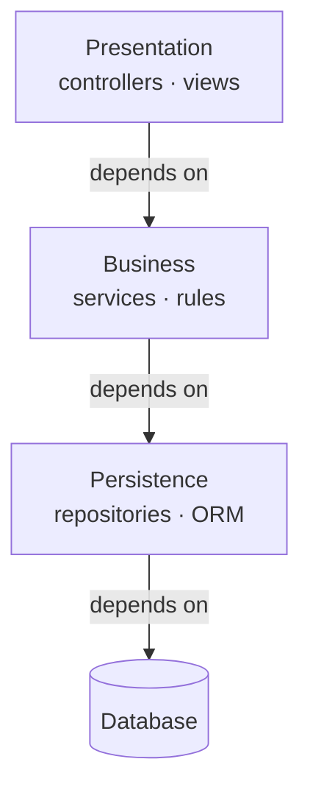
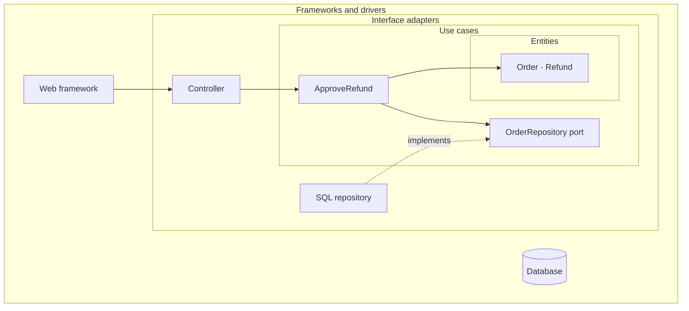
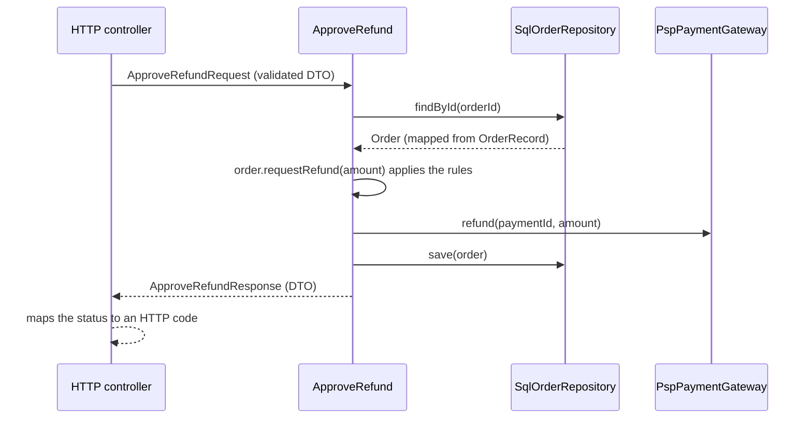
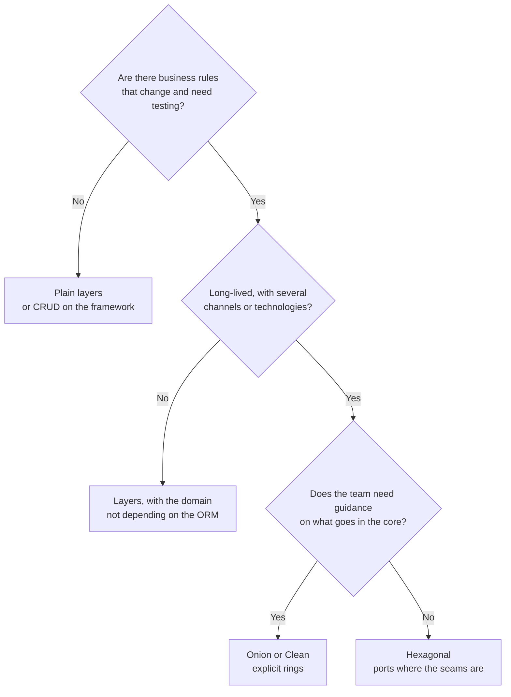

# Layered, Onion and Clean: where dependencies point

Your team wants a command-line tool that does exactly what one endpoint already does: approve a refund. It should take an afternoon. Then you open `RefundService` and find that it takes an HTTP request object, returns an ORM entity with lazy relations, and throws exceptions from the web framework. To reuse it you have to fake a request, open a database session and catch errors that mean nothing outside HTTP. Nobody designed it that way; the direction of the dependencies did. Layered architecture, Onion Architecture and Clean Architecture are three answers to the same question, and the difference that matters fits in one sentence: **what separates these styles is not how many layers they draw but which way source code dependencies point; in classic layering they run down to the database, in Onion and Clean they converge on the domain**.

This article covers the whole family: where layered architecture comes from and why it couples business logic to persistence, what Palermo and Martin proposed, what the styles share and where they differ, what a well-built boundary looks like, which mistakes turn any of them into bureaucracy, and which one to pick for which kind of system. The code shows names and shapes only; everything else is in prose, tables and diagrams.

<Callout tone="info" title="Sources and cut-off date">
  Checked in October 2026. Dates and quotes from Palermo, Martin and Fowler come from their own
  blogs. I read Mark Richards' report in a PDF copy of the 2015 edition, not on the O'Reilly site
  (which returned 403). Simon Brown's authorship of chapter 34 of Martin's book is confirmed only by
  secondary sources.
</Callout>

## Classic layered architecture

Martin Fowler describes it as one of the most common ways to modularize an information-rich program: split it into three broad layers, **presentation**, **domain logic** and **data source**. He stresses that these are logical layers, not physical tiers; they can live in one process. His default version is linear: presentation depends on the domain, and the domain depends on the data source.



The arrows are source code dependencies and also the path every request takes. That overlap is the key to everything that follows.

### Why it became the default

Mark Richards, in his report _Software Architecture Patterns_ (O'Reilly, 2015), calls it the most common architecture pattern, also known as n-tier, and the de facto standard for most Java EE applications. He gives a reason that is not technical at all and still rings true: it mirrors the communication and organizational structure of most corporate IT departments. There is a UI team, a backend team and a database team, and each gets its own layer.

Richards adds two terms that make the discussion precise:

- **Closed layers.** A request must go through the layer directly below; it cannot skip it. That gives you **layers of isolation**: a change in one layer should not ripple into the others.
- **Open layers.** You explicitly mark the layers a request may bypass, such as a shared services layer. Every open layer is an architectural decision and should be documented as one.

The appeal is real: it is easy to explain, everyone on the team recognizes it, and web frameworks ship with it. For many applications it remains a good choice, and Richards himself presents it as a solid starting point when you are not sure which pattern fits.

### Where the dependency problem comes from

The trouble is the arrow that leaves the domain: **business logic depends on persistence**. If the service imports the concrete repository and the repository returns ORM entities, the business logic ends up written in terms of tables, sessions and annotations. Jeffrey Palermo put it in a sentence worth remembering in 2008: transitive dependencies are still dependencies. The UI does not import the database, but it cannot work without the business layer, and the business layer cannot work without data access. In practice, the UI is coupled to the database.

Palermo also made an economic argument, which [hexagonal architecture](/docs/arquitectura-hexagonal) develops in more detail. Fowler, in his 2015 article, describes the variant that avoids the coupling: a mapper between the domain and the data source so the domain no longer depends on it, and he notes that this variant is often called hexagonal architecture. That variant is where the whole family starts.

| Symptom                                                     | Cause in a classic layered design                      |
| ----------------------------------------------------------- | ------------------------------------------------------ |
| Testing a business rule needs a database                    | The service depends on the concrete repository         |
| Switching ORMs touches dozens of services                   | ORM entities are the domain model                      |
| A second channel (CLI, queue) duplicates controller logic   | Services take and return web framework types           |
| The database schema dictates business vocabulary            | The model was derived from tables, not from rules      |
| N+1 queries show up in the view without anyone calling them | Lazy ORM objects travel all the way up to presentation |

## Onion Architecture

Jeffrey Palermo published _The Onion Architecture: part 1_ on his blog on 29 July 2008, and the series continued; in part 3, dated 4 August 2008, he compared it with traditional layering and summarized its principles. The picture is an onion: concentric rings around a **domain model** that depends only on itself.

What the text actually says:

- The **domain model** sits at the center.
- The first ring around the domain is typically where the **repository interfaces** live: saving and retrieving behavior, expressed from the business side.
- The number of layers in the application core **varies**; what is fixed is that the domain is at the center.
- The outer ring is **reserved for things that change often**: user interface, infrastructure and tests. Repository implementations live there because they are coupled to a specific data access technique.
- **The database is not the center; it is external.** In Palermo's framing, there are no database applications, only applications that might use a database.

Part 3 lists four tenets: the application is built around an independent object model; inner layers define interfaces and outer layers implement them; the direction of coupling is toward the center; and all application core code can be compiled and run separately from infrastructure. He also points out a difference from classic layering that is easy to miss: **any outer layer can call any inner layer directly**, whereas in traditional layering a layer can only call the one directly beneath it.

Palermo scoped it from the first post: he wrote that it is not appropriate for small websites and that it is appropriate for long-lived business applications and applications with complex behavior. That caveat tends to get lost when teams apply it to every project by default.

## Clean Architecture

Robert C. Martin published _The Clean Architecture_ on his blog on 13 August 2012 and expanded it in the book _Clean Architecture: A Craftsman's Guide to Software Structure and Design_ (Prentice Hall, 2017). The post lists its predecessors: Alistair Cockburn's hexagonal architecture, Palermo's Onion, his own _Screaming Architecture_, DCI by James Coplien and Trygve Reenskaug, and BCE by Ivar Jacobson, and says they all share one objective: separation of concerns.

His diagram has four circles:

| Circle                 | Contains                                                                                         |
| ---------------------- | ------------------------------------------------------------------------------------------------ |
| Entities               | Enterprise-wide business rules, the ones that would exist even without software                  |
| Use Cases              | Application-specific rules; they orchestrate data flowing to and from the entities               |
| Interface Adapters     | Controllers, presenters and views; they convert data between the core format and the outside one |
| Frameworks and Drivers | Database, web framework, devices: the glue to the outside world                                  |



The **dependency rule** is the heart of the post: source code dependencies can only point inwards, and nothing in an inner circle can know anything about an outer one, not even the name of a function, class or variable declared out there.

Three clarifications from Martin himself that prevent common misreadings:

- **The circles are schematic.** Asked whether there are only four, he says no: you may need more, as long as the dependency rule holds.
- **Flow of control and source dependencies can point in opposite directions.** Control starts in the controller, moves through the use case and ends in the presenter. To keep the use case from depending on the presenter, it calls an interface declared in its own circle (an output port) that the presenter implements. That is the dependency inversion from [SOLID](/docs/solid), applied at every boundary.
- **What crosses a boundary is isolated, simple data structures**: basic structs, data transfer objects (DTOs), function arguments. Do not pass entities or database rows, and shape the data in whatever form is most convenient for the inner circle.

The book also includes chapter 34, _The Missing Chapter_, which several reviews attribute to Simon Brown (the publisher's table of contents does not name him) and which compares four ways of packaging code: by layer, by feature, ports and adapters, and by component. It is worth reading for the folder problem discussed further down.

## What they share and what differs

Martin said it in 2012: these architectures vary somewhat in their details, but they are very similar. The table shows where the real difference lies and where it is only vocabulary. Hexagonal architecture has its [own comparison](/docs/arquitectura-hexagonal), so it is left out here.

| —                                    | Classic layers                         | Onion (Palermo, 2008)           | Clean (Martin, 2012)                                           |
| ------------------------------------ | -------------------------------------- | ------------------------------- | -------------------------------------------------------------- |
| Dependency direction                 | Downward, all the way to the database  | Toward the center               | Inward                                                         |
| What sits at the center              | Nothing: the database is at the bottom | The domain model                | Entities                                                       |
| Number of rings                      | Typically three                        | Variable inside the core        | Four, "schematic"                                              |
| Where the repository interface lives | Next to its implementation, if at all  | First ring around the domain    | Inside, as a port: the rule requires it                        |
| Who may call whom                    | Each layer the one directly below      | Any outer layer any inner layer | Inward, crossing boundaries with DTOs                          |
| Distinctive contribution             | Separation by technical role           | Infrastructure is external      | The rule written down explicitly, plus data flow at boundaries |

**What they share** is the rule: business logic does not depend on technology, and technology plugs into interfaces that the business defines. **What differs** is how prescriptive each one is: how many rings, what they are called, and whether interfaces always go in the inner ring (Onion, Clean) or only where there is a real seam.

[Hexagonal architecture](/docs/arquitectura-hexagonal) predates Onion and Clean and is the least prescriptive of the three: it says nothing about inner rings, only a core with ports and adapters around it. If your team already thinks in ports, renaming them to "circles" buys you nothing; if you need guidance on what goes inside the core, Onion and Clean give you more structure. The hexagonal article covers how to organize ports and adapters, contract tests and tooling; here we stay with what sets the family apart from classic layering.

## Anatomy of a use case and a boundary

A use case is one operation the system offers, named in business terms: approve a refund, close an accounting period, reassign an order. It has an input, an output and declared dependencies. A **boundary** is the point where the direction of dependency flips and where data changes shape.

### What crosses the boundary and what does not

| Piece                     | Lives in             | Shape                                                | Crosses boundaries                    |
| ------------------------- | -------------------- | ---------------------------------------------------- | ------------------------------------- |
| Input DTO                 | Edge of the use case | Plain data, already validated by the inbound adapter | Yes: it is what comes in              |
| Output DTO                | Edge of the use case | Plain data, no behavior                              | Yes: it is what goes out              |
| Domain entity             | Center               | Data with behavior and invariants                    | No: it stays inside                   |
| ORM record                | Persistence adapter  | ORM class or type, with annotations or schema        | No: mapped before it reaches the core |
| HTTP request and response | Inbound adapter      | Web framework types                                  | No: the controller translates them    |

Why insist on keeping ORM objects out of the core? Because they are not data; they are infrastructure behavior in disguise.

- **Lazy loading.** Touching a relation can fire a query, sometimes outside the transaction or from the view. The core does I/O without knowing it.
- **Change tracking.** Many ORMs flush changes to managed objects when the unit of work closes. A rule that "only computed something" ends up writing to the database.
- **Schema shape.** The object mirrors tables and foreign keys, not business concepts. Every migration becomes a domain change.
- **Testing.** If the core uses ORM types, testing it requires the ORM. The family's main promise, testing business logic without infrastructure, is gone.

Mapping has a real cost, which is why you should not add it where it buys nothing; the common mistakes section covers that.

### Worked example: approving a refund

Back to the opening problem. The rules: you cannot refund more than was charged, the order cannot be older than a given age, and above a certain amount the request goes to manual review. There are two inbound channels (HTTP and CLI), a database and a payment provider.

The structure is organized by domain first and by rings inside each module, which is what Fowler recommends once layers grow: domain-oriented modules at the top level, layered internally.

```text
src/refunds/                         # module per domain; rings inside
  domain/                            # Order, Refund, Money and their invariants
  application/
    approve-refund.ts                # use case + input and output DTOs
    ports.ts                         # OrderRepository, PaymentGateway
  adapters/
    http/refunds-controller.ts       # HTTP -> DTO -> use case -> HTTP status
    cli/approve-refund-command.ts    # second channel, no duplicated logic
    persistence/order-record.ts      # ORM type: never leaves this folder
    persistence/sql-order-repository.ts
    payments/psp-payment-gateway.ts
  compose.ts                         # composition root for the module
```

The use case contract is the only thing worth showing as code: what goes in, what comes out, and what it needs.

```typescript
// application/approve-refund.ts
export type ApproveRefundRequest = {
  readonly orderId: string;
  readonly amount: number; // in the currency's minor unit
  readonly requestedBy: string;
};
export type ApproveRefundResponse =
  | { readonly status: 'approved'; readonly refundId: string }
  | { readonly status: 'needs-review' | 'rejected'; readonly reason: string };

export declare function makeApproveRefund(deps: {
  readonly orders: OrderRepository;
  readonly payments: PaymentGateway;
}): (request: ApproveRefundRequest) => Promise<ApproveRefundResponse>;
```

Note three decisions. The response is a discriminated union, not an exception: "needs review" is a business outcome, not an error. Ports are named after what the business needs (`OrderRepository`, `PaymentGateway`), not after the technology. And the use case has no idea whether HTTP or the CLI is calling it. A request flows like this:



The rules live in the `Order` entity, not in the use case: the use case orchestrates (load, ask the entity to decide, charge, save, respond). If the body of `makeApproveRefund` starts filling up with conditions on amounts and dates, a rule is leaking out of the domain. The CLI channel is one new adapter that builds the same DTO; neither the domain nor the use case changes. That is the afternoon of work the opening scenario had turned into a week.

## Common mistakes

None of these styles fails in theory; they fail in how they are applied. These are the patterns that keep recurring.

### Pass-through layers

Richards calls it the **architecture sinkhole anti-pattern**: requests that flow through several layers with little or no logic in any of them, like a controller calling a service calling a repository that runs a query, with the data coming back up without being aggregated or transformed. His rule of thumb is 80-20: around 20% pass-through requests is normal; if the ratio flips, the architecture does not fit the problem.

In Onion and Clean the symptom looks like use cases that only call `repository.save(dto)`. It usually comes with the **anemic domain model** Fowler described in 2003: entities with data and no behavior, and all the logic in services. If there are no rules to protect, the core is ceremony. If there are rules but they live in services, the core exists only in the folder names.

### An interface for everything

The dependency rule requires interfaces at boundaries, not on every class. A culture of "every class gets its `IThing`" multiplies files, breaks editor navigation and buys nothing: an interface with one implementation and no boundary to test independently is noise. Palermo said inner layers define interfaces and outer layers implement them; he did not say everything inside one layer must hide behind an interface. The working criterion: add an interface where the dependency direction flips (persistence, external services, presentation) or where there is real variation.

### Layer folders that hide a tangle

Having `controllers/`, `services/` and `repositories/` at the root guarantees nothing. Folders are not boundaries: a service can import the ORM, a controller can call a repository and skip the service, and two business modules can depend on each other in a cycle, all within the "correct" folder layout. Packaging by technical layer also scatters every feature across the tree and hides what the system is about. Fowler recommends that once layers grow, the top level should be split into domain-oriented modules that are layered internally. If no tool checks dependency direction, the architecture is just a drawing (see [coupling and cohesion](/docs/acoplamiento-cohesion)).

### Too many layers for a CRUD app

An internal tool that saves and lists forms has no rules to protect. Giving it entities, use cases, ports, adapters, input and output DTOs and mappers in both directions means adding a field touches seven files. You pay that cost on every change for the life of the system, in exchange for database independence nobody will use. It is exactly the case Palermo said his proposal was not meant for.

| Mistake                  | Signal in the code                                    | Fix                                                         |
| ------------------------ | ----------------------------------------------------- | ----------------------------------------------------------- |
| Pass-through layers      | One-line methods that delegate to the next layer      | Open the layer explicitly or drop it in that module         |
| Anemic domain            | Getter-only entities; services hundreds of lines long | Move rules into entities and keep the use case thin         |
| Interface for everything | `IFoo` with one implementation and no boundary        | Delete it; add it when the second reason shows up           |
| Folders without a rule   | ORM imports from `services/` or `domain/`             | An executable dependency rule in CI                         |
| Ceremony in a CRUD app   | Adding a field touches more than five files           | Plain layers in that module; keep rings for the rich domain |
| ORM entities in the core | The domain imports ORM annotations or types           | Map in the persistence adapter                              |

## Choosing a style

There is no universal winner. The choice depends on how much business logic needs protecting, how long the system will live, and how many channels or technologies will change. It is also a per-module decision: one system can have a billing module in rings and an admin panel in plain layers.



| Kind of system                                              | Reasonable style                                      | Why                                                                   |
| ----------------------------------------------------------- | ----------------------------------------------------- | --------------------------------------------------------------------- |
| Admin tool, CRUD over forms                                 | Classic layers, even open ones                        | No rules to isolate; speed of change matters more than independence   |
| Product with a rich domain (insurance, logistics, payments) | Onion or Clean, per domain module                     | The rules are the asset; they must be testable without infrastructure |
| Small single-purpose service                                | Plain layers plus one port on the volatile dependency | A port toward the external provider gives most of the benefit         |
| Legacy layered system that has to evolve                    | Invert the domain-to-persistence dependency first     | That arrow costs the most; the rest can wait                          |
| A prototype of a few weeks                                  | Whatever the framework gives you                      | You do not yet know which rule deserves protection                    |

### When to use a concentric architecture

- Business rules are the reason the system exists and they change often.
- The system will live for years and outlast several frameworks or ORM versions.
- Several inbound channels (HTTP, queues, CLI, scheduled jobs) must share the same logic.
- You want most tests to run in milliseconds, without a database.
- You practice [DDD](/docs/domain-driven-design) and each bounded context deserves its own core.

### When not to use one

- The system is mostly reading and writing forms with no rules.
- The team is small, the product is still being validated, and every extra file hurts.
- Most requests would be pass-through: Richards' sinkhole is already warning you.
- You will not put an automated rule in place to protect it; without one it will decay into folders.

Whatever you choose, record it in an [ADR](/docs/adr) with the context that justified it, and revisit it when that context changes. The [technical debt](/docs/deuda-tecnica-evolucion) of a poorly chosen architecture is paid on every change, in both directions: too little structure and too much.

## Enforcing the rule

A circle diagram does not stop anyone from importing the ORM into an entity. A rule that runs on every build does: it is an architectural [fitness function](/docs/fitness-functions). There are three generic mechanisms, and they combine well:

| Mechanism           | What it checks                                               | Where you see the failure     |
| ------------------- | ------------------------------------------------------------ | ----------------------------- |
| Linter import rules | That one folder does not import from another, with a message | In the editor, as you type    |
| Dependency analyzer | The full graph: directions, cycles, external packages        | In CI, with a report or graph |
| Architecture tests  | The same rules expressed as tests in the project             | In the test suite             |

Whatever the tool, the rules have the same shape: a source, what it may not import, and why.

```typescript
// generic shape of the rules; each tool has its own syntax
const dependencyRules = [
  { from: 'src/*/domain', forbid: ['src/*/application', 'src/*/adapters', 'orm'] },
  { from: 'src/*/application', forbid: ['src/*/adapters', 'orm', 'web-framework'] },
  { from: 'src/*/adapters/http', forbid: ['src/*/adapters/persistence'] },
];
```

The first rule protects the center, the second keeps use cases from knowing the technology, and the third stops one adapter from using another and bypassing the core. Forbidding **external packages** (the ORM, the web framework) in the domain matters as much as forbidding folders: it is the most common way to break the rule without noticing.

In a system that already violates the rule hundreds of times, do not wait until it is clean to turn the rule on. Freeze existing violations in an exceptions file, block new ones, and make sure that file can only shrink. The [hexagonal architecture](/docs/arquitectura-hexagonal) article shows concrete tools for TypeScript, Java and .NET.

## Checklist

- [ ] You can state which way dependencies point between domain and persistence, and a tool checks it in CI.
- [ ] The domain does not import the ORM, the web framework or vendor SDKs.
- [ ] Each use case has an input DTO and an output DTO, free of framework and ORM types.
- [ ] Business rules live in entities, and use cases only orchestrate.
- [ ] Interfaces exist at boundaries or where there is real variation, not out of habit.
- [ ] Most requests do real work in each layer; pass-through layers are opened or removed.
- [ ] The top level of the code is organized by domain, with layers or rings inside.
- [ ] The style chosen for each module is recorded in an ADR along with its context.

## Sources

Checked in October 2026.

- [The Onion Architecture: part 1 (Jeffrey Palermo, 29 July 2008)](https://jeffreypalermo.com/2008/07/the-onion-architecture-part-1/)
- [The Onion Architecture: part 3 (Jeffrey Palermo, 4 August 2008)](https://jeffreypalermo.com/2008/08/the-onion-architecture-part-3/)
- [The Clean Architecture (Robert C. Martin, 13 August 2012)](https://blog.cleancoder.com/uncle-bob/2012/08/13/the-clean-architecture.html)
- [Clean Architecture: A Craftsman's Guide to Software Structure and Design (Robert C. Martin, 2017)](https://www.informit.com/store/clean-architecture-a-craftsmans-guide-to-software-structure-9780134494166): publisher page and table of contents, including chapter 34
- [Presentation Domain Data Layering (Martin Fowler, 26 August 2015)](https://martinfowler.com/bliki/PresentationDomainDataLayering.html)
- [Anemic Domain Model (Martin Fowler, 25 November 2003)](https://martinfowler.com/bliki/AnemicDomainModel.html)
- [Software Architecture Patterns (Mark Richards, O'Reilly, 2015)](https://www.oreilly.com/library/view/software-architecture-patterns/9781491971437/): chapter 1, read in a PDF copy of the 2015 edition
