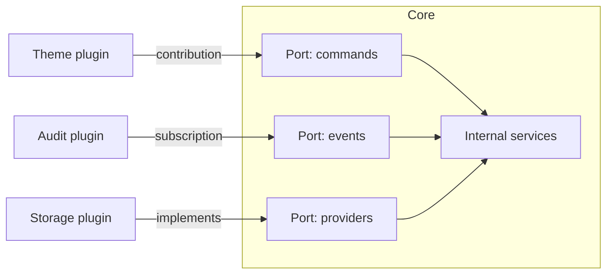

An extensible system lets someone add features without touching the core's code. It sounds like a
free virtue, but most systems that open up to plugins end up trapped by the very API they wanted to
make flexible: every public method is a promise that someone, somewhere, is already relying on.

The thesis here is concrete: **opening a system is only worth it when you can keep the core's
contract stable for years**. The real cost is not writing the first plugin. It is versioning the API,
isolating plugins that fail, and retiring what should no longer be used, calmly and on a schedule. If
you cannot commit to that, the extension ends up costing more than a well-made internal fork.

## When to open the system

Three signals justify a plugin architecture. The first is **more variable behaviour than teams able to
build it**: a code editor whose users want languages, themes and debuggers that the core team will
never write. The second is **customers who need to adapt a flow without waiting for a release**, for
example a payment gateway that requires country-specific validations. The third is **a core that
changes slowly and a periphery that changes fast**, so separating the two lowers the risk of each
release.

The opposite signals are just as useful. If there is only one customer, an extension point is a
premature abstraction: the same logic inside the core behind a configuration option is enough. If the
domain changes every week, any contract breaks before anyone uses it. And if nobody owns the public
API, a plugin system becomes a file of promises that nobody reviews.

<Callout tone="info" title="A practical rule">
  Before you publish an extension point, write the first plugin yourself, inside the team, and count
  how many times you had to touch the core to do it. If the number is high, the point is in the
  wrong place and it is not yet an API.
</Callout>

## Extension points: contracts, not loose hooks

An extension point is a place in the core where a plugin can take part, with a written contract: what
it receives, what it may return, what guarantees the core gives and what it does not. The difference
between a loose hook and an extension point is the contract. A hook that passes the whole internal
object forces every plugin to depend on the core's internal shape; an extension point passes a small
type defined for its purpose and hides everything else.

In practice it helps to distinguish three families. **Declarative contributions** describe something
the core knows how to render: a command, a menu entry, a new column. They are the safest, because the
core controls drawing, validation and ordering. **Events** announce that something happened and do not
wait for an answer, so a plugin cannot block the flow. **Providers** are the places where a plugin
implements an interface that the core calls to resolve something: a storage backend, an export format,
a validator. Each family has a different compatibility cost, which is why they should not share one
API.

Design the contract type as if it were public from day one, because it is. Use stable names, avoid
exposing internal classes, and add optional fields rather than changing the meaning of existing ones.
A contract that grows by addition is cheap to maintain; one that changes shape forces every plugin to
be rewritten.



## Where the plugin runs

The most expensive decision is the loading model. There are three common ones, and each changes
security, performance and the debugging experience.

A plugin **in the same process** is the fastest: calling a function is cheap and nothing is
serialised. But a bug in the plugin can bring the whole core down, and the plugin can see the core's
memory. It is reasonable for trusted extensions maintained by the same team.

A plugin in **a separate process** is the model modern editors use. VS Code, for example, runs its
extensions in a separate extension host process, precisely so that a slow or unstable extension does
not degrade startup or the editor's responsiveness. The price is inter-process communication: every
call is serialised, so the API should be designed for a few large calls rather than many small ones.

A **remote** plugin, running in another service, isolates completely and lets you scale and deploy it
on its own, but it adds latency, network failures and a transport contract that must also be
versioned. It only pays off when the plugin belongs to another organisation or needs resources the
core does not have.

As a general rule, start with the strongest isolation your latency tolerates. It is easier to relax
isolation to gain performance than to harden a shared model after third parties depend on it.

## Permissions and sandboxing

A third-party plugin is code you do not control. The sandbox limits what it can do, and the permission
system makes that limit visible before installation. The most solid pattern is **declaring permissions
in the manifest**, so the core can reject an installation or ask for confirmation without running any
plugin code.

Chrome extensions show the approach well. The official documentation recommends requesting optional
permissions wherever the feature allows it, so the user decides on access at the moment it is needed.
It also separates API permissions from host permissions: an extension can use the storage API and
still be unable to read a page's content until the matching host is granted.

Your plugin manifest can follow the same logic:

```yaml
name: csv-exporter
version: 1.4.0
api: '>=2.1 <3.0'
permissions:
  - documents.read
optional_permissions:
  - network.egress
```

The key is that a permission describes a **capability**, not an implementation. `documents.read` says
what the plugin may touch; it does not say which method it uses. That lets you change the core's
implementation without changing what the permission means, and lets the user understand what they are
granting.

Do not confuse sandboxing with trust. A sandbox limits damage from bugs or malice; it does not replace
review, package signing or a policy on which plugins are published. If the catalogue accepts any plugin
without review, the declared permission is only a label.

## Versioning the public API

A plugin API has two versions in play: the core's and each plugin's. The contract between them must be
explicit. The plugin declares the API version it needs, as a range, and the core decides whether to
load it. That declaration prevents the most common failure: a plugin that loads, runs and then breaks
subtly because something it took for granted has changed.

To decide what counts as a breaking change, apply the [Semantic Versioning](https://semver.org/)
rules. Removing a field, changing a parameter's type or altering the order of calls is a major change;
a compatible addition is minor; a fix that leaves the contract untouched is a patch. The detail that
matters here is that the rule applies to **the public API**, not to the implementation. If a plugin
depended on an undocumented side effect, the change is breaking even though the written contract did
not change. That is why it helps to document the guarantees you do not give.

Keep two API versions active during a migration window. That lets the core load plugins written for the
previous version through an adapter that translates the calls. The adapter has a maintenance cost, but
it avoids the sudden cut that forces every author to update on the same day.

## Deprecation and retirement

Retiring part of an API is harder than adding one, because you have to tell people you do not know.
Two IETF standards give useful vocabulary for doing it well. [RFC 9745](https://www.rfc-editor.org/info/rfc9745),
published in March 2025, defines a `Deprecation` header that says a resource is or will be deprecated
and can point to documentation. [RFC 8594](https://www.rfc-editor.org/info/rfc8594), published in May 2019,
defines `Sunset`, which gives the date on which a resource will stop responding. Both are about HTTP,
but the principle applies to any API: announce the deprecation with a date, give a replacement, and
keep the retirement date even when nobody is watching it.

A reasonable schedule has three phases. During the **notice** phase the API works as before, but the
core records which plugins use it. During the **warning** phase every call emits a clear message with
the replacement. When the **retirement** date arrives, the call fails with an error that names the
version and the replacement. Recording usage is what lets you decide with data: if only one plugin from
an author who does not reply is left, retirement costs something very different from what the plan on
paper suggests.

<Callout tone="warning" title="Do not retire on the calendar alone">
  A retirement date without measurement forces changes on plugins nobody maintains. Before you
  retire part of the API, check who uses it and offer an adapter or a written migration path.
</Callout>

## A case: changing the export format without breaking anyone

Picture an editor with an export plugin. The v1 API defines `export(document)`, which returns the full text as CSV. Then a
need arrives: documents of hundreds of megabytes that do not fit in memory. The v2 API needs an output stream, so the
signature becomes `export(document, output)`.

The wrong path is to change the signature and publish version 2.0 the same day. Plugins written for v1 stop loading, and the
authors who do not reply are left behind. The user sees an editor with fewer features and has no idea why.

The right path has three steps. First, the new function is added without removing the old one: the core declares both in
contract 2.1, and the old one is marked as deprecated in the documentation and in the usage registry. Second, the core offers
an adapter: if a plugin only implements `export` returning text, the core calls that function, writes the result to the stream
and records the call as use of the old API. The cost is that the core keeps two paths during the window; the benefit is that no
plugin stops loading. Third, the decision is made from data. Once the period the team sets has passed, the registry shows which
plugins still use the old path. If there are none, it is retired. If plugins from an active author remain, that author gets a
dated notice. If they belong to an author who does not reply, the decision stops being technical: keep the adapter for another
year, or publish a version of the core itself that covers that plugin.

The case teaches two things. The first is that a change that looks technical, from text to stream, is really a decision about how
much compatibility you are willing to pay for. The second is that the retirement date is set not by the calendar but by the use that
remains. That is why the version range each plugin declares, such as `api: ">=2.1 <3.0"`, matters: it tells the core what it can
load without guessing.

## Isolated failures and lifecycle

A failing plugin must not take the core or other plugins down with it. That requires three mechanisms.
The first is a **time limit** on each call, so that a hung plugin cannot block the interface. The second
is **error isolation**: an exception from a plugin is caught, logged with its identifier, and the core
carries on without that contribution. The third is a **visible plugin state** (active, disabled after
failures, incompatible with the API version) that the user can check.

The lifecycle matters too. Installing, enabling, disabling and uninstalling are distinct operations. A
disabled plugin must not run code at startup. An uninstalled plugin must release its resources. And the
core must be able to start even when an installed plugin is no longer compatible, because the
alternative is leaving the user without an editor, a store or a dashboard because of someone else's
module.

## Contract tests with plugins

The cheapest way to catch breaking changes is to test the contract with real plugins. Keep a set of
reference plugins, one per family of extension points, and run them on every change to the core. If a
change breaks a reference plugin, the change is breaking even if the internal tests pass. The pattern is
the same as contract tests between services, with one difference: the consumer is not deployed with you.

Add a degradation test as well: disable each plugin and check that the core keeps working with the
remaining features. Many systems only test the happy path with every plugin enabled, and discover a
hidden dependency when a user disables one in production.

## Common mistakes

The most common mistake is **exposing the internal model as the API**. A plugin that depends on the
core's classes makes it impossible to refactor the core without breaking third parties. The fix is a
small contract type, separate from the internal types, even if it looks like duplication at first.

The second mistake is **one extension point per concrete request**. Each customer asks for a different
hook and the core ends up with hundreds of points nobody understands. Before adding one, ask whether the
case can be solved with a configuration option or with a declarative contribution.

The third is **having no written compatibility policy**. If nobody knows what guarantees the API gives,
every change is argued from scratch and plugins end up depending on accidental behaviour.

The fourth is **confusing extensibility with open access to everything**. Some parts of the core must
stay closed: security, persistence of critical data and money flows. Opening them for flexibility turns
one plugin's bug into a data incident.

## Tools

You do not need a framework to start. A registry of extension points with explicit types, a manifest
that is validated at install time, and a script that runs the reference plugins cover most cases. Package
and signing tools are useful once the catalogue is public, because they let you verify the origin before
installing. The choice depends on the language and on whether plugins share the core's process; what
matters is that the API and the manifest are versioned in the same repository as the core.

## Checklist

- [ ] At least three real cases justify the extension point, and the team wrote the first plugin.
- [ ] Each extension point has a small contract type, separate from the internal types.
- [ ] The manifest declares the API version and the permissions, and the core validates them before running anything.
- [ ] Permissions describe capabilities, not implementations.
- [ ] A versioning and deprecation policy is written, with dates and replacements.
- [ ] Usage of each deprecated part is recorded before it is retired.
- [ ] A failing plugin does not bring the core down, and its state is visible to the user.
- [ ] A set of reference plugins runs in CI on every change to the core.

## Sources

- [RFC 9745: The Deprecation HTTP Response Header Field](https://www.rfc-editor.org/info/rfc9745), IETF, March 2025.
- [RFC 8594: The Sunset HTTP Header Field](https://www.rfc-editor.org/info/rfc8594), IETF, May 2019.
- [Chrome Developers: Declare permissions](https://developer.chrome.com/docs/extensions/mv3/declare_permissions), extension documentation.
- [Visual Studio Code: extension documentation](https://code.visualstudio.com/api), on the extension host process.
- [Semantic Versioning](https://semver.org/), versioning specification.
