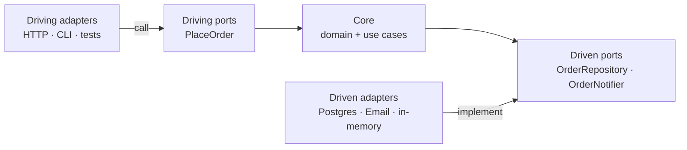
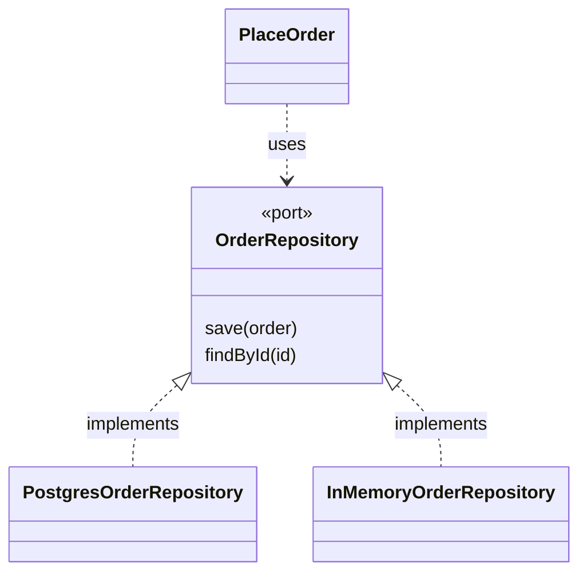

# Hexagonal architecture: ports and adapters

Most systems start the same way: a controller that calls a service that calls a repository. Over time the business rules end up spread across the controller, the SQL queries and the framework hooks. Testing a rule requires spinning up a database, and switching frameworks forces you to touch the business logic. Hexagonal architecture attacks that problem with a single idea: **the business logic does not know the outside world; the outside world adapts to the business logic**.

This article explains the pattern and its dependency rule, compares it with the onion and clean architectures, and grounds it in concrete decisions: how to organize the folders, how to name ports, adapters and use cases, and where each responsibility lives. Then it shows how to test it, how to protect it with executable rules, when it is not worth it and what it costs. The code is only a guide to names and structure, not a recipe to copy.

<Callout tone="info" title="Cutoff date">
  Tool versions are from October 2026 and come from the npm registry and official sites. I could not
  open Cockburn's original text (the server answered 403): what is said about it comes from
  secondary sources and is flagged as such.
</Callout>

## The problem it solves

Alistair Cockburn formulated the pattern to avoid two traps of object-oriented design: undesired dependencies between layers and business logic contaminating user-interface code (according to the Wikipedia entry, which cites his article of April 1, 2005). Jeffrey Palermo described it from the other side: in a traditional layered architecture each layer depends on the one beneath it, and the UI ends up coupled to data access, because transitive dependencies count too. Since data-access techniques change every few years, that coupling ends up pushing toward a rewrite.

The symptoms in a real system are recognizable:

| Symptom                                                   | Usual cause                                  |
| --------------------------------------------------------- | -------------------------------------------- |
| To test a rule you have to spin up the database           | The rule is mixed in with queries or the ORM |
| Switching framework or vendor touches the business logic  | The business logic imports framework types   |
| The same calculation lives in the controller and in a job | There is no single entry point to the logic  |
| Integration tests are slow and brittle                    | Every test goes through every layer          |

## The idea: ports and adapters

The pattern splits the system into a **core** (the domain and the use cases) and an **outside** (UI, database, email, queues). The core talks to the outside only through **ports**: interfaces written in the language of the business. **Adapters** translate between a port and a concrete technology.



The arrows are **code dependencies**: notice that none of them leaves the core toward an adapter. Two clarifications about the name:

- **"Hexagonal" is a drawing convention**, not a rule: the hexagon leaves room to draw the different ports and does not mean there are six. Cockburn prefers the name _ports and adapters_.
- **Driving ports** (primary) are the core's API: what the outside asks of it. **Driven ports** (secondary) are what the core needs from the outside. This is common terminology in later literature; I did not verify it in the original text.

| —                   | Driving port                    | Driven port                        |
| ------------------- | ------------------------------- | ---------------------------------- |
| Who starts the call | The outside (HTTP, CLI, a test) | The core                           |
| Who implements it   | The core's use case             | An infrastructure adapter          |
| Example             | `PlaceOrder`                    | `OrderRepository`, `OrderNotifier` |
| Typical adapters    | HTTP controller, CLI command    | Postgres, email, in-memory version |

An important detail: **the core defines the port**, using the vocabulary of the business. It is called `OrderRepository.save(order)`, not `OrdersTable.insertRow(...)`. If the port mirrors the technology, the coupling has only moved elsewhere.

## The dependency rule

Robert Martin states it like this in his 2012 article: source code dependencies can only point inwards, and no name declared in an outer circle can be mentioned in an inner one. Palermo had put it in other words in 2008: all code can depend on more central layers, but not on layers further out.

This is the **D in [SOLID](/docs/solid)**, dependency inversion, applied to the whole architecture. At runtime the use case calls the repository; in the source code it is the adapter that depends on the core's port. The arrow of control and the arrow of dependency point in opposite directions:



Martin adds a practical consequence: what crosses a boundary should be simple data structures, not database rows or ORM entities, because that would drag the dependency inward.

## Hexagonal, onion and clean: what they share

All three proposals come from the same problem. Martin says so in his article: they all have the same objective, the separation of concerns. They differ in vocabulary and in how prescriptive they are.

| —                        | Hexagonal                                                                            | Onion                                                         | Clean                                                           |
| ------------------------ | ------------------------------------------------------------------------------------ | ------------------------------------------------------------- | --------------------------------------------------------------- |
| Author and year          | Alistair Cockburn, 2005                                                              | Jeffrey Palermo, July 29, 2008                                | Robert C. Martin, August 13, 2012                               |
| Metaphor                 | Inside and outside, with ports and adapters                                          | Concentric rings around the domain model                      | Four concentric circles                                         |
| Inner layers             | Does not prescribe them (according to Graça, the original says nothing about layers) | Domain model at the center; repository interfaces in the core | Entities, Use Cases, Interface Adapters, Frameworks and Drivers |
| Distinctive contribution | Symmetry between what drives and what is driven                                      | Infrastructure is external: "the database is not the center"  | The explicit dependency rule and simple data across boundaries  |

In practice you can pick the vocabulary your team prefers: the rule that makes it work is the same. This guide uses "ports and adapters" because it better describes the seams you are going to write.

## How it is organized and named

Take a small case: **placing an order**. There is one driving port (`PlaceOrder`), two driven ports (save the order and notify the customer), real and test adapters, and a single place where everything is wired together. No frameworks and no injection container: what matters here is not the code but where each thing lives and what it is called.

### Folder structure

The folder that holds the core is the boundary. Everything inside `core/` is business; everything outside is technology or composition.

```text
src/
  core/                        # the hexagon: imports nothing from outside
    domain/                    # entities, values and rules
    ports/driving/             # what the outside asks of the core
    ports/driven/              # what the core needs from the outside
    use-cases/                 # orchestrate domain + driven ports
  adapters/
    driving/http/              # turn a request into a command
    driven/postgres/           # implement a port with a technology
    driven/memory/             # in-memory version, for tests and development
  main.ts                      # composition root: the only one that knows everything
```

Separating `driving` from `driven` inside `adapters/` makes the symmetry of the pattern visible and lets you write one dependency rule per side.

### Naming conventions

A good name tells you which side of the boundary you are on without opening the file.

| Piece              | Convention                                  | Example                                              | Why                                                         |
| ------------------ | ------------------------------------------- | ---------------------------------------------------- | ----------------------------------------------------------- |
| Driving port       | A business verb, same as the use case       | `PlaceOrder`                                         | Describes the intent, not the channel it arrives through    |
| Command and result | Port name plus `Command` or `Result`        | `PlaceOrderCommand`, `PlaceOrderResult`              | Simple data crossing the boundary, no ORM types             |
| Driven port        | A business noun plus its role               | `OrderRepository`, `OrderNotifier`                   | The business asks to "save an order", not to "insert a row" |
| Driven adapter     | The technology plus the port it implements  | `PostgresOrderRepository`, `InMemoryOrderRepository` | You can see what it replaces and swap it for another one    |
| Use case           | A `make` factory plus the driving port name | `makePlaceOrder`                                     | It receives its dependencies as an argument                 |
| Driving adapter    | The use case name plus the channel          | `placeOrderHandler`                                  | One piece per channel: HTTP, CLI, queue                     |
| Composition root   | A single file, `main` or `compose`          | `main.ts`                                            | With several, the dependency graph stops being readable     |

### Ports and the use case: signatures only

The only thing worth seeing as code is the shape of the contracts. Note that the port speaks in business verbs (`save`, `findById`) and that the use case declares what it needs without knowing who provides it:

```typescript
// core/ports/driven/order-repository.ts
export type OrderRepository = {
  save(order: Order): Promise<void>;
  findById(id: string): Promise<Order | undefined>;
};

// core/ports/driving/place-order.ts
export type PlaceOrder = (command: PlaceOrderCommand) => Promise<PlaceOrderResult>;

// core/use-cases/place-order.ts: dependencies arrive as an argument
export declare function makePlaceOrder(deps: {
  readonly orders: OrderRepository;
  readonly notifier: OrderNotifier;
}): PlaceOrder;
```

The body of the use case is short on purpose: it creates the order with the domain rules, saves it, notifies and returns a result. If it grows, that is usually a sign that a business rule is escaping from the domain.

### Where each responsibility lives

| Piece            | Responsible for                                                                                                                     | Must not do                                   |
| ---------------- | ----------------------------------------------------------------------------------------------------------------------------------- | --------------------------------------------- |
| Domain           | Invariants and rules: an order needs at least one line, positive quantities                                                         | Know about HTTP, SQL or serialization formats |
| Use case         | Orchestrating: domain, driven ports, the order of operations                                                                        | Choose status codes or write SQL              |
| Driving adapter  | Validating input at the boundary, translating it into a command and domain errors into status codes                                 | Contain business rules                        |
| Driven adapter   | Translating the core model to the technology and validating what it reads: outside data is `unknown` until it goes through a schema | Return rows or ORM entities to the core       |
| Composition root | Choosing which adapter plugs into each port                                                                                         | Contain logic: it only wires                  |

With this separation, switching from Postgres to another database means writing another adapter and changing one line in the composition. Neither the domain nor the use case notices.

## How to test it

The most immediate benefit is that the core is tested without infrastructure. The doubles are small, real adapters (an in-memory version, a notifier that records what it received), not _mocks_ configured call by call, so the tests verify behavior and not the order of invocations.

| Test type  | What it checks                                           | What it runs against                                      | How many              |
| ---------- | -------------------------------------------------------- | --------------------------------------------------------- | --------------------- |
| Core       | Domain rules and use case orchestration                  | In-memory adapters                                        | Many, in milliseconds |
| Contract   | That each driven adapter fulfills what the port promises | The same suite against the in-memory and the real version | One suite per port    |
| End to end | That the composition is wired correctly                  | The assembled system                                      | Few                   |

The question the **contract test** answers is: how do you know the Postgres adapter behaves like the in-memory one? You write a single suite (save and retrieve what was saved, return `undefined` if it does not exist) as a function that receives a repository factory, and you run it against each implementation; in CI, the real one runs against a test database. That way the in-memory adapter stops being an invention and becomes one more implementation of the contract. The result is a healthy pyramid.

## Protect it with executable rules

A diagram does not stop someone from importing `postgres` from a use case on a Friday afternoon. A rule that runs in CI does: it is an architecture [fitness function](/docs/fitness-functions). There are three ways to express the same rules (the core does not know the adapters and the adapters do not know each other); choose according to where you want to see the error.

### dependency-cruiser

It is configured with `forbidden` rules, each with a `from` and a `to`. One is enough for the most important rule; references with groups (`$1`) also let you forbid an adapter from depending on another one of the same family.

```javascript
// .dependency-cruiser.cjs (excerpt)
module.exports = {
  forbidden: [
    {
      name: 'core-without-adapters',
      severity: 'error',
      from: { path: '^src/core' },
      to: { path: '^src/(adapters|main)' },
    },
  ],
};
```

With `error` severity, the exit code of `dependency-cruiser src` is the number of violations, so the pipeline fails. `dependency-cruiser --init` generates an initial configuration. A second useful rule forbids `core/` from importing npm packages with `dependencyTypes`: that way the core only knows its own types.

### ESLint with `import-x/no-restricted-paths`

This is what this very repository uses for its component layers (atoms, molecules, organisms). Each zone says which folder cannot import from which, with a message that whoever breaks the rule will see:

```typescript
// eslint.config.ts (excerpt)
const architectureZones = [
  {
    target: './src/core',
    from: ['./src/adapters', './src/main.ts'],
    message: 'The core does not depend on adapters.',
  },
  // one zone per dependency rule
];
```

The advantage over a separate tool is that the error shows up in the editor, while you type, with the message explaining why.

### ArchUnitTS and ArchUnit

If you prefer to express the architecture as one more test, **ArchUnitTS** (package `archunit`, inspired by ArchUnit but unrelated to the project) offers a fluent API in the style of `projectFiles().inFolder(...).shouldNot().dependOnFiles()`; with Vitest it needs `globals: true` in its configuration. In Java, **ArchUnit** includes a specific check, `onionArchitecture()`, which declares the domain, the application services and the adapters, and forbids the core from depending on them or the adapters from depending on each other.

### In a system that already exists

If the current code already breaks the rule hundreds of times, do not postpone it: freeze what exists and block what is new. dependency-cruiser does it with `dependency-cruiser src --baseline` (it creates `.dependency-cruiser-known-violations.json`) and then `--ignore-known`; ArchUnit, with `FreezingArchRule.freeze(...)`. The exceptions file should only ever shrink.

## When not to use it and what it costs

Hexagonal architecture is not free. Every port adds an interface, an adapter and, often, a mapping between the core's model and the technology's. That cost is paid on every change, so it has to buy something.

| Situation                                                     | Reasonable decision                                     |
| ------------------------------------------------------------- | ------------------------------------------------------- |
| CRUD with no rules: saving and reading forms                  | Do not use it; a thin controller over the ORM is enough |
| There are business rules that change and must be tested often | Use it in that module                                   |
| A dependency may change (payment gateway, email provider)     | Put a port exactly there                                |
| A prototype of a few weeks                                    | Start simple and extract ports when the need appears    |

The most common costs and how to contain them:

- **Mappings.** Avoid duplicating models by reflex: if the adapter can store the domain type as it is, do not create one more DTO.
- **Indirection.** Do not put an interface on every class. A port is justified when there is real variation or a boundary you want to test separately.
- **More files.** That is the price of separation. If the module is small, a single `core/` folder and an `adapters/` folder are enough.

## Relationship with DDD and with AI agents

With [DDD](/docs/domain-driven-design), the core is the domain model and each bounded context usually has its own hexagon. An anti-corruption layer that translates another system's model is, in practice, an adapter. To decide where the system's boundaries are, the [C4 model](/docs/c4-model) and [coupling and cohesion](/docs/acoplamiento-cohesion) come first.

For working with AI agents it has a concrete advantage. Böckeler talks about _harnessability_: clear module boundaries and checkable dependencies make code easier to harness. An agent that has to change an adapter knows it does not have to touch the business rules, and an executable dependency rule is a computational sensor: if the agent breaks the boundary, it gets the failure as feedback and can fix it. We develop this in [harness engineering with Claude Code](/docs/harness-engineering-claude-code).

## Tools to sustain it

Versions according to the npm registry and official sites, October 2026.

| Tool                            | What it does                                                          | Maturity                                                                       | Use it when                                                             | Avoid it when                                                     |
| ------------------------------- | --------------------------------------------------------------------- | ------------------------------------------------------------------------------ | ----------------------------------------------------------------------- | ----------------------------------------------------------------- |
| dependency-cruiser              | Validates and visualizes dependencies with your own rules (JS and TS) | v18.6.0, MIT license, Node 22, 24 or 26 and later                              | You want rules outside the linter, graphs (Mermaid, dot) and a baseline | You already cover everything with ESLint import rules             |
| `import-x/no-restricted-paths`  | Forbids imports between folders, with a message                       | ESLint plugin already present in this repository                               | You want the error in the editor and zero new tools                     | You need graphs, cycles or frozen exceptions                      |
| eslint-plugin-boundaries        | Classifies files into elements and limits how they relate             | v7.2.0, MIT license, ESLint 6 or later as peer, Node 18.18 or later            | Many element types and per-type rules                                   | Two or three folders: one `no-restricted-paths` zone is enough    |
| ArchUnitTS (`archunit` package) | Architecture rules as TypeScript tests                                | v2.5.4, MIT license; Jest ready, Vitest with `globals: true`                   | You want to express the architecture as a test, with your runner        | You prefer the linter workflow and want no test dependencies      |
| ArchUnit (Java)                 | Architecture test library; includes `onionArchitecture()`             | v1.5.0 (news item of August 4, 2026)                                           | JVM backend                                                             | You do not use Java                                               |
| NetArchTest                     | Fluent API for architecture rules in .NET                             | .NET Standard 2.0, MIT, inspired by ArchUnit; I did not verify recent activity | .NET backend                                                            | You need a tool with confirmed maintenance: check before adopting |
| NestJS modules                  | Encapsulate providers: only what is exported is public API            | Documented at docs.nestjs.com                                                  | You already use NestJS and want boundaries between modules              | You expect it to prevent core-to-adapter dependencies on its own  |

A nuance about NestJS: according to its documentation, a module only lets you inject providers that belong to it or that are explicitly exported by an imported module, and those exports are its public API. That helps boundaries between modules, but the framework does not know what a "core" is: the core-to-adapters rule still needs one of the tools above.

## Common mistakes

- **Ports that mirror the technology.** An `SqlOrderTable` in the core is not a port: it is the database under another name.
- **One port per class.** Interfaces with no second implementation and no testing need only add noise.
- **ORM entities in the domain.** They bring the infrastructure dependency in through the back door.
- **The core imports libraries.** One exception leads to the next; use a rule that forbids it.
- **Several composition sites.** If every adapter wires itself, the dependency graph stops being readable.
- **Adapters that talk to each other.** If one needs the other, what is missing is a port or a use case.
- **No contract tests.** The in-memory adapter and the real one drift apart without anyone noticing.
- **A diagram without a rule.** If no tool fails when it is violated, it is not an architecture: it is a wish.

## Checklist

- [ ] The core imports nothing from outside: no frameworks, no ORM, no vendor SDKs.
- [ ] Each port is written in the language of the business and defined by the core.
- [ ] There is a single place where use cases and adapters are connected.
- [ ] Data that crosses a boundary is simple structures, validated on the way in.
- [ ] The core is tested without infrastructure, using in-memory adapters.
- [ ] Each driven port has a contract suite run against every adapter.
- [ ] An executable rule in CI prevents the core from depending on adapters.
- [ ] Ports exist where there is real variation, not out of habit.
- [ ] The decision to apply the pattern or not is recorded in an [ADR](/docs/adr).

## Sources

Consulted in October 2026. Cockburn's original text could not be opened (HTTP 403): what is said about it comes from Wikipedia, which cites his article of April 1, 2005, and from a third-party summary (Graça).

- [Hexagonal Architecture (Alistair Cockburn, 2005)](https://alistair.cockburn.us/hexagonal-architecture/): original article, not accessible in this lookup
- [Hexagonal architecture on Wikipedia](<https://en.wikipedia.org/wiki/Hexagonal_architecture_(software)>)
- [Ports and Adapters Architecture (Herberto Graça)](https://herbertograca.com/2017/09/14/ports-adapters-architecture/): third-party summary, from search results only
- [The Clean Architecture (Robert C. Martin, August 13, 2012)](https://blog.cleancoder.com/uncle-bob/2012/08/13/the-clean-architecture.html)
- [The Onion Architecture, part 1 (Jeffrey Palermo, July 29, 2008)](https://jeffreypalermo.com/2008/07/the-onion-architecture-part-1/)
- [dependency-cruiser](https://github.com/sverweij/dependency-cruiser), its [CLI reference](https://github.com/sverweij/dependency-cruiser/blob/main/doc/cli.md) and its [rules reference](https://github.com/sverweij/dependency-cruiser/blob/main/doc/rules-reference.md)
- [ArchUnit](https://www.archunit.org/) and its [user guide](https://www.archunit.org/userguide/html/000_Index.html)
- [ArchUnitTS](https://github.com/LukasNiessen/ArchUnitTS)
- [eslint-plugin-boundaries](https://github.com/javierbrea/eslint-plugin-boundaries)
- [NetArchTest](https://github.com/BenMorris/NetArchTest)
- [NestJS modules](https://docs.nestjs.com/modules)
- Versions: npm registry for [dependency-cruiser](https://registry.npmjs.org/dependency-cruiser/latest), [eslint-plugin-boundaries](https://registry.npmjs.org/eslint-plugin-boundaries/latest) and [archunit](https://registry.npmjs.org/archunit/latest)
