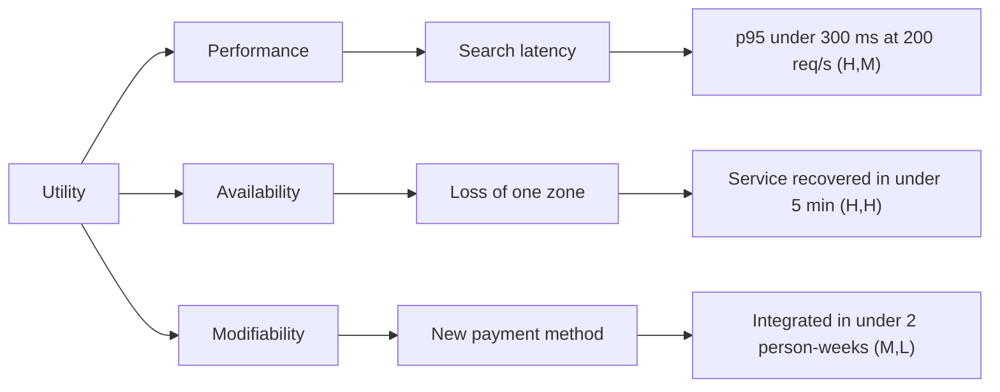
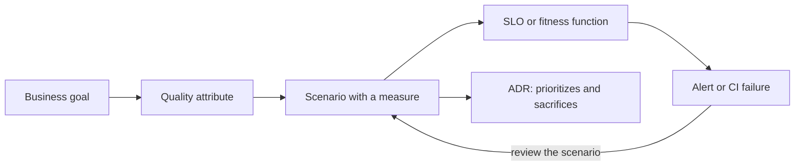

# Quality attributes and trade-offs

Two systems can do exactly the same thing and have opposite architectures. One serves ten users
with a database and a server; the other serves ten million, cannot go down during business
hours and must be able to switch payment providers in two weeks. What separates them is not the
functionality but the **quality attributes**: how much, how fast, how reliably and at what cost.
That is why they, more than the feature list, shape the architecture.

The problem is that almost nobody writes them in a way that can be checked. "It must be fast" and
"it must be secure" decide nothing. This article shows how to choose the few attributes that
drive the design, turn them into measurable scenarios, reason about their conflicts with a light
version of the ATAM method, track them with SLOs and fitness functions, and record every
sacrifice in an [ADR](/docs/adr).

<Callout tone="info" title="Cutoff date">
  Data as of October 2026. The ISO/IEC 25010 quality model is the 2023 edition; tool versions and
  activity were checked in their repositories on October 12, 2026. Verify both before locking in a
  decision.
</Callout>

## Functionality versus quality

**Functional requirements** say _what_ the system does. **Quality attributes** (also called
architectural characteristics or non-functional requirements) say _how well_ it does it: with
what latency, what availability, how easy it is to change. Functionality almost always admits
several architectures; quality is what rules most of them out.

To avoid inventing a vocabulary, it helps to rely on a standard one. ISO/IEC 25010 is the product
quality model of the SQuaRE family; its 2023 edition defines **nine characteristics**:

| Characteristic         | Question it answers                                       | Change versus 2011                                              |
| ---------------------- | --------------------------------------------------------- | --------------------------------------------------------------- |
| Functional suitability | Does it do what it should, and do it well?                | —                                                               |
| Performance efficiency | How long does it take and how many resources does it use? | —                                                               |
| Compatibility          | Does it coexist and exchange data with other systems?     | —                                                               |
| Interaction capability | Can users reach their goals with it?                      | Replaces _usability_; adds inclusivity and self-descriptiveness |
| Reliability            | Does it keep working and recover from failures?           | _Faultlessness_ replaces _maturity_                             |
| Security               | Does it protect data and resist attacks?                  | Adds _resistance_                                               |
| Maintainability        | Is it easy to change and to test?                         | —                                                               |
| Flexibility            | Does it adapt to different environments and uses?         | Replaces _portability_; adds _scalability_                      |
| Safety                 | Does it avoid causing harm to people or surroundings?     | New characteristic                                              |

<Callout tone="warning" title="Source of the table">
  The ISO standard is paywalled. The list of nine characteristics and the 2023 changes come from the
  [arc42 Quality Model](https://quality.arc42.org/articles/iso-25010-update-2023) summary and other
  summaries; the questions in the middle column are our paraphrase, not the normative text.
</Callout>

You do not need all nine. They work as a checklist so you do not forget a dimension (have you
thought about _safety_? about compatibility?), not as an obligation to optimize every one.

## Why you cannot maximize everything

Every attribute is bought with another. The original SEI report on ATAM illustrates it with a
minimal example: if raising the speed of a communication channel improves throughput but reduces
its reliability, that speed is a **tradeoff point**: a single parameter that pushes two attributes
in opposite directions.

These are common tensions (illustrative, not a closed catalog):

| You want more... | It usually costs...             | Why                                                                                |
| ---------------- | ------------------------------- | ---------------------------------------------------------------------------------- |
| Security         | Performance and ease of use     | Encryption, validation and authentication add work and friction                    |
| Availability     | Cost and operational simplicity | Redundancy means more pieces to deploy, pay for and watch                          |
| Availability     | Immediate consistency           | Replicating data across nodes forces a choice about what happens on failure        |
| Modifiability    | Performance                     | Layers and indirection ease change and add work                                    |
| Performance      | Modifiability                   | Optimizing tends to couple the code to the measured case                           |
| Delivery speed   | Maintainability                 | Today's shortcuts are paid back with interest (see [clean code](/docs/clean-code)) |

The practical consequence is both uncomfortable and useful: **there is no "best" architecture, only
the one that best fits the attributes that matter in your context**. Deciding which attributes
those are is the first real architectural decision.

## Choosing the three to five that drive the design

A system with ten top-priority attributes has none. The SEI method starts from the same point:
the project manager presents the **business drivers** (for example, high availability, time to
market or high security) because the architectural drivers follow from them. A practical way to do
it in a one-hour workshop:

1. **Start from the business, not the ISO list.** What would make the product fail? Losing data,
   failing an audit, being unable to change quickly, overcharging?
2. **Walk through the nine characteristics** as a check and note which ones carry real risk.
3. **Vote.** Each participant distributes three points. What gets the most points stays, up to a
   maximum of five.
4. **Set a bar for the rest.** What is not in the five must be "good enough", not ignored:
   state it ("tolerates an hour of downtime per month") so nobody optimizes it by accident.

The SEI report itself shows why a method helps: in its example, stakeholders started with
security and modifiability as the key attributes, and the utility tree revealed that performance
and availability mattered too. If you pick from memory, you get surprises late.

## Writing quality attribute scenarios

An attribute without a measure cannot be checked. According to Bass, Clements and Kazman
(_Software Architecture in Practice_), a **quality attribute scenario** has six parts:

| Part               | Question it answers                                            |
| ------------------ | -------------------------------------------------------------- |
| Source of stimulus | Who or what generates the event?                               |
| Stimulus           | What exactly happens?                                          |
| Environment        | Under which conditions: normal load, overload, degraded mode?  |
| Artifact           | Which part of the system receives it?                          |
| Response           | What does the system do?                                       |
| Response measure   | With which number do you verify the response is the right one? |

The last row is what turns a wish into a requirement. The SEI report puts it bluntly: sentences
like "the architecture shall be modifiable and robust" are untenable because they **are not
refutable**. A good scenario can fail.

A complete performance example, for an orders API:

| Part               | Value                                                        |
| ------------------ | ------------------------------------------------------------ |
| Source of stimulus | Authenticated customer from the web application              |
| Stimulus           | Searches their orders by status                              |
| Environment        | Normal operation, 200 requests per second                    |
| Artifact           | Orders service (search endpoint)                             |
| Response           | Returns the first page of results                            |
| Response measure   | 95th percentile latency under 300 ms; less than 0.1 % errors |

For modifiability the pattern is identical but the measure changes unit: "a developer adds a new
payment method touching at most one module and in under two person-weeks". You do not need to
fill in all six parts when some are obvious; you do need the measure.

## The utility tree

When you have dozens of scenarios, you need to order them. The SEI proposes the **utility tree**:
the root is the "utility" of the system, below it go the attributes, then their refinements and,
at the leaves, the concrete scenarios. Each leaf is prioritized with two letters (High, Medium or
Low): its **importance** to the success of the system and the **perceived risk** of achieving it,
that is, how hard the architecture team thinks it will be. The report prefers that coarse scale
because stakeholders cannot reliably tell finer shades apart.



Read it like this: the `(H,H)` leaf is very important and hard to achieve, so it is where analysis
time is best spent. The `(M,L)` leaf is low risk and can wait. The tree answers "where do I spend
my limited review time?".

## A light ATAM for teams

ATAM (_Architecture Tradeoff Analysis Method_) is an SEI method described in report
CMU/SEI-2000-TR-004 (Kazman, Klein and Clements, August 2000). It evaluates how the decisions of
an architecture affect quality attributes and how they trade off against each other. It has nine
steps in two phases:

| Group                      | Steps                                                                                           |
| -------------------------- | ----------------------------------------------------------------------------------------------- |
| Presentation               | 1. Present the ATAM · 2. Present business drivers · 3. Present the architecture                 |
| Investigation and analysis | 4. Identify architectural approaches · 5. Generate the utility tree · 6. Analyze the approaches |
| Testing                    | 7. Brainstorm and prioritize scenarios · 8. Analyze again with the top-voted scenarios          |
| Reporting                  | 9. Present results                                                                              |

Steps 1 to 6 form phase 1 and steps 7 to 9 form phase 2, in which the wider stakeholder group
takes part. The report says they have run ATAM over three consecutive days, while noting that the
most effective ones separate an initial phase to build a shared understanding of the architecture
from a later formal meeting.

A normal team rarely has three days. This **adaptation of ours** (not the SEI method, but it keeps
its core) fits in half a day:

1. **Business drivers** (15 min): three sentences on what matters and why.
2. **Utility tree** (60 min): the attributes that drive the design yield scenarios with a
   measure, and each leaf gets its pair of letters.
3. **Analysis** (90 min): only for leaves of high importance. Whoever designed it explains which
   architectural decision covers that scenario; everyone else tries to break it.
4. **Record** (30 min): risks, non-risks, sensitivity points and tradeoff points.
5. **Decisions** (15 min): each finding ends in an ADR, an automatically checked scenario or a
   task.

### What gets recorded

The report defines four kinds of finding. It is worth using their names because they are precise:

| Finding               | Definition (paraphrased from the report)                                                               |
| --------------------- | ------------------------------------------------------------------------------------------------------ |
| **Risk**              | An important architectural decision not yet made, or made without fully understanding its consequences |
| **Non-risk**          | A good decision that relies on assumptions that often stay implicit                                    |
| **Sensitivity point** | A parameter to which a measurable quality attribute response is highly correlated                      |
| **Tradeoff point**    | A parameter that is a sensitivity point for more than one attribute and affects them differently       |

Both risks and non-risks are documented with three fields. Use them as a one-line-each template:

```markdown
Risk R-3: <short title>

- Decision: what is undecided, or was decided without fully understanding it.
- Quality response and consequence: which attribute is affected and how.
- Rationale: why it matters.
```

An illustrative example: the decision is not having fixed the retry policy toward the payment
provider; the consequence, that if the provider goes down unlimited retries would saturate the
queue and degrade checkout availability; the rationale, that without a cap or growing backoff the
load multiplies exactly when the provider is at its worst.

A non-risk is written the same way but with a positive rationale and the assumptions in plain
sight ("assuming one message per second and processing under 30 ms, a one-second deadline is
reasonable"). Writing down the assumptions is what lets you review them when they change.

## Common tactics per attribute

A tactic is a design decision that moves an attribute in one direction. This table collects common
examples, not a complete catalog, and its last column is a reminder that nothing is free:

| Attribute              | Common tactics                                                                     | What they usually cost                       |
| ---------------------- | ---------------------------------------------------------------------------------- | -------------------------------------------- |
| Performance            | Caching, bounded queues, concurrency, reducing work per request                    | Stale data, complexity, more memory          |
| Availability           | Redundancy, health checks, retries with growing backoff, circuit breaker           | Cost and more pieces to operate              |
| Modifiability          | Encapsulating, stable interfaces, lowering [coupling](/docs/acoplamiento-cohesion) | Indirection, more contract code              |
| Security               | Authentication and authorization, least privilege, validating at boundaries        | Latency and user friction                    |
| Interaction capability | Immediate feedback, preventing user errors                                         | More interface logic to maintain             |
| Testability            | Injecting dependencies, exposing observable state                                  | More abstractions (see [SOLID](/docs/solid)) |

## Making them measurable: SLI, SLO and error budget

Runtime attributes (latency, availability) are best measured with the reliability vocabulary of
Google SRE. Its definitions, quoted from the book:

- **SLI** (service level indicator): "a carefully defined quantitative measure of some aspect of
  the level of service that is provided". For example, latency or error rate.
- **SLO** (service level objective): "a target value or range of values for a service level that is
  measured by an SLI".
- **SLA** (service level agreement): a contract with users that includes **consequences** for
  meeting or missing the SLOs it contains. An SLO has none.

<Callout tone="warning" title="Means and percentiles">
  The SRE book prefers percentiles to the mean because the mean hides the tail of slow requests. The
  50th percentile reflects the typical case; a high one, such as the 99th, approximates a plausible
  worst case. A scenario that says "mean latency under 200 ms" can be met while one request in
  twenty takes several seconds.
</Callout>

The book also gives rules for setting targets that deserve to be written into your scenario: do
not base the target on current performance (it can lock you into something that needs heroic
effort), avoid absolutes such as "always available", use as few SLOs as possible and start loose
to tighten over time.

The _Site Reliability Workbook_ recommends expressing an SLI as the ratio of good events to total
events, which keeps it between 0 % and 100 %. From there comes the **error budget**: 100 % minus
the SLO. With a 99.9 % SLO over 3 million requests in four weeks, the budget is 3,000 errors.
Translated to time, over a 30-day window (our own calculation):

| SLO     | Error budget | Downtime tolerated in 30 days |
| ------- | ------------ | ----------------------------- |
| 99 %    | 1 %          | 7 h 12 min                    |
| 99.9 %  | 0.1 %        | 43 min 12 s                   |
| 99.99 % | 0.01 %       | 4 min 19 s                    |

Each extra decimal costs far more than the previous one, so the SLO is a business decision and
not a technical minimum. An error budget policy describes what happens when it runs out; the
workbook mentions prioritizing reliability bugs, working only on reliability until the SLO is met
again, or freezing production changes, and asks you to name who acts and who approves the policy.

Not every attribute is an SLO. Modifiability is measured with other numbers: the SEI utility tree
includes scenarios such as "change the web user interface in under four person-weeks". Nor is
everything that matters measured in production: modifiability and security scenarios can be
checked in CI.

## Guarding them with fitness functions

A scenario nobody checks goes back to being an opinion. The solution is the one explained in the
article on [fitness functions](/docs/fitness-functions): let the scenario live where it runs. To do
that, declare the scenario as data with stable names and leave the check to a small function that
compares what was observed against the maximum:

```typescript
type QualityScenario = {
  id: string; // P-1, D-2…: cited from the ADR, the test and the alert
  attribute: 'performance' | 'availability' | 'modifiability';
  stimulus: string; // "order search at 200 requests per second"
  measure: { metric: 'p95_ms' | 'error_rate'; max: number };
};
```

The stable identifier is what ties the pieces together: the same `P-1` appears in the scenario, in
the ADR, in the load threshold and in the alert. And the check must **fail when there is no
data**: a measure without observations does not pass. It is the same principle as the safety hooks
in the [Claude Code harness](/docs/harness-engineering-claude-code): a guard that crashes must not
open the door.

In practice you do not write the percentile yourself: the load tool does. With k6, thresholds are
pass or fail criteria, and if one is missed the process exits with a non-zero code, which is
exactly what a pipeline needs:

```javascript
export const options = {
  thresholds: {
    http_req_failed: ['rate<0.001'], // less than 0.1 % errors
    http_req_duration: ['p(95)<300'], // 95 % of requests under 300 ms
  },
};
```

For production, Sloth generates Prometheus rules and multi-window, multi-burn-rate alerts from a
YAML file. The full specification is in the project README; this is just its shape, for a 99.9 %
availability:

```yaml
service: 'orders'
slos:
  - name: 'requests-availability'
    objective: 99.9
    sli:
      events: { error_query: '…', total_query: '…' } # PromQL queries
    alerting: { name: 'OrdersHighErrorRate' }
```

## Keeping a record: the trade-off in an ADR

A scenario and a measure describe the goal; the [ADR](/docs/adr) records what you gave up to
reach it. An architecture ADR that does not name what it sacrifices is incomplete because **every
significant decision prioritizes one attribute at the expense of another**. The attribute fields
are a convention we recommend, not part of Nygard's original format:

```markdown
# ADR 0012: <decision in one sentence>

## Context (the scenario that motivates it, for example D-2)

## Decision

## Attribute it prioritizes

## Attribute it sacrifices

## How it is verified
```

An illustrative example of how it would be filled in:

| Field              | Content                                                                         |
| ------------------ | ------------------------------------------------------------------------------- |
| Context            | Scenario D-2 requires recovering the service in under 5 minutes if a zone fails |
| Decision           | Read replica in a second zone with guided manual failover                       |
| Prioritizes        | Availability (scenario D-2)                                                     |
| Sacrifices         | Cost (an extra replica) and immediate read consistency after failover           |
| How it is verified | Quarterly drill and a 99.9 % SLO with an error-budget burn alert                |

That way, when someone proposes cutting the replica "because it costs money", the ADR answers
which scenario breaks. And an ADR that appears without a scenario to justify it is often a sign of
over-engineering.



## Tools

Status checked in the repositories and official documentation on October 12, 2026.

| Tool              | What it does                                                            | Maturity (verified data)                                                                   | Use it when                                            | Avoid it when                                               |
| ----------------- | ----------------------------------------------------------------------- | ------------------------------------------------------------------------------------------ | ------------------------------------------------------ | ----------------------------------------------------------- |
| **k6**            | Load tests with JavaScript scripts and thresholds that fail the process | Version 2.3.0 (Sep 21, 2026); last change Oct 12, 2026; now under Grafana                  | You want latency and errors as a CI gate               | You need to measure perceived performance in a browser      |
| **OpenTelemetry** | Vendor-neutral standard to generate and export traces, metrics and logs | CNCF project; Collector 0.162.0 (Sep 28, 2026)                                             | You want to obtain SLIs without vendor lock-in         | You expect it to store or visualize: it is not a backend    |
| **Prometheus**    | Metrics as time series, queried with PromQL                             | CNCF since 2016; version 3.15.0 (Sep 25, 2026)                                             | You compute availability and latency SLIs              | You need 100 % accuracy, such as per-request billing        |
| **Sloth**         | Generates SLO rules and alerts for Prometheus from YAML                 | Version 0.16.0 (Apr 2026); last change May 26, 2026; its README says "actively maintained" | You already use Prometheus and want budget-burn alerts | You do not use Prometheus                                   |
| **OpenSLO**       | Open YAML specification to define SLOs in a vendor-neutral way          | The repository publishes no releases or tags; last change Sep 24, 2026                     | You want definitions portable across tools             | You need a specification with stable, tagged versions       |
| **Lighthouse CI** | Runs Lighthouse in CI and checks budgets (for example, LCP)             | Version 0.15.1 (Jun 26, 2025); last commit that same day                                   | You track perceived web performance on every PR        | You need an actively maintained tool: evaluate alternatives |

Two caveats. First, a tool with no recent activity is not invalid (it may be finished), but you
should know it before depending on it. Second, none replaces the earlier step: without agreed
scenarios and targets, you will measure precisely what does not matter.

## Common mistakes

- **Attributes without a number.** "Scalable" and "secure" are not refutable. If the scenario
  cannot fail, it is not a scenario.
- **Trying to satisfy ten attributes.** When everything is a priority, there is no trade-off to
  decide and it gets decided by default. Keep three to five.
- **Means instead of percentiles.** The mean hides the tail of slow requests.
- **An SLO above the real need.** Each decimal of availability costs disproportionately more. An
  SLO is a business decision.
- **Confusing SLO with SLA.** The SLA has contractual consequences; the SLO is an internal goal.
- **Setting the target from current performance.** You can lock yourself into a level that needs
  heroic effort to maintain.
- **ATAM as a ceremony.** If the workshop does not end in ADRs, checkable scenarios or tasks, it
  was a meeting.
- **Forgetting what is sacrificed.** An ADR that only describes the gain is incomplete.
- **Evaluating once and never returning.** Scenarios expire with the business: review them when a
  driver changes.

## Checklist for your next decision

- [ ] The business drivers are written in three sentences or fewer.
- [ ] There are three to five priority attributes, voted on, and a declared bar for the rest.
- [ ] Each priority attribute has at least one scenario with a measure.
- [ ] Latencies are expressed in percentiles, not means.
- [ ] Scenarios are prioritized by importance and perceived risk.
- [ ] Risks, non-risks, sensitivity points and tradeoff points are recorded.
- [ ] Each key scenario has an automatic check: a threshold, an SLO or a fitness function.
- [ ] One ADR per important decision names the attribute it prioritizes and the one it sacrifices.
- [ ] There is an error budget policy with named owners.
- [ ] Someone will review the scenarios when the business changes.

## Sources

Consulted in October 2026. The parts marked as adaptation or our own calculation do not come from
the sources.

- [ATAM: Method for Architecture Evaluation (Kazman, Klein, Clements; CMU/SEI-2000-TR-004)](https://www.sei.cmu.edu/library/atam-method-for-architecture-evaluation) and its [PDF report](https://resources.sei.cmu.edu/asset_files/TechnicalReport/2000_005_001_13706.pdf)
- [Quality Attribute Scenarios, chapter of Bass, Clements and Kazman, _Software Architecture in Practice_ (copy hosted at UBC)](https://people.ece.ubc.ca/matei/EECE417/BASS/ch04lev1sec5.html)
- [ISO 25010 update 2023 (arc42 Quality Model)](https://quality.arc42.org/articles/iso-25010-update-2023)
- [Service Level Objectives (Google SRE Book)](https://sre.google/sre-book/service-level-objectives/)
- [Implementing SLOs (Google SRE Workbook)](https://sre.google/workbook/implementing-slos/)
- [Thresholds (k6 documentation)](https://grafana.com/docs/k6/latest/using-k6/thresholds/)
- [OpenTelemetry: what it is](https://opentelemetry.io/docs/what-is-opentelemetry/)
- [Prometheus: overview](https://prometheus.io/docs/introduction/overview/)
- [Sloth (repository)](https://github.com/slok/sloth)
- [OpenSLO (repository)](https://github.com/OpenSLO/OpenSLO)
- [Lighthouse CI (repository)](https://github.com/GoogleChrome/lighthouse-ci) and its [assertions configuration](https://googlechrome.github.io/lighthouse-ci/docs/configuration.html)
