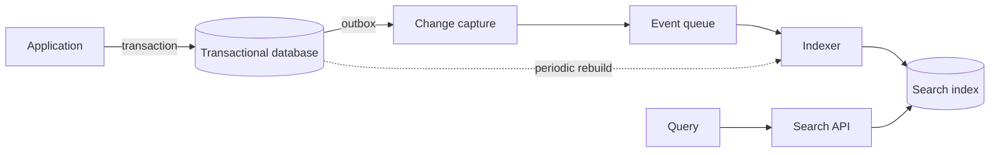

Almost every application ends up needing search: a customer by name, a product by word, a document by
fragment. The temptation is to solve it with a `LIKE '%text%'` over the table and move on. That works
until the table grows, the queries need ordering by relevance, typos must be tolerated or several
languages must be searched. Then search becomes slow, imprecise and hard to explain.

The thesis here is that **search is a capability with its own data model**, and that the key question is
not which engine to use but how much of the search your existing database can answer. A text index inside
the database covers most cases with little operational work. A dedicated inverted index only pays off when
relevance, volume or typo tolerance no longer fit in the database, and paying for it means keeping it in
sync without losing changes. This article covers both decisions and the cost of each.

## What the search actually needs

Before choosing technology, list what the search must do. Five questions separate the cases. Do you need
to **rank by relevance**, or is filtering and sorting by date enough? Do you tolerate **word variants**
(singular and plural, conjugations), or only exact matches? Do you need **typo tolerance** and synonyms?
Do you need **facets**, counting results by category while the user searches? And what is the **volume** of
documents and the rate of change?

If the answer to almost all of them is "no" or "a little", you do not need a search engine. An indexed
filter solves prefix search, and a table of a few thousand rows is searched comfortably with a full-text
index. If the answer is "yes" to several, search stops being a detail of the database and becomes a
component with its own lifecycle.

<Callout tone="info" title="The most common case">
  Most business applications search a few hundred thousand rows, with filters by status and date and
  a couple of text fields. For that profile, a full-text index in the database is usually the right
  answer for years.
</Callout>

## The text index inside the database

PostgreSQL, for example, includes full-text search. It turns text into a `tsvector`, a list of normalised
lexemes (without accents or inflections, depending on the language configuration), and indexes it with a
GIN index. The official documentation states that a GIN index requires the column to be of type
`tsvector`, and that the index can be built on an expression, provided the function names its text search
configuration explicitly.

This approach has clear advantages. The search lives in the same transaction as the data, so a freshly
inserted record appears in search without delay. There is no second system to operate, replicate or
reindex separately. Ordinary filters (status, customer, date) combine with the search in the same query,
which is what the business usually asks for.

It has limits too. The ranking is basic compared with a dedicated engine, and typo tolerance depends on
extra extensions. Every index adds write cost, and a GIN index on a table with many updates can grow and
take time to keep up. And search competes for the same resources as transactions, so a heavy text query can
affect the rest of the application.

## When a dedicated inverted index is worth it

An inverted index maps each term to the list of documents that contain it. It is the structure search
engines use: Lucene, and the systems built on it such as Elasticsearch and OpenSearch, or lighter engines.
Its advantage is not magic; the indexing model, ranking and distribution are designed for search rather
than for transactions.

A dedicated engine is justified in four cases. The first is **rich relevance**: weighting the title against
the body, using synonyms, learning from clicks or combining business signals. The second is **tolerance and
language**: typos, morphology across several languages, search over nested fields. The third is **facets and
aggregations** over millions of documents with low latency. The fourth is **isolating load**: search traffic
should not degrade transactional writes.

The price is real. Now there are two sources of truth for the same data, a synchronisation process, a cluster
to operate and a new class of failure: the index that falls behind, or that returns results from an older
version of the document. Before choosing the engine, decide whether the problem is relevance or volume. Many
teams install a cluster to fix a slow query that a well-designed index in the database would have solved.

## Modelling the search document

The index does not index tables; it indexes **search documents**: a projection of the data designed for the
queries. A product may have one document with its name, description, categories and filterable attributes,
even though in the database those are spread across five tables. Designing that document is the most
important decision, because it determines what can be searched and how expensive it is to change.

Three decisions are worth making explicitly. First, **which fields are searchable, which are only filterable
and which are only returned** in the result. A searchable field is analysed and indexed; a filterable field is
stored as an exact value; a returned field takes no index space. Second, **the weights**: the title usually
counts more than the description, and technical attributes perhaps should not affect ranking at all. Third,
**the language**: a document with text in several languages needs different analysers, or one field per
language. Mixing languages in one field degrades relevance in both.

Version the document schema from the first day. When you change an analyser or a field, do not modify the
live index: build a new one with the new schema, feed it, and when it is ready switch the application to
it through an alias. That flow lets you roll back without losing anything.

## Keeping the index in sync

The index is **derived data**: its only source of truth is the transactional database. That sentence has a
practical consequence: if the index is lost or corrupted, it must be rebuildable in full. If some change
exists only in the index, you have created a second source of truth without meaning to.

There are three ways to feed it, and each has a characteristic failure. **Dual writes**, where the
application writes to the database and then to the index, is the simplest and the most fragile: if the
second write fails, the database and the index diverge and nobody notices until someone searches for the
record. **Change data capture** reads the database's change log and publishes every change to a stream;
Debezium documents the outbox pattern, in which the application writes an event to a table inside the same
transaction as the change, and a connector publishes it afterwards. The event exists if and only if the
change exists. **Periodic rebuilding** walks the database and regenerates the full index; it is slow, but it
is the safety net you should always have.

The indexer must be **idempotent**. The same event can arrive twice, and applying it twice must not change the
result. This is achieved by indexing by document identifier and version, and discarding events older than the
version already in the index. Without this property, any retry corrupts the search silently.

Measure the delay between a change and its appearance in search. For many applications a few seconds is
acceptable; for a catalogue that must reflect changes immediately, it is not. That number belongs in the search
contract, because it decides the strategy: synchronous writes, change capture or batch rebuilding.

## A case: a catalogue that keeps growing

Suppose a shop with three hundred thousand products, search by name and category, and prices that change every hour. The first
version uses `LIKE` over the name and description. Over time the queries get slow and, worse, a user searching for "sneaker" does
not find products named "sneakers". The problem has two different parts, and they should be treated separately.

The first step is a full-text index in the database, using the English text configuration. Morphology handles plurals and inflections
without any extra engine. The index is built over the expression that produces the search vector, with the configuration name made
explicit, and the filter by category and availability is combined in the same query. Before accepting the change, measure it with a set
of reference queries and compare latency and results against the previous version. Without that comparison, the improvement is an impression.

The second step arrives with a new requirement: "bag" must find "bags" and "handbags", and users type typos. The database still handles
morphology, but typo tolerance and synonyms push towards a dedicated index. The decision should not be taken on instinct. Before installing
a cluster, analyse which queries fail and why. If most failures are synonyms, a synonym dictionary in the text configuration, where the engine
supports it, may be enough. If typos are widespread, the dedicated engine is justified, along with its synchronisation cost.

The third step appears once the price is part of the search document. Every price change becomes an event the indexer must process, and events
can arrive out of order or more than once. This is where the outbox pattern and idempotency come in. An old price that arrives after the new one
is discarded because its version is lower than the one in the index. Without that rule, search would show a price that no longer exists, and no
error would appear in the logs.

The case shows a useful sequence: the database first, then measurement, then a dedicated engine only if the analysis calls for it, and always with
synchronisation designed before the index has consumers.

## Relevance: measure before you tune

Tuning relevance without measuring is guessing. Define a set of representative queries with the results that
are considered correct, and measure how many of them appear in the top positions. That measure changes when you
alter weights, analysers or synonyms, and it lets you compare changes instead of arguing from impressions.

Beyond quality, observe behaviour. Queries with no results reveal vocabulary that users use and the index does
not know. Queries that end in a new search with no click suggest the ranking is failing. And searches with a
huge number of results reveal missing facets or filters. This data is cheap to collect and is usually more
useful than any theoretical tuning.

## Operation and hidden costs

An index has costs that do not show up in the first version. It grows with the volume and with the number of
indexed fields, so measure its size, not only its speed. Every rebuild consumes resources and should be scheduled
outside peak hours. And search needs its own monitoring: 95th-percentile latency, error rate, synchronisation
delay and the size of the event queue are the minimum signals.

The reference set of queries should live in the repository and run in the pipeline. That way, an analyser change that worsens the critical queries
fails before it reaches production, just as a regression test would. And if the search document holds personal data, the index inherits the privacy
obligations: retention, deletion and access control. A deletion that reaches the database but not the index leaves personal data searchable, so the
deletion event must be handled with the same priority as an insert in the synchronisation.

There is also an organisational cost. Someone must own the document schema, the analysers and the quality of the
results. If search has no owner, each team adds a field without thinking about the others, and the index becomes a
catch-all.

## Common mistakes

The first mistake is **moving business logic into the index**. If permissions or a record's status are only checked
in the index, any lag lets users see data they should no longer see. The search can return identifiers that the
application then checks against the database, and that check is what decides.

The second is **indexing everything**. The more searchable fields, the more noise and cost, and relevance gets
worse because terms are diluted. Index what users actually search for.

The third is **having no rebuild path**. When the index is corrupted, the only way out is a long incident. Testing
the full rebuild from start to finish, at least once, is what makes the plan credible.

The fourth is **treating ranking as a detail**. A user who cannot find what they are looking for does not distinguish
between a slow index and one that sorts badly; they leave the search and blame the application.

The fifth is **not bounding queries**. A search with no result limit, no pagination and no timeout turns any common term, such as "shirt" or "a",
into a query that consumes resources across the whole cluster. Bound the number of results, set a maximum time and paginate from the first day,
because adding those limits later means changing the contract with every client of the API.

## Tools

To start, use the full-text engine of the database you already run. When the requirements justify it, a dedicated
engine with per-language analysers, index aliases and online reindexing. For synchronisation, change capture from the
database's log is the most robust option when the database allows it; dual writes are only justified in small
systems, and even then with a periodic rebuild. The choice of engine matters less than being clear about the search
document, the source of truth and the acceptable delay.

## Checklist

- [ ] The requirement questions (relevance, morphology, typos, facets, volume) are answered in writing.
- [ ] The simplest index that meets the requirements was chosen, and a dedicated engine has a documented reason.
- [ ] The search document is defined: searchable, filterable and returned fields, with weights and language.
- [ ] The index is treated as derived data and can be rebuilt in full through a tested procedure.
- [ ] The indexer is idempotent and discards events with an older version.
- [ ] The delay between a change and its appearance in search is measured and written into the contract.
- [ ] A set of reference queries measures relevance before each tuning change.
- [ ] Search has its own monitoring and a named owner.

## Sources

- [PostgreSQL: GiST and GIN index types](https://www.postgresql.org/docs/current/textsearch-indexes.html), full-text search documentation.
- [Debezium: Outbox Event Router](https://debezium.io/documentation/reference/transformations/outbox-event-router), outbox table pattern and change capture.
