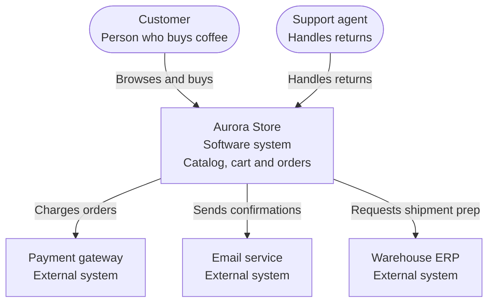
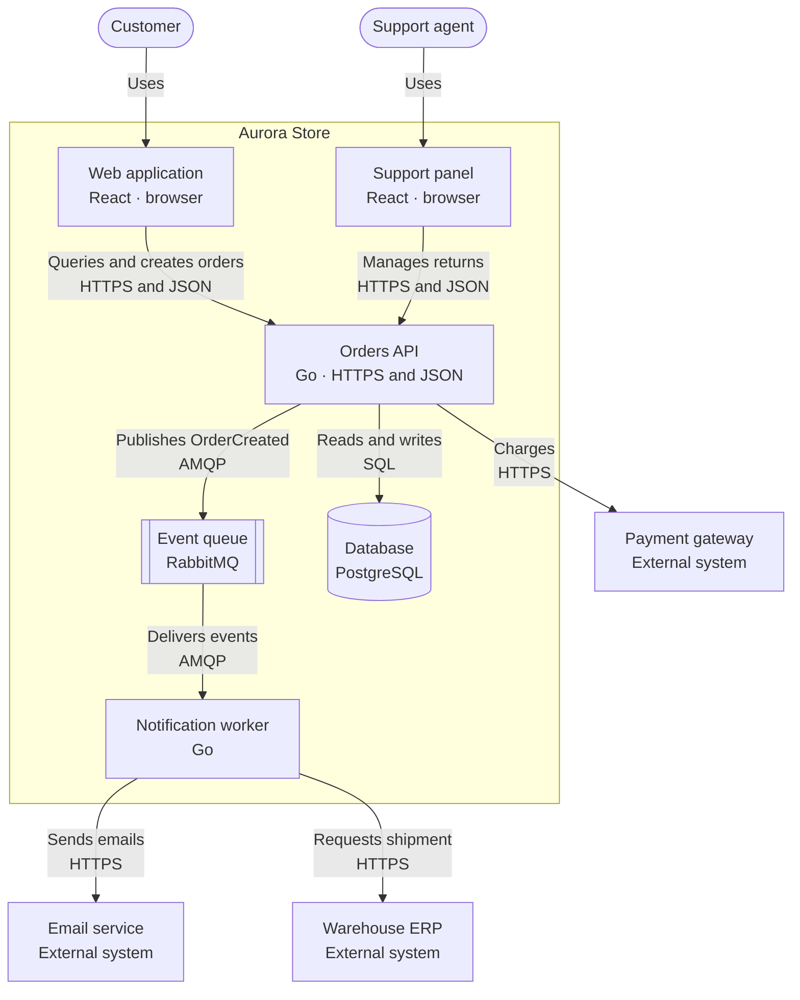
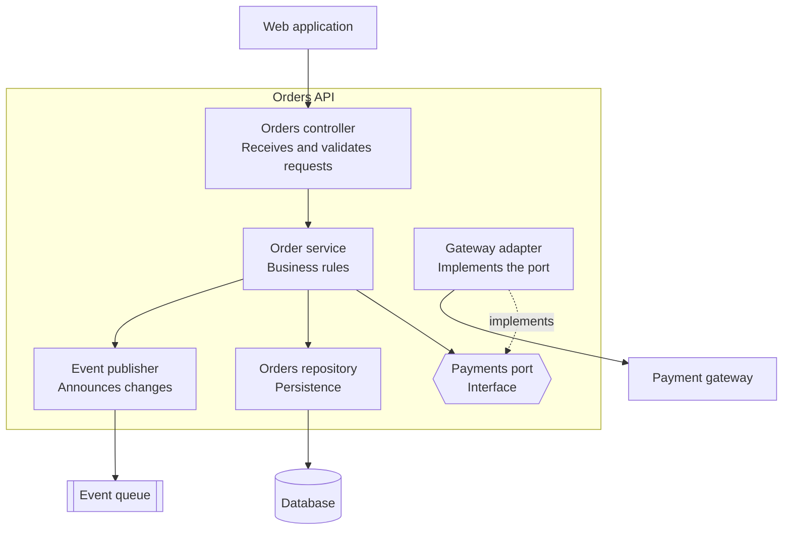
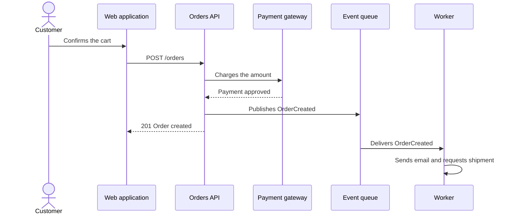

# C4 model

Most architecture diagrams fail for the same reason: they are boxes and arrows that each
person reads differently. Is that box a service, a class, a team or a server? Is that arrow
an HTTP call, an event or "is kind of related to"? When the diagram cannot answer, the
meeting turns into an argument about the drawing instead of the system.

The **C4 model**, created by Simon Brown, tackles that problem with a simple idea: architecture
is explained at **four zoom levels**, like a map. First you see the country, then the city,
then the street and, only if needed, the building. Each level has its own audience, its own
vocabulary and a small number of elements.

This article walks you through the four levels with a single end-to-end example, gives you the
notation rules that prevent ambiguity, and ends with how to adopt it in a real team without it
turning into bureaucracy.

## Why the C4 model exists

Typical diagrams fail in three ways:

- **They mix levels.** Users, microservices, tables and classes live in the same picture.
  Nobody knows what altitude to look at.
- **They have no vocabulary.** Every author invents their own shapes and colors, so each
  diagram has to be learned from scratch.
- **They age silently.** They get drawn on a whiteboard or in a graphical tool, exported as
  an image, and nobody touches them again.

C4 answers each point: it separates the levels, defines four types of element and works very
well as **diagrams as code**, versioned alongside the system they describe.

<Callout tone="info" title="C4 is not a notation, it is a way to abstract">
  The model does not prescribe specific shapes or colors. What it prescribes is what each element
  means and which level of detail belongs in each diagram. You can draw it with Mermaid,
  Structurizr, PlantUML or a whiteboard.
</Callout>

## The four building blocks

Before the levels, the vocabulary has to be fixed. Every C4 diagram is made of four types of
element, nested like Russian dolls:

| Element             | What it is                                                         | Example                                |
| ------------------- | ------------------------------------------------------------------ | -------------------------------------- |
| **Person**          | A human user or role of the system.                                | Customer, support agent                |
| **Software system** | What delivers value to users; the highest-level unit.              | Aurora Store, external payment gateway |
| **Container**       | An application or data store that runs separately.                 | Web app, API, database, queue          |
| **Component**       | A grouping of code with a clear responsibility inside a container. | Order service, repository, adapter     |

<Callout tone="warning" title='"Container" does not mean Docker'>
  In C4, a container is anything that must be running for the system to work: a single-page
  application in the browser, an API, a worker, a database or a file system. A Docker container may
  host one of them, but they are not the same thing. Think "separately deployable and runnable
  unit".
</Callout>

## The example we will use: Aurora Store

So the levels read as a single story, we will use an invented system: **Aurora Store**, an
online specialty coffee shop.

- **Customers** browse the catalog, fill a cart and pay.
- **Support agents** handle returns and inquiries.
- To charge, the store uses an external **payment gateway**.
- To confirm orders, it sends emails through an external **email service**.
- To prepare shipments, it integrates with the **warehouse ERP**, which already exists in the
  company.

You will see how each level answers a different question about this same system.

## Level 1: Context

**Question it answers:** what is this system, who uses it and which other systems does it
talk to?

The context diagram shows your system as **a single box** in the center, surrounded by the
people who use it and the external systems it depends on. No technologies and no internal
details: it is the diagram you would show to someone from the business, a new team member or
an auditor.



**What to include**

- The system you are describing, with one sentence about its purpose.
- Every type of person who uses it.
- Every external system it exchanges information with.

**What to leave out**

- Technologies, protocols and databases.
- Anything internal to the system.

**Audience:** everyone, including non-technical roles. If someone from the business does not
understand this diagram in a minute, it is too detailed.

**What it is for in practice:** discovering forgotten external dependencies, aligning
expectations about scope and spotting who actually uses the system.

## Level 2: Containers

**Question it answers:** which large executable pieces make up the system and how do they
communicate?

Here you open the system box and show its containers: applications, services, data stores and
queues. **Technologies appear**, because this level is where the decisions that cost the most
to change are made. If you are choosing which language or platform to use for each piece, the
article on [languages in the AI era](/docs/lenguajes-era-ia) helps you ground those decisions.



**What every container needs**

1. A clear, unique **name**.
2. A **type:** web application, API, database, queue, and so on.
3. Its main **technology**.
4. Its **responsibility** in one sentence.

**What every arrow needs**

- A **label with the intent** ("Charges", "Publishes OrderCreated"), not just "uses".
- The **protocol or medium** when it matters (HTTPS and JSON, SQL, AMQP).
- A direction: it points from whoever initiates the communication.

**Audience:** developers, operations and architects. It is the diagram consulted most
day to day and the one that best supports technical onboarding.

**What it is for in practice:** deciding deployment boundaries, seeing where single points of
failure are, discussing what scales separately and reviewing security risks between
containers.

## Level 3: Components

**Question it answers:** how is a specific container organized inside?

This level zooms into **one container** (not the whole system) and shows its components:
groupings of code with a clear responsibility, such as controllers, services, repositories or
adapters. This is where design principles become visible.

Let us open Aurora Store's orders API:



Notice the **payments port**: the order service depends on an interface, not on the concrete
gateway. It is the dependency inversion of the [SOLID principles](/docs/solid) turned into a
box on the diagram. Switching payment providers only touches the adapter.

**Audience:** the team that builds and maintains that container.

**When to do it:** do not draw it for every container. Do it only for the most complex or
critical ones, or when the team needs to agree on its internal structure. A component diagram
of a three-endpoint API is noise.

## Level 4: Code

**Question it answers:** how is a specific component implemented?

The last level drops down to classes, interfaces and functions. It is the only level where
**hand-drawing is not advisable**: the code is already the source of truth, and any manual
diagram will be outdated within weeks. If you need it, generate it from the repository (UML
class diagrams, dependency graphs, type documentation).

The payments port from the previous level, seen in code:

```ts title="payments.ts"
export type PaymentResult = {
  status: 'approved' | 'declined';
  reference: string;
};

export type PaymentGateway = {
  charge(orderId: string, amountInCents: number): Promise<PaymentResult>;
};

export class OrderService {
  constructor(private readonly payments: PaymentGateway) {}

  async checkout(orderId: string, amountInCents: number): Promise<PaymentResult> {
    return this.payments.charge(orderId, amountInCents);
  }
}
```

`PaymentGateway` is the "Payments port" box from the diagram; any class that satisfies that
type (`StripeGateway`, a `FakeGateway` for tests) can be plugged in without touching
`OrderService`. The relationship between diagram and code is direct, and that is what you are
after.

<Callout tone="tip" title="Rule of thumb">
  Levels 1 and 2 are worth it for almost every system. Level 3 is for the pieces that deserve it.
  Level 4 is almost never hand-drawn: trust the code and the [clean code
  practices](/docs/clean-code).
</Callout>

## Summary of the four levels

| Level | Diagram    | Shows                                  | Audience                   | When                      |
| ----- | ---------- | -------------------------------------- | -------------------------- | ------------------------- |
| 1     | Context    | System, people and external systems    | Everyone, incl. business   | Always                    |
| 2     | Containers | Applications, services and data stores | Development and operations | Almost always             |
| 3     | Components | Internal pieces of one container       | That container's team      | Only for complex pieces   |
| 4     | Code       | Classes, types and functions           | Whoever implements         | Generated, not hand-drawn |

## Supplementary diagrams

The four levels describe **static structure**. For what they do not cover, the model proposes
three additional diagrams:

- **System landscape:** a context widened to the whole organization, with all systems and
  people. Useful when there are dozens of systems.
- **Dynamic:** shows how elements collaborate for one specific use case, in order. It is drawn
  as a sequence.
- **Deployment:** maps containers to real infrastructure: regions, clusters, nodes,
  environments. It answers where each thing runs.

A dynamic diagram of Aurora Store's purchase flow:



## Notation rules

Even though C4 prescribes no shapes, these rules prevent almost every misunderstanding:

1. **A descriptive title** on every diagram: type and scope ("Containers of Aurora Store").
2. **One level per diagram.** If people appear next to classes, you mixed levels.
3. **Every element carries a name, a type, a technology (if applicable) and a one-sentence
   responsibility.**
4. **Every arrow carries a label** with intent and, when it matters, protocol. Unlabeled
   arrows are decoration.
5. **A legend** if you use colors, shapes or lines with meaning.
6. **Consistency across diagrams:** the same element is called the same in every level.
7. **Between 5 and 15 elements per diagram.** With more, split; with fewer, the diagram may
   not be needed.
8. **Unidirectional arrows** that show who initiates, not the data flow.

## Diagrams as code

Drawing in a graphical tool guarantees the diagram will age. The alternative is to treat it as
code: text in the repository, reviewed in pull requests and rendered automatically.

The diagrams on this site use **Mermaid**, which is written in code blocks and displayed as an
interactive diagram. Other common options:

| Tool                | Main idea                                                              |
| ------------------- | ---------------------------------------------------------------------- |
| **Mermaid**         | Text in Markdown; supported by GitHub, GitLab and many docs platforms. |
| **Structurizr DSL** | A single model from which all C4 views are generated consistently.     |
| **PlantUML + C4**   | A library of C4 macros on top of PlantUML.                             |

The advantage of the **single-model** approach (Structurizr) is that you define each element
once and the views are derived, so a rename propagates to every level:

```text title="workspace.dsl"
workspace "Aurora Store" {
  model {
    customer = person "Customer" "Buys coffee online"
    aurora = softwareSystem "Aurora Store" {
      web = container "Web application" "Catalog and cart" "React"
      api = container "Orders API" "Business rules" "Go"
      db = container "Database" "Orders and catalog" "PostgreSQL"
    }
    customer -> web "Uses"
    web -> api "Queries and creates orders" "HTTPS and JSON"
    api -> db "Reads and writes" "SQL"
  }
  views {
    systemContext aurora { include * autolayout lr }
    container aurora { include * autolayout lr }
  }
}
```

<Callout tone="info" title="Diagrams next to the code">
  Keep diagrams in the same repository as the system and review them in the same pull requests. If a
  change alters a container or an external dependency, the diagram must change in the same commit.
</Callout>

## How to adopt it in your team

You do not need to document everything from day one. A realistic path:

1. **Start with context (30 minutes).** Gather the team in front of a whiteboard and draw
   the system, the people and the external systems. You will find disagreements faster than
   in any document.
2. **Continue with containers.** Do it with someone who knows the real deployment. Compare
   the result with what actually runs in production: the differences are findings.
3. **Move them to code** (Mermaid or Structurizr) and commit them to the repository.
4. **Link them from the README** and from decision records (ADRs). A diagram nobody can find
   does not exist.
5. **Add components only where it hurts.** A piece that causes confusion or review conflicts
   is a candidate.
6. **Review them in pull requests.** If the change affects structure, the diagram is part of
   the change.

C4 pairs well with **ADRs** (architecture decision records): the diagram shows what the system
looks like; the ADR explains why it looks that way.

## Common mistakes

| Mistake                                | Why it hurts                                     | How to avoid it                               |
| -------------------------------------- | ------------------------------------------------ | --------------------------------------------- |
| Mixing levels in one diagram           | Nobody knows what altitude to look at            | One level per diagram                         |
| Boxes called "Backend" or "Services"   | They say neither what they do nor the technology | Concrete name, type and technology            |
| Unlabeled arrows                       | They force readers to guess what happens         | Label with intent and protocol                |
| Confusing container with Docker        | Images get drawn instead of runnable units       | "Separately deployable and runnable unit"     |
| Drawing components for everything      | High cost, low value, goes stale                 | Only where there is real complexity           |
| Diagrams in an unversioned tool        | They age and nobody knows which is current       | Diagrams as code in the repository            |
| Drawing the ideal system, not the real | It misleads whoever consults it                  | Compare with production; document what exists |
| Giant diagrams "to see it all"         | Unreadable and without an audience               | Split by level, scope and purpose             |

## Guided exercise

Spend one hour on your own system:

1. **10 minutes:** write in one sentence what the system does and list the people and
   external systems. Draw the context diagram.
2. **20 minutes:** list the deployable containers and how they communicate. Note each one's
   technology and responsibility.
3. **10 minutes:** compare your drawing with what really runs (repositories, pipelines,
   infrastructure). Note every difference.
4. **15 minutes:** pick the container with the most recent changes and draw its components.
   Does any of them depend directly on an external system with no interface in between?
5. **5 minutes:** commit it to the repository as Mermaid and link it from the README.

## Checklist

- [ ] Every diagram has a clear title, level and scope.
- [ ] Every element has a name, type, technology (if applicable) and responsibility.
- [ ] Every arrow has a label with intent and, when it matters, protocol.
- [ ] Someone from the business understands the context diagram in a minute.
- [ ] Diagrams live in the repository and are reviewed in pull requests.
- [ ] Names match across levels and with the code.
- [ ] The diagram reflects what runs today, not what is desired.

## Takeaways

- C4 is **four zoom levels**: context, containers, components and code.
- A **container** is a separately runnable unit, not a Docker container.
- Levels 1 and 2 are almost always worth it; level 3 is drawn with judgment and level 4 is
  generated.
- Labels on arrows and concrete names remove most ambiguity.
- Diagrams should live as code next to the system so they do not age.

To carry the structure into code, continue with the [SOLID principles](/docs/solid) and the
[clean code](/docs/clean-code) practices.
