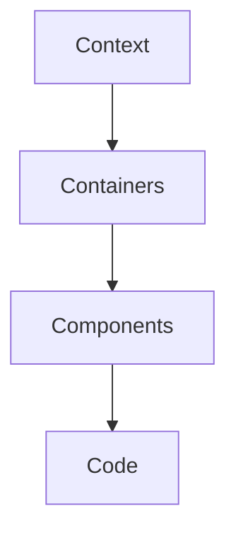

# C4 model

The C4 model proposes four zoom levels to communicate architecture without losing anyone
along the way. Combine it with [SOLID](/docs/solid) when you drill down into code detail.

## Levels

## Context

Show the system as a box inside its ecosystem: users and external systems. It is the first
diagram you present to business stakeholders.

## Containers

Break the system down into independently deployable applications, services and data stores.

## Components

Detail the pieces inside a container and their responsibilities. This is where interfaces
that apply dependency inversion appear.

## Code

The last level is usually delegated to tooling: class diagrams, types and documentation
generated directly from the repository.

<Callout tone="info" title="Diagrams as code">
  Keep Mermaid diagrams next to the content so they evolve with the repository and go through the
  same reviews as code.
</Callout>
