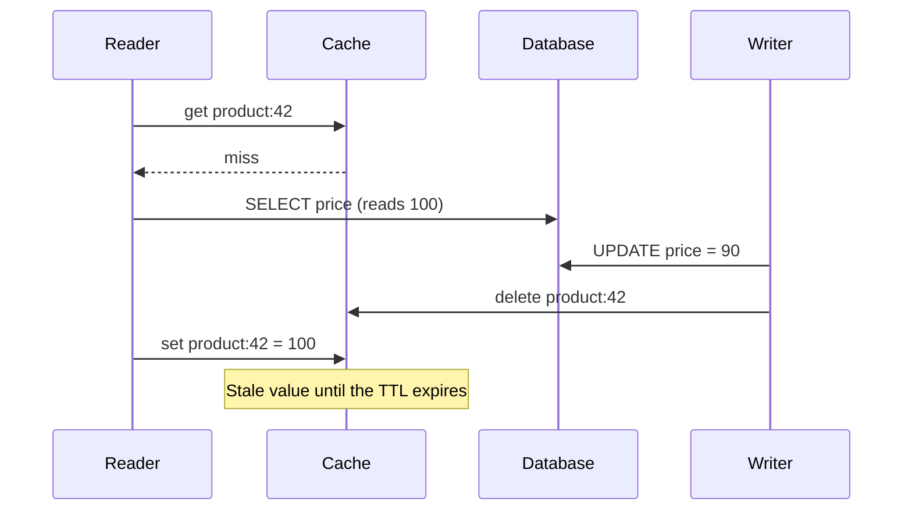
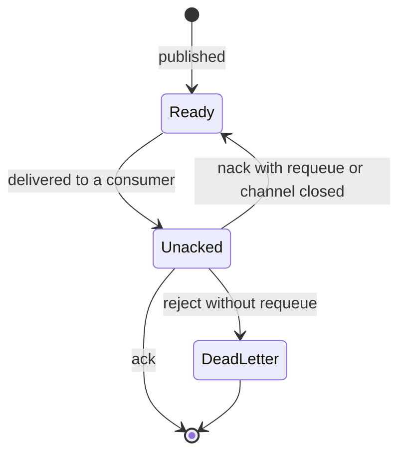
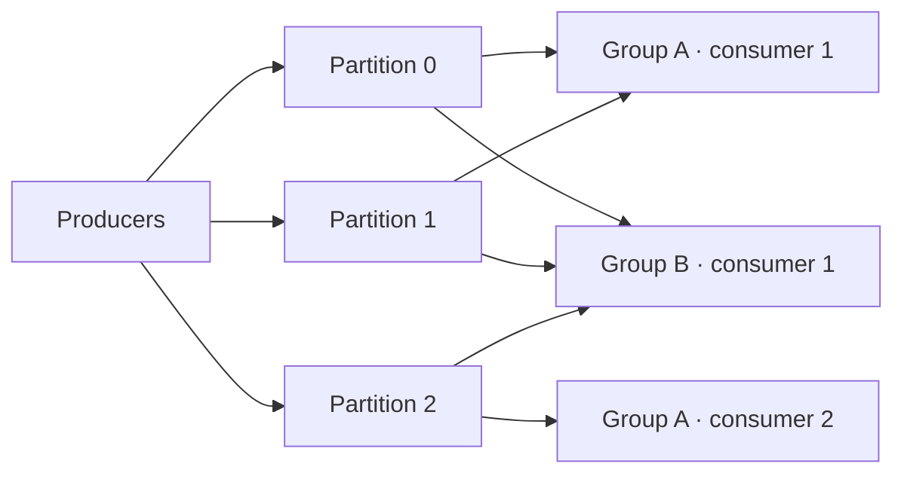

# Caching, queues and streaming

The product page takes 900 ms and the database sits at 80 % CPU. Someone puts a cache in front of it and p99 drops to 40 ms. Two weeks later, two incidents come in: a customer paid yesterday's price because the cache was still serving it, and at 10:00 the key for the featured deal expired and thousands of requests hit the database at once. Meanwhile, email sending was moved to a queue so it would not block checkout, and now the analytics team wants those same order events… which the queue deleted as soon as they were processed.

The three pieces solve different problems and fail in different ways: **a cache is a copy that trades freshness for speed, and a queue or a log is a durable buffer between whoever produces work and whoever consumes it; what separates a queue from a log is what happens to a message after it is read.**

<Callout tone="info" title="Scope and cut-off date">
  The event model and CQRS live in [event-driven architecture and
  CQRS](/docs/event-driven-cqrs-event-sourcing); idempotency and the outbox in [sagas, outbox and
  idempotency](/docs/sagas-outbox-idempotencia); retries and the circuit breaker in [resilience in
  distributed systems](/docs/resiliencia-sistemas-distribuidos). This article only links to them.
  Kafka, RabbitMQ and Redis behavior comes from their official documentation, checked in October
  2026.
</Callout>

## Caching: buying latency with freshness

A cache pays off when many reads ask for the same thing and that data changes rarely or can tolerate being slightly out of date. Azure's cache-aside guidance puts it plainly: caching works best for relatively static data or data that is read often. If most requests miss, the cost of checking and filling the cache can outweigh the benefit.

Before you pick a pattern, answer three questions: how long can the data be stale without causing harm, who finds out when it changes, and what happens if the cache disappears all at once.

### Read and write patterns

| Pattern                      | Who loads on a miss                              | What happens on a write                                    | Main risk                                                 |
| ---------------------------- | ------------------------------------------------ | ---------------------------------------------------------- | --------------------------------------------------------- |
| Cache-aside (lazy loading)   | The application: reads the database and fills it | The application writes to the database and deletes the key | A window of stale data and races between reads and writes |
| Read-through                 | The cache itself or its library, via a loader    | Combined with either of the next two                       | The loader gets coupled to the data schema                |
| Write-through                | Usually nobody: the data is already there        | Cache and database are updated in the same operation       | Slower writes and a cache full of data nobody reads       |
| Write-back (or write-behind) | Nobody: the cache receives the data first        | Written to the cache and flushed to the database later     | If the cache loses data before the flush, writes are lost |

**Cache-aside** is the most common because it asks nothing special of the cache. The ElastiCache documentation lists its advantages: only requested data is cached, and if a node fails the application keeps working, with higher latency. The downside is the miss penalty (three trips: cache, database and cache write) and stale data.

**Write-through** targets exactly that: the same guide notes that the cache is not stale after a write, at the price of two writes and of filling memory with data that may never be read. A new node starts empty, which is why it is usually combined with lazy loading.

**Write-back** gives you the fastest writes but makes the cache the temporary owner of the data. Use it only if you know what happens when that memory is lost and can live with it; in most business systems the database remains the source of truth.

### TTL: insurance against what you forget to invalidate

A TTL (time to live) expires the key after a period. AWS describes it precisely: it does not guarantee the value is fresh, but it bounds how stale it can get. Azure adds the balance: a TTL that is too short forces constant reloads, one that is too long leaves stale data.

Three practical decisions:

- **One TTL per kind of data, not one global value.** The catalog can live for minutes; a balance, for seconds or not at all.
- **Random spread.** If you load ten thousand keys at once with the same TTL, they expire at once. Adding a random margin to the TTL is a common way to spread those reloads; the AWS guide to caching with Redis recommends it: [cache validity](https://docs.aws.amazon.com/whitepapers/latest/database-caching-strategies-using-redis/cache-validity.html).
- **Expiration is not eviction.** You decide expiration; the cache decides eviction when it runs out of memory. In Redis, `maxmemory` and `maxmemory-policy` control it.

## Invalidation: the hard problem

Martin Fowler records a saying attributed to Phil Karlton: there are only two hard things in computer science, cache invalidation and naming things. It is hard because the cache and the database are two systems with no shared transaction: any sequence of writing to one and deleting from the other leaves gaps.

### Database first, then delete the key

Azure's guidance insists on the order: update the database **before** deleting the key. If you delete first, another reader can miss the cache, read the old value from the database and store it again before your write lands.

Facebook described in 2013 how it used memcache as a demand-filled _look-aside_ cache: the write goes to the database and then a delete is sent to the cache. They explain that they delete rather than update because deletes are idempotent. Even so, the right order does not close every race:



Facebook called this a _stale set_: a server stores a value in the cache that is no longer the latest one. Their fix was _leases_: on a miss, memcached hands the client a token bound to the key, and if a delete for that key arrives in the meantime, the token is invalidated and the stale write is rejected.

### Strategies by how much staleness you can tolerate

| Strategy                         | Stale-data window                            | Cost                                                     |
| -------------------------------- | -------------------------------------------- | -------------------------------------------------------- |
| TTL only                         | Up to the full TTL                           | Minimal; nobody has to announce changes                  |
| Delete on write (cache-aside)    | Small, with races like the one above         | Every write must know which keys it affects              |
| Write-through                    | Close to none after a successful write       | Slower writes, coupled to the cache                      |
| Invalidate from change events    | However long the event takes to arrive       | Event infrastructure and reliable delivery of the notice |
| Versioned keys (`product:42:v7`) | None for readers of the new version          | Old versions take memory until they expire               |
| Leases or conditional writes     | Prevents storing stale values after a delete | Cache support or extra client logic                      |

If you invalidate from another service, the notice has to arrive even if the writing process dies right after the commit. Publishing it in the same transaction as the change is the problem the outbox solves: see [sagas, outbox and idempotency](/docs/sagas-outbox-idempotencia). And to know which consistency model you are actually offering readers, see [CAP, PACELC and consistency](/docs/cap-pacelc).

## Cache stampede

A **stampede** (_cache stampede_ or _thundering herd_) happens when a heavily read key disappears and many requests miss at the same time, all go to the database and all try to refill the same key. The database receives, in one burst, the load the cache was saving it.

Facebook's case gives a sense of scale: over a week of misses on keys especially prone to this, the peak database query rate was 17,000 per second without leases and 1,300 with them. Their mechanism limits tokens to one every 10 seconds per key; the other clients wait briefly and retry, and by then the data is usually back in the cache.

Common mitigations, from simplest to most elaborate:

- **Coalesce requests in-process.** If ten threads on the same server miss the same key, only one goes to the database and the rest wait for its result.
- **A lock per key.** Redis documents `SET resource value NX EX seconds` as a simple lock that releases itself on expiry, while recommending Redlock for stronger guarantees. Whoever does not get the lock waits or serves what it has.
- **Serve stale data while recomputing.** This is the idea behind `stale-while-revalidate` in RFC 5861 (Mark Nottingham, May 2010) for HTTP caches, and the same idea Facebook used when returning values marked as stale.
- **Recompute before expiry.** Vattani, Chierichetti and Lowenstein (VLDB 2015) propose probabilistic early expiration: each read randomly decides whether to recompute, with higher probability the closer the expiry and the more expensive the regeneration.
- **Warm up.** If you know a deal starts at 10:00, load the key beforehand.

## What to cache and what not to

| Good candidate                                                   | Poor candidate                                                                |
| ---------------------------------------------------------------- | ----------------------------------------------------------------------------- |
| Catalogs, configuration, translations: read often, change rarely | Balances, stock at checkout, any data that decides a transaction              |
| Results of expensive computations with stable inputs             | Sensitive data in a cache shared across users or applications                 |
| Responses from slow external services with an agreed TTL         | Data that is almost never requested twice: the hit rate does not pay the cost |
| Sessions or tokens, when the cache is the store and not a copy   | Sessions in a local cache relying on server affinity in a web farm            |

Two caveats. First, the key must include everything that changes the response: language, currency, tenant or permissions. A key without the tenant ID leaks data between customers. Second, decide what to do with "not found": Azure's example avoids caching null values; caching them with a short TTL protects the database from repeated lookups of missing keys, at the cost of noticing a new record late.

### Redis as an example, not as the answer

Redis is an in-memory key-value store widely used as a cache, but it is not the only option: Memcached, Valkey or an in-process local cache cover part of the same problem. What matters is knowing which decisions it forces on you. A local cache is the fastest, but every instance holds its own copy and, as Azure warns, they drift apart quickly.

```text
# redis.conf (shape, not recommended values)
maxmemory 2gb                  # memory limit for data
maxmemory-policy allkeys-lru   # what to evict when the limit is hit

# key convention: <domain>:<id>[:<variant>]
product:42:en-US
tenant:acme:report:2026-10
```

According to its documentation, `allkeys-lru` is a good starting point if you have no reason to prefer another policy; the `volatile-*` policies only evict keys with a TTL and, if there are none, behave like `noeviction`, which rejects new writes once memory is full.

## Queues and logs: what happens to a message after it is read

Moving work into a messaging system decouples the producer's pace from the consumer's. There are two underlying models, and they are worth keeping apart.

### Queue with competing consumers

Each message is processed by **one** consumer. Several consumers read from the same queue and share the work; to scale, you add consumers. Once the consumer acknowledges the message, it is gone. RabbitMQ documents the cycle: with manual acknowledgements, unacknowledged messages are requeued if the channel closes and arrive flagged as redelivered, and a message can reach one consumer after having gone to another. With several consumers and redeliveries, global ordering is no longer guaranteed.



### Partitioned log

Jay Kreps, in his article "The Log" (LinkedIn, December 2013), describes the log as perhaps the simplest possible storage abstraction: an append-only, totally ordered sequence of records ordered by time. Kafka puts that idea into practice. According to its documentation, events **are not deleted after consumption**: they are kept for as long as you configure per topic. Each reader keeps its own position (the offset), which works like a bookmark, and can move back to reread.

A topic is split into partitions. Events with the same key go to the same partition, and Kafka guarantees that consumers read each partition in the order it was written; across partitions there is no order. Within a consumer group, each partition is read by exactly one consumer at a time, so a group's parallelism is capped by the number of partitions. Different groups read the same topic independently.



### Pub/sub: one copy per subscriber

In publish-subscribe, each subscriber gets its own copy. Durability depends on the product. Redis Pub/Sub, for instance, documents at-most-once delivery: if the subscriber fails or is disconnected, the message is lost for good, and the documentation itself points to Redis Streams when you need stronger guarantees. In a queue broker, the durable equivalent is giving each subscriber its own queue.

| —                         | Queue with competing consumers                 | Pub/sub                                        | Partitioned log                                  |
| ------------------------- | ---------------------------------------------- | ---------------------------------------------- | ------------------------------------------------ |
| Who receives each message | One consumer                                   | Every subscriber                               | One consumer per group; every group              |
| After processing          | Deleted on acknowledgement                     | Depends: ephemeral or one queue per subscriber | Still there until retention expires              |
| Ordering                  | Not guaranteed with several consumers          | Depends on the product                         | Per partition, not global                        |
| Rereading the past        | No; only what remains queued or in dead letter | Usually not                                    | Yes, by moving the offset within retention       |
| How it scales             | More consumers                                 | More subscribers, each at its own pace         | More partitions, and consumers up to that number |

## Acknowledgements and delivery semantics

When you acknowledge decides the semantics. If you acknowledge **before** processing and the process crashes, the message is lost: at-most-once. If you acknowledge **after** and crash between processing and acknowledging, you will receive it again: at-least-once, with duplicates. Kafka's documentation states that its default guarantee is at-least-once, and that at-most-once requires disabling producer retries and committing the offset before processing.

| Semantics     | What you risk                  | Where it fits                                                   |
| ------------- | ------------------------------ | --------------------------------------------------------------- |
| At-most-once  | Lost messages                  | Sampled metrics, ephemeral notifications, presence signals      |
| At-least-once | Duplicates                     | The default for business work, with idempotent consumers        |
| Exactly-once  | Complexity and a limited scope | Read, process and write inside the same system that supports it |

### The real scope of "exactly once"

Kafka added three pieces in version 0.11 (per the Confluent blog announcement of June 30, 2017): an idempotent producer that prevents duplicates from retries within a partition, transactions that write atomically across partitions and commit the consumer offset in the same transaction, and the Kafka Streams guarantee enabled with `processing.guarantee` (today `exactly_once_v2`, which requires brokers 2.5 or later). Consumers must read with `read_committed` isolation to avoid seeing data from aborted transactions.

<Callout tone="warning" title="Exactly once inside Kafka, not in your system">
  The guarantee covers the cycle of reading from Kafka, processing and writing to Kafka. According
  to the announcement itself, RPC calls to remote stores and clients that write on their own are not
  covered: an email sent or a payment-gateway charge can happen twice. For external outputs, the
  Kafka documentation suggests storing the offset in the same place and in the same operation as the
  result; the general alternative is an idempotent consumer.
</Callout>

In practice, design for at-least-once and make processing twice have the same effect as processing once. How to build that idempotency is covered in [sagas, outbox and idempotency](/docs/sagas-outbox-idempotencia).

## Ordering by key and partitions

Since order only exists within a partition, the partition key is a design decision, not a detail:

- **Pick the key by the entity whose order matters.** If an order's events must be processed in sequence, the key is the order ID, not the customer ID or a random value.
- **Watch for hot keys.** A customer that generates half the traffic puts half the load on one partition and one consumer.
- **Plan the partition count.** Kafka's operations documentation warns that adding partitions does not move existing data and that, if assignment is by key hash, the same key may start landing on a different partition. Per-key ordering breaks during the change.
- **Out-of-band retries lose order.** If a consumer sets a failed message aside to retry later and moves on to the next one with the same key, per-key ordering is gone. Decide whether you would rather block the partition or accept the reordering.

## Retention and reprocessing

In a log, retention is a per-topic policy: by time, by size, or by compaction, which keeps at least the latest value for each key within a partition. That retention enables things a queue cannot:

- **A new consumer** (a search index, an analytics model) starts from the beginning of what is retained without asking the producer for anything.
- **Fix a bug and reprocess.** You deploy the fix, move the group's offset back and recompute.
- **Rebuild state** from a compacted topic after a crash.

The price is that reprocessing repeats effects. If the consumer sends emails, reprocessing a week resends them. Separate consumers that compute state from those that trigger external effects, and protect the latter with idempotency. In a queue, what has been acknowledged does not come back; messages that fail again and again end up in a _dead letter_ queue that someone has to review.

## Backpressure: when the consumer cannot keep up

If you produce faster than you consume, work piles up somewhere. The question is where, and with what limit:

- **Pull model.** In Kafka the consumer fetches at its own pace; the documentation notes that if it falls behind, it can catch up. The signal to watch is each group's lag.
- **A cap on unacknowledged messages.** In RabbitMQ, prefetch (`basic.qos`) sets how many unacknowledged deliveries a channel allows; with automatic acknowledgement there is no limit, and a slow consumer piles messages up in memory. The documentation suggests values between 100 and 300 usually give good throughput.
- **A cap on queue length.** RabbitMQ lets you set one with three overflow behaviors: `drop-head` (the default, drops the oldest), `reject-publish` and `reject-publish-dlx` (reject new messages and, with publisher confirms, the producer receives a `nack`).

Rejecting or slowing the producer beats letting a queue grow without bound. What the producer does with that rejection (retries with backoff, circuit breaker, load shedding) is covered in [resilience in distributed systems](/docs/resiliencia-sistemas-distribuidos).

## How to choose: queue, pub/sub or log

There is no winner; there are questions that tip the balance:

| Question                                                     | If yes, look toward…                                     |
| ------------------------------------------------------------ | -------------------------------------------------------- |
| Is each message a task that exactly one worker must do?      | Queue with competing consumers                           |
| Do several independent systems react to the same fact?       | Durable pub/sub or a log                                 |
| Do you need to reread the past or add new consumers later?   | Log with retention                                       |
| Does order matter per entity?                                | Log partitioned by that entity                           |
| Do you need priorities, delays or per-message routing?       | Queue (queue brokers usually offer these out of the box) |
| Is losing a message acceptable and latency the top priority? | Ephemeral pub/sub                                        |
| Can the team not run one more cluster?                       | The managed service you already have, even if not ideal  |

If the problem is deciding which events to publish and how to model the system around them, that is [event-driven architecture and CQRS](/docs/event-driven-cqrs-event-sourcing). Record the choice and its alternatives in an [ADR](/docs/adr).

## When to use it and when not to

**Cache, yes:** repeated reads of data that tolerates seconds or minutes of delay, and a measured bottleneck in the database or a slow service. **Cache, no:** data that decides a transaction, low hit rates, or a problem an index would fix.

**Queue or log, yes:** work that does not need to finish inside the request, spikes the slow part cannot absorb, or several consumers of the same fact. **No:** when the user needs the answer to continue and asynchrony only hides latency behind polling, or when a direct call with a sensible timeout is enough.

## Common mistakes

- **Caching without a TTL "because we already invalidate."** The day a delete fails, the stale value lives forever.
- **Deleting the key before writing to the database.** Another reader refills it with the old value.
- **Every key with the same TTL.** They expire together and cause a scheduled stampede.
- **Keys without tenant or language.** One customer sees another's data.
- **Acknowledging the message before processing it** and calling it at-least-once.
- **Believing "exactly once" covers the email or the charge.** It only covers what stays inside Kafka.
- **Choosing the partition key at random** and finding out later that per-order ordering mattered.
- **Not watching lag** until retention deletes messages nobody had read.
- **Using a queue when you need to reread** or a log when you need per-message priorities.

## Worked example: a store's catalog and orders

A store has 50 catalog reads per write, a daily spike at 10:00 when deals start, and three systems that want to know about every order: email, search and analytics.

1. **Catalog with cache-aside and a 10-minute TTL with random spread.** Ten minutes of a stale price on the product page are acceptable to the business; at checkout they are not, so the cart reads the price from the database.
2. **Invalidation from a product-changed event**, published through an outbox so it is not lost. The TTL stays as a safety net.
3. **The 10:00 deals warmed up at 9:55**, plus in-process request coalescing on every instance for hot keys.
4. **Confirmation emails on a queue** with competing consumers, manual acknowledgement after sending, and an idempotency key per order so nothing is sent twice.
5. **Order events on a log partitioned by order ID**, with 7-day retention. Search and analytics are separate groups; when the search index changes, its group rewinds to the start and rebuilds without affecting the others.
6. **Explicit limits:** bounded prefetch on the email queue and an alert on each log group's lag.

The decision, with the rejected alternatives (one queue for everything, write-through on the catalog), goes into an ADR. If load grows by another order of magnitude, revisit it against the [quality attributes](/docs/atributos-de-calidad) that justified it.

## Checklist

- [ ] Every cached item has a TTL chosen by how long it can be stale.
- [ ] On writes, the database is updated first and the cache is invalidated afterward.
- [ ] Hot keys are protected against stampedes and TTLs include random spread.
- [ ] Cache keys include tenant, language and anything else that changes the response.
- [ ] The delivery semantics are decided and consumers acknowledge after processing.
- [ ] Consumers with external effects are idempotent.
- [ ] The partition key reflects the entity whose order matters.
- [ ] There are backpressure limits and alerts on lag or queue length.

## Sources

Checked in October 2026. Kreps's article was read through copies of the text; the LinkedIn site did not respond during this research.

- [The Log: What every software engineer should know about real-time data's unifying abstraction (Jay Kreps, December 16, 2013)](https://engineering.linkedin.com/distributed-systems/log-what-every-software-engineer-should-know-about-real-time-datas-unifying)
- [Scaling Memcache at Facebook (Nishtala et al., NSDI 2013)](https://www.usenix.org/conference/nsdi13/technical-sessions/presentation/nishtala)
- [Optimal Probabilistic Cache Stampede Prevention (Vattani, Chierichetti and Lowenstein, PVLDB 8, 2015)](https://doi.org/10.14778/2757807.2757813)
- [RFC 5861: HTTP Cache-Control Extensions for Stale Content (Mark Nottingham, May 2010)](https://www.rfc-editor.org/rfc/rfc5861)
- [Cache-Aside pattern (Azure Architecture Center)](https://learn.microsoft.com/en-us/azure/architecture/patterns/cache-aside)
- [Caching strategies (Amazon ElastiCache)](https://docs.aws.amazon.com/AmazonElastiCache/latest/dg/Strategies.html)
- [TwoHardThings (Martin Fowler)](https://martinfowler.com/bliki/TwoHardThings.html)
- Redis: [key eviction](https://redis.io/docs/latest/develop/reference/eviction/), [SET](https://redis.io/docs/latest/commands/set/), [Pub/Sub](https://redis.io/docs/latest/develop/pubsub/) and [Streams](https://redis.io/docs/latest/develop/data-types/streams/)
- Kafka: [introduction](https://kafka.apache.org/intro), [delivery semantics](https://docs.confluent.io/kafka/design/delivery-semantics.html), [consumer design](https://docs.confluent.io/kafka/design/consumer-design.html) and [log compaction](https://docs.confluent.io/kafka/design/log_compaction.html)
- [Exactly-once Semantics Are Possible: Here's How Apache Kafka Does It (Confluent blog, June 30, 2017)](https://www.confluent.io/blog/exactly-once-semantics-are-possible-heres-how-apache-kafka-does-it/)
- RabbitMQ: [consumer acknowledgements and prefetch](https://www.rabbitmq.com/docs/confirms) and [queue length limit](https://www.rabbitmq.com/docs/maxlength)
