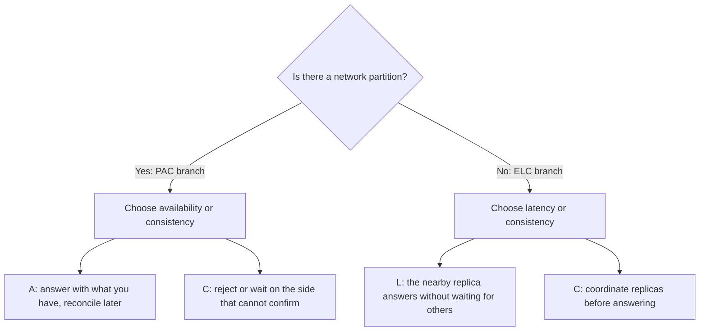
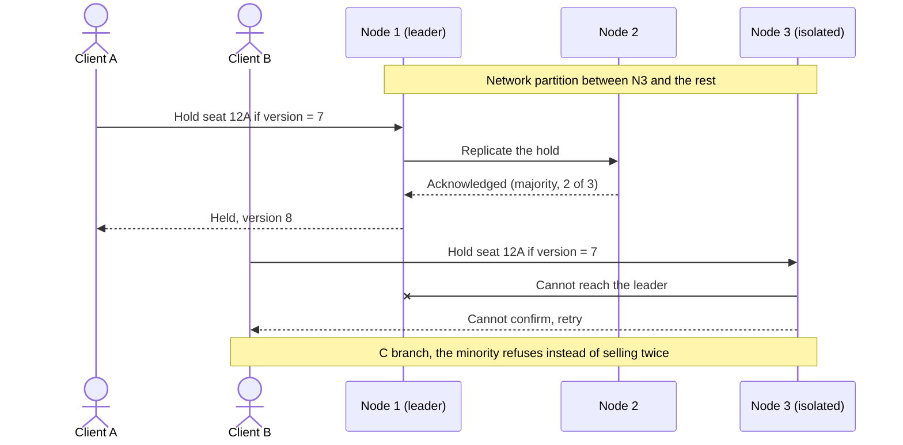

# CAP theorem, PACELC and consistency

Your database is replicated across two data centers. One Tuesday the link between them drops for forty seconds. In that window, one customer buys the last seat on the flight on one side and another customer buys the same seat on the other. Or the opposite happens: the system refuses to sell on both sides, and the business asks why the site "was down" when every server was answering. Both outcomes are design decisions, and CAP and PACELC are the vocabulary for making them on purpose: **once data is replicated, every operation has to choose what it gives up when the network fails (availability or consistency) and what it gives up when the network works (latency or consistency)**.

This article covers what the theorem says and what it does not, how PACELC extends it, which consistency models sit between "strong" and "eventual", and how all of it plays out in four cases: a transfer, a shopping cart, a counter and a seat reservation. Then it walks through the tools architects actually use (idempotency, conditional writes, quorums, replication topologies) and how to verify what a system promises. The code only shows names and shapes; it is not a recipe.

<Callout tone="info" title="Cutoff date and sources">
  Checked in October 2026. The definitions come from the original texts by Brewer (the 2000 slides),
  Gilbert and Lynch (2002) and Abadi (2012), read from public copies. Whenever I describe how a
  specific system behaves, I attribute it to the source and the year: default configurations change,
  so do not read it as a current label.
</Callout>

## The problem it solves

A single machine does not have this dilemma: there is one copy of each item, and every read sees the latest write. The problem shows up as soon as you **replicate**, whether to survive a node failure, to scale reads or to put data close to users in several regions. From then on, two replicas can go a while without hearing from each other, and the system has to decide what to do with the requests that arrive in the meantime.

| Symptom in production                                     | Decision nobody made explicitly                           |
| --------------------------------------------------------- | --------------------------------------------------------- |
| The same seat or the same unit of stock is sold twice     | Accepting writes on both sides of a partition             |
| The site "goes down" even though every node is alive      | Rejecting writes on the side that cannot reach a majority |
| You edit your profile, reload and see the old value       | Reading from any replica with no session guarantees       |
| An item you removed from the cart comes back              | Merging divergent versions with no rule for deletes       |
| Every "strong" read takes as long as the farthest replica | Coordinating replicas across regions on every operation   |

## From conjecture to theorem

Eric Brewer put the idea forward in his invited talk _Towards Robust Distributed Systems_ at PODC on July 19, 2000. His slide says that of consistency, availability and tolerance to network partitions, "you can have at most two" for any shared-data system. The same talk contains an idea that usually gets lost: comparing ACID with BASE, Brewer notes that he thinks it is a spectrum, not a switch.

In 2002, Seth Gilbert and Nancy Lynch (MIT) published the formal version and its proof in _ACM SIGACT News_. The proof is short: split the network into two groups that cannot talk, write a value in one and read it in the other. If the reader must answer (availability), it cannot know about the write; if it must return the latest value (consistency), it cannot answer. The paper adds a subtlety worth knowing: in the asynchronous model, without clocks, a node cannot tell a lost message from a slow one, so it cannot guarantee both properties even in the executions where no message is lost. With clocks and timeouts (the partially synchronous model) it is possible to be consistent while the network works and to return stale data only when messages are lost.

### The three properties, precisely

| Property               | Definition in Gilbert and Lynch                                                                                           | What it does not mean                                                                    |
| ---------------------- | ------------------------------------------------------------------------------------------------------------------------- | ---------------------------------------------------------------------------------------- |
| C, consistency         | Atomic or **linearizable** consistency: there is a total order of operations and each one appears to happen at an instant | Not the C in ACID, and not "the data satisfies the business rules"                       |
| A, availability        | Every request received by a non-failing node gets a response                                                              | Not a 99.9% SLA: it sets no time bound, and it requires an answer from _every_ live node |
| P, partition tolerance | The network may lose arbitrarily many messages between nodes; any message loss can be modeled as a temporary partition    | Not a feature you turn on: it is a property of the environment                           |

Two details of the availability definition matter in practice. First, since it sets no time bound, a response that takes a minute still counts as available. Second, it requires an answer from nodes stranded on the minority side too. Martin Kleppmann made the point in 2015: many systems sold as "highly available" do not meet this definition, even when they meet their SLA.

### The C in CAP is not the C in ACID

Gilbert and Lynch spell it out in a footnote: database consistency refers to transactions, while atomic consistency refers to a single request/response sequence, and it covers what ACID would split into A and C. Put differently, CAP is about **replicas agreeing** on an object, not about integrity constraints. A system can be linearizable on every key and still let a multi-key transaction leave data that breaks a business rule.

## The most common misreadings

- **"Pick two out of three."** Brewer himself wrote in 2012 that the "2 of 3" formulation "was always misleading" because it oversimplifies the tensions between the properties, and that CAP prohibits only a small part of the design space.
- **"My system is CA."** On a real network messages get lost, so P is not optional. The real decision is what to do _during_ a partition: answer with possibly stale data (A) or refuse to answer on the side that cannot confirm (C). A "CA" system is, in practice, either a single node or a system that never decided what happens when the network fails.
- **"CAP forces me to give up consistency all the time."** Abadi calls this reasoning flawed: CAP only constrains the system in the face of certain failures and says nothing about normal operation. If a system is weak while the network is healthy, the reason is something else, usually latency.
- **"Consistency is consistency."** As shown above, the C in CAP means linearizability. There are many weaker models, and several of them stay available during a partition.
- **"This database is CP" (or AP).** Kleppmann asked in 2015 that people stop using those labels: a single leader with asynchronous followers that serve reads is neither CP (follower reads are not linearizable) nor AP (a client cut off from the leader cannot write). On top of that, behavior often depends on how each operation is configured.

## PACELC: what happens when the network works

In February 2012, Daniel Abadi argued in IEEE's _Computer_ magazine that the consistency/latency trade-off has shaped distributed databases more than CAP itself. His proposal, PACELC (pronounced "pass-elk"), rewrites CAP as two branches: **if there is a partition (P), how does the system trade availability (A) against consistency (C)? Else (E), when the system runs normally, how does it trade latency (L) against consistency (C)?**



The argument is simple. High availability requires replication, and once you replicate there are only three ways to propagate a write: to all replicas at once, first to an agreed-upon master, or first to an arbitrary node. Each variant pays in consistency or in latency: synchronous replication waits for the slowest replica; asynchronous replication answers sooner, but someone may read an old version; routing every read to the master keeps reads consistent but forces a round trip across the world even when a replica sits next door. Abadi adds that over a wide-area network there is no way around this trade-off, and that it only applies to systems that replicate.

| Combination | During a partition                           | During normal operation                    | Examples Abadi gave in 2012 (default configuration)                  |
| ----------- | -------------------------------------------- | ------------------------------------------ | -------------------------------------------------------------------- |
| PA/EL       | Keeps answering and reconciles later         | Answers fast even if the data may be stale | Dynamo, Cassandra, Riak                                              |
| PC/EC       | Stops answering where it cannot confirm      | Pays latency to coordinate                 | VoltDB/H-Store, Megastore, BigTable/HBase                            |
| PA/EC       | Prioritizes answering                        | Consistent reads and writes                | MongoDB, with the caveat that its minority side fails CAP's formal A |
| PC/EL       | Does not drop consistency below its baseline | Prioritizes latency                        | PNUTS (Yahoo)                                                        |

Use the table to understand the reasoning, not to pick a product: these are configurations from more than a decade ago, and Abadi himself points out that these systems let you adjust the trade-off. The useful part is the question, which you can ask of every operation in your system: _what does it do when the network fails, and what does it do when it works?_

## A spectrum of consistency

Between linearizability and "everything agrees eventually" there are intermediate models with concrete guarantees. The right-hand column summarizes what Jepsen documents for each model during a partition: **total** means any healthy node can keep answering; **sticky** means it works as long as each client keeps talking to the same server.

| Model                 | What it guarantees                                                                        | Plain-language example                                                                                 | During a partition |
| --------------------- | ----------------------------------------------------------------------------------------- | ------------------------------------------------------------------------------------------------------ | ------------------ |
| Linearizable (strong) | Each operation appears to happen at an instant, in an order that respects real time       | Your bank confirms the transfer, you call your business partner and they already see the new balance   | Unavailable        |
| Sequential            | One total order shared by everyone, consistent with each client's own order, no real time | Everyone sees the group chat messages in the same order, even if one phone lags behind                 | Unavailable        |
| Causal                | Operations related by cause and effect are seen in that order; others in any order        | Nobody sees the "yes" reply before the "lunch?" question                                               | Sticky             |
| Read your writes      | After you write, your reads see your write (no promise to other clients)                  | You change your profile picture, reload and see the new one, while someone else still sees the old one | Sticky             |
| Monotonic reads       | Once you have seen a value, you never see an older one                                    | A comment you already read does not vanish when you reload                                             | Total              |
| Eventual              | If writes stop arriving, all reads eventually return the last value                       | The like counter differs for a few seconds between your phone and your laptop                          | Total              |

Each model has a lineage. Herlihy and Wing defined linearizability in 1990; Lamport defined sequential consistency in 1979. The session guarantees (read your writes, monotonic reads, writes follow reads and monotonic writes) were proposed by Terry and colleagues at Xerox PARC in 1994, with intermittently connected mobile clients in mind. The definition of eventual consistency in the table is Werner Vogels' from 2008; he also singles out monotonic reads plus read-your-writes as the most desirable pair in an eventually consistent system.

## Four worked cases

All four use the same method: identify the invariant that must not break, compare the cost of an error with the cost of a refusal, and decide per operation.

### Account transfer

The invariant is that the balance stays within the allowed limit and that money is neither created nor destroyed. An error costs money and trust; a refusal costs a retry. That is why the debit usually runs with strong consistency on the account and, during a partition, the side that cannot confirm rejects the operation. The client's retry must be safe, which is what an idempotency key gives you (see below).

There is a legitimate alternative that Brewer describes in 2012 with the ATM example: during a partition the ATM switches to a stand-in mode where it keeps dispensing cash up to a **bounded net limit** and refuses beyond it; the bank fixes things afterwards through auditing and compensation (an overdraft fee, for instance). Brewer sums it up by saying the banking system depends not on consistency for correctness but on auditing and compensation. That is the A branch of CAP with measured risk and a recovery plan. Accepting writes with no limit and no plan is not.

### Shopping cart

The Dynamo paper (Amazon, 2007) is the classic case: "add to cart" must never be forgotten or rejected. If the latest version of the cart is unavailable, the change is applied to an older version and divergent versions are reconciled later by merging them. The paper is upfront about the price: an added item is never lost, but **a deleted item can resurface**. This is a deliberate PA/EL choice: losing a sale costs more than showing an extra item that the customer removes before paying. What you do need is read-your-writes within the session, so the user sees what they just added.

### Social feed counter

A like counter tolerates lag: nobody loses money seeing 1,203 instead of 1,205. Eventual consistency is the right answer here, with two caveats. First, the user who taps "like" must see their own vote (read your writes), even if the total takes a while to converge. Second, the counter must converge without losing concurrent increments. Brewer's 2012 article mentions commutative replicated data types (CRDTs) as structures that provably converge after a partition. A counter fits well because addition commutes: each replica counts its own increments and merging adds them up. The same article draws the line: addition is commutative, but addition with a bounds check (a balance that cannot go below zero) is not. That is why the counter can converge and the transfer cannot.

### Seat reservation

The invariant is hard: one seat, one passenger. Holding a seat needs a linearizable conditional write on that seat, and during a partition the minority side must refuse. The rest of the flow can be weaker: the seat map you browse can be a few seconds stale, as long as the final hold is validated against the source of truth.



Client B gets an error, not a double booking. If B retries against the majority, the conditional write fails because the version is no longer 7, and the system reports the seat as taken. The diagram shows the reasoning; how a given database implements leaders and majorities is a question for its documentation.

| Case             | Invariant                          | During a partition                      | Normal operation           | Minimum guarantee for the user |
| ---------------- | ---------------------------------- | --------------------------------------- | -------------------------- | ------------------------------ |
| Transfer         | Balance within the limit           | Reject, or accept up to a bounded limit | Consistency on the account | Idempotent retry               |
| Cart             | Never lose an added item           | Accept and merge                        | Latency                    | Read your writes               |
| Feed counter     | Converge without losing increments | Accept and merge                        | Latency                    | See your own vote              |
| Seat reservation | One seat, one passenger            | Reject on the minority side             | Consistency on the hold    | A clear error, not a duplicate |

## The architect's toolbox

### Idempotency keys

On a network that loses messages, the client cannot tell whether its request failed or the response did. An idempotency key makes retries safe: the client generates it, sends it on every attempt, and the server returns the stored result instead of executing twice. Stripe's documentation is a good reference for the contract: an `Idempotency-Key` header, V4 UUIDs recommended, the saved response returned for retries with the same key, an error if the parameters differ, and keys that may be pruned once they are at least 24 hours old.

```typescript
// api/transfers: the client generates the key and resends it on every retry
type TransferCommand = {
  readonly idempotencyKey: string; // V4 UUID generated by the client
  readonly fromAccount: string;
  readonly toAccount: string;
  readonly amountCents: number;
};

// Same key, same parameters: returns the stored response.
// Same key, different parameters: an error, never a second transfer.
export declare function requestTransfer(command: TransferCommand): Promise<TransferResult>;
```

### Versions and conditional writes

A conditional write only applies if the data has not changed since you read it. It prevents the "lost update" and it is the backbone of the seat reservation. HTTP has it as a standard: the `If-Match` header with an entity tag makes the request conditional, and if the condition fails the server answers `412 Precondition Failed` (RFC 9110). Databases expose it under different names (compare-and-set, optimistic versioning); the contract your domain should see is this:

```typescript
type Versioned<T> = { readonly value: T; readonly version: number };

type SeatRepository = {
  get(seatId: string): Promise<Versioned<Seat>>;
  // 'conflict' if another write got there first: never overwrite blindly
  holdIfVersion(seatId: string, expected: number, holder: string): Promise<'ok' | 'conflict'>;
};
```

Versions help on the client side too: Vogels describes how a client can get read-your-writes and monotonic reads by discarding reads whose version is older than the last one it has seen.

### Quorum reads and writes

With N replicas, a write is acknowledged once W replicas accept it, and a read queries R of them. If R + W > N, the sets overlap and every read touches at least one replica that received the latest acknowledged write; if R + W ≤ N, you may read from replicas that do not have it yet. Examples with N = 3:

| R   | W   | Overlap? | Effect                                                                   |
| --- | --- | -------- | ------------------------------------------------------------------------ |
| 1   | 1   | No       | Fastest; you may read a stale value                                      |
| 2   | 2   | Yes      | Tolerates one replica down for reads and writes; pays the latency of two |
| 1   | 3   | Yes      | Fast reads; any replica down blocks writes                               |
| 3   | 1   | Yes      | Fast writes; any replica down blocks reads                               |

Abadi flags a subtlety: overlap alone is not enough for Gilbert and Lynch's consistency; the protocol needs additions. Treat quorums as a lever on the latency/consistency trade-off, not as a synonym for linearizable.

### Replication topologies

| Topology                                  | Consistency                                           | Latency                                                         |
| ----------------------------------------- | ----------------------------------------------------- | --------------------------------------------------------------- |
| Single leader, synchronous replicas       | Replicas up to date                                   | Every write waits for the slowest replica                       |
| Single leader, async, reads on the leader | Reads up to date                                      | Reads travel to the leader even with a replica nearby           |
| Single leader, async, reads on replicas   | Reads may be stale                                    | Local, fast reads                                               |
| Several nodes accept writes               | Concurrent conflicting writes that must be reconciled | Fast local writes; detecting and resolving conflicts has a cost |

### Consistency per operation, not per database

The practical conclusion of everything above: you do not decide "the database is strong or eventual", you decide **each operation**. Within the same system, holding a seat and counting page views deserve different answers. Write it down as an explicit, reviewable policy, and record it in an [ADR](/docs/adr):

```typescript
// consistency-policy.ts: one decision per operation, reviewed like any contract
type ReadGuarantee = 'linearizable' | 'read-your-writes' | 'eventual';
type OnPartition = 'reject' | 'accept-and-reconcile';

export const consistencyPolicy = {
  'seats.hold': { read: 'linearizable', onPartition: 'reject' },
  'transfers.debit': { read: 'linearizable', onPartition: 'reject' },
  'cart.addItem': { read: 'read-your-writes', onPartition: 'accept-and-reconcile' },
  'feed.likeCount': { read: 'eventual', onPartition: 'accept-and-reconcile' },
} satisfies Record<string, { read: ReadGuarantee; onPartition: OnPartition }>;
```

In [DDD](/docs/domain-driven-design), the aggregate already draws this boundary: synchronous consistency inside, asynchronous between aggregates. If your aggregates are well designed, you already know which operations need strong consistency and which can converge.

## How to verify what a system promises

A consistency claim that nobody has tested under failure is a hypothesis. The way to check it is **fault injection**: run concurrent operations while cutting links, pausing processes or skewing clocks, record the history of responses, and check whether that history is legal under the promised model.

Jepsen is the public reference for this approach. According to its site, since 2013 it has analyzed over two dozen databases, coordination services and queues, finding replica divergence, data loss and stale reads, among other problems. Its method has three traits you can borrow: it tests real binaries on real clusters (opaque-box), it exercises the failure modes specific to distributed systems (faulty networks, unsynchronized clocks, partial failure), and it generates random operations whose history is checked against a model. Jepsen states the limit itself: these tests cannot prove a system correct, only find errors.

What to do in your own system:

- **Read the published analysis** for the version you run before relying on a guarantee, and check which configuration was tested.
- **Test your critical operations**, not just the database: a linearizable store does not save an application that reads from a cache and writes unconditionally.
- **Turn the invariant into an automated check** that runs in an environment with injected faults: it is an architectural [fitness function](/docs/fitness-functions).
- **Measure the latency of strong operations** in production, per region: that is the price of the EC branch, and it must be visible.

## When to use it and when not to

Distributed consistency is expensive to design, operate and test. It pays off when replication buys you something concrete; otherwise a single database is the better answer. The same logic applies in [monolith versus microservices](/docs/monolito-vs-microservicios): splitting data across services or regions turns every operation between them into a consistency problem.

| Situation                                                                          | Reasonable decision                                                                                                      |
| ---------------------------------------------------------------------------------- | ------------------------------------------------------------------------------------------------------------------------ |
| A single primary handles the load and the business tolerates a failover of minutes | One database with a standby; the dilemma shrinks to which writes you can lose on failover                                |
| Users in several regions and read latency is a quality requirement                 | Replicate, accept local reads (EL) where the operation tolerates it, and go strong only where an invariant lives         |
| There are uniqueness or balance invariants                                         | Strong consistency and a conditional write on that operation, even if everything else is eventual                        |
| The system must keep accepting writes with the network cut (mobile, retail stores) | The A branch with reconciliation designed from day one: merges, compensations, limits                                    |
| Nobody can say what happens to an operation if a link drops                        | Before picking technology, write the per-operation policy and discuss it as a [trade-off](/docs/trade-offs-y-decisiones) |

If you have to justify the decision to the business, translate it into [quality attributes](/docs/atributos-de-calidad): availability, latency and data correctness compete with each other, and CAP and PACELC tell you exactly where.

## Common mistakes

- **Labeling the database and forgetting the operation.** The same database can serve strong or stale reads depending on how each request is configured.
- **Confusing the C in CAP with the C in ACID.** Replicas agreeing is one thing; integrity rules holding is another.
- **Designing for "CA".** Not deciding what happens during a partition does not prevent it: it just hands the decision to whatever the default behavior is.
- **Ignoring the ELC branch.** Partitions are rare; the latency of coordinating replicas is paid on every request.
- **Retrying without idempotency.** A timeout does not tell you whether the operation ran; blind retries duplicate charges and orders.
- **Merging versions without thinking about deletes.** Dynamo's cart shows that merging is easy for additions and hard for removals.
- **Reconciling without a plan.** If you accept writes on both sides, merging and compensation are part of the design, not an emergency script.
- **Trusting the documentation without tests.** Look for the published analysis of your version and test your invariants with injected faults.

## Checklist

- [ ] Every operation that writes replicated data declares what it does during a partition: reject, or accept and reconcile.
- [ ] Every read declares its minimum guarantee (linearizable, read your writes, eventual) and why.
- [ ] Hard invariants (uniqueness, balance, capacity) use versioned conditional writes.
- [ ] Every operation the client may retry accepts an idempotency key.
- [ ] If divergent writes are accepted, the merge rule, deletes included, is written down and tested.
- [ ] The latency of strongly consistent operations is measured per region.
- [ ] At least one automated test checks the critical invariants under injected network faults.
- [ ] The consistency policy is recorded in an ADR and revisited when the topology changes.

## Sources

Checked in October 2026. The Gilbert and Lynch PDF on the author's site returned HTTP 403; I read the copy hosted by a Princeton course. Brewer's 2012 article was read in the version republished by InfoQ.

- [Towards Robust Distributed Systems (Eric Brewer, PODC invited talk, July 19, 2000)](https://sites.cs.ucsb.edu/~rich/class/cs293b-cloud/papers/Brewer_podc_keynote_2000.pdf): slides, copy hosted by a UCSB course
- [Brewer's Conjecture and the Feasibility of Consistent, Available, Partition-Tolerant Web Services (Seth Gilbert and Nancy Lynch, ACM SIGACT News, June 2002)](https://www.cs.princeton.edu/courses/archive/spring22/cos418/papers/cap.pdf), [DOI 10.1145/564585.564601](https://doi.org/10.1145/564585.564601)
- [Consistency Tradeoffs in Modern Distributed Database System Design (Daniel Abadi, IEEE Computer, February 2012)](https://cs.umd.edu/~abadi/papers/abadi-pacelc.pdf)
- [CAP Twelve Years Later: How the "Rules" Have Changed (Eric Brewer, republished by InfoQ on May 30, 2012)](https://www.infoq.com/articles/cap-twelve-years-later-how-the-rules-have-changed/)
- [Please stop calling databases CP or AP (Martin Kleppmann, May 11, 2015)](https://martin.kleppmann.com/2015/05/11/please-stop-calling-databases-cp-or-ap.html)
- [Eventually Consistent (Werner Vogels, ACM Queue, 2008)](https://www.cs.princeton.edu/courses/archive/fall15/cos518/papers/ec-vogels.pdf)
- [Dynamo: Amazon's Highly Available Key-value Store (DeCandia et al., SOSP 2007)](https://www.cs.princeton.edu/courses/archive/fall15/cos518/papers/dynamo.pdf)
- [Session Guarantees for Weakly Consistent Replicated Data (Terry et al., PDIS 1994)](https://pages.cs.wisc.edu/~remzi/Classes/739/Fall2016/Papers/bayou-sessions94.pdf): verified from search results
- [Linearizability: A Correctness Condition for Concurrent Objects (Herlihy and Wing, ACM TOPLAS, 1990)](https://www.cs.columbia.edu/~wing/publications/HerlihyWing90.pdf): verified from search results and Jepsen
- Jepsen: the [consistency models guide](https://jepsen.io/consistency), the pages for [linearizable](https://jepsen.io/consistency/models/linearizable), [sequential](https://jepsen.io/consistency/models/sequential), [causal](https://jepsen.io/consistency/models/causal) and [read your writes](https://jepsen.io/consistency/models/read-your-writes), and the [analyses index](https://jepsen.io/analyses)
- [Idempotent requests (Stripe API documentation)](https://docs.stripe.com/api/idempotent_requests)
- [RFC 9110, HTTP Semantics (June 2022)](https://www.rfc-editor.org/rfc/rfc9110.html): the `If-Match` and `412 Precondition Failed` sections
