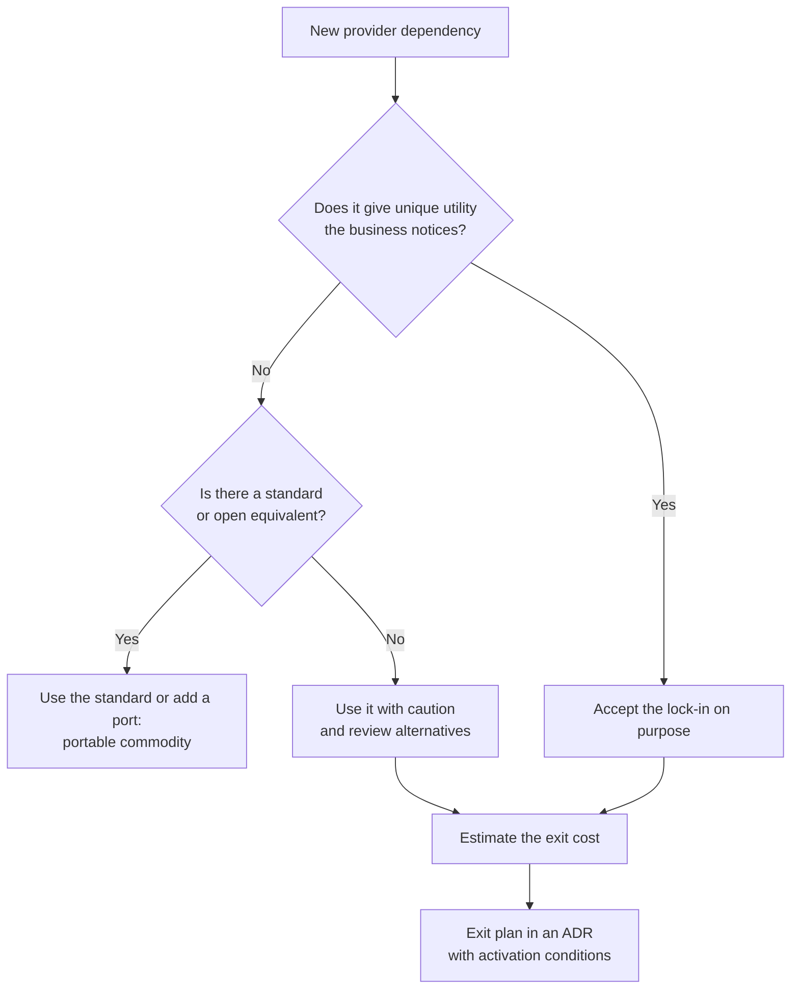
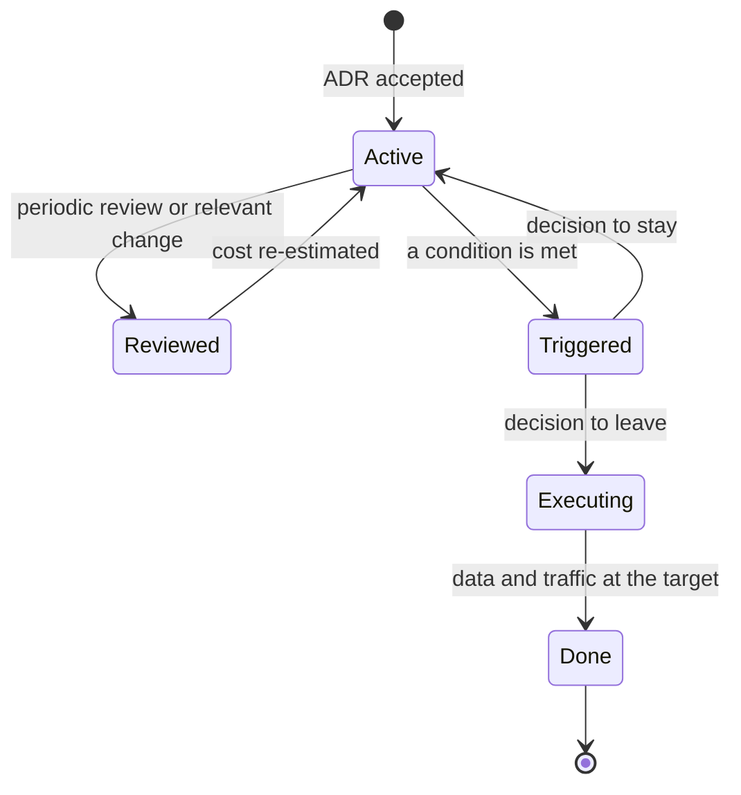

# Locked in to one vendor: lock-in and exit plan

Three years ago your team picked a proprietary managed database, _serverless_ functions triggered by the provider's events, and the provider's queue service. It was a good call: the team reached production in weeks and nobody had to run servers. Today a pricing change notice arrives, or a customer requires the data to live in another jurisdiction, or the company is acquired by one that works with a different provider. Someone in the meeting asks "how much would it cost us to leave?" and nobody can answer, because the answer is spread across the data, the code, operations, the contract and what the team knows.

**Lock-in is the cost of switching: everything you would have to transfer, rewrite, relearn and renegotiate to stop using a provider or a product.** It is neither good nor bad in itself. It is a decision variable, and like any variable you should measure it, weigh it against what it buys you, and revisit it over time.

This is the fourth lesson in the cloud series. It covers the types of lock-in, how to estimate exit cost without relying on the provider's numbers, what portability means at each layer, what the abstractions that promise it actually cost, and how to turn all of that into a documented exit plan with activation conditions that has been tested. Multi-cloud as a strategy has its own lesson; here it only appears as one way to reduce lock-in.

<Callout tone="info" title="Cut-off date and scope">
  Researched in October 2026. It includes no prices or quotas from any provider: they change often
  and depend on your contract. The regulatory deadlines quoted come from the published text of the
  EU Data Act; summarizing them here is not legal advice, and amendments under negotiation are
  flagged where relevant.
</Callout>

## The problem it solves

Lock-in is rarely chosen explicitly. It accumulates: a managed service here, a trigger there, a permissions policy written in the provider's language. Each step is reasonable; together, if nobody looks, they become a decision nobody made.

| Symptom                                                            | Decision nobody made explicitly                             |
| ------------------------------------------------------------------ | ----------------------------------------------------------- |
| Nobody can estimate a migration, not even to an order of magnitude | Keeping an inventory of proprietary dependencies            |
| A price increase can only be accepted, not negotiated              | Keeping a credible alternative                              |
| The provider's SDK shows up in hundreds of business-logic files    | Where the boundary between business and technology sits     |
| Exporting the data takes a project, not a procedure                | In what format and how often the data must be able to leave |
| The exit plan exists but has never been run                        | Testing the plan and measuring how long it takes            |

## What lock-in is, and what it is not

Gregor Hohpe lays it out in _Don't get locked up into avoiding lock-in_ (martinfowler.com, September 9, 2019) with three ideas worth keeping in mind. First, lock-in is not all or nothing; it is a spectrum. Second, avoiding one kind of lock-in often creates another: your own abstraction layer frees you from the provider and ties you to that layer. Third, open source reduces some forms of lock-in, but not all of them; a free product still has its own APIs, versions and specific skills.

That gives the criterion for the whole lesson: the goal is not zero lock-in, but a switching cost that is **known, accepted on purpose, and proportionate to what you get in return**.

It also helps to keep apart two concepts that ISO/IEC 19941:2017 treats separately: **interoperability** (two systems can work together) and **portability** (data or applications can move from one environment to another). A service can be interoperable, with a standard API to query it, and still poorly portable, if its data only comes out in a proprietary format.

## Types of lock-in

Hohpe names eight varieties in his article (vendor, product, version, architecture, platform, skills, legal and mental). For cloud decisions, a practical grouping is this one:

| Type                      | What ties you down                                                        | Typical example                                             | Warning sign                                            |
| ------------------------- | ------------------------------------------------------------------------- | ----------------------------------------------------------- | ------------------------------------------------------- |
| API and programming model | Interfaces and ways of working that exist only at one provider            | Functions triggered by the provider's storage events        | The SDK appears in business code                        |
| Data                      | Volume, format and model of the stored data                               | A single-table design built for one specific NoSQL database | There is no automated full export                       |
| Operations and tooling    | Dashboards, alerts, runbooks, IaC and processes built for one environment | Alerts defined in the monitoring service's query language   | The runbook mentions consoles, not procedures           |
| Contractual and licensing | Spend commitments, volume discounts, license changes                      | A multi-year minimum spend commitment                       | Nobody on the technical team has read the exit clauses  |
| Talent                    | What the team knows and who you can hire                                  | The whole team certified on a single cloud                  | Migration estimates ignore the learning curve           |
| Ecosystem                 | Integrations, partners and third-party products around the provider       | A product bought through the provider's marketplace         | Critical dependencies that only exist in that ecosystem |

### Proprietary APIs and programming models

What ties you down most is usually not the API itself but the **programming model**. AWS Lambda, Azure Functions and Google Cloud Run functions share the idea of running code in response to events, but they differ in the available triggers, the shape of the events, configuration, and how permissions are granted. You can package your function in a portable container and still depend entirely on the provider's bucket invoking it with the provider's event format. The lesson on [serverless and managed compute](/docs/serverless-y-computacion-gestionada) goes deeper into this.

### Data

Data ties you down in three ways that add up: **volume** (moving a lot takes time and transfer), **format** (a proprietary dump has to be converted) and **model** (a schema designed around one database's capabilities does not move to another without redesign). Beyond the primary data, everything derived counts too: indexes, backups, event history, metadata catalogs and the permissions on each dataset.

### Operations and tooling

This is the most overlooked kind because it is not in the application code. Dashboards, alerts, on-call procedures, deployment pipelines and infrastructure as code are all written for one environment. Hohpe illustrates it with Terraform: the tool works with many providers, but the scripts still contain constructs specific to each one. The tool is portable; your infrastructure code is not.

### Contractual and licensing

Minimum spend commitments, volume discounts and conditional credits create an exit cost that has nothing technical about it. Licensing matters too, even for tools that look neutral: on August 10, 2023, HashiCorp announced that future releases of its products would move from the MPL 2.0 license to the Business Source License 1.1, and the community responded with OpenTofu, a fork the Linux Foundation took in in September 2023. Teams that depended on Terraform had to evaluate a change they had not planned for.

### Talent and ecosystem

A team that knows one provider deeply is an asset, and also a dependency: migrating means training, a temporary productivity dip and sometimes hiring. The ecosystem adds what you do not control: third-party products bought through the marketplace, partner integrations, and services your customers already use on that cloud.

## Exit cost as a decision variable

Exit cost has four components. Estimating them separately avoids both "there is no way to know" and the optimistic "we just need to move the data".

| Component              | What it includes                                                            | How to estimate it without provider numbers                                           |
| ---------------------- | --------------------------------------------------------------------------- | ------------------------------------------------------------------------------------- |
| Transferring data      | Export, convert format and model, load, validate and reconcile              | Measure your actual volume and the time of a trial export; extrapolate from there     |
| Rewriting integrations | Code using proprietary APIs, triggers, permissions, IaC, dashboards, alerts | Inventory SDK call sites, classified by whether they have a direct equivalent         |
| Requalifying the team  | Training, productivity dip, hiring new profiles                             | Weeks per person based on the team's prior experience with the target                 |
| Migration time         | Running both environments during the transition, features not being built   | Estimated duration times the current monthly cost of operating, plus opportunity cost |

### How to estimate it with your own data

You do not need the target's price list to get a useful first estimate. You need data you already have:

1. **Inventory.** List every provider service you use and every place in the code, the IaC and operations that depends on it. SDK imports are a good starting point.
2. **Classification.** For each dependency: direct equivalent (configuration changes), equivalent with changes (the adapter changes), or no equivalent (the design changes).
3. **Effort.** Estimate each group in person-weeks using your own team's history, not migration tool promises.
4. **Duration and double running.** Your current bill tells you what a month of running at the source costs; add it for the length of the transition.
5. **Range.** Give an optimistic and a pessimistic value. If the gap between them is huge, what you are missing is inventory, not precision.

Hohpe suggests a simple way to use the result: the expected cost of leaving is roughly the switching cost multiplied by the probability of having to switch. Minimizing switching cost is not always the most economical choice: if the probability is low, spending a lot to avoid it rarely pays off. That is the arithmetic of this lesson's worked example. How to track recurring cloud cost and treat it as one more requirement is covered in [FinOps: cost as an attribute](/docs/finops-costo-como-atributo).

### Exit cost grows over time

The header figure sums up the dynamics. Exit cost (the _lock-in_ curve) starts low and grows with time of use, often accelerating: every month you accumulate more data, more integrations, more automation and more provider-specific knowledge. The cost of staying (the _status quo_ line) is what you pay, or fail to gain, by remaining with the current provider instead of the best alternative over your planning horizon; the figure simplifies it as constant.

While the curve sits below the line, leaving is the cheap option if the alternative turns out to be better. At point **t\*** they cross: from there on, leaving costs more than staying, and the gap **Δ** keeps widening. Two practical consequences: re-estimate the exit cost at regular intervals, because last year's number no longer holds, and decide whether you want to keep the exit option **before** you reach t\*, not after.

## Portability layer by layer

Portability is not a property of the system but of each layer. Portable compute says nothing about identity or observability.

| Layer                  | What makes it portable                                                                   | Where lock-in comes back                                                         |
| ---------------------- | ---------------------------------------------------------------------------------------- | -------------------------------------------------------------------------------- |
| Data                   | Open formats (Apache Parquet, Apache Iceberg tables), standard SQL, regular full exports | Database-only features, models built for one engine, proprietary catalog         |
| Compute                | Container images following the OCI specification                                         | Triggers, permissions and managed services around the container                  |
| Orchestration          | Kubernetes and its standard APIs                                                         | Load balancers, storage classes, add-ons and the provider's identity integration |
| Identity               | OpenID Connect, SAML and SCIM (RFC 7643 and 7644) for users and provisioning             | The cloud's own roles and permission policies: no direct equivalent              |
| Messaging and events   | Open protocols (AMQP, the Kafka protocol) and the CloudEvents format                     | Delivery semantics, ordering, retries, dead-letter queues and triggers           |
| Observability          | OpenTelemetry and its OTLP protocol, to instrument once                                  | Dashboards, alerts and queries written in the backend's language                 |
| Infrastructure as code | Multi-provider tools (Terraform, OpenTofu, Pulumi)                                       | The declared resources are specific to each provider                             |

A few notes on the table. CloudEvents is a specification for describing event metadata in a common way; the CNCF announced its graduation on January 25, 2024. OpenTelemetry lets you instrument once and export to different backends, but it does not migrate your dashboards or alerts. Apache Iceberg is a table format built on files such as Parquet that lets several engines read the same tables. None of these pieces removes lock-in from its layer: they reduce it and push it toward whatever surrounds them.

## Abstractions and what they cost

There are three common ways to put distance between your system and a provider: your own layers, ports and adapters, and multi-cloud libraries. All of them buy portability with the same currency: **functionality you lose and maintenance you add**.

| Strategy                         | What you gain                                               | Functionality you lose                                                 | Maintenance you add                                     |
| -------------------------------- | ----------------------------------------------------------- | ---------------------------------------------------------------------- | ------------------------------------------------------- |
| Provider SDK throughout the code | Speed and access to every capability                        | Nothing in the short term                                              | Nothing at first; a high exit cost spread everywhere    |
| Your own port with adapters      | Change concentrates in one adapter; tests without the cloud | Whatever you do not expose through the port                            | The port, the adapter and their contract tests          |
| Multi-cloud library              | A single API for several providers                          | What they do not all share: you drift to the lowest common denominator | One more dependency, with its versions and community    |
| Your own platform on Kubernetes  | Uniform compute and deployment across environments          | Higher-level managed services you would have to replace                | Running the platform, which becomes an internal product |
| Open formats and protocols       | Data and events that leave without conversion               | Optimizations specific to the provider's own format                    | Little, if the provider supports them natively          |

The best cost-benefit option is usually the second one, applied **only where there is real variation or exit risk**. [Hexagonal architecture](/docs/arquitectura-hexagonal) explains how to design those ports and how to prove each adapter meets the same contract; here the consequence is enough: with a port in front of the provider, "how much would it cost to leave?" is answered by counting adapters, not files.

Hohpe warns about two limits. Abstractions leak: sooner or later the provider's behavior seeps through (latencies, limits, error semantics). And elaborate multi-cloud plans can undo the main benefits of the cloud, such as low friction and managed services. When using several providers really pays off is the subject of [multi-cloud: when it makes sense](/docs/multinube-cuando-tiene-sentido).

## The conscious decision: differentiator or commodity

The same Hohpe article crosses two axes: the **cost of switching** and the **unique utility** a service gives you. The combination suggests what to do with each dependency.

| —                   | Low unique utility                                                | High unique utility                                             |
| ------------------- | ----------------------------------------------------------------- | --------------------------------------------------------------- |
| Low switching cost  | Disposable: use it without much thought                           | Ideal, and rare: unique capabilities tend to tie you down       |
| High switching cost | Caution: you are paying lock-in for something available elsewhere | Accepted lock-in: choose it on purpose and prepare an exit plan |

The practical rule that follows: **avoid lock-in for commodities and accept it for what differentiates you**. Virtual machines, object storage, standard relational databases and simple queues are commodities: keeping them portable is cheap and costs you nothing. An analytics engine, a globally distributed database or an AI service that gives you a capability you could not build is a differentiator: using it fully can be worth the lock-in.

Hohpe adds a useful warning: a capability that is unique to the provider does not necessarily produce unique value for your business. The question is not "does only this provider have it?" but "does it give us something our customers notice?". To decide how much analysis each case deserves, the one-way and two-way doors idea from [trade-offs and decisions](/docs/trade-offs-y-decisiones) fits well: a commodity service behind a port is a two-way door; a data model designed for a proprietary engine is almost always one-way.



## The exit plan as an architecture artifact

An exit plan is not a full migration document: it is the **prepared answer** to "what would we do if we had to leave?". Because it shapes long-term decisions, its natural home is an [ADR](/docs/adr): one per dependency accepted on purpose, or one per provider if the scope is broad.

```text
# ADR NNNN: we accept <service> and its exit plan
## Context          <!-- why this service, which alternative we discarded -->
## Decision         <!-- which lock-in we accept and where the boundary is -->
## Exit cost        <!-- range per component and date of the estimate -->
## Possible target  <!-- at least one evaluated alternative -->
## Activation       <!-- measurable conditions that open the plan -->
## Sequence         <!-- data, integrations, cutover, decommissioning -->
## Evidence         <!-- last drill: date, duration, findings -->
## Owner and next review
```

### Activation conditions

A plan without triggers never runs: it always seems too early. Conditions must be observable and written in your own terms:

- **Price:** a rate or billing model change above a threshold you define against your current bill.
- **Service:** a retirement notice or a breaking change in a service you depend on.
- **Reliability:** repeated misses of the service objectives you agreed on internally.
- **Regulation and data residency:** a new requirement the provider cannot meet in the regions you use.
- **Strategy:** an acquisition, a merger or a change of corporate provider.

Meeting a condition does not force you to leave: it forces you to **reopen the decision** with updated data. The plan's lifecycle makes that explicit:



### Testing the plan

An exit plan nobody has run is a hypothesis. There are cheap ways to turn it into evidence:

- **Export drill:** export a representative dataset, load it into an alternative environment, and measure how long it takes and what gets lost along the way.
- **Tabletop exercise:** walk through the sequence with the team and note every step that depends on someone who has left or on a console.
- **Executable rule:** a [fitness function](/docs/fitness-functions) that counts provider SDK imports outside the adapters and fails if they grow without an explicit decision.
- **Periodic re-estimation:** update the exit cost range and its date in the ADR; if the curve is getting close to t\*, it is time to decide.

## Negotiation and contract: what to ask for

The contract is one more layer of lock-in, and the one the technical team reads least. Without going into figures, this is what to ask for or check:

| Area                   | What to ask for                                                                                                 |
| ---------------------- | --------------------------------------------------------------------------------------------------------------- |
| Exit clauses           | Assistance during the transition, a deadline to complete it, and service continuity meanwhile                   |
| Data portability       | A full list of what can be exported (data, metadata, configuration), a documented format and a retrieval window |
| Deletion               | Confirmation of deletion at the end, with its scope                                                             |
| Price changes          | Minimum notice for changes to rates or to the billing model                                                     |
| Service changes        | Notice of retirements and breaking changes, with a migration window                                             |
| Spend commitments      | What happens to the commitment if you leave early or the service changes                                        |
| Transfer costs on exit | Whether there is an exit waiver and under what conditions                                                       |

### What EU regulation already requires

If you contract in the European Union, part of that list is already mandatory. Regulation (EU) 2023/2854, known as the Data Act, applies from September 12, 2025. Its Article 25 requires the contract for a data processing service to include, among other points, a maximum notice period of two months to start switching, a maximum transitional period of 30 calendar days (extendable up to seven months if the provider justifies that it is technically unfeasible), a data retrieval period of at least 30 days, and an exhaustive specification of exportable data and assets. Its Article 29 limits switching charges to costs directly linked to the process until January 12, 2027, and prohibits them from that date.

Separately, Google Cloud (January 11, 2024), AWS (March 5, 2024) and Microsoft Azure (March 13, 2024) announced they would not charge data transfer to the internet for customers who leave, with different conditions in each case: for example, requesting it through support and moving all the data or canceling the subscriptions. Check the current conditions before counting on them in your estimate.

<Callout tone="warning" title="Regulation in motion">
  In November 2025 the European Commission proposed a "Digital Omnibus" package that would change
  the Data Act's switching rules for custom-made services and for SMEs. As of mid-2026 it was still
  under negotiation. Check the text in force and your legal team before relying on a specific
  deadline.
</Callout>

## When to invest in portability, and when not to

| Situation                                                                 | Reasonable decision                                                                   |
| ------------------------------------------------------------------------- | ------------------------------------------------------------------------------------- |
| Commodity service with a standard available (relational, objects, queues) | Use the standard or a port: it is cheap and you lose nothing relevant                 |
| Differentiating service the business notices                              | Use it fully; accept the lock-in in an ADR with an exit plan                          |
| Regulatory or data residency requirement that may change                  | Data in open formats and an automated full export from day one                        |
| Product in discovery, with no certainty it will survive                   | Do not invest in portability; keep a minimal inventory and revisit later              |
| Provider with a history of abrupt price or service changes                | Raise the probability in your estimate and test the plan more often                   |
| The whole platform abstracted "just in case"                              | No: you pay the abstraction cost everywhere and get the benefit only in the rare case |

## Common mistakes

- **Assuming portability comes "by default".** Containers or Kubernetes do not make the system portable: identity, data, networking and observability still belong to the provider.
- **Using a proprietary service without knowing it is one.** A database-only feature, a trigger or a proprietary export format slips through code review without anyone flagging it as a decision.
- **An exit plan nobody has tested.** Without a drill, cost and duration are a guess, and the steps that depend on people or consoles only surface on the day it matters.
- **Abstracting everything out of fear.** The lowest common denominator takes away what justified going to the cloud and leaves you with your own layer to maintain.
- **Confusing a portable tool with portable code.** A multi-provider IaC tool does not make the resources you declare portable.
- **Estimating once and filing it away.** Exit cost grows with time of use; last year's estimate no longer describes today's system.
- **Forgetting the contract.** A spend commitment or a license can outweigh all the technical work.

## Worked example: the bookings database

A team of six is building a bookings platform. It has to choose where to store bookings and is torn between two options. All figures are **assumed** and expressed in person-weeks to avoid depending on prices.

- **Option A:** a proprietary managed NoSQL database (along the lines of DynamoDB, Cosmos DB or Firestore), with automatic scaling and built-in change streams.
- **Option B:** managed PostgreSQL (along the lines of Amazon RDS, Azure Database for PostgreSQL or Cloud SQL), more standard, with somewhat more operational work.

First, the estimated exit cost of each option over a two-year horizon:

| Component              | Option A (person-weeks) | Option B (person-weeks) |
| ---------------------- | ----------------------: | ----------------------: |
| Transferring data      |                       6 |                       2 |
| Rewriting integrations |                      14 |                       2 |
| Requalifying the team  |                       4 |                       1 |
| Migration time         |                       6 |                       3 |
| **Total**              |                  **30** |                   **8** |

Next, what avoiding lock-in with option B costs over those two years: half a person-week of extra operations per month for 24 months, that is, 12 person-weeks, plus 4 person-weeks to build the change stream that A provides out of the box. In total, 16 person-weeks.

The team estimates a 15% probability of having to leave within that horizon. Using Hohpe's arithmetic:

- **Option A:** 0 upfront + 30 × 0.15 = **4.5** expected person-weeks.
- **Option B:** 16 upfront + 8 × 0.15 = 16 + 1.2 = **17.2** expected person-weeks.

Option B only pays off if the probability of leaving exceeds the point where both sums are equal: 30 × p = 16 + 8 × p, so p = 16 / 22 ≈ 73%. Nothing in the context suggests a probability that high, so the team picks **A and accepts the lock-in on purpose**.

The decision does not end there. The team records the exit cost range and its date in an ADR, defines two activation conditions (a billing model change above the agreed threshold against the current bill, and any data residency requirement the provider cannot meet), automates a monthly full export to Parquet, and schedules a load drill into PostgreSQL every six months. It also writes down that if the probability of leaving changes, the numbers get redone.

## Checklist

- [ ] You have an inventory of proprietary services and where they are used in code, IaC and operations.
- [ ] Each dependency is classified as commodity or differentiator, with the reason written down.
- [ ] Exit cost is estimated per component, with a range and a date.
- [ ] Critical data can leave in full, in a documented open format, without a special project.
- [ ] Accepted lock-in is recorded in an ADR with measurable activation conditions.
- [ ] The exit plan has been tested with a drill and the result is recorded.
- [ ] The contract covers exit, portability, deletion, and notice of price and service changes.
- [ ] The estimate is reviewed at fixed intervals, before leaving costs more than staying.

## Next lesson

With exit cost measured, the next question is whether using several providers at once reduces risk or just multiplies it: [multi-cloud: when it makes sense](/docs/multinube-cuando-tiene-sentido).

## Sources

Accessed in October 2026.

- [Don't get locked up into avoiding lock-in (Gregor Hohpe, martinfowler.com, September 9, 2019)](https://martinfowler.com/articles/oss-lockin.html)
- [Regulation (EU) 2023/2854, the Data Act, on EUR-Lex](https://eur-lex.europa.eu/eli/reg/2023/2854/oj); Articles 25, 29 and 50 also read on [Springlex](https://www.springlex.eu/en/packages/data-act/data-act-regulation/article-25/)
- [ISO/IEC 19941:2017, Cloud computing — Interoperability and portability](https://www.iso.org/standard/66639.html): public scope and table of contents only
- [Free data transfer out to internet when moving out of AWS (AWS, March 5, 2024)](https://aws.amazon.com/blogs/aws/free-data-transfer-out-to-internet-when-moving-out-of-aws/)
- [Eliminating data transfer fees when migrating off Google Cloud (Google Cloud, January 11, 2024)](https://cloud.google.com/blog/products/networking/eliminating-data-transfer-fees-when-migrating-off-google-cloud)
- [Free data transfer out to internet when leaving Azure (Azure Updates, March 13, 2024)](https://azure.microsoft.com/updates/now-available-free-data-transfer-out-to-internet-when-leaving-azure/)
- [HashiCorp adopts the Business Source License (HashiCorp, August 10, 2023)](https://www.hashicorp.com/en/blog/hashicorp-adopts-business-source-license) and [OpenTofu](https://opentofu.org/)
- [CNCF announces the graduation of CloudEvents (January 25, 2024)](https://www.cncf.io/announcements/2024/01/25/cloud-native-computing-foundation-announces-the-graduation-of-cloudevents/)
- [OpenTelemetry](https://opentelemetry.io/)
- [RFC 7644, SCIM: Protocol](https://www.rfc-editor.org/rfc/rfc7644) and [RFC 7643, SCIM: Core Schema](https://www.rfc-editor.org/rfc/rfc7643)
- [Apache Iceberg](https://iceberg.apache.org/) and [Apache Parquet](https://parquet.apache.org/)
- The Digital Omnibus proposal and its status: [Greenberg Traurig analysis (July 2026)](https://www.gtlaw.com/en/insights/2026/7/eu-digital-omnibus-package-proposes-amendments-to-data-act)
