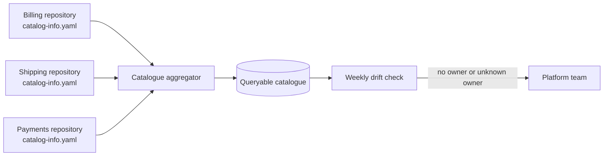

There is a question almost nobody in a mid-sized organisation can answer quickly: who owns this service,
which APIs does it expose, and can it be retired without breaking someone? The answers live in the heads of
two people, in an outdated document or in the history of a chat channel. When those people move to another
team, the organisation discovers it has services nobody maintains and APIs nobody dares to touch.

The thesis of this article is that **a service catalogue is a decision tool, not an inventory**. Its value
lies in answering three questions without a meeting: who decides, what state the service is in and what
contract it offers. API governance exists to make those answers true and to announce incompatible changes
with a date. A catalogue without verified owners is just a list of names; governance without retirement
dates is bureaucracy that never retires anything.

## What a catalogue answers

A catalogue answers operational questions. During an incident, it lets you find the owner of the failing
service and the consumers that depend on it. When a team wants to reuse a capability, it shows whether one
already exists and what contract it has. When an API is about to change, it lets you find who uses it before
the change is announced. And when the organisation wants to reduce cost or complexity, it shows which services
have not changed for years and have no active owner.

What the catalogue does not do is replace each service's documentation or the architecture as a whole. Its job
is short and precise: **be the reliable index** that points to the documentation, the contract, the repository,
the support channel and the owner. If it tries to hold all the documentation, it becomes heavy and nobody keeps
it up to date.

<Callout tone="info" title="A minimal catalogue is enough">
  With three verified fields per service (owner, status and contract), the catalogue already answers
  most incident questions. Other fields are added when a specific question needs them.
</Callout>

## The minimum data for each service

The owner should be a **team**, not a person. People change roles; teams have a channel, a backlog and a shared
responsibility. The owner must match a real entity in the organisation's directory, because a free-text name does
not let you reach anyone at three in the morning.

The status describes maturity and lifecycle: experimental, in production, deprecated or retired. It is the most
useful field for deciding whether to reuse a service. An experimental service can change without notice; a
production service has a contract; a deprecated one must not receive new consumers.

The contract is the specification of the API or event the service offers, with its version and a link to the file
that defines it. Without a linked contract, the catalogue describes a service but does not make it usable.

Complete the entry with a support channel, the main dependency and the criticality level. These four fields cover
most incident questions. Everything else is optional and must justify its maintenance cost.

```yaml
apiVersion: backstage.io/v1alpha1
kind: Component
metadata:
  name: billing
  description: Issues and voids customer invoices
spec:
  type: service
  lifecycle: production
  owner: payments-team
  system: payments
  providesApis:
    - billing-api
```

The example follows the descriptor format of Backstage, an open-source software catalogue that reads a
`catalog-info.yaml` file kept next to the code. That format is only one concrete form; the idea works with any
tool. What matters is that the owner and the status live **in the same repository as the service**, because then
they change in the same review as the code.

## Where the information lives

There are two possible homes for the catalogue: a central registry edited by hand, or files in each repository that
a process collects. A central registry is easy to start and drifts quickly: the service changes owner in its
repository and the registry still shows the previous team. Files in the repository cost more at the beginning, but
a change of owner is reviewed like any other change.

The practical recommendation is the second option. The central catalogue aggregates and queries; the truth about
each service lives next to its code. A periodic check should detect **drift**: services without an owner, with an
owner that does not exist or with an obsolete status. A weekly check that lists those cases is enough to keep the
catalogue honest.



## Statuses and what they imply

A status is only useful if it changes how someone consuming it behaves. That is why each status should carry an
explicit rule.

An **experimental** service can change without warning and must not be a dependency of a critical flow. A
**production** service keeps its contract, and any incompatible change follows the API lifecycle. A **deprecated**
service accepts no new consumers, has a retirement date and names a replacement. A **retired** service no longer
exists, and the catalogue keeps the entry so that historical queries can find where it went.

The last part is often forgotten. Retiring a service without a trace forces someone, months later, to investigate
why an integration fails. A retired entry with its replacement costs very little and saves a lot of lost time.

## Light governance: rules that are checked

API governance fails when it consists of committees that review every change. It works when it consists of a short
set of rules that are checked automatically and that most teams follow without thinking. Some useful rules: every
production service has an owner and a linked contract; no public endpoint is published without a version; incompatible
changes go through a deprecation procedure; and resource names follow a single convention.

Human review is kept for decisions that deserve it: a new API that crosses domains, a contract that creates a strong
dependency between teams, or a change that affects external customers. That boundary is what keeps governance light.
If every change goes through the same review, the committee becomes the bottleneck and teams learn to avoid it.

A rule enforced in the integration pipeline is worth more than ten pages of policy. For example, a contract checker can
reject a change that removes a field without bumping the major version. That check is cheap and removes a whole class of
incidents.

## The API lifecycle

An API goes through four phases: design, publication, use and retirement. The first three are handled well by ordinary
practices; the fourth is the one most organisations neglect.

During **design**, the contract is written before the implementation and reviewed with the known consumers. During
**publication**, the API gets a version, is registered in the catalogue and is documented with examples of errors. During
**use**, the owner knows who consumes what, because consumers register or are discovered through metrics. **Retirement**
requires dated notices, a clear replacement and a way to measure the remaining use.

To announce those dates in the protocol itself, HTTP has two IETF standards. [RFC 9745](https://www.rfc-editor.org/info/rfc9745),
published in March 2025, defines the `Deprecation` header, which says a resource is or will be deprecated and can link to
the migration documentation. [RFC 8594](https://www.rfc-editor.org/info/rfc8594), published in May 2019, defines `Sunset`,
which gives the date on which the resource will stop responding. Neither forces anything: they are a shared vocabulary. What
changes the situation is that consumers see them on every response, without depending on someone reading an email.

<Callout tone="warning" title="A retirement date without measurement protects nobody">
  Before setting a retirement date, measure how many consumers still call the API and who they are.
  If the traffic comes from a team that does not reply, the retirement needs a written migration
  plan and help from the service owner, not just a date.
</Callout>

## Who decides what

Governance needs two kinds of owners. **Service owners** decide the contract and the pace of change of their service. The
**platform or architecture team** defines the common rules, maintains the catalogue and resolves conflicts between teams.
The boundary between them must be written down: what a team can decide without consulting anyone, and what requires a shared
review.

If the platform decides everything, teams lose speed and the catalogue loses its information because nobody maintains it
within their scope. If each team decides everything, APIs contradict each other and every integration becomes a special
case. A reasonable boundary is that each team decides within its contract, and the platform decides on whatever crosses
contracts.

## A case: retiring the billing API

Suppose the billing service exposes an `invoices-api` v1 with loose fields, and v2 adds per-line taxes. The decision to deprecate v1 is
already taken. The hard part is retiring it without anyone finding out too late.

The first step is the catalogue. The billing service entry does not change owner, but its contract moves to v2 and v1 is marked as deprecated,
with a link to the migration guide. Anyone who looks up the old API in the catalogue sees the replacement before writing any code.

The second step is headers. Every v1 response carries `Deprecation`, with the date the deprecation began, and `Sunset`, with the date it will
stop responding. Consumers see it on every call, without depending on someone reading an email. These are two standard headers, not a house convention.

One distinction is often confused: the version of the service and the version of the API. A service can be deployed dozens of times a day without changing
its contract, and an API can move to a new major version without the service changing its name. That is why the catalogue records both separately: the
contract version is the one consumers need to know, and the deployment version is the one operations needs during an incident.

The third step is measurement. The API gateway counts v1 calls per consumer identifier. In a case like this, the usual finding is three consumers:
two internal teams with their own backlogs and one external partner without a signed contract. The measurement changes the conversation. The time
each internal team needs to migrate is negotiated in its planning; the external partner receives direct contact from the integration owner, with an
extended date and a written commitment.

The fourth step is retirement. On the `Sunset` date, v1 answers with an error that names v2 and links to the guide. If someone breaks anyway, the
incident is recorded in the catalogue as a lesson about the process, not as the consumer's fault. The useful question is why the notice did not reach
them, not who ignored it.

This case shows that the catalogue and the governance are not paperwork. The catalogue says who decides and whom to notify; the headers say when;
the measurement says who will feel it. Without those three pieces, the retirement date is a promise nobody can keep.

## When the catalogue is not worth it

A catalogue has a maintenance cost and does not always pay for itself. In a small organisation with a few services and a
team that knows them all, a six-row document is enough, and building a registry with synchronisation processes is
over-engineering. The tipping point usually comes when there are more services than people who remember them, when teams
change often, or when an incident takes longer to find the owner than to fix the problem.

Before that point, what helps is discipline: one owner per service written in the repository, and a retirement date for
every deprecation. Those two practices are worth having even without a tool.

## Common mistakes

The first mistake is **an owner that is a person**. When that person changes teams, the catalogue becomes useless and nobody
notices until the next incident.

The second is **a catalogue nobody maintains**. If the status of services never changes, the catalogue describes the past. A
periodic review with an assigned owner keeps it from becoming decoration.

The third is **deprecating without a replacement**. Announcing that an API will disappear without saying what replaces it forces
every consumer to investigate, and most of them postpone until the retirement date.

The fourth is **governing by committee**. A process that requires approval for every small change pushes teams to publish APIs
without registering them. Reviews should be reserved for changes that cross contracts.

The fifth is **cataloguing what nobody maintains**. A catalogue entry carries authority: whoever reads it assumes the status and the owner are true. If a
service has not changed in two years and its owner no longer exists, the entry is only useful if it is marked as unowned and a decision is taken about its
future: adopt it, deprecate it or retire it. Leaving it in production status is the cheapest way to mislead someone who decides to reuse it.

## Tools

To start, a spreadsheet with owner, status, contract and channel columns, reviewed each quarter by someone responsible for it is
enough. When the number of services justifies it, a software catalogue that reads descriptors from the repositories avoids drift;
Backstage is an open-source option that does this. For APIs, a contract registry with versioning and a compatibility checker in the
pipeline lets you apply the rules without manual reviews. The tool matters less than the discipline around the data; an expensive
tool with fake owners improves nothing.

## Checklist

- [ ] Every production service has a team as its owner, verifiable in the organisation's directory.
- [ ] The status (experimental, production, deprecated, retired) is updated in the same change that alters the service.
- [ ] Every production API links to its versioned contract.
- [ ] A periodic check detects services without an owner, with an unknown owner or with an obsolete status.
- [ ] Governance rules are checked in the pipeline; human review is reserved for changes that cross contracts.
- [ ] Every deprecation has a replacement, a retirement date and a measurement of the remaining use.
- [ ] The boundary between team decisions and platform decisions is written down.

## Sources

- [RFC 9745: The Deprecation HTTP Response Header Field](https://www.rfc-editor.org/info/rfc9745), IETF, March 2025.
- [RFC 8594: The Sunset HTTP Header Field](https://www.rfc-editor.org/info/rfc8594), IETF, May 2019.
- [Backstage: Descriptor format of catalog entities](https://backstage.spotify.com/docs/portal/core-features-and-plugins/catalog/descriptor-format), official descriptor format documentation.
