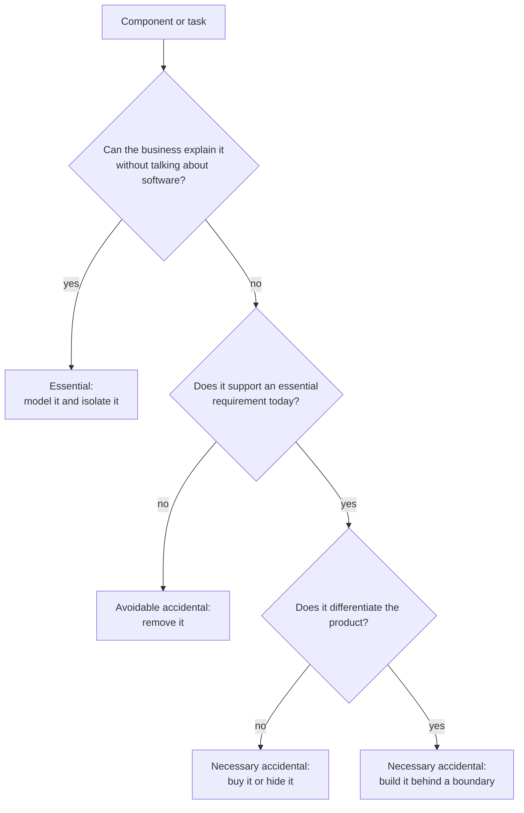
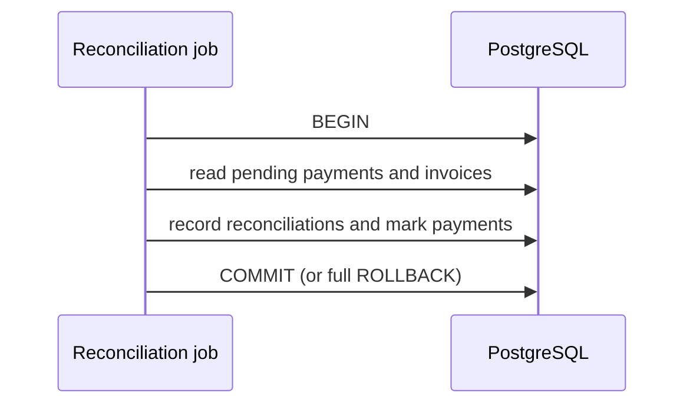

# Essential and accidental complexity

The business asks for something small: invoices should show the customer's purchase order number. The rule fits in one sentence. The change takes two weeks: a migration, the ORM mapping, three DTOs, an event schema, a cache invalidation and a coordinated deployment of two services. Nobody in planning argues about the rule; all the time goes into what surrounds it. That gap between what the problem demands and what your solution adds has had a name for four decades.

**Essential complexity belongs to the problem you are solving; accidental complexity is what your chosen solution adds: tools, infrastructure and your own decisions.**

This article covers where the distinction comes from, how to tell one from the other with concrete questions, the two symmetric traps people fall into when applying it, and the ways to reduce the accidental part. It is not a full decision framework (that lives in [trade-offs and decision-making](/docs/trade-offs-y-decisiones)); it is a lens for looking at the cost of a system before you decide.

<Callout tone="info" title="Cut-off date and sources">
  Checked in October 2026. Brooks's text was read in the 1987 IEEE Computer version reproduced by
  UCSF; Moseley and Marks's, in the original PDF. Dan Luu's essay could not be opened from this
  research session: what is said about it comes from summaries and is flagged as such.
</Callout>

## The origin: "No Silver Bullet"

Fred Brooks presented "No Silver Bullet: Essence and Accidents of Software Engineering" at the 1986 IFIP World Computer Congress (published in its proceedings, _Information Processing 1986_). IEEE Computer reprinted it in April 1987 (vol. 20, no. 4, pp. 10–19), and in 1995 it became chapter 16 of the anniversary edition of _The Mythical Man-Month_, followed by a chapter 17 in which Brooks revisits the essay in light of its critics.

Brooks borrows the terms from Aristotle. He splits the difficulties of software into **essence**, those inherent in the nature of software, and **accidents**, those that today attend its production but are not inherent. "Accident" does not mean mishap here: it means something present without being necessary.

For Brooks, the essence of a system is a construct of interlocking concepts: data sets, relationships among them, algorithms and function invocations. The hard part, he argues, is specifying, designing and testing that construct, not the labor of representing it in a language or checking that the representation is faithful.

### The four inherent properties

Brooks traces essential difficulty to four properties of software:

| Property      | What it means in the essay                                                      | How you notice it today                                       |
| ------------- | ------------------------------------------------------------------------------- | ------------------------------------------------------------- |
| Complexity    | No two parts are alike: growing means adding different elements that interact   | Each new case multiplies the combinations you have to test    |
| Conformity    | Software has to fit arbitrary human institutions and systems                    | Tax rules, other systems' formats, per-customer exceptions    |
| Changeability | It is under constant pressure to change, precisely because it is easy to change | The business asks for tweaks it would never ask of a building |
| Invisibility  | It has no natural geometric representation that shows all of it                 | No single diagram tells the whole system                      |

### The thesis and its argument

The central thesis is that no single development, in either technology or management technique, promises by itself even one order-of-magnitude improvement within a decade in productivity, reliability or simplicity.

The argument rests on the distinction. Brooks reviews earlier breakthroughs (high-level languages, time-sharing and unified programming environments) and concludes that they all attacked accidental difficulties. If, as he believes, the conceptual parts of the task already take most of the time, no improvement in how those concepts are expressed can yield large gains. That is why the last part of the essay turns to attacks on the essence: **buying instead of building**, refining requirements with rapid prototypes, growing software incrementally instead of building it in one go, and developing great designers.

## A useful restatement: the problem as users see it

In "Out of the Tar Pit" (February 6, 2006), Ben Moseley and Peter Marks adopt the distinction and tighten it. They define essential complexity as inherent in the problem **as seen by the users**, and accidental complexity as everything else: the complexity the team would not have to deal with in an ideal world, for example the complexity that comes from performance issues or from suboptimal language and infrastructure.

Their practical test is handy: if users do not even know what something is (a thread pool, a loop counter), it cannot be essential. And they part ways with Brooks on a central point: they reject the premise that most of the complexity in today's systems is essential. In their view much of it is accidental, and they examine its causes in this order: first the handling of state, which they consider the main one; then explicit control flow; and finally code volume, which they call "in many ways a secondary effect" because much code exists to manage state or specify control.

The two definitions clash less than it seems. Brooks talks about the essence of software in general; Moseley and Marks, about the essence of a specific problem. For diagnosing a system, the second one is more practical.

### Necessary is not the same as essential

There is no ideal infrastructure in the real world. If users need a search to respond in under 200 ms, that requirement is essential; the cache that makes it possible is accidental, even if it is indispensable today. The difference matters: the requirement is not negotiable, but the cache can be replaced by another solution. Quality requirements deserve the same reading; we cover them in [quality attributes](/docs/atributos-de-calidad).

## Essential versus accidental

| Dimension          | Essential complexity                                       | Accidental complexity                               |
| ------------------ | ---------------------------------------------------------- | --------------------------------------------------- |
| Origin             | The problem's rules, data and variability                  | Tools, infrastructure and team decisions            |
| Who recognizes it  | A domain expert can explain it without mentioning software | Only someone who knows the implementation           |
| Can it be removed? | Not without changing the problem or the scope              | Yes, at least in principle                          |
| How you manage it  | Model it well, isolate it, negotiate scope                 | Remove it, hide it behind a boundary, buy it solved |
| When it changes    | When the business or the regulation changes                | When the technology or the team structure changes   |
| Example            | An order is never invoiced twice; VAT depends on country   | Mapping the order between ORM, DTO and event        |

## Where accidental complexity comes from

### Tools that impose their model

An ORM that cannot represent a domain value (an amount with a currency, a date range) forces you to split it into loose columns and rebuild it by hand on every read. The code starts to revolve around what the ORM allows rather than what the business says. Each workaround is small; together they shape the system. Isolating that tool behind a port is what [hexagonal architecture](/docs/arquitectura-hexagonal) proposes.

### Infrastructure added before it was needed

The classic case: a queueing system for a process that fit in one transaction. The queue brings at-least-once delivery, idempotent consumers, orphaned messages, retries, a schema to version and one more component to watch. If the volume and the decoupling requirements did not call for it, all of that is accidental. When they do, the patterns for doing it well are in [sagas, outbox and idempotency](/docs/sagas-outbox-idempotencia).

### Decisions nobody revisits

A generic abstraction for a single case, an in-house framework, a configuration with forty options nobody touches, a service boundary drawn along the org chart instead of the domain. They were reasonable decisions at the time, and nobody evaluates them again. Premature splitting into services is the most expensive version; we discuss it in [monolith versus microservices](/docs/monolito-vs-microservicios).

### Dependencies that drag along

The more one module knows about another, the more accidental complexity spreads with every change. That is the territory of [coupling and cohesion](/docs/acoplamiento-cohesion), which also explains why a deep module (a lot of functionality behind a small interface) is one of the best defenses.

### Complexity that piles up

Accidental complexity does not show up all at once: it settles in with every shortcut. When it makes sense to take it on knowingly, and how to pay it back, is covered in [technical debt and evolution](/docs/deuda-tecnica-evolucion).

## How to tell them apart: diagnostic questions

No measurement classifies every line of code. There are questions that, asked about a component or about the work behind a change, point in one direction:

| Question                                                                | If the answer is yes, it suggests… |
| ----------------------------------------------------------------------- | ---------------------------------- |
| Would a domain expert describe it without mentioning technology?        | Essential                          |
| Would it exist if you had ideal tools and infrastructure?               | Essential                          |
| Does it change when the technology changes, not when the business does? | Accidental                         |
| Would any company in any industry solve it the same way?                | Accidental and not differentiating |
| Could you remove it without users noticing a functional difference?     | Accidental                         |
| Does nobody remember which requirement brought it in?                   | Probably accidental                |



The answers are rarely clean. A component can mix both: the tax calculation is essential, the format in which you request it from the tax provider is not. Separating the two inside the component is already progress.

## Two symmetric traps

### Mistaking accidental for essential

"That is how the business works" sometimes means "that is how the old system worked". A nightly close nobody asked for, which existed because the previous system processed in batches; a 30-character name limit inherited from a column. Over the years, tool limitations turn into rules the business repeats. Before modeling a rule, ask which user problem it solves. If the answer is a technical limitation, it is accidental even if it has been in the process manual for ten years.

### Mistaking essential for accidental

The opposite trap is more expensive. A billing module full of conditionals looks like messy code, and partly it is, but many of those conditionals encode tax regimes, partial refunds or deals with specific customers. The rewrite that promises to "clean it up" rediscovers those rules in production, one at a time. Ugly code is not always accidental complexity: sometimes it is essential complexity poorly expressed. Modeling the domain in its own language, as [Domain-Driven Design](/docs/domain-driven-design) proposes, helps here.

<Callout tone="warning" title="A distinction that gets used as a weapon">
  "That is accidental complexity" sounds like a diagnosis, but it is often an opinion about a
  technology someone dislikes. Ask for the requirement the component supports to be named, or for
  proof that it supports none, before accepting the label.
</Callout>

## How much of the cost is accidental?

There is no universal figure, and you should be wary of anyone who offers one. What exists are argued positions:

- **Brooks (1986)** believed the accidental part had already shrunk a lot and that conceptual work dominated; hence his skepticism about silver bullets.
- **Moseley and Marks (2006)** argue the opposite: that much of the complexity in large systems is accidental and that the goal of software engineering should be to remove as much of it as possible.
- **Dan Luu (2020)**, in "Against essential and accidental complexity", questions whether the essential share can be bounded in advance, because making work cheaper changes which problems people attempt. We could not open the essay; this comes from third-party summaries.

Without a general figure, there are still reasons to suspect that the accidental part tends to grow more than it seems. Each added piece interacts with the earlier ones, so their combined cost tends to grow faster than the sum of the parts. It is paid on every change, not only when it is built. And it is invisible to the business, so nobody outside the team pushes to remove it. The essential part, by contrast, is in plain sight and discussed in every planning session.

You do not need a global figure: it is enough to know which one dominates in your system. Look for these signals:

- The time a change takes is eaten by coordination (deployments, contracts between services, migrations) rather than by the rule.
- Incidents start in infrastructure and configuration, not in business rules.
- Onboarding a new person is about internal tools, not about the domain.
- Estimates blow up because of "everything around it", not because of the logic.

If you see the opposite (changes take long because the problem is hard, and the discussions are about rules), your cost is probably essential and the lever is scope and the model, not technology.

## Does the thesis still hold?

Four decades later, the thesis is still debated. There are arguments in both directions:

- **For.** Specifying what a system must do is still hard, and no tool decides for you which rules the business has or how they interact.
- **Against.** Open source, package managers and managed services mean many teams no longer build what they used to build. You can read that as confirming Brooks, who listed buying instead of building as an attack on the essence, or as evidence that the accidental margin was larger than he estimated.
- **Open.** LLM-based coding assistants mostly make expression cheaper, which Brooks considered accidental. Whether that moves the specification bottleneck closer or further away is an open question; we touch on some implications in [languages in the AI era](/docs/lenguajes-era-ia).

A cautious reading: the distinction has held up better than the prediction. Whether a tenfold gain arrived within a decade depends on how you measure it; separating the problem from its solution in order to decide where to invest is still useful.

## How to reduce accidental complexity

### Remove it

The most effective reduction is removal. A component that supports no current essential requirement gets removed, even if it was costly to build; money already spent is not an argument. The same goes for unused configuration options, abstractions with a single implementation and layers that only forward calls.

### Hide it behind a boundary

When it is necessary, let a single module pay for it. A good boundary concentrates the accidental complexity (the provider's protocol, the ORM, the retries) and lets the rest of the system speak in domain terms. It does not remove it, but it stops it from spreading with every change.

### Buy it solved

Brooks framed this as the most radical solution: not building the software at all. If the complexity does not differentiate your product (authentication, email delivery, queues, observability), buying or adopting something mature is usually cheaper than maintaining it. The same logic applies to choosing well-known technology over novelty; we develop it in [the shiny new tool](/docs/trade-offs-y-decisiones#the-shiny-new-tool).

Buying is not free: it brings integration, vendor dependency and someone else's model. That is why the bought component also goes behind a boundary.

### Defer it

Many accidental pieces get added just in case. Delaying the decision until the requirement is real avoids paying for complexity that buys nothing yet. The criteria for choosing the moment are in [trade-offs and decision-making](/docs/trade-offs-y-decisiones).

### A minimal register

One practice that helps: record each relevant accidental piece with the requirement that justifies it and the condition for retiring it. The shape can be as simple as this:

```yaml
# docs/complexity-register.yaml (illustrative shape)
- component: search-cache
  kind: accidental
  sustains: 'p99 of /search < 200 ms'
  owner: search-team
  retire_when: '…'
# …
```

An entry without `sustains` is a candidate for removal. Important decisions also go into an [ADR](/docs/adr).

## When to apply this analysis and when not to

| Situation                                                          | Worth the analysis?                                         |
| ------------------------------------------------------------------ | ----------------------------------------------------------- |
| Small changes take weeks and nobody can explain why                | Yes: start there                                            |
| You are about to add new infrastructure (queues, cache, a service) | Yes, before deciding                                        |
| You plan to rewrite a module "because it is a mess"                | Yes, so you do not throw away essential rules with the code |
| A prototype that will be thrown away in weeks                      | No: accidental complexity in a prototype costs little       |
| The problem is new and you do not understand the domain yet        | Not yet: first understand what is essential                 |

## Common mistakes

- **Confusing simple with easy.** Rich Hickey separated the two in "Simple Made Easy" (Strange Loop, 2011): easy is relative to the person (familiar, at hand); simple is a property of the thing, which does not intertwine parts. A familiar tool can add a lot of accidental complexity.
- **Measuring only your own code.** The team also pays for the complexity of infrastructure, configuration and tooling.
- **Labeling without the requirement in front of you.** Classifying without knowing what users need turns the analysis into preferences.
- **Moving complexity instead of reducing it.** Splitting a module into three services keeps the complexity and adds a network.
- **Ignoring the cost of removal.** Removing something also costs; sometimes the right move is to isolate it and leave it.
- **Believing that buying removes complexity.** It shifts it to the vendor contract and the integration.

## Worked example: payment reconciliation

**Context.** A billing team reconciles payments from a gateway against issued invoices every night. It is a few thousand payments a day, everything lives in the same PostgreSQL database, and the current process is a job that sometimes fails halfway. The team's proposal: publish each payment to a message broker, create a consumer service that reconciles, and use an outbox so no events are lost.

**Diagnosis.** The questions applied to the proposal:

| Piece                    | Does the business explain it? | Does it support a requirement today?       | Classification        |
| ------------------------ | ----------------------------- | ------------------------------------------ | --------------------- |
| Matching payment/invoice | Yes                           | Yes                                        | Essential             |
| Partial payments         | Yes                           | Yes                                        | Essential             |
| Broker and consumer      | No                            | No: the volume fits in one transaction     | Avoidable accidental  |
| Outbox                   | No                            | Only if there is a broker                  | Derived accidental    |
| Job failing halfway      | No                            | Yes: reconciliation must be all or nothing | Accidental with cause |

The real problem behind the proposal was the job failing halfway. That calls for atomicity, not messaging.



**Decision.** Reconcile the whole night in a single transaction: a few thousand rows fit easily, and if anything fails everything is rolled back and the job is rerun without leaving half-done reconciliations. The reconciliation rules (partial payments, rounding tolerances) are isolated in their own module, in their own language. Access to the gateway sits behind a boundary so it can be replaced.

**Conditions for revisiting it.** An ADR records that the decision is reconsidered if the volume no longer fits the nightly window, if another system needs to react to each payment in real time, or if reconciliation moves to a different database. If any of these happens, messaging stops being avoidable accidental complexity and starts supporting a requirement.

## Checklist

- [ ] Every relevant component has the essential requirement it supports named.
- [ ] Business rules live apart from the technology that runs them.
- [ ] Before adding infrastructure, someone answered which current requirement demands it.
- [ ] What does not differentiate the product is bought or adopted mature, behind a boundary.
- [ ] Before a rewrite, the essential rules encoded in the current code were inventoried.
- [ ] Inherited limitations the business repeats as rules were questioned with users.
- [ ] Accidental pieces have an explicit condition for retiring them.

## Sources

Checked in October 2026.

- [No Silver Bullet: Essence and Accidents of Software Engineering (Frederick P. Brooks, Jr., IEEE Computer, vol. 20, no. 4, April 1987)](https://www.cgl.ucsf.edu/Outreach/pc204/NoSilverBullet.html): IEEE Computer version; first published in _Information Processing 1986_ (IFIP)
- [No Silver Bullet on Wikipedia](https://en.wikipedia.org/wiki/No_Silver_Bullet): publication history and chapters 16 and 17 of the 1995 edition
- [Out of the Tar Pit (Ben Moseley and Peter Marks, February 6, 2006)](https://curtclifton.net/papers/MoseleyMarks06a.pdf)
- [Against essential and accidental complexity (Dan Luu)](https://danluu.com/essential-complexity/): not accessible from this research session; cited through summaries
- [Simple Made Easy (Rich Hickey, Strange Loop, September 2011)](https://www.infoq.com/presentations/Simple-Made-Easy/): video of the talk published by InfoQ
