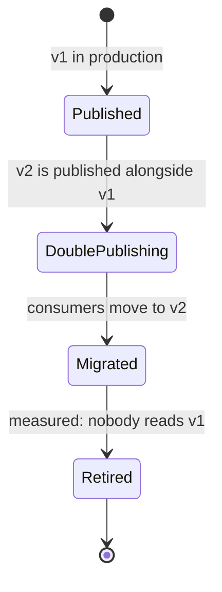

# Versioned, compatible event contracts

A published event is an API that nobody has called yet. The producer emits it and moves on; it
does not know how many consumers read it, since when, or with which version of the code. When the
producer changes the shape of the event, the failure does not show up in its pipeline. It shows up
in a consumer owned by another team, sometimes days later, sometimes as a value silently
misread with no error at all. Designing how an event evolves is therefore part of designing the
event, not a task for when the first change arrives.

This article covers that evolution: what it means to treat the schema as a contract, which changes
are safe, how to version, and how to retire an old version without switching anyone off blindly.
It builds on the event pattern in [Event-driven, CQRS and Event Sourcing](/docs/event-driven-cqrs-event-sourcing),
which already covers versioning of stored events; here the focus is on events that travel between
services.

## The event as a contract

An event has two parts that evolve at different speeds. The **envelope** carries the metadata
(identifier, origin, type, timestamp) and should have the same shape for every event in the
organization. The **body**, or payload, carries the business fact and is where almost all changes
happen. A standard envelope avoids reinventing the metadata in every topic: [CloudEvents v1.0.2](https://github.com/cloudevents/spec/blob/v1.0.2/cloudevents/spec.md)
defines as required attributes `id`, `source`, `specversion` and `type`, and as optional ones
`datacontenttype`, `dataschema`, `subject` or `time`.

The body needs a serialization format and a schema that describes it. The choice constrains which
changes are easy, so it is not a detail:

| Format      | What it offers for evolution                                                                                        | Typical pitfall                                        |
| ----------- | ------------------------------------------------------------------------------------------------------------------- | ------------------------------------------------------ |
| Avro        | Resolution between the schema that wrote the data and the one that reads it; default values and aliases in the spec | Adding a field without a default value breaks old data |
| Protobuf    | Fields identified by number; retired numbers and names are kept with `reserved`                                     | Reusing a number or changing a type corrupts old data  |
| JSON Schema | Human-readable, with no binary format; compatibility depends on which constraints the schema uses                   | It is easy to write a schema that accepts anything     |

All three can be registered in a schema registry. Confluent's registry, for example, supports the
three formats and applies compatibility rules to each new version before accepting it. Choosing a
format is also choosing how much discipline the format imposes: Avro and Protobuf push you to think
about evolution; JSON Schema leaves it to the team.

## Schema in a registry and verified in CI

A schema registry stores the versions of each _subject_ (in Confluent, usually one subject per
topic) and, for each one, a **compatibility mode**. Confluent documents seven modes: `BACKWARD`,
`BACKWARD_TRANSITIVE`, `FORWARD`, `FORWARD_TRANSITIVE`, `FULL`, `FULL_TRANSITIVE` and `NONE`. The
default is `BACKWARD`.

| Mode                 | What it guarantees                                                    | Usual deployment order        |
| -------------------- | --------------------------------------------------------------------- | ----------------------------- |
| `BACKWARD` (default) | A consumer on the new schema reads data written with the previous one | Consumers first               |
| `FORWARD`            | A consumer on the latest schema reads data written with the new one   | Producers first               |
| `FULL`               | Both directions against the latest version                            | Either order                  |
| `*_TRANSITIVE`       | The same, but against every registered version, not only the latest   | Same as its simple variant    |
| `NONE`               | No checks at all                                                      | None is safe: any change goes |

Confluent documents `BACKWARD` as the default. A practical reason, this article's judgment and not the
documentation's, is that it lets you rewind a consumer to the beginning of the topic and read months-old
data with the current schema. For Protobuf, its schema evolution guide gives `BACKWARD_TRANSITIVE` as the
best practice, since adding new message types is not forward compatible. The mode is set per subject and should be a reviewed decision,
not whatever value comes by default.

Two layers of verification complete the picture:

- **In CI**, before merging a schema change, compatibility is checked against the registry. The
  Confluent's API reference documents the call `POST /compatibility/subjects/{subject}/versions/{version}`,
  which tests a schema against a registered version of the _subject_.
- **At the broker**, Confluent's schema ID validation rejects, per topic, messages whose schema ID is
  not registered. It validates the identifier, not the message contents, and messages with a null
  value pass the check. It is a safety net: it prevents publishing data under a schema nobody
  registered, but it does not replace the compatibility check.

## Which changes are safe

The operational rule is the same as for a synchronous API: the consumer must keep working without
anyone touching its code. The table summarizes the most common changes; format details vary, so
the reason column is what to keep.

| Change                                        | Safe?                   | Reason                                                                                                       |
| --------------------------------------------- | ----------------------- | ------------------------------------------------------------------------------------------------------------ |
| Add an optional field with a default value    | Yes                     | The new consumer fills the default for old data; the old consumer ignores the field                          |
| Add a required field with no default value    | No                      | Old data does not carry it, and the new consumer cannot read it                                              |
| Remove a field someone reads                  | No                      | The consumer that uses it fails or falls back to an empty value                                              |
| Remove a field in Protobuf that nobody reads  | Yes, if reserved        | Its number and name are reserved so nobody reuses them                                                       |
| Rename a field in Avro                        | Yes, with an alias      | The alias lets the reader match the old name                                                                 |
| Rename a field in Protobuf                    | Depends on the format   | The number stays, so the binary still works; JSON that uses the name does not                                |
| Change a field's number in Protobuf           | No                      | Equivalent to deleting the field and creating a different one                                                |
| Change a field's type                         | No, almost always       | Protobuf tolerates some conversions between integer types, but its guide advises almost never changing types |
| Change the meaning without changing the shape | No                      | The schema does not detect it; only consumers notice                                                         |
| Add a value to an `enum`                      | Depends on the consumer | It breaks anyone who treats the list of values as closed                                                     |

Two writing rules help more than any check. The first: **do not reuse retired names or numbers**;
a reservation is cheap, and a misread value is not corrected later. The second: **a new field does
not change what the old ones mean**. A criterion of this article (not a rule): if a new version
cannot be derived from the previous one, it is really another event and deserves another type. That idea
helps decide between evolving an event and changing its type.

The consumer has a role too. A tolerant reader, which reads only what it needs and ignores the rest,
absorbs additive changes; a consumer that validates the whole event against a rigid copy of the
schema turns every new field into a breakage. The same applies to the
[tolerant reader in APIs](/docs/diseno-de-apis#compatibility-and-versioning).

## Versioning the event or the topic

When a change is not compatible, there are two places to put the version:

- **In the event type.** The `type` attribute or the message name carries the version, for example
  `order.created.v2`. Producers and consumers of both versions share one topic, and ordering across
  versions is preserved. This requires consumers to distinguish types and both formats to coexist
  during migration.
- **In the topic.** A new topic, for example `orders-v2`, isolates the versions. Each consumer
  subscribes to the one it understands, but ordering across both is lost and two flows must be
  maintained for the duration of the migration.

A criterion that tends to work (my own judgment, not a standard): compatible changes do not get a
new version; incompatible ones change the type when the event flow must remain a single stream, and
get a new topic when the two shapes should not share a channel. Whichever you choose, the version
must be visible in the message itself, not only in the topic name or the schema file name.

## Deprecation: double publishing and measured retirement

An old version is code, tests and dependencies on the consumers' side. Retiring it requires a
process with phases and an exit criterion that does not depend on a calendar date:



**Double publishing** is the period when the producer emits the same fact in both versions. It has
a cost (two formats, two serialization paths, more storage if the event is retained), so it should
last only as long as consumers take to migrate, no longer. It is the same idea as the expand and
contract phases of [migrating databases without downtime](/docs/migraciones-bd-sin-downtime): add the
new first, move reads, and remove the old at the end.

Retirement should depend on a measurement, not a calendar. The producer needs to know which
consumers read each version: a subscriber registry, a metric per consumer group, or a version the
consumer declares. Only when the metric shows that nobody reads v1 over an agreed period is
publication cut. For synchronous APIs, the `Deprecation` and `Sunset` headers announce that
timetable; for events there is no equivalent standard header, so the notice goes through the
organization's usual channels and, above all, through the metric.

## Ownership of the event

An event without an owner accumulates changes from everyone and has nobody answering for its
compatibility. Settle three things before the first consumer exists:

- **Who defines it.** The team that owns the business fact (the producer) defines it, not the
  consumer that needs it first. Consumers can request fields, but the owner decides the shape.
- **Who can change it.** Only the owner merges schema changes, and the merge passes the
  compatibility check. An incompatible change requires a new version and, if it affects the whole
  organization, an [ADR](/docs/adr) that justifies it.
- **Where it lives.** The schema lives in a repository or the registry, with its history, and each
  consumer declares which version it depends on. Without that declaration there is no way to measure
  deprecation.

## Contract tests between producer and consumer

Schema compatibility proves the shape, not the use. A field can remain valid and still stop meaning
what the consumer expected. Consumer-driven contract tests cover that boundary: the consumer
declares what it expects from the message and the producer verifies it. [Pact](https://docs.pact.io/getting_started/how_pact_works)
supports this model for asynchronous messages (_message pacts_): the consumer writes a test, Pact
generates the contract, and the producer verifies it against its code, with dependencies replaced.
The abstraction does not depend on the transport, so it works the same over Kafka or a queue.

[AsyncAPI](https://www.asyncapi.com/docs/reference/specification/v3.1.0) covers the documentation
side: channels, operations and messages, with schemas in JSON Schema or, for Avro and Protobuf, a
multi-format schema object that states the format. That specification works as the organization's
inventory of events. Contract tests and the broader testing strategy are covered in
[Testing strategy: pyramid and contracts](/docs/estrategia-de-pruebas-contratos).

## Worked example: an order that gains a channel

An `OrderCreated` event moves from version 1, which had a decimal `price` field, to version 2, which
replaces the amount with integer cents and adds the sales channel. The Protobuf description shows
the decisions, not the full contents:

```proto
// Shape of the message after the change; v1 fields are reserved, never reused.
message OrderCreated {
  string order_id = 1;
  string customer_id = 2;
  reserved 4;              // was: price (decimal), retired in v2
  reserved "price";        // the name too, so JSON cannot reuse it
  int64 amount_cents = 5;
  string channel = 6;      // new field: v1 consumers ignore it
}
```

What matters in this example is not the syntax but the order of the decisions. The change of amount
type is not made on the `price` field: a new field with a new number is created and the old one is
reserved. Then the producer publishes both versions during double publishing, consumers migrate one
by one and, when the metric shows nobody reads version 1, publication stops. The channel is added
without touching anyone, because it is additive.

## When it does and does not apply

Formalize the contract when the event crosses team boundaries, when it is retained for later replay,
or when languages and deployments differ among its consumers. Those are the cases where an
uncoordinated change breaks someone you cannot see.

The full process is not worth it when the event is internal to one module, with a single consumer
deployed alongside the producer and no retention. There, an integration test and a coordinated
change in the same pull request are cheaper than a registry and a deprecation calendar.

## Common mistakes

- **"We only add fields"** without reading rules. Adding a required field, or one that changes the
  meaning of another, breaks as much as removing one.
- **Reusing numbers or names** that were retired, especially in Protobuf, where the binary cannot
  tell the old field from the new one.
- **Versioning without measuring.** Publishing v2 and retiring v1 by date, without knowing who reads
  v1, is the most common way to break a forgotten consumer.
- **Validating only in the producer.** A producer with its own validation does not protect consumers
  from a change deployed in another environment; compatibility is checked in the registry and in CI.
- **`NONE` mode in production.** It disables the check that justifies using a registry.
- **A schema without an owner.** When everyone can change it, nobody answers for its compatibility.

## Checklist

- [ ] Each event has an owner, a versioned schema and a chosen serialization format.
- [ ] The registry has an explicit compatibility mode per subject; `NONE` does not appear in
      production.
- [ ] CI checks compatibility before merging a schema change.
- [ ] Retired fields are reserved (number and name in Protobuf); nothing reuses a number.
- [ ] An incompatible change creates a new version, with the type-or-topic criterion documented.
- [ ] Deprecation has phases, limited double publishing and a metric that decides retirement.
- [ ] There are contract tests between the producer and each consumer, not only schema tests.
- [ ] Consumers are tolerant readers and idempotent; see
      [Sagas, outbox and idempotency](/docs/sagas-outbox-idempotencia#inbox-deduplicating-on-the-consumer-side).

## Sources

Consulted in October 2026.

- [Schema Evolution and Compatibility for Schema Registry on Confluent Platform](https://docs.confluent.io/platform/current/schema-registry/fundamentals/schema-evolution.html) and its [Confluent Cloud version](https://docs.confluent.io/cloud/current/sr/fundamentals/schema-evolution.html)
- [Validate Broker-side Schema IDs in Confluent Platform](https://docs.confluent.io/platform/current/schema-registry/schema-validation.html)
- [Schema Registry API Reference (Confluent)](https://docs.confluent.io/platform/current/schema-registry/develop/api.md)
- [Apache Avro Specification 1.11.1](https://avro.apache.org/docs/1.11.1/specification/)
- [Language Guide (proto3), Protocol Buffers](https://protobuf.dev/programming-guides/proto3/)
- [Proto Best Practices (Protocol Buffers)](https://protobuf.dev/best-practices/dos-donts/)
- [AsyncAPI Specification 3.1.0](https://www.asyncapi.com/docs/reference/specification/v3.1.0)
- [CloudEvents v1.0.2 specification (cloudevents/spec repository)](https://github.com/cloudevents/spec/blob/v1.0.2/cloudevents/spec.md)
- [How Pact works (Pact Docs)](https://docs.pact.io/getting_started/how_pact_works) and [event-driven systems guide for JavaScript (Pact Docs)](https://docs.pact.io/implementation_guides/javascript/docs/messages)
