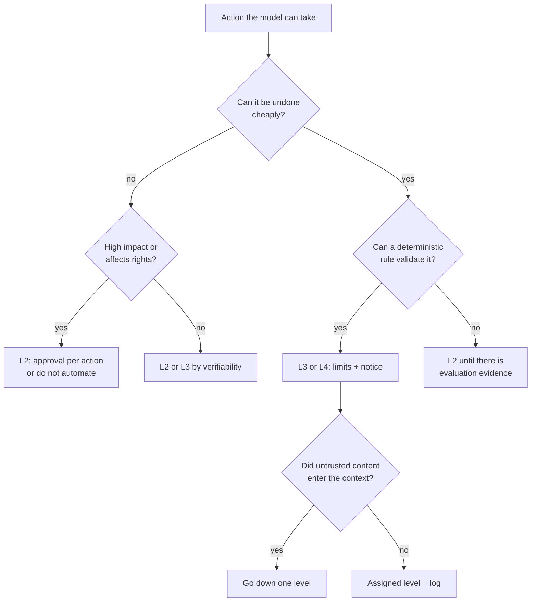
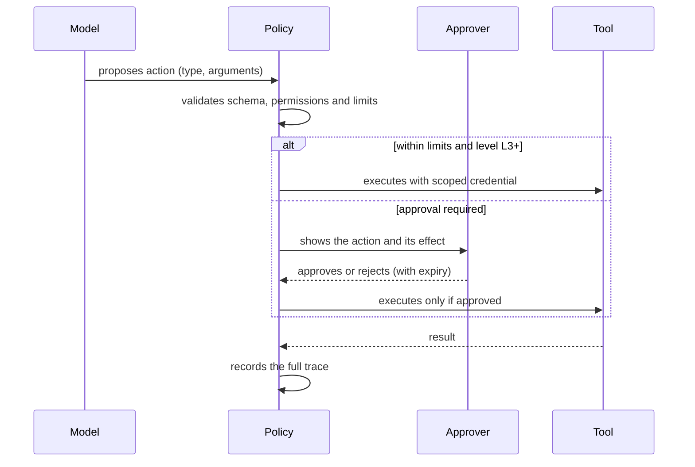

# Controlling AI: governance, autonomy and evaluation

The support assistant had been in production for three weeks and was doing well: it answered order questions and, to speed things up, someone gave it access to the refund tool "just to try it out". One Friday an email arrives with a PDF attached. Inside, in white text on a white background, a line asks the assistant to refund the whole order and close the ticket. The assistant does it. Nobody approved it, because nobody had decided that approval was needed. Nobody notices until the books are closed, because the log kept the reply to the customer but not the tool call.

No component failed in the classic sense. The model did what its context asked, the tool executed a valid command and the permission existed. What was missing was a design decision: **controlling AI means deciding, for every action a probabilistic system can take, how much autonomy it has, which control comes before or after it, how its quality is measured and who is accountable when it fails.**

This lesson is about that decision: an autonomy scale with criteria for placing each action on a level, the difference between _human-in-the-loop_ and _human-on-the-loop_, the reference frameworks worth knowing (NIST AI RMF, the EU AI Act and the OWASP Top 10 for LLM Applications), continuous evaluation, guardrails, logging and accountability. The internal architecture of an agent (loop, memory, RAG, orchestration) is covered in [architecture of LLM and agent applications](/docs/arquitectura-agentes-llm); how to chain steps and agents into a workflow, in [designing agent workflows](/docs/disenar-flujos-con-agentes); general security principles, in [security by design](/docs/seguridad-por-diseno).

<Callout tone="info" title="Cut-off date and scope">
  Sources checked in October 2026. EU AI Act dates and the regulation that amended it in 2026 come
  from the European Commission's page, the Official Journal of the EU and the regulation's official
  service desk. Human Rights Watch's definitions of _human-in-the-loop_ and _human-on-the-loop_ are
  cited through a secondary source. None of this is legal advice.
</Callout>

## The control problem: a probabilistic system that acts

While a model only suggests, its mistake costs the time it takes a person to read and discard it. Once it acts, its mistake costs whatever the effect costs: a payment, an email sent to a customer, a deleted record. Moving from suggesting to acting does not change the model; it changes the blast radius of every failure, and that is an architecture decision.

Three properties make this kind of control different from controlling a deterministic service:

| Property                              | Consequence                                                                         | Control that compensates                                                        |
| ------------------------------------- | ----------------------------------------------------------------------------------- | ------------------------------------------------------------------------------- |
| Non-deterministic output              | The same input can lead to different actions; a test that passes once proves little | Evaluation with case sets and rates, not single examples                        |
| Instructions and data share a context | A document, an email or a tool response can change what the model does              | Permissions that do not depend on the model, approval for what cannot be undone |
| Errors that look like success         | The model does not flag its own mistakes; its explanation can sound convincing      | Deterministic output validation and people who review effects, not reasoning    |

The practical conclusion is uncomfortable: you cannot guarantee the model will be right, so you design for its errors to be **detectable, bounded and reversible**. The autonomy you grant should match the cost of its worst plausible error, not how well it did in the demo.

## Levels of autonomy

Grading automation is an old idea. Thomas Sheridan and William Verplank proposed a ten-level scale in 1978, from fully manual control to full computer autonomy (later sources also reproduce a shorter version). Raja Parasuraman, Sheridan and Christopher Wickens refined it in 2000 in _IEEE Transactions on Systems, Man, and Cybernetics_: automation applies separately to four functions (acquiring information, analyzing it, deciding and acting), and one system can sit at a different level for each. For AI agents, K. J. Kevin Feng, David W. McDonald and Amy X. Zhang published a five-level proposal in June 2025, defined by the user's role (operator, collaborator, consultant, approver and observer), with a thesis architects can use: autonomy is a design decision, separate from the model's capability.

The scale below is operational and does not reproduce any of the above. It is meant for placing **actions**, not systems: the same agent has actions at different levels.

| Level | Name                         | What the model does                                       | What the person does                              |
| ----- | ---------------------------- | --------------------------------------------------------- | ------------------------------------------------- |
| L1    | Suggest                      | Proposes text or an option                                | Decides and acts on their own                     |
| L2    | Prepare and ask for approval | Prepares the full action and leaves it pending            | Approves or rejects each action before the effect |
| L3    | Act within limits            | Acts if the action meets fixed rules; otherwise escalates | Reviews only exceptions and a sample              |
| L4    | Act and notify               | Acts and notifies                                         | Supervises, can stop and roll back                |
| L5    | Act without direct oversight | Acts; a record is kept for audit                          | Reviews metrics and incidents after the fact      |

Notice that between L2 and L3 the decision-maker for the normal case changes: at L2 a person approves every action; at L3 deterministic rules written in advance decide, and the person only sees what the rules do not cover. That is the most delicate step on the scale.

### Which decision fits each level

Three criteria cover most cases:

- **Reversibility.** Can the effect be undone, at what cost and how quickly? A draft is discarded; a sent email is gone; a refund can be clawed back, with friction. The general reasoning about reversible and irreversible decisions is in [trade-offs and decisions](/docs/trade-offs-y-decisiones); here it is applied to each action of the model.
- **Impact.** How much money, how many people or which rights an error affects, and how many times it can repeat before anyone notices. A small error that runs a thousand times an hour is a large error.
- **Verifiability.** Can a deterministic rule check that the action is correct? An amount against the original order can be checked; the tone of a reply to an angry customer, not entirely.

| Reversibility        | Low impact | Medium impact | High impact            |
| -------------------- | ---------- | ------------- | ---------------------- |
| Reversible and cheap | L4 or L5   | L4            | L3                     |
| Reversible at a cost | L4         | L3            | L2                     |
| Irreversible         | L3         | L2            | L2, or do not automate |

The table is a starting point, not a normative threshold. Verifiability moves the cell: if a rule can check the action, you can go up one level; if it cannot, go down one.



## Human-in-the-loop and human-on-the-loop

The terms come from control engineering and became widely used in the debate on autonomous weapons. Human Rights Watch's report _Losing Humanity_ (November 2012) distinguished, according to the sources that cite it, three situations: the system acts only on a person's command (_in the loop_), it acts under the oversight of a person who can override it (_on the loop_), or it acts with no human input (_out of the loop_). The same report warned that oversight that is too limited effectively turns the second case into the third, and that warning is the part most useful for software.

| —                        | Human-in-the-loop (L2)                            | Human-on-the-loop (L4)                             |
| ------------------------ | ------------------------------------------------- | -------------------------------------------------- |
| When control happens     | Before the effect                                 | During or after the effect                         |
| What it protects         | A bad action does not happen                      | A bad action does not repeat or spread             |
| Main cost                | Latency and review hours                          | Exposure to harm until someone steps in            |
| Typical failure mode     | Approving without looking, from volume or fatigue | Nobody watches the dashboard; oversight is nominal |
| Architecture requirement | Pending action state, with expiry                 | Stop button, rollback and useful alerts            |

The EU AI Act addresses both risks for high-risk systems. Its Article 14 requires that the people overseeing a system can understand its capabilities and limitations, stay aware of the tendency to over-rely on its output (automation bias), decide not to use it or override its output, and interrupt it with a stop button or similar procedure that brings it to a safe state. Even if your system is not in that category, the list is a good specification of what real oversight needs.

### Mandatory approval points

Some actions should never drop below L2, however much evaluation evidence accumulates:

- Irreversible effects with meaningful impact: payments and transfers, permanent deletions, messages to third parties on behalf of the company.
- Changes to permissions, credentials or security settings, including the agent's own permissions.
- Decisions that affect a person's rights or situation: employment, credit, access to services.
- Actions above a spending or volume threshold set by the business.
- The first run of a new type of action, until there is an evaluation baseline.

An approval point only protects if it is well designed. The person approves **the concrete action** (recipient, amount, affected record), not the model's intent or its explanation; the pending action expires if nobody approves it; and the approver has the competence and the authority to say no. Article 26 of the EU AI Act asks exactly that of whoever deploys a high-risk system: assign oversight to people with the necessary competence, training and authority.



The policy lives outside the model: the model proposes, the code decides whether the proposal runs, escalates or is rejected.

## Reference frameworks

### NIST AI Risk Management Framework

NIST released AI RMF 1.0 on January 26, 2023 as guidance **intended for voluntary use**. It organizes risk management into four functions: **GOVERN** (culture, policies, processes and accountability; it cuts across the other three), **MAP** (establishing the system's context to identify its risks), **MEASURE** (analyzing, assessing and monitoring risks, including test, evaluation, verification and validation, which the framework abbreviates as TEVV) and **MANAGE** (allocating resources to risks and planning incident response). On July 26, 2024 it published the generative AI profile, NIST AI 600-1. As of this writing, NIST's page states that AI RMF 1.0 is being revised.

Its practical value is vocabulary and coverage: the autonomy scale in this lesson is a MAP and MANAGE decision, continuous evaluation is MEASURE, and logging and assigning owners are GOVERN.

### EU AI Act

Regulation (EU) 2024/1689 entered into force on August 1, 2024 and sorts systems into four risk levels: unacceptable (prohibited practices), high (allowed with obligations such as risk management, logging, documentation and human oversight), transparency risk (for example, telling people they are talking to a chatbot) and minimal (no specific rules). According to the European Commission's page, it applies in stages:

| Date             | What starts to apply                                                                      |
| ---------------- | ----------------------------------------------------------------------------------------- |
| February 2, 2025 | Prohibited practices and AI literacy obligations                                          |
| August 2, 2025   | Governance rules and obligations for general-purpose AI models                            |
| August 2, 2026   | General application, transparency rules and the start of enforcement                      |
| December 2, 2027 | High-risk rules for Annex III use cases (employment, education, critical infrastructure…) |
| August 2, 2028   | High-risk rules for systems embedded in regulated products (Annex I)                      |

The last two dates are later than in the 2024 text: they were postponed by the so-called Digital Omnibus on AI, published in the Official Journal as Regulation (EU) 2026/1744 and in force since July 27, 2026, according to the Commission. For an architect, three articles shape the design of a high-risk system the most: Article 12 (the system must allow automatic recording of events over its lifetime), Article 14 (human oversight, covered above) and Article 26 (the deployer keeps those logs for at least six months, unless other law requires a different period).

<Callout tone="warning" title="Classification is not a technical decision">
  Whether a system falls under Annex III depends on its purpose and context of use, not on the
  technology. That classification belongs to the legal team, working from the consolidated text of
  the regulation; the architecture should be ready for either answer (logging, oversight and
  documentation built in from the start).
</Callout>

### OWASP Top 10 for LLM Applications

The current edition is 2026, published on August 4, 2026; it supersedes the 2025 edition. Its first risk, **LLM01:2026 Prompt Injection**, is defined as the vulnerability that occurs when an input (from the user, retrieved content, tool output or persistent memory) alters the model's behavior in ways the developer did not intend; it separates **direct** injection (the user's own input) from **indirect** injection (instructions embedded in external content the model processes, such as web pages, documents or emails), and notes that injected text does not need to be visible to a human. Two other risks are pure governance: **LLM03:2026 Excessive Agency** (harmful actions caused by excessive functionality, permissions or autonomy) and **LLM06:2026 Unbounded Consumption**, which includes _denial of wallet_: draining the budget of a pay-per-use service. On December 9, 2025 the project also published a separate list for agentic applications.

| Framework                    | Nature                             | What it is for here                                       |
| ---------------------------- | ---------------------------------- | --------------------------------------------------------- |
| NIST AI RMF 1.0 and AI 600-1 | Voluntary guidance                 | Splitting accountability and covering the whole lifecycle |
| EU AI Act                    | EU regulation                      | Knowing which legal obligations apply and from when       |
| OWASP Top 10 for LLM 2026    | Security risk list                 | Reviewing concrete threats and their mitigations          |
| ISO/IEC 42001:2023           | Certifiable AI management standard | Fitting AI governance into an existing management system  |

## Prompt injection: the risk that changes once you add tools

Without tools, an injection produces wrong text. With tools, it produces an action. That is why injection is the risk that most constrains the level of autonomy: the attack in the opening email did not need to break anything, only to write somewhere the model would read. OWASP's mitigations for LLM01 include constraining model behavior, validating output formats, enforcing least privilege, **requiring human approval for high-risk actions**, segregating and identifying external content, and adversarial testing. None is enough on its own; the detailed technical mitigations are in [architecture of LLM and agent applications](/docs/arquitectura-agentes-llm).

The governance consequence is a simple rule: **the level of autonomy also depends on what entered the context**. If the model read untrusted content (an attachment, a web page, a third party's response), the write actions in that run drop one level. That is the last diamond in the decision diagram.

## Continuous evaluation

[Evals](/docs/arquitectura-agentes-llm) are the tests of an AI system; here they matter as a governance mechanism: **the evidence that lets an action move up or down a level**. Without measurement, autonomy is set by intuition and kept by inertia.

| Case set          | What it catches                                                 | When it runs                          |
| ----------------- | --------------------------------------------------------------- | ------------------------------------- |
| Common cases      | Whether the normal task is done well                            | On every prompt, model or tool change |
| Edge cases        | Missing data, ambiguity, amounts at the edge of a rule          | On every change                       |
| Adversarial       | Direct and indirect injection, attempts to escalate permissions | On every change and periodically      |
| Regressions       | Every real incident turned into a fixed case                    | Always; never deleted                 |
| Production sample | Drift: real traffic changes or the provider changes the model   | Weekly or monthly, with human review  |

Beyond accuracy, the metrics that govern are the **escalation rate** (how many actions L3 sends to a person), the **approver rejection rate** (if they never reject anything, either the action can move up a level or they are approving without looking) and the **cost per task**. Treat the model, its version and the prompt as versioned artifacts: a change to any of them is a deployment and goes through the same gate, just as a [fitness function](/docs/fitness-functions) protects an architectural property.

```yaml
# shape of a per-action evaluation gate (illustrative)
action: refund.create
level: L3
eval_suite: refunds-v4 # common, edge, adversarial, regressions
gate:
  decision_accuracy: '>= 0.98'
  injection_success: '== 0'
  escalation_rate: '<= 0.15'
on_fail: downgrade_to_L2
# …
```

The cost of not measuring is not just the regression nobody sees. It is that you cannot defend any autonomy decision: neither raise a level when the system has earned it nor explain why it sat at its level when something went wrong.

## Guardrails

A guardrail is a deterministic control around the model that does not rely on the model cooperating. In this lesson's figure they are the barrier every action passes through, whatever its level.

| Guardrail                  | What it prevents                              | Where it lives                          | OWASP risk (2026)                           |
| -------------------------- | --------------------------------------------- | --------------------------------------- | ------------------------------------------- |
| Output validation          | Malformed or out-of-range actions             | Between the model and the tool          | LLM10:2026 Improper Output Handling         |
| Least privilege per tool   | An injection reaching what it should not      | In the tool's credential                | LLM03:2026 Excessive Agency                 |
| Spending and volume limits | Repeated errors at scale and denial of wallet | In the policy, with counters per period | LLM06:2026 Unbounded Consumption            |
| Logging and traceability   | Invisible failures and blurred accountability | In the orchestration layer              | Cross-cutting                               |
| Data isolation             | Leaks between customers or into the context   | In the query and in context assembly    | LLM02:2026 Sensitive Information Disclosure |

The rule that ties them together: the credential belongs to the tool, not to the model, and its scope is that of the concrete action. A refund tool that can only refund orders of the ticket's customer, up to an amount, is a stronger guardrail than any instruction in the prompt.

```yaml
# shape of a per-tool policy (illustrative)
tool: refund.create
scope: order.customer_id == ticket.customer_id
max_amount_eur: 50
budget: { per_day_eur: 1500, per_customer_per_month: 1 }
tainted_context: escalate # untrusted content in the context
log: [inputs_provenance, args, decision, approver, result, cost]
```

## What to log and who is accountable

For every run that produces an effect, the log should let you rebuild what happened without asking anyone:

- Run identifier, timestamp and the requested action.
- Model, version, and the version of the prompt and of the policy applied.
- Provenance of what entered the context (user, internal system, external content).
- Every tool call with its arguments and its result.
- Autonomy level applied and, if there was an approval, who approved, when and what they were shown.
- Cost of the run.

Also decide how long logs are kept and which personal data goes into traces: the EU AI Act's minimum retention for high-risk systems sits alongside data protection law, and both call for explicit decisions.

Accountability never belongs to the model. A split that works:

| Role               | Accountable for                                                         |
| ------------------ | ----------------------------------------------------------------------- |
| System owner       | The level assigned to each action and the decision to raise or lower it |
| Owner of each tool | The credential's scope and the spending limits                          |
| Approver           | The concrete action they approved, given what they were shown           |
| Evaluation team    | That case sets cover the real risk and stay current                     |

Assigning levels and justifying them is an architecture decision: record it in an [ADR](/docs/adr), with the evaluation evidence behind it and the condition that would force a review.

## When to use it and when not

Granting autonomy (L3 to L5) makes sense when:

- Volume makes reviewing every action impractical and errors are cheap to reverse.
- A deterministic rule can validate the action before it runs.
- You have an evaluation set that includes adversarial cases and you run it on every change.

Stay at L1 or L2, or do not automate, when:

- The action is irreversible and high impact, or affects a person's rights.
- You cannot measure the quality of the action against a verifiable criterion.
- The model's context routinely includes third-party content you do not control.
- Nobody can take accountability for the outcome by name.

## Common mistakes

- **Broad permissions "just to try it out".** The trial stays in production and so does the permission. Define a tool's scope before connecting it, and test with the final scope.
- **Evaluating only the happy path.** A set that measures the normal task says nothing about injection or edge cases, which are what decide whether an action can move up a level.
- **Trusting the model to correct itself.** Asking the model to review its own action helps quality, but it is not a control: the same context that fooled it can fool the review. Control is deterministic or human.
- **Assigning the level to the system instead of the action.** "The assistant is L4" lumps checking an order together with refunding it.
- **Rubber-stamp approvals.** A hundred approvals a day with a rejection rate near zero usually means the action belongs at L3 with good rules, or that nobody is looking.
- **Logging the reply but not the action.** Without the tool call and its arguments, the incident cannot be reconstructed.
- **Changing the model without rerunning the evaluation.** A new version can improve the average and get worse on exactly the adversarial cases.

## Worked example: three levels for a support agent

Assumptions: an online shop receives 2,000 tickets a month. 70% (1,400) are order-status questions; 25% (500) are refunds of up to 50 EUR, averaging 30 EUR; 5% (100) are refunds above 50 EUR or account cancellations. Today a person handles all of them.

| Action                        | Monthly volume | Reversibility and impact            | Level | Control                                          |
| ----------------------------- | -------------- | ----------------------------------- | ----- | ------------------------------------------------ |
| Answer order status           | 1,400          | Message sent; low impact            | L4    | Read-only tool, output validation, 2% review     |
| Refund up to 50 EUR           | 500            | Reversible at a cost; medium impact | L3    | Amount and customer rules, daily cap, 10% review |
| Larger refund or cancellation | 100            | Hard to reverse; high impact        | L2    | Approval per action with a 24-hour expiry        |

The daily cap comes from the data: 500 refunds a month is about 16.7 a day; at 30 EUR on average, about 500 EUR a day. A cap of 1,500 EUR a day (three times the average) absorbs normal peaks and limits the damage of a systematic failure to one day of bounded exposure. If the cap is reached, further actions drop to L2 until someone reviews.

The human workload goes from 2,000 tickets to 178 reviews a month: 100 L2 approvals, 50 reviews for the 10% of automatic refunds and 28 for the 2% of replies. Refunds that L3 escalates because they break the rules add to that figure and are the first metric to watch.

Two rules close the design. If the ticket includes attachments or external links, that run's refund drops to L2: it is the direct defense against the opening email. And refunds up to 50 EUR only moved to L3 after passing a set of 300 cases (40 of them adversarial) with 98% correct decisions and no successful injection; if a new model or prompt version misses that threshold, the action goes back to L2, no debate.

## Checklist

- [ ] Every action with an effect has an assigned level, justified by reversibility, impact and verifiability.
- [ ] Irreversible high-impact actions and permission changes go through human approval.
- [ ] Approvers see the concrete action, have the authority to reject it, and approvals expire.
- [ ] Each tool has its own credential with minimal scope plus spending and volume limits.
- [ ] Untrusted content in the context lowers the level of write actions.
- [ ] The evaluation set includes edge, adversarial and regression cases, and runs on every model or prompt change.
- [ ] The log lets you rebuild every run: provenance, tools, level, approval and cost.
- [ ] Levels and thresholds are recorded in an ADR with named owners.

## Sources

Checked in October 2026.

- [AI Risk Management Framework (NIST)](https://www.nist.gov/itl/ai-risk-management-framework): release date, voluntary use, the AI 600-1 profile and the ongoing revision
- [AI RMF Core (NIST AI Resource Center)](https://airc.nist.gov/airmf-resources/airmf/5-sec-core/): the GOVERN, MAP, MEASURE and MANAGE functions
- [AI Act: regulatory framework (European Commission)](https://digital-strategy.ec.europa.eu/en/policies/regulatory-framework-ai): risk levels, timeline and Digital Omnibus changes (in force on July 27, 2026; postponements to December 2, 2027 and August 2, 2028)
- [Regulation (EU) 2026/1744 in the Official Journal of the EU (OJ L_202601744)](https://eur-lex.europa.eu/legal-content/EN/TXT/?uri=OJ:L_202601744): text of the Digital Omnibus on AI
- [AI Act Service Desk: Article 12](https://ai-act-service-desk.ec.europa.eu/en/ai-act/article-12), [Article 14](https://ai-act-service-desk.ec.europa.eu/en/ai-act/article-14) and [Article 26](https://ai-act-service-desk.ec.europa.eu/en/ai-act/article-26)
- [OWASP GenAI LLM Top 10 2026](https://genai.owasp.org/resource/owasp-genai-llm-top-10-2026/) and [final files of the 2026 edition (GitHub)](https://github.com/GenAI-Security-Project/GenAI-LLM-Top10/tree/main/2026/final): identifiers and definitions of LLM01, LLM02, LLM03, LLM06 and LLM10
- [OWASP Top 10 for LLM Applications (project repository)](https://github.com/OWASP/www-project-top-10-for-large-language-model-applications): current edition and release date (August 4, 2026)
- [OWASP Top 10 for Agentic Applications for 2026](https://genai.owasp.org/resource/owasp-top-10-for-agentic-applications-for-2026/)
- [Levels of Autonomy for AI Agents (Feng, McDonald and Zhang, arXiv 2506.12469)](https://arxiv.org/abs/2506.12469)
- [A model for types and levels of human interaction with automation (Parasuraman, Sheridan and Wickens, 2000)](https://doi.org/10.1109/3468.844354)
- [Human-in-the-loop on Wikipedia](https://en.wikipedia.org/wiki/Human-in-the-loop): secondary source for the definitions in the 2012 Human Rights Watch report
- [ISO/IEC 42001:2023 (IEC Webstore)](https://webstore.iec.ch/publication/90574)
