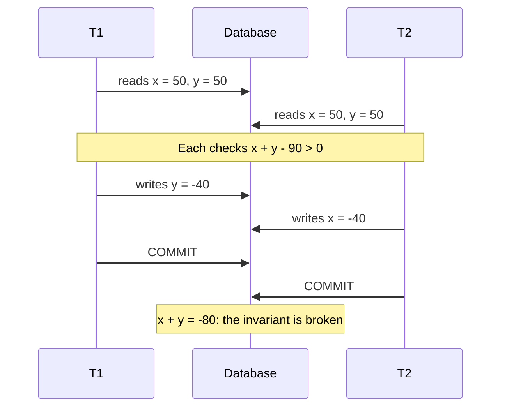
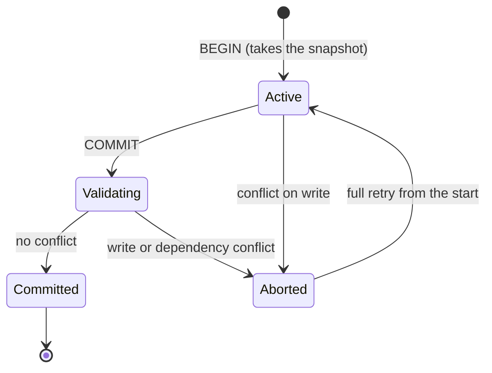
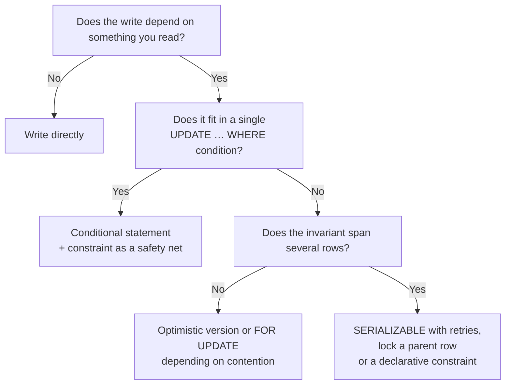

# Data, ACID and isolation levels

An account holds a balance of 100. Two requests arrive almost at once: one withdraws 10, the other 20. Each reads the balance, subtracts in memory and saves the result. Both read 100, so one writes 80 and the other 90. The final balance is 90 when it should be 70. No exception, no error log line, both transactions ran `COMMIT` and the unit tests pass. The system simply lost a write.

This article is about why that happens and how to decide what protection you need. The core idea fits in one sentence: **a transaction is a unit of work the database runs as indivisible, and the isolation level decides how much it is shielded from the other transactions running at the same time**. By default, that "how much" is almost never "completely", and knowing so is part of designing the system.

It starts before tables, with the data model, because that is where the rules a transaction must preserve come from. Then come ACID, concurrency anomalies, the standard isolation levels and their critique, MVCC, locking and indexes. What is left out has its own article: consistency across replicas in [CAP theorem, PACELC and consistency](/docs/cap-pacelc), operations spanning several services in [sagas, outbox and idempotency](/docs/sagas-outbox-idempotencia), and caches in [caching, queues and streaming](/docs/caching-colas-streaming).

<Callout tone="info" title="Cut-off date and scope">
  Sources checked in October 2026. PostgreSQL behavior comes from its version 18 documentation;
  MySQL from the InnoDB chapter of the 8.4 manual; SQL Server from Microsoft Learn. I make no claims
  about other engines: check their documentation before assuming they behave the same way.
</Callout>

## Model the data before the tables

A schema is the last modeling decision, not the first. Before writing `CREATE TABLE`, get clear on what exists in the domain, how each thing is identified, how things relate and which rules must hold at all times. Those rules, the **invariants**, are what will later decide where a transaction begins and ends and which isolation level you need.

Two papers founded this vocabulary. Edgar F. Codd published "A Relational Model of Data for Large Shared Data Banks" in 1970, proposing the relational model and introducing a normal form for relations. Peter Chen presented the entity-relationship model and its diagramming technique for database design in _ACM Transactions on Database Systems_ in 1976.

### Entities, keys and cardinality

- **Entity.** Something with its own identity that the business needs to remember: a customer, an order, an account. If two records with identical attributes must still be told apart, you have an entity.
- **Key.** What identifies an entity unambiguously. A natural key comes from the domain (a national ID number); a surrogate key is generated by the system. The natural one encodes a business rule but changes when the business changes; the surrogate one is stable but does not prevent duplicates on its own. The usual answer is a surrogate identifier plus a `UNIQUE` declaration on the natural key.
- **Cardinality.** How many instances on one side relate to how many on the other: one-to-one, one-to-many, many-to-many. A many-to-many relationship almost always hides an entity of its own (an enrollment, an order line) with attributes nobody had named yet.

The step most often skipped is writing the invariants in business language: "the balance can never be negative", "an email belongs to a single user", "an order has at least one line". For each, ask whether the database can enforce it with a declarative constraint or whether it depends on logic across several rows. The answer shapes everything that follows.

### Normalize or denormalize

Normalizing means storing each fact in one place. Denormalizing means copying a fact into several places so that a particular read does not have to assemble it. It is not a question of purity but of **where you want to pay**: on write or on read.

| Criterion               | Normalized model              | Denormalized model                          |
| ----------------------- | ----------------------------- | ------------------------------------------- |
| Cost of a write         | One row per fact              | Several copies to update                    |
| Cost of a read          | Assembles data with `JOIN`    | Reads one row or one document               |
| Risk of inconsistency   | Low: the fact exists once     | High if the copies are not updated together |
| Who protects invariants | Database constraints          | The application or a sync process           |
| Fits when               | Writes and integrity dominate | A measured read is critical and stable      |

Denormalize starting from a specific query you measured, not in anticipation. And decide at the same moment how the copy will be maintained: in the same transaction, with an asynchronous process or with a materialized view. If the copy lives outside the database, the problem becomes one of caching or events, covered in [caching, queues and streaming](/docs/caching-colas-streaming) and [event-driven, CQRS and event sourcing](/docs/event-driven-cqrs-event-sourcing).

## Transactions and ACID

The ACID acronym appears in "Principles of Transaction-Oriented Database Recovery" by Theo Haerder and Andreas Reuter, published in _ACM Computing Surveys_ in December 1983. The paper lists four properties a transaction needs in order to behave as an indivisible unit (atomicity, consistency, isolation and durability), groups them under the acronym, and proposes treating transaction support as the "ACID test" of a system's quality. The transaction concept is older; what the paper settles is the name.

| Property    | What it promises                                                       | What it does not promise                                                          |
| ----------- | ---------------------------------------------------------------------- | --------------------------------------------------------------------------------- |
| Atomicity   | All or nothing: if the transaction aborts, its effects are undone      | That the transaction's logic is correct                                           |
| Consistency | A transaction that ends normally leaves the database obeying its rules | That the database knows your rules: it only enforces the ones you declared        |
| Isolation   | What a transaction does is hidden from concurrent ones                 | Full isolation: it depends on the configured level, and the usual one is not full |
| Durability  | What was committed survives later failures                             | That an asynchronous replica already has it                                       |

Two nuances worth internalizing:

- **The C belongs to the application.** Haerder and Reuter define it this way: a transaction that reaches its normal end commits only legal results. The database helps with constraints (`NOT NULL`, `UNIQUE`, `CHECK`, foreign keys), but an invariant you never declared holds only if every transaction respects it.
- **The I is the one most often traded off.** The other three are usually treated as fixed guarantees, although durability is tunable too: in PostgreSQL, `synchronous_commit = off` reports success before the log reaches disk, and a crash can lose the most recent committed transactions without leaving the database inconsistent. Isolation, by contrast, comes in explicit degrees, and most engines' default degree allows anomalies. It is not the C of CAP either: [CAP theorem, PACELC and consistency](/docs/cap-pacelc) explains that difference.

## Concurrency anomalies

An anomaly is an outcome that could not happen if the transactions had run one after the other. The notation from Berenson and his coauthors (1995) describes them as histories: `r1[x]` means "transaction 1 reads x", `w2[x]` means "transaction 2 writes x", and `c1` and `a1` are its commit and abort.

| Anomaly                  | Typical history                         | What you see                                                  |
| ------------------------ | --------------------------------------- | ------------------------------------------------------------- |
| Dirty read (P1)          | `w1[x] … r2[x] … (a1 or c1)`            | You read a value that may never be committed                  |
| Non-repeatable read (A2) | `r1[x] … w2[x] … c2 … r1[x] … c1`       | The same row changes between two reads                        |
| Phantom (A3)             | `r1[P] … w2[y in P] … c2 … r1[P] … c1`  | The same query returns a different set of rows                |
| Lost update (P4)         | `r1[x] … w2[x] … w1[x] … c1`            | One write overwrites another, based on a stale read           |
| Write skew (A5B)         | `r1[x] … r2[y] … w1[y] … w2[x] … c1 c2` | Each transaction is correct; together they break an invariant |

A2 and A3 are the paper's strict interpretations: they describe the anomaly once it has happened, with the second read. Their broad forms, P2 and P3, end in `((c1 or a1) and (c2 or a2) in any order)`: it is enough for another transaction to write what T1 read before T1 finishes.

### Dirty read

A transaction reads what another wrote and has not yet committed. If the writer aborts, the reader made a decision based on data that never existed. It is the most obvious anomaly and the one almost no engine allows at its default level.

### Non-repeatable read and phantom

In a non-repeatable read, a row you already read changes because another transaction modified it and committed. In a phantom, no particular row changes; the **set** matching a condition does: another transaction inserts or deletes rows and your `SELECT … WHERE` returns something different the second time. The distinction matters because locking the rows you read does not stop new rows from appearing.

### Lost update

This is the balance from the introduction and the figure at the top of this article: two transactions read the same value, compute in memory and write; the later write erases the other. The pattern behind it is common enough to have a name of its own: **read-modify-write** without the database knowing that the write depends on the read.

### Write skew

This is the subtlest anomaly because neither transaction overwrites the other: they write different rows. Berenson and his coauthors illustrate it with two items, x and y, under the constraint that x + y should stay positive, like two accounts whose sum must not drop below zero:



No individual check failed. The invariant spans several rows, and each transaction validated it against a snapshot the other one was about to invalidate.

## Isolation levels: the standard and its critique

The 1992 SQL standard defines four levels (`READ UNCOMMITTED`, `READ COMMITTED`, `REPEATABLE READ` and `SERIALIZABLE`) by which of its three named phenomena they prevent: dirty read, non-repeatable read and phantom. In the July 1992 draft text the default level is `SERIALIZABLE`, and a serializable execution is defined as one that produces the same effect as some serial execution of those transactions.

| Level (SQL-92)     | Dirty read   | Non-repeatable | Phantom      |
| ------------------ | ------------ | -------------- | ------------ |
| `READ UNCOMMITTED` | Possible     | Possible       | Possible     |
| `READ COMMITTED`   | Not possible | Possible       | Possible     |
| `REPEATABLE READ`  | Not possible | Not possible   | Possible     |
| `SERIALIZABLE`     | Not possible | Not possible   | Not possible |

In 1995, Hal Berenson, Phil Bernstein, Jim Gray, Jim Melton, Elizabeth O'Neil and Patrick O'Neil published "A Critique of ANSI SQL Isolation Levels" at SIGMOD. Their argument: the three phenomena are ambiguous and, even under their broadest reading, do not rule out anomalous behavior; nor do they properly describe the lock-based levels that commercial engines implement. The paper proposes stricter definitions, adds new phenomena (dirty write, lost update, read skew, write skew) and formally defines **snapshot isolation**. One telling detail: the 1992 text states that no level loses updates but never defines that anomaly; the paper formalizes it as P4 and shows that lock-based `READ COMMITTED` allows it.

Their summary table, trimmed to the columns that matter most in design:

| Level (Berenson et al.) | Dirty read | Lost update | Non-repeatable | Phantom   | Write skew |
| ----------------------- | ---------- | ----------- | -------------- | --------- | ---------- |
| `READ UNCOMMITTED`      | Possible   | Possible    | Possible       | Possible  | Possible   |
| `READ COMMITTED`        | No         | Possible    | Possible       | Possible  | Possible   |
| `REPEATABLE READ`       | No         | No          | No             | Possible  | No         |
| Snapshot isolation      | No         | No          | No             | Sometimes | Possible   |
| `SERIALIZABLE`          | No         | No          | No             | No        | No         |

Look at the two middle rows: lock-based `REPEATABLE READ` and snapshot isolation cannot be ranked. Each prevents something the other allows. That is why "which level is stronger?" is not enough; ask **which anomaly breaks your invariant** and which concrete level, in your engine, prevents it.

## Snapshot isolation and MVCC

Engines with **MVCC** (multiversion concurrency control) keep several versions of each row. Each statement or transaction reads a consistent snapshot of the data even while others are writing. The PostgreSQL documentation sums up the advantage: reading never blocks writing and writing never blocks reading.

Snapshot isolation is what you get when the snapshot is taken at the start of the transaction and a rule is added for writes: if two concurrent transactions modify the same item, only the first to commit may succeed (Berenson et al. call this _first-committer-wins_). That rule prevents lost updates. What it does not prevent is write skew, because the two transactions in the previous example write different rows and no write rule sees them as conflicting.

To close that gap there is **serializable snapshot isolation** (SSI), described by Michael Cahill, Uwe Röhm and Alan Fekete at SIGMOD 2008: the engine still reads snapshots, but it tracks read-write dependencies between concurrent transactions and aborts one when it detects a pattern that could produce an anomaly. PostgreSQL has used it for `SERIALIZABLE` since version 9.1, whose release notes announce a "true" serializable level and keep the previous single-snapshot behavior under `REPEATABLE READ`. It only protects transactions running at `SERIALIZABLE`. The price is that **some transactions fail and must be retried from scratch**.



## What your engine does by default

The standard says `SERIALIZABLE` by default; the most widely used engines do not. And the same level name does not guarantee the same thing across them.

| Engine             | Default level                                      | Worth knowing                                                                                                                              |
| ------------------ | -------------------------------------------------- | ------------------------------------------------------------------------------------------------------------------------------------------ |
| PostgreSQL 18      | `READ COMMITTED`                                   | `READ UNCOMMITTED` behaves as `READ COMMITTED`; `REPEATABLE READ` is snapshot isolation and does not allow phantoms; `SERIALIZABLE` is SSI |
| MySQL 8.4 (InnoDB) | `REPEATABLE READ`                                  | Non-locking reads use the snapshot from the first read; locking reads see a different state                                                |
| SQL Server         | `READ COMMITTED` with shared locks                 | With `READ_COMMITTED_SNAPSHOT` on it uses row versions; `SNAPSHOT` requires `ALLOW_SNAPSHOT_ISOLATION`                                     |
| Azure SQL Database | `READ COMMITTED` with `READ_COMMITTED_SNAPSHOT` on | Same name as in SQL Server, different read behavior                                                                                        |

Two PostgreSQL behaviors under `READ COMMITTED` explain many incidents. First, an `UPDATE` that finds its row modified by another in-progress transaction waits for it to finish and then re-evaluates its `WHERE` against the new version; that is why `UPDATE account SET balance = balance - 10` as a single statement does not lose updates, while reading the balance into the application and writing it later does. Second, under `REPEATABLE READ` and `SERIALIZABLE`, transactions can fail with a serialization error (SQLSTATE `40001`), and the documentation asks applications to retry them from the beginning.

<Callout tone="warning" title="The level's name is not the contract">
  `REPEATABLE READ` is snapshot isolation in PostgreSQL and something else in InnoDB; `READ
  COMMITTED` takes read locks in SQL Server and not in Azure SQL Database. If you switch engines or
  services, check again which anomalies your level allows.
</Callout>

## Pessimistic versus optimistic locking

When an operation reads and then writes based on what it read, you have two ways to avoid losing someone else's write.

**Pessimistic locking** assumes there will be a conflict and prevents it up front. In PostgreSQL, `SELECT … FOR UPDATE` locks the rows it reads against modification, deletion and other locks until the transaction ends. Whoever comes next waits. The risk is deadlock: PostgreSQL detects it and aborts one of the transactions, and its documentation recommends always acquiring locks in the same order.

**Optimistic concurrency control** assumes conflicts will be rare and detects them at the end. H. T. Kung and John T. Robinson formalized it in 1981 (_ACM Transactions on Database Systems_): transactions do not lock and, if validation finds a conflict, they are rolled back and rerun. In an application it usually takes the form of a version column and a conditional write. The HTTP version of the idea (`If-Match`, `412`) is already in [CAP theorem, PACELC and consistency](/docs/cap-pacelc); here the database shape is enough:

```sql
-- shape of the conditional write, not a recipe
UPDATE account
   SET balance = :new_balance, version = version + 1
 WHERE id = :id
   AND version = :version_read;
-- 0 rows affected: another transaction wrote first → re-read and decide
```

| Criterion               | Pessimistic (`FOR UPDATE`)                  | Optimistic (version)                        |
| ----------------------- | ------------------------------------------- | ------------------------------------------- |
| When it acts            | Before writing: locks on read               | On write: checks that nothing changed       |
| Cost without contention | Locks nobody needed                         | Close to zero                               |
| Cost under contention   | Waits and deadlocks                         | Retries, possibly many                      |
| Scope                   | One database transaction                    | Can span several requests (a form)          |
| Fits when               | Conflict is likely and a retry is expensive | Conflict is rare or the user can resolve it |

Before picking either, ask whether you need to read first at all. Many operations fit in **a single conditional statement** that the database runs atomically, with no explicit locks and no versions:



## Indexes: faster reads paid for on writes

An index is a performance decision with an explicit cost. The PostgreSQL documentation puts it plainly: once created, the system must keep it in sync with the table, which adds work to every data modification, and indexes that are seldom or never used should be removed. The planner decides whether to use one based on its statistics, which `ANALYZE` keeps up to date.

- **Index queries, not columns.** Start from real queries and their plans (`EXPLAIN`), not from a hunch about which column "gets searched a lot".
- **Foreign keys are not indexed automatically in PostgreSQL.** Its documentation advises indexing the referencing columns, because deleting or updating the referenced row forces a scan of the referencing table.
- **A unique index is also integrity.** In PostgreSQL, a `UNIQUE` constraint creates a unique B-tree index: besides speeding up lookups, it is the right way to guarantee no duplicates under concurrency.
- **Every index is paid for on every write.** On insert-heavy tables, measure the effect before adding the fifth one.

## When to and when not to

Raise the isolation level or use explicit locks when:

- An invariant spans several rows or tables and you cannot express it as a constraint.
- The operation reads and then writes based on what it read, and it does not fit in one statement.
- The cost of an anomaly (money, stock, permissions) clearly outweighs the cost of retries.

Don't when:

- A declarative constraint (`UNIQUE`, `CHECK`, foreign key) already enforces the rule.
- The operation is a single conditional statement the database runs atomically.
- They are reporting reads that tolerate a slightly stale snapshot.
- The rule crosses services: no local transaction reaches that far, and you need [sagas, outbox and idempotency](/docs/sagas-outbox-idempotencia).

## Common mistakes

- **Assuming serializability by default.** The standard makes it the default; PostgreSQL and SQL Server use `READ COMMITTED` and InnoDB uses `REPEATABLE READ`. If your code assumes transactions run as if one at a time, it is probably wrong.
- **Read-modify-write without a lock.** Reading a value, computing in the application and writing it back is the recipe for a lost update. Use an atomic statement, a version or `FOR UPDATE`.
- **Validating only in the application.** Checking "that email does not exist" and then inserting leaves a window in which another request inserts the same one. A `UNIQUE` constraint closes the window; application-side validation is there to give a good message, not to guarantee the rule.
- **Moving to `SERIALIZABLE` without retries.** The level keeps its promise by aborting transactions. Without a mechanism that retries the ones failing with `40001`, you only swap silent anomalies for visible errors.
- **Long transactions.** Keeping a transaction open while calling another service stretches locks and snapshots; PostgreSQL even provides `idle_in_transaction_session_timeout` to cut off forgotten sessions.
- **Trusting the level's name when switching engines.** See the warning in the previous section.
- **"Just in case" indexes.** Each one makes writes more expensive and takes space; if it shows up in no plan, it is surplus.

## Worked example: stock and an order limit

A store has two rules: a product's stock is never negative, and a customer cannot have more than three pending orders. The database is PostgreSQL at its default level.

**Stock.** The rule lives in a single row. The decision is a conditional statement that decrements only if enough stock remains, plus a `CHECK` constraint as a safety net. No need to raise isolation: if the statement affects zero rows, there was no stock and the customer is told.

**Order limit.** The rule spans several rows: count pending orders and, if there are fewer than three, insert one. Two concurrent requests each count two, each insert one, and the customer ends up with four. It is write skew via inserts: a phantom that breaks an invariant. The options:

| Option                                                  | Advantage                              | Cost                                                |
| ------------------------------------------------------- | -------------------------------------- | --------------------------------------------------- |
| `SERIALIZABLE` in every transaction that creates orders | The engine detects the conflict        | Retries on `40001` that must be built and tested    |
| `FOR UPDATE` on the customer row before counting        | Serializes only that customer's orders | One more lock; consistent lock ordering             |
| Counter on the customer row with a `CHECK`              | The rule becomes a single-row rule     | Keeping the counter right on every create and close |

The team chooses to lock the customer row: per-customer contention is low, the change is local and it does not force retries across the whole application. They record it in an [ADR](/docs/adr) together with the `SERIALIZABLE` alternative, in case more multi-row rules show up and generalizing pays off.

## Checklist

- [ ] The domain invariants are written down, and for each one you know whether a constraint or a transaction protects it.
- [ ] Rules that can be constraints (`UNIQUE`, `CHECK`, foreign keys) are constraints.
- [ ] You know your engine's default isolation level and which anomalies it allows.
- [ ] No operation reads, computes and writes without an atomic statement, a version or a lock.
- [ ] Transactions under `REPEATABLE READ` or `SERIALIZABLE` retry on `40001`.
- [ ] Transactions contain no network calls and no waiting on users.
- [ ] Every index answers a measured query, and the foreign keys that need one are indexed.
- [ ] Denormalization comes with an explicit mechanism to keep the copies in sync.

## Sources

Checked in October 2026.

- [Principles of Transaction-Oriented Database Recovery (Haerder and Reuter, _ACM Computing Surveys_ 15(4), December 1983)](https://doi.org/10.1145/289.291): origin of the ACID acronym, read in full text
- [A Critique of ANSI SQL Isolation Levels (Berenson et al., SIGMOD 1995)](https://arxiv.org/abs/cs/0701157): phenomena P0–P4, A5A, A5B, snapshot isolation and Table 4
- [Draft of the SQL-92 standard (July 1992)](https://www.contrib.andrew.cmu.edu/~shadow/sql/sql1992.txt): levels, phenomena P1–P3 and the default level
- [A Relational Model of Data for Large Shared Data Banks (Codd, 1970)](https://courses.cs.washington.edu/courses/cse544/02sp/papers/codd70.pdf)
- [The Entity-Relationship Model: Toward a Unified View of Data (Chen, 1976)](https://www.comp.nus.edu.sg/~lingtw/papers/tods76.chen.pdf)
- [On Optimistic Methods for Concurrency Control (Kung and Robinson, 1981)](https://www.eecs.harvard.edu/~htk/publication/1981-tods-kung-robinson.pdf)
- [Serializable Isolation for Snapshot Databases (Cahill, Röhm and Fekete, SIGMOD 2008)](https://courses.cs.washington.edu/courses/csep544/09sp/resources/fekete-sigmod2008.pdf) and [SSI on the PostgreSQL wiki](https://wiki.postgresql.org/wiki/Serializable)
- [PostgreSQL 9.1.0 release notes (2011)](https://www.postgresql.org/docs/release/9.1.0/): "true" serializable level since 9.1; the current isolation documentation identifies it as Serializable Snapshot Isolation
- PostgreSQL 18: [transaction isolation](https://www.postgresql.org/docs/current/transaction-iso.html), [`synchronous_commit`](https://www.postgresql.org/docs/current/runtime-config-wal.html), [introduction to MVCC](https://www.postgresql.org/docs/current/mvcc-intro.html), [explicit locking](https://www.postgresql.org/docs/current/explicit-locking.html), [indexes](https://www.postgresql.org/docs/current/indexes-intro.html) and [constraints](https://www.postgresql.org/docs/current/ddl-constraints.html)
- [InnoDB transaction isolation levels (MySQL 8.4)](https://dev.mysql.com/doc/refman/8.4/en/innodb-transaction-isolation-levels.html)
- [SET TRANSACTION ISOLATION LEVEL (Microsoft Learn)](https://learn.microsoft.com/en-us/sql/t-sql/statements/set-transaction-isolation-level-transact-sql)
