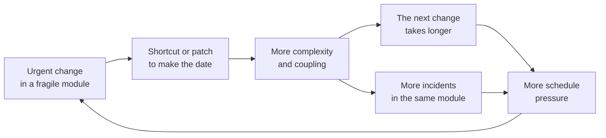
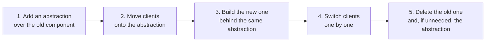
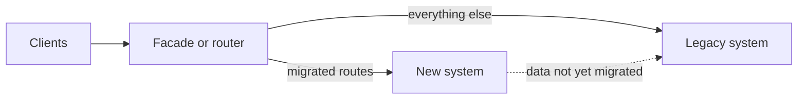
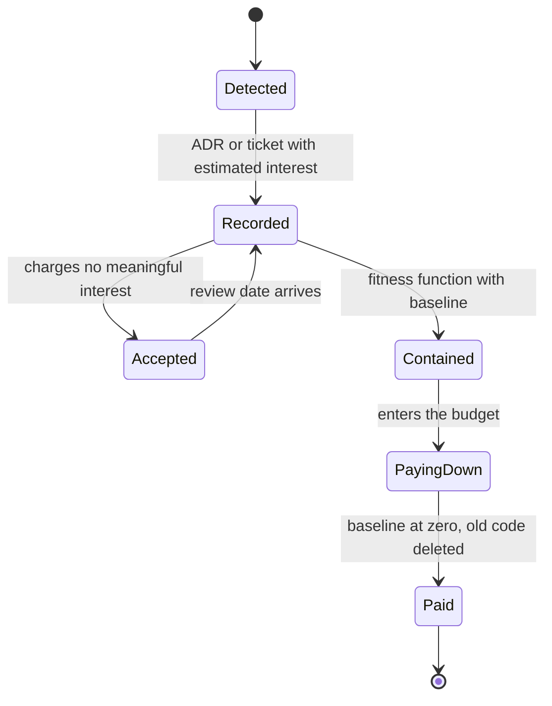

# Technical debt and architectural evolution

You know the symptoms. A change that took two days last year now takes two weeks, and nobody can say where the time goes. Every estimate comes with "depends on what billing looks like". Incidents keep landing in the same three modules. Someone proposes a rewrite, someone else says there is no time for one, and the "tech debt" backlog keeps growing without anyone opening it. Technical debt is the way to name that problem precisely: **it is the gap between the design the system has and the design it would need for the changes ahead, and you pay for it in extra effort every time you touch the affected code**.

This article covers where the metaphor came from and what it actually meant, classifies debt with Fowler's quadrant, and splits it into principal and interest. It then shows how to measure debt without vanity metrics, why architecture debt is the expensive kind, and how to evolve a system through guided, incremental change: the boy scout rule, a capacity budget, branch by abstraction, the strangler fig and feature flags. It closes with how to record deliberate debt in an ADR, a worked example and the most common mistakes.

<Callout tone="info" title="What is verified and what is not">
  Dates and quotes come from the primary sources listed at the end, with two exceptions: what is
  said about Ward Cunningham's 2009 video comes from third-party transcripts, and the labels of each
  cell in Fowler's quadrant only appear in an image in his article, so they are paraphrased here
  from the text.
</Callout>

## Where the metaphor comes from

Ward Cunningham used it in an OOPSLA 1992 experience report titled "The WyCash Portfolio Management System". The line everyone quotes is: "Shipping first time code is like going into debt." The rest of the passage sets the terms: a little debt speeds development as long as it is paid back promptly with a rewrite, and the danger comes when it is not paid back, because every minute spent on not-quite-right code counts as interest.

The important nuance is **what** was being borrowed. Cunningham was not talking about writing careless code to go faster. He meant shipping code that reflected the team's current understanding of the problem, knowing that understanding would improve. The debt is the gap between what the code expresses and what you now know. You pay it back by folding that learning into the design.

According to several transcripts of a video Cunningham published in 2009, he had to clarify this himself: many people had confused the metaphor with the idea of writing code poorly with the intention of fixing it later, and he said he was never in favor of writing code poorly. Martin Fowler picked up the metaphor on his bliki in 2003 and rewrote that entry thoroughly in 2019, where he frames it around _cruft_: deficiencies in internal quality that make software harder to modify.

The practical consequence is that **not all debt is a mistake**. A design that was right given what you knew, and falls short today, is legitimate debt, the kind Cunningham had in mind. Sloppy code is a different case, and there is a debate around it: some argue that a mess is not debt, while Fowler's answer is that the metaphor still works, because the mess also charges interest, and that the useful distinction is not "debt or not debt" but "prudent or reckless". That distinction drives the next section.

## Fowler's technical debt quadrant

In 2009 Fowler proposed classifying debt along two axes: **deliberate or inadvertent** (did you know you were taking it on?) and **prudent or reckless** (was the decision reasonable given what you knew?). The result is a two-by-two grid that lets a team talk about debt without assigning blame and decide what to do with each case.

| —               | Reckless                                                                                                 | Prudent                                                                                                                |
| --------------- | -------------------------------------------------------------------------------------------------------- | ---------------------------------------------------------------------------------------------------------------------- |
| **Deliberate**  | The team knows good practices but goes "quick and dirty" because it believes it cannot afford clean code | The team knows it is taking on debt, chooses to do so to hit a milestone, and has a plan to pay it back                |
| Example         | Skipping tests on a payment flow "because we're in a hurry" and never coming back                        | Shipping a carrier integration through a synchronous adapter, knowing it must move to a queue once volume justifies it |
| **Inadvertent** | The team does not know design practices and has no idea it is taking on debt                             | Once the project is done the team realizes what the design should have been, and finds a debt it never chose           |
| Example         | Business logic in controllers and string-built SQL everywhere, with nobody seeing it as a problem        | After a year, the team realizes "customer" and "account" were distinct concepts the model conflated from day one       |

Fowler makes an uncomfortable point about the prudent-inadvertent cell: it is not just common but inevitable for teams that are excellent designers, because design is learning. It is not a discipline failure; it is the price of understanding the domain while you build. What sets a good team apart is that it **recognizes it and pays it down** instead of living with it.

What the quadrant is for in practice:

- **Deliberate and prudent**: record it, give it an exit condition and an owner. This is the only kind you should create on purpose.
- **Inadvertent and prudent**: turn it into refactoring as soon as you spot it, prioritized by where it hurts.
- **Deliberate and reckless**: an incentives or pressure problem, not a technical one. It gets solved in the conversation with product, not with more tickets.
- **Inadvertent and reckless**: solved with training, code review and executable rules, not with a cleanup sprint.

## Principal and interest

The financial metaphor has two parts, and it pays to keep them apart:

- **Principal**: the cost of fixing the design. A bounded amount of work, even if sometimes a large one.
- **Interest**: the recurring extra effort you pay on every change while the design stays as it is. More reading time, more manual testing, more incidents, more coordination.

Fowler illustrates it with simple numbers: a feature that would take four days in clean code takes six with cruft, so the two-day difference is the interest. Removing the cruft first costs five days. For a single feature that does not pay off (nine days instead of six), but if two more similar features are coming, it does. The conclusion he draws is the key to this whole article: **you only pay interest when you work in the affected area**. Crufty but stable areas can be left alone; heavily changed ones call for zero tolerance.

That is why interest compounds exactly where you change the most. The usual loop feeds itself:



| Area of the code                       | Interest it charges  | What to do about its principal                |
| -------------------------------------- | -------------------- | --------------------------------------------- |
| Poorly designed and rarely touched     | Low                  | Leave it; document the risk if it is critical |
| Poorly designed and changed every week | High and growing     | Pay first, in small steps tied to each change |
| Well designed with one specific gap    | Low                  | Fix it next time you pass through             |
| Boundary between modules nobody owns   | High and hard to see | Assign an owner before trying to pay          |

## Code-level debt vs architecture-level debt

Debt does not all live at the same level. Code debt sits inside a file or a module; architecture debt sits in the relationships between modules, in boundaries and in cross-cutting decisions.

| —              | Code debt                                          | Architecture debt                                                                        |
| -------------- | -------------------------------------------------- | ---------------------------------------------------------------------------------------- |
| Where it lives | Inside a function, class or module                 | Between modules, in boundaries, shared data and cross-cutting decisions                  |
| Examples       | Long functions, confusing names, local duplication | A database shared across services, dependency cycles, one domain split across two places |
| Who notices    | Whoever edits that file                            | Everyone, as coordination overhead, lockstep deploys and cascading incidents             |
| How you pay    | Refactoring within the same change                 | A staged migration lasting weeks or months                                               |
| Risk of paying | Low if there are tests                             | High: it touches contracts, data and several teams                                       |
| Main tool      | [Clean code](/docs/clean-code) and review          | Fitness functions, ADRs and incremental migration tactics                                |

Architecture debt is the expensive kind for three reasons. First, **it multiplies interest**: a bad boundary means every change in one module drags changes in others, which is exactly what [coupling and cohesion](/docs/acoplamiento-cohesion) measure. Second, **it cannot be paid in a single change**: it needs a migration with intermediate states that have to work in production. Third, **it degrades the [quality attributes](/docs/atributos-de-calidad)** the business actually sees (availability, performance, lead time), not just the comfort of whoever writes the code.

## Measuring debt without vanity metrics

Measuring debt is not about putting a total number on it. It is about finding **where interest is being paid** and whether that interest is rising or falling. Four signals work well together; none of them is enough on its own.

### Lead time for changes

DORA defines change lead time as the time it takes for a change to go from being committed to version control to being deployed in production. Slice it by module or service and debt shows up as areas where changes consistently take longer than the system average. What matters is the trend and the comparison between areas, not the absolute value.

### Hotspots: change frequency times complexity

In 2013 Adam Tornhill proposed, in the article that became the starting point for his book _Your Code as a Crime Scene_ (Pragmatic Bookshelf, 2015), combining two sources: version-control history (how often a file changes and how many people touch it) and a complexity measure (lines of code or cyclomatic complexity). A **hotspot** is where high activity and high complexity overlap. The reasoning lines up with Fowler's: complex code nobody touches charges no interest; complex code touched every week does.

What comes out of this analysis is a short, ranked list, not a thousand-file report. Tornhill stresses that these are heuristics: a hotspot is a question for the team, not a verdict.

### Incidents that keep touching the same module

Tag every incident and postmortem with the modules involved in the cause or the fix. When the same module shows up again and again, that is a stronger signal than any static metric, because it measures interest paid in production, with customers affected.

### Friction reported by the team

A short, recurring survey (for example, at the end of each iteration) with a single question per module touched: how much did the existing design slow you down? It is subjective, but it catches early what metrics take months to show, and it is the only signal that captures cognitive cost. Use it to decide where to look, and the other three to confirm.

### What not to measure

| Tempting metric                   | Why it misleads                                                                                          |
| --------------------------------- | -------------------------------------------------------------------------------------------------------- |
| Total lines of code               | A large, healthy system has many lines; deleting code does not always reduce debt                        |
| A single "debt index" or score    | Lumps together problems with very different costs and hides where the interest is; teams game the number |
| Count of static analysis warnings | Weighs a clumsy name in dead code the same as a cycle between domains in the core                        |
| Tool-estimated "debt hours"       | Estimates principal with generic rules and says nothing about interest, which is what matters            |
| Test coverage as a target         | Gets inflated with tests that do not verify behavior                                                     |

None of these is useless as context. The problem starts when one of them becomes the goal.

## Evolutionary architecture: guided, incremental change

Neal Ford, Rebecca Parsons and Patrick Kua published _Building Evolutionary Architectures_ (O'Reilly, 2017); the second edition, from November 2022, adds Pramod Sadalage as an author. Their definition is short: an evolutionary architecture **supports guided, incremental change across multiple dimensions**.

Both words carry weight:

- **Incremental**: the system changes in small steps that get deployed, observed and can be rolled back. The opposite of a rewrite that only delivers value on the day it finishes.
- **Guided**: each step is protected by automated checks on the characteristics that must not degrade. Those checks are [fitness functions](/docs/fitness-functions): dependency rules, latency budgets, size limits or contracts that fail in CI when the architecture drifts from what was decided.

Applied to debt, this changes the question. It is no longer "when do we stop to pay it?" but "which fitness function stops it from growing while we pay it down gradually?". A rule that freezes current violations and blocks new ones halts compound interest from day one, even if the principal takes months to come down. All it needs is a good name:

```typescript
// fitness/billing-boundary.fitness.ts
export declare function noNewImportsOfLegacyBillingRepo(
  graph: DependencyGraph,
  baseline: KnownViolations,
): FitnessResult; // fails if a dependency appears that is not in the baseline
```

## Tactics for evolving without a rewrite

The tactics differ in scope: some work on what you are already touching, others replace whole parts. You combine them; one is rarely enough.

### The boy scout rule

Robert C. Martin stated it in _97 Things Every Programmer Should Know_, adapting the scouting rule: always check a module in a little cleaner than you found it. It works because it applies Fowler's principle with no planning overhead: cleanup happens exactly where work happens, which is where interest is paid. Its limit is just as clear: **it does not pay architecture debt**, because nobody moves a module boundary in passing while fixing a bug.

### A dedicated capacity budget

Reserving a fixed share of the team's capacity for debt stops every item from competing with features at every planning session. **There is no standard percentage**: it is a policy decision that depends on how much interest you are paying and how much pressure the business is under. What makes it work is not the number but three rules: the budget goes to hotspots, not to whatever each person feels like fixing; it is reviewed against data (did lead time in that area go down?); and it is adjusted, up or down, explicitly.

### Branch by abstraction

Fowler wrote it up in 2014; the name was popularized by Paul Hammant, who credits the technique to Stacy Curl. It lets you replace a component that many parts of the system depend on without a long-lived branch: everything happens on mainline and the system stays deployable at every step.



It is the code-level version of what [hexagonal architecture](/docs/arquitectura-hexagonal) calls a port: a seam with two implementations for a while.

### Strangler fig

Fowler described the pattern on 29 June 2004 under the name _Strangler Application_, inspired by the strangler figs he saw in the Queensland rainforest, and on 29 April 2019 renamed it _Strangler Fig_. The idea: instead of replacing a system in one go, you build the new one around the old and divert behavior to it piece by piece until the old one can be switched off.



The hard part is rarely the router; it is the data. During the migration both systems coexist and each piece of data needs a single source of truth. Decide that up front and write it down.

### Feature flags during the migration

Pete Hodgson distinguishes several kinds of toggles; the relevant ones here are **release toggles**, which let you deploy incomplete or alternative code without turning it on. In a migration they let you switch implementations by traffic percentage or by customer and roll back without a deploy. Hodgson warns that these toggles are transitional and should generally not stick around much longer than a week or two, and that every toggle is inventory with a carrying cost: conditional logic and combinations to test. A flag that stays is new debt.

### Which one to use

| Tactic                | Scope                                | Typical duration       | Main risk                                 | Use it when                                        |
| --------------------- | ------------------------------------ | ---------------------- | ----------------------------------------- | -------------------------------------------------- |
| Boy scout rule        | What you touch in the current change | Ongoing                | Mixed changes that make review harder     | The debt is code-level and sits in active areas    |
| Dedicated budget      | Prioritized hotspots                 | Ongoing, reviewed      | Spending it where no interest is charged  | Some debt does not fit inside feature work         |
| Branch by abstraction | A component used by many             | Weeks                  | An abstraction that is never removed      | You are replacing a library, an ORM or a vendor    |
| Strangler fig         | A subsystem or an entire system      | Months                 | Two half-finished systems indefinitely    | You are replacing a large part with live users     |
| Feature flags         | Activation of any of the above       | Days or weeks per flag | Forgotten flags and untested combinations | You need to switch and roll back without deploying |

## Recording deliberate debt in an ADR

Deliberate, prudent debt is an architecture decision, so it deserves an [ADR](/docs/adr). What sets a debt ADR apart from a regular one is four fields that turn "we'll fix it later" into a commitment you can check:

```markdown
# ADR-0042: Synchronous integration with the shipping carrier

## Context

## Decision

## Debt taken on

- Expected interest: <what it costs each month and where it shows>
- Exit condition: <measurable fact that forces repayment>
- Owner: <a team or a person, not "everyone">
- Review date: <YYYY-MM-DD>

## Consequences
```

The **exit condition** matters most and is the one most often left out. It has to be an observable fact, not an intention: "when peak orders per minute cross a given threshold", "before we launch the second country", "when the module's lead time exceeds twice the system average". Without one, the review becomes a formality and the debt becomes permanent. If the condition has not been met by the review date, renew the ADR with a new date; if it has, repayment enters planning with priority.

## Worked example: the billing module

An order-management SaaS runs a monolith with a billing module that computes taxes, renders the invoice PDF and writes straight into the orders tables. Six other modules read those tables. The team's complaint: "every change to billing breaks something".

**1. Measure.** They cross six months of git history with per-file complexity. The values in this table are illustrative, but the pattern is the usual one:

| File                        | Changes in 6 months | Relative complexity | Related incidents |
| --------------------------- | ------------------- | ------------------- | ----------------- |
| `billing/tax-calculator`    | Very high           | High                | Several           |
| `billing/invoice-pdf`       | Low                 | High                | None              |
| `billing/orders-repository` | High                | Medium              | Several           |
| `reports/legacy-export`     | Almost none         | Very high           | None              |

`legacy-export` is the ugliest code in the system and nobody touches it: it charges no interest and is out of scope. `invoice-pdf` is complex but stable: document it and leave it. The interest is in the tax calculation and in the shared access to orders.

**2. Classify.** The tax calculation is prudent, inadvertent debt: it was designed for one country and there are now three. The shared table access is architecture debt: six modules coupled through data.

**3. Stop the compounding.** Before paying anything, they add a fitness function with a baseline: no new module may read the orders tables directly. The six existing violations are frozen.

**4. Pay in stages.** For taxes they use branch by abstraction: a `TaxPolicy` port, the current implementation behind it, a new per-country one, and a release toggle per country to switch and roll back. For order access they strangle: an orders module with its own API, and the six consumers migrate one at a time; each migration shrinks the baseline by one.

**5. Record.** An ADR captures the decision to keep shared access during the migration, with expected interest (coordination on every schema change), exit condition (baseline at zero), owner (the orders team) and a quarterly review date.

The intermediate structure, with names that tell you what stage each piece is in:

```text
src/
  billing/
    tax/
      tax-policy.ts             # the abstraction: a port
      legacy-tax-policy.ts      # current implementation, to be deleted
      per-country-tax-policy.ts # new implementation, behind a toggle
  orders/
    orders-api.ts               # the replacement strangling direct access
fitness/
  orders-tables-access.fitness.ts
  orders-tables-access.baseline.json  # may only shrink
```

Every debt item goes through the same lifecycle, and it helps for the team to see it that way:



## When to take on debt and when it is a warning sign

### When debt is a good decision

- **Validate before you invest.** If you do not know whether a feature will be used, a minimal design is prudent. The learning is worth more than a perfect design for something you may delete.
- **There is a real external date** (regulatory, contractual, market) and the cost of missing it exceeds the expected interest. With an ADR and an exit condition.
- **The code is short-lived**: a migration script, a proof of concept with a deletion date.
- **The area will not change**: a mediocre design in a stable module barely charges interest.

### When it is a warning sign

- **Nobody chose it.** If debt only surfaces through incidents, the problem is practices, not priorities.
- **Interest already exceeds useful work** in an area: most of the time spent on changes goes into understanding and working around the design.
- **Deliberate debt has no exit condition and no owner.** That is not debt; it is an undocumented permanent decision.
- **It blocks a quality attribute the business needs**: you cannot scale, deploy independently or meet a security requirement without paying it.
- **The team avoids certain modules**, or only one person dares to touch them.

## Common mistakes

- **Rewriting as the fix.** A full rewrite holds back value until the end, has to chase a system that keeps changing, and tends to reproduce the debt it never understood. Fowler proposed the strangler fig precisely as the alternative.
- **A debt backlog nobody prioritizes.** A long list of tickets with no estimated interest and no owner never gets paid. Ten items backed by data beat two hundred backed by good intentions.
- **Treating all debt as equal.** Ugly code nobody touches does not deserve the same effort as a hotspot that causes incidents. Prioritize by interest, not by ugliness.
- **Chasing a score.** Lowering a global debt index is easy if you fix what does not matter.
- **Paying without closing the tap.** Without a rule that stops debt from growing, new debt eats whatever you pay down.
- **Abstractions and flags that never go away.** Branch by abstraction and release toggles are scaffolding; if they stay, they are the next debt.
- **Calling everything debt.** If every style disagreement is "tech debt", the term stops being useful in negotiations with product.

## Checklist

- [ ] Every debt item has estimated interest, an owner and, if deliberate, an exit condition.
- [ ] You know your hotspots, from change history crossed with complexity, and review them regularly.
- [ ] Lead time and incidents are visible per module, not only for the system as a whole.
- [ ] Significant deliberate debt is recorded in an ADR with a review date.
- [ ] A fitness function with a baseline keeps known architecture debt from growing.
- [ ] Capacity for paying down debt is an explicit policy reviewed against data.
- [ ] Large migrations move through branch by abstraction or the strangler fig, deployable at every step.
- [ ] Every release toggle and temporary abstraction has a removal date.

## Sources

Checked in October 2026.

- [The WyCash Portfolio Management System (Ward Cunningham, OOPSLA 1992)](https://c2.com/doc/oopsla92.html)
- [Technical Debt (Martin Fowler, 2003, rewritten in 2019)](https://martinfowler.com/bliki/TechnicalDebt.html)
- [Technical Debt Quadrant (Martin Fowler, 14 October 2009)](https://martinfowler.com/bliki/TechnicalDebtQuadrant.html)
- [Ward Cunningham on technical debt (rc3.org, 2009)](https://rc3.org/2009/03/02/ward-cunningham-on-technical-debt/): third-party summary of the 2009 video; the page returned HTTP 403, so what is said about the video comes from search results
- [DORA metrics guide](https://dora.dev/guides/dora-metrics/)
- [Code as a Crime Scene (Adam Tornhill, 2013)](https://adamtornhill.com/articles/crimescene/codeascrimescene.htm) and [InfoQ's coverage of his talk and book (2015)](https://www.infoq.com/news/2015/03/code-as-a-crime-scene)
- [Building Evolutionary Architectures at Thoughtworks](https://www.thoughtworks.com/insights/books/building-evolutionary-architectures) and [the second edition at O'Reilly](https://oreilly.com/library/view/building-evolutionary-architectures/9781492097532)
- [The Boy Scout Rule (Robert C. Martin, in 97 Things Every Programmer Should Know)](https://www.oreilly.com/library/view/97-things-every/9780596809515/ch08.html)
- [Branch By Abstraction (Martin Fowler, 7 January 2014)](https://martinfowler.com/bliki/BranchByAbstraction.html)
- [Original Strangler Fig Application (Martin Fowler, 29 June 2004)](https://martinfowler.com/bliki/OriginalStranglerFigApplication.html) and [Strangler Fig (Martin Fowler, revised 22 August 2024)](https://martinfowler.com/bliki/StranglerFigApplication.html)
- [Feature Toggles (Pete Hodgson, 2017)](https://martinfowler.com/articles/feature-toggles.html)
