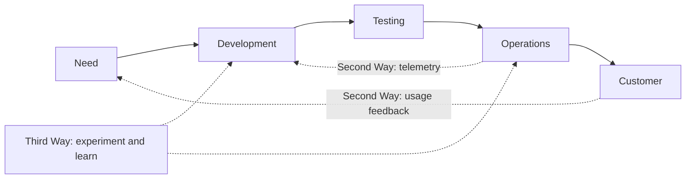
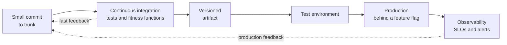

# DevOps and its culture: the foundation of delivery

For years, development and operations had opposite goals. Developers were judged on changing the system; operations, on keeping it up. A wall rose between them, and large, rare, painful releases were thrown over it. **DevOps** is the set of ideas that tears that wall down: sharing responsibility for delivering and operating, delivering in small batches, and learning fast from what happens in production.

This article is the cultural foundation, not a tools tutorial. It explains where DevOps comes from, what it is and is not, the frameworks used to understand it (CALMS and the Three Ways), the evidence from DORA research and Westrum's culture typology, how it connects to architecture and to AI agents, and a realistic adoption order. Tools come at the end, because they are a consequence of culture and not its starting point.

<Callout tone="info" title="Cutoff date">
  The data is from October 2026. The DORA metrics were read in the official guide on dora.dev and
  tool versions were checked on October 12, 2026 in their repositories. Check the official source
  before deciding: this field changes every year.
</Callout>

## The problem DevOps solves

In a traditional organization, each team optimizes its own piece. Development ships as fast as it can and operations brakes to protect stability. The familiar result: changes pile up for weeks, are deployed together, and when something fails nobody knows which of the hundreds of changes was the cause. Because deploying hurts, it happens less often, and because it happens less often, each deployment is bigger and riskier.

The talk "10+ Deploys Per Day: Dev and Ops Cooperation at Flickr", by John Allspaw and Paul Hammond at Velocity 2009, laid out the way out. Their slides frame the classic conflict (operations as the team that says "no" to change) and argue that the business needs change, so the answer is to **lower the risk of change** with tools and culture, not to discourage it. Their stated goal was for operations people to think more like developers and developers more like operations.

## Where it comes from

| Year | Milestone                                                                                                             |
| ---- | --------------------------------------------------------------------------------------------------------------------- |
| 2006 | In an ACM Queue interview, Werner Vogels (Amazon) sums up his model: "You build it, you run it"                       |
| 2009 | Allspaw and Hammond present Flickr's daily deployments at Velocity                                                    |
| 2009 | Patrick Debois organizes the first devopsdays in Ghent, Belgium; the name comes from there                            |
| 2012 | Gene Kim publishes the essay "The Three Ways"                                                                         |
| 2013 | _The Phoenix Project_ (Kim, Behr and Spafford) is published, a novel about an IT project in crisis                    |
| 2016 | _The DevOps Handbook_ (second edition in 2021, with Kim, Humble, Debois, Willis and Forsgren)                         |
| 2018 | _Accelerate_ (Forsgren, Humble and Kim) presents four years of statistical research on what determines IT performance |

Debois coined the word in 2009 by organizing the first event, according to IT Revolution's page; other sources say the name was more of an accident. What matters is the sequence: first the practice (Flickr), then the community, then the research that measured it.

## What DevOps is and is not

| It is not                                             | It is                                                                               |
| ----------------------------------------------------- | ----------------------------------------------------------------------------------- |
| A job title ("DevOps engineer") that acts as a bridge | A way of working in which development and operations share goals and responsibility |
| A separate team in charge of deployment               | The team that builds also delivers, observes and responds                           |
| A set of tools (CI, containers, Kubernetes)           | Practices and culture that tools make possible                                      |
| Automating everything from day one                    | First removing work that adds nothing, then automating what is left                 |
| Speed at the expense of stability                     | The evidence shows both improve together (see DORA below)                           |

The most widespread antipattern is creating a "DevOps team" that sits between development and operations. It did not tear down the wall: it put a third silo in the middle, with its own ticket queue. Such a team only makes sense if it offers capabilities that other teams consume on their own, not if it runs deployments for them.

## Two frameworks to understand it

### CALMS

CALMS (Culture, Automation, Lean, Measurement, Sharing) summarizes the pillars of DevOps. Sources disagree about its origin. According to O'Reilly's book on SAFe and DevOps, John Willis and Damon Edwards proposed CAMS in 2010 and Jez Humble added the L; others credit Humble directly. Treat it as a useful summary and not as a standard.

| Pillar      | Question it forces you to answer                                            |
| ----------- | --------------------------------------------------------------------------- |
| Culture     | Do development and operations share responsibility and learn from failures? |
| Automation  | Does a machine do what is repetitive and error-prone?                       |
| Lean        | Do we work in small batches and eliminate waiting and waste?                |
| Measurement | Do we decide with delivery and production data?                             |
| Sharing     | Does knowledge flow between teams, or does it live in a few people's heads? |

### The Three Ways

Gene Kim described them in his 2012 essay and later used them in the _DevOps Handbook_. They are principles, not concrete practices:

1. **Flow (systems thinking):** look at the performance of the whole system, not of a silo. Never pass a known defect downstream, never let a local optimization degrade the whole.
2. **Amplify feedback loops:** create right-to-left feedback channels so corrections can keep happening. Shorten and strengthen every loop, and put knowledge where it is needed.
3. **A culture of continual experimentation and learning:** encourage risk-taking and learning from failure, set aside time to improve daily work, and even inject faults on purpose to build resilience.



The First Way is the solid left-to-right line; the Second, the dotted return arrows; the Third, the organization's ability to improve the whole system.

## Culture is the foundation

### Westrum's typology

Sociologist Ron Westrum proposed in 2004 (in the journal then called Quality and Safety in Health Care, today BMJ Quality and Safety) a typology of organizational cultures based on how information flows. DORA adopts it and summarizes it like this:

| Characteristic         | Pathological            | Bureaucratic             | Generative             |
| ---------------------- | ----------------------- | ------------------------ | ---------------------- |
| Orientation            | Power                   | Rules                    | Performance            |
| Cooperation            | Low                     | Modest                   | High                   |
| Messengers             | Messengers are punished | Messengers are neglected | Messengers are trained |
| Responsibility         | Shirked                 | Narrow                   | Risks are shared       |
| Bridging between teams | Discouraged             | Tolerated                | Encouraged             |
| In the face of failure | Scapegoating            | Justice                  | Inquiry                |
| Novelty                | Crushed                 | Leads to problems        | Implemented            |

DORA states that a high-trust, generative culture predicts software delivery and organizational performance, and that psychological safety also predicts software delivery performance. These are predictive research findings, not proof of direct causation. The practical idea: if the person who spots a problem is punished or ignored, no tool will make up for that missing information.

### Blameless postmortems

Google's SRE book devotes a chapter to postmortem culture. A blameless postmortem must focus on the contributing causes of the incident "without indicting any individual or team", and assumes that everyone involved had good intentions and acted with the information they had. Its most quoted line: you can't "fix" people, but you can fix systems and processes. When finger-pointing prevails, people stop reporting problems for fear of punishment.

John Allspaw defended the same approach at Etsy in 2012 and clarified a common misunderstanding: blameless does not mean without accountability. He talks about a just culture that balances safety and accountability, and that investigates the situational factors and the decisions of the people closest to the failure.

### "You build it, you run it"

In a 2006 ACM Queue interview, Vogels summed up Amazon's model like this: "You build it, you run it". The AWS blog that reviewed the interview (May 16, 2006) states that giving developers operational responsibilities "has greatly enhanced the quality of the services". The reason is incentives: someone who is woken at night by a failure stops treating operability as someone else's problem. It is the most direct form of shared ownership.

## Measuring: DORA research

DORA (DevOps Research and Assessment) has spent years measuring which practices are associated with better outcomes. Its official guide today defines **five delivery performance metrics**, grouped into two families:

| Family      | Metric (DORA name)              | What it measures                                                                         |
| ----------- | ------------------------------- | ---------------------------------------------------------------------------------------- |
| Throughput  | Change lead time                | Time from a change being committed to version control until it is deployed in production |
| Throughput  | Deployment frequency            | How many deployments happen in a period, or the time between them                        |
| Throughput  | Failed deployment recovery time | Time to recover from a failed deployment that requires immediate intervention            |
| Instability | Change fail rate                | Ratio of deployments that require immediate intervention                                 |
| Instability | Deployment rework rate          | Ratio of unplanned deployments that happen as a result of an incident in production      |

DORA says that in 2025 it evolved the four classic metrics into five; according to summaries of the report, the novelty is the rework rate. Its central conclusion holds: speed and stability are **not a trade-off**. The metrics are correlated for most teams; the best do well on all five and the worst do poorly on all five. This dismantles the argument that sustained the wall: you do not have to slow down to be stable.

To use the metrics sensibly:

- **Measure the system, not people.** A metric turned into an individual target stops measuring and starts being gamed.
- **Compare yourself with yourself over time**, not with other companies.
- **They are indicators, not goals.** They tell you where to look, not what to change.

## Practices and their cultural reason

Every technical DevOps practice exists for a human reason. Knowing the reason keeps you from applying it as a ritual.

| Practice                               | What it exists for (cultural reason)                                                                                    |
| -------------------------------------- | ----------------------------------------------------------------------------------------------------------------------- |
| Continuous integration and trunk-based | So nobody works in isolation: DORA cites at most three active branches, merging at least once a day and no code freezes |
| Continuous delivery                    | So the software is always in a releasable state and the decision to release is a business one                           |
| Continuous deployment                  | So every change that passes the pipeline reaches production on its own: the next step, not a requirement                |
| Feature flags                          | Separating deploying from releasing; Flickr already used them as levers for operations                                  |
| Infrastructure as code                 | So the environment is reviewable and reproducible like any other change, not oral tradition                             |
| GitOps                                 | So Git is the source of truth for the desired state and changes are reviewed like code                                  |
| Observability                          | So development and operations look at the same data, like Flickr's shared dashboards                                    |
| Blameless postmortems                  | Turning every incident into shared learning                                                                             |

Martin Fowler distinguishes two practices that get confused: **continuous delivery** means being able to deploy frequently, but you may choose not to; **continuous deployment** means every change goes through the pipeline and is put into production automatically. To do continuous deployment you must first do continuous delivery. On branching, trunkbaseddevelopment.com defines it as a model with a single branch ("trunk") plus short-lived, single-person branches, with feature flags to decide the order of releases.



How you organize the pipeline also communicates intent. A simple, readable convention that separates verifying, building and promoting:

```text
.github/workflows/
  ci.yml        # on every proposed change: verify
  release.yml   # when merged into main: build and publish the artifact
  deploy.yml    # promote an already-built artifact to an environment
```

## DevOps and architecture

Architecture decides how much DevOps culture is possible. **Conway's law** (1968) states it: organizations which design systems are constrained to produce designs which are copies of the communication structures of these organizations. A wall between teams ends up drawn in the system.

DORA reaches the same conclusion from data: effective organizational and technical structures predict continuous delivery; with a tightly coupled architecture, small changes can cause cascading failures, and as services become less tightly coupled, deployment frequency should increase. To counter Conway it recommends the _Inverse Conway Maneuver_: shape the teams so that they support the architecture you want.

This connects with the rest of the library:

- **Deployability** is a [quality attribute](/docs/atributos-de-calidad) that is decided and measured, not an accident.
- [Coupling](/docs/acoplamiento-cohesion) is what slows delivery: two services that must be deployed together are, in practice, one.
- [Fitness functions](/docs/fitness-functions) are the architecture's pipeline: executable rules that run in continuous integration.
- Every decision that changes how you deliver deserves its [ADR](/docs/adr).
- A [hexagonal](/docs/arquitectura-hexagonal) design makes it easy to test the core without infrastructure, which shortens feedback.
- The [C4 model](/docs/c4-model) helps you see which containers are deployed separately and who owns each one.

## SRE and platform engineering

Two neighboring ideas that are often confused with DevOps. According to Google's _Site Reliability Workbook_, **SRE** is a concrete implementation of DevOps: "class SRE implements interface DevOps", a programming analogy. DevOps is the broad, not very prescriptive philosophy about how to operate; SRE is a role with service responsibilities and a more opinionated framework, with the same belief in measurement and in accepting that change is necessary to improve.

**Platform engineering** goes another way: instead of every team reinventing its pipeline, one team offers internal capabilities that the others consume on their own. It works when treated as a product with users, and degenerates into the "DevOps team" antipattern when it becomes a bottleneck with tickets.

## DevOps and AI agents

A coding agent writes changes faster than a person, and that increases exactly what DevOps has to sustain: the frequency and volume of changes. DORA's 2025 report sums up the effect: AI improves throughput, "but often at the cost of stability if your foundation isn't solid". An agent is only as safe as the delivery process around it.

That is why the pipeline and the tests are the **sensors** of the [harness](/docs/harness-engineering-claude-code): continuous integration, fitness functions, small deployments and observability catch the agent's mistake before a person does. And whoever builds [applications with agents](/docs/arquitectura-agentes-llm) inherits the same rule: observability, evaluations and explicit limits are the DevOps version for non-deterministic systems.

## An adoption map by stages

DevOps is not adopted all at once. Each stage builds on the previous one, and **measuring before optimizing** keeps you from automating the wrong thing.

| Stage | Focus                  | What to do                                                                              | Sign it is ready                                    |
| ----- | ---------------------- | --------------------------------------------------------------------------------------- | --------------------------------------------------- |
| 1     | Understand and measure | Draw the path of a change to production and measure the five DORA metrics as they stand | You know how long a change takes today and why      |
| 2     | Small batches          | Continuous integration, trunk-based, automated tests on every change                    | You integrate daily and the main branch stays green |
| 3     | Automated delivery     | A single automated path to production, infrastructure as code, feature flags            | Deploying is boring                                 |
| 4     | Observe and learn      | Shared observability, SLOs, blameless postmortems                                       | Incidents produce improvements, not culprits        |
| 5     | Scale                  | Internal platform, clear ownership per service, architecture that decouples teams       | Teams deliver without asking others for permission  |

## Modern tools by function

Tools enable practices; they do not replace them. Versions checked on October 12, 2026 in the official repositories.

| Function       | Tool              | What it does                                                                                   | Maturity (own assessment)                 | When to use it                                                           | When not to                                                                         |
| -------------- | ----------------- | ---------------------------------------------------------------------------------------------- | ----------------------------------------- | ------------------------------------------------------------------------ | ----------------------------------------------------------------------------------- |
| CI/CD          | GitHub Actions    | CI/CD platform that runs workflows triggered by repository events                              | Very high                                 | Your code already lives on GitHub                                        | You need to run everything on your own infrastructure with no external dependencies |
| CI/CD          | GitLab CI/CD      | Pipelines defined in a `.gitlab-ci.yml` file at the project root                               | Very high                                 | You want repository and pipeline on a single platform                    | Your team is already standardized on another ecosystem                              |
| Infrastructure | OpenTofu 1.13.1   | Infrastructure as code, under the Linux Foundation's stewardship, an alternative to Terraform  | High                                      | You want an open license and compatibility with Terraform configurations | You depend on a vendor's proprietary features                                       |
| Infrastructure | Terraform 1.16.5  | HashiCorp's infrastructure as code, under the Business Source License 1.1                      | Very high                                 | You already use it and the license fits your case                        | You offer a product that competes with HashiCorp, where the BSL restricts it        |
| Containers     | Docker            | Packages applications and their dependencies into containers                                   | Very high (Engine 29.9.0)                 | You want reproducible environments                                       | A simple function on a managed platform does not need it                            |
| Orchestration  | Kubernetes 1.37.1 | Open source platform for managing containerized workloads, with declarative configuration      | Very high                                 | You have many services and teams that justify the operational cost       | You have few services: the cost outweighs the benefit                               |
| GitOps         | Argo CD 3.5.5     | Declarative GitOps continuous delivery for Kubernetes                                          | High                                      | You already deploy on Kubernetes and want Git as the source of truth     | You do not use Kubernetes                                                           |
| GitOps         | Flux 2.9.6        | Continuous and progressive delivery solutions for Kubernetes; a CNCF graduated project         | High                                      | You want a modular, extensible approach on Kubernetes                    | You do not use Kubernetes                                                           |
| Observability  | OpenTelemetry     | Framework and toolkit to generate, export and collect traces, metrics and logs, vendor-neutral | High (Collector 0.162.0)                  | You want to instrument once and choose the backend later                 | You need storage or dashboards: it does not include them                            |
| Observability  | Grafana 13.2.3    | Dashboards and visualization of metrics, logs and traces                                       | Very high                                 | You want one shared dashboard for development and operations             | You are looking for a data storage service                                          |
| Feature flags  | OpenFeature       | Open, vendor-neutral specification for the feature flag API; a CNCF incubating project         | Medium (specification 0.9.0, not yet 1.0) | You want to avoid lock-in with a flag vendor                             | You only need a couple of simple switches                                           |

## Common mistakes

- **Starting with tools.** Buying a CI platform does not change how people collaborate. Start with the path of the change and with culture.
- **Turning DevOps into a job title or a separate team.** It creates a new silo with its own ticket queue.
- **Using metrics as a weapon against people.** They get gamed and destroy the trust that made them useful.
- **Blaming individuals.** If a postmortem ends in a name, next time nobody will speak up.
- **Automating a broken process.** You get the same waste, faster. Remove the step before automating it.
- **Chasing continuous deployment without continuous delivery.** Without reliable tests, deploying more often only multiplies incidents.
- **Ignoring architecture.** Coupled services force you to deploy together; no culture makes up for that.
- **Giving AI more speed without more sensors.** The volume of changes goes up and stability goes down if the foundation is not solid.

## Checklist to get started

- [ ] Everyone on the team knows how long a change takes from commit to production.
- [ ] The five DORA metrics are measured at team level, not person level.
- [ ] You integrate into the main branch at least once a day, with short-lived branches.
- [ ] There is a single automated path to production that anyone on the team can run.
- [ ] Whoever builds the service also observes it and responds when it fails.
- [ ] Incidents end in a blameless postmortem with concrete actions.
- [ ] Decisions that change delivery are recorded in an ADR.
- [ ] Architecture rules are verified in the pipeline as fitness functions.
- [ ] Before giving an AI agent more autonomy, the pipeline stops it when it makes a mistake.

## Sources

Consulted in October 2026; check each fact against the official source before deciding.

- [DORA metrics (official guide)](https://dora.dev/guides/dora-metrics/)
- [DORA 2025: Year in review](https://dora.dev/insights/dora-2025-year-in-review/)
- [DORA: generative organizational culture](https://dora.dev/capabilities/generative-organizational-culture/)
- [DORA: loosely coupled teams](https://dora.dev/capabilities/loosely-coupled-teams/)
- [DORA: trunk-based development](https://dora.dev/capabilities/trunk-based-development/)
- [Westrum, "A typology of organisational cultures" (BMJ Quality and Safety, 2004)](https://qualitysafety.bmj.com/content/13/suppl_2/ii22)
- [Allspaw and Hammond, "10+ Deploys Per Day" (slides, Velocity 2009)](https://paulhammond.org/2009/06/velocity/10deploys.pdf)
- [Pivotal: summary of the Flickr talk](https://content.pivotal.io/blog/flickr-10-deploys-per-day-velocity-2009)
- [The origins of DevOps: what's in a name](https://devops.com/the-origins-of-devops-whats-in-a-name/)
- [Gene Kim, "The Three Ways"](https://itrevolution.com/the-three-ways-principles-underpinning-devops/)
- [_The Phoenix Project_](https://itrevolution.com/product/the-phoenix-project/)
- [_The DevOps Handbook_, second edition](https://itrevolution.com/product/the-devops-handbook-second-edition/)
- [_Accelerate_](https://itrevolution.com/product/accelerate/)
- [AWS News Blog on Vogels's interview (2006)](https://aws.amazon.com/blogs/aws/acm_queue_inter)
- [Google SRE: postmortem culture](https://sre.google/sre-book/postmortem-culture/)
- [Google SRE Workbook: how SRE relates to DevOps](https://sre.google/workbook/how-sre-relates/)
- [Etsy Code as Craft: blameless postmortems](https://www.etsy.com/codeascraft/blameless-postmortems)
- [Conway, "How Do Committees Invent?" (1968)](https://www.melconway.com/Home/Committees_Paper.html)
- [Martin Fowler: continuous delivery](https://martinfowler.com/bliki/ContinuousDelivery.html)
- [Trunk-based development](https://trunkbaseddevelopment.com/)
- [CALMS in _SAFe for DevOps_ (O'Reilly)](https://oreilly.com/library/view/safe-for-devops/9781803231426/B18756_Part1.xhtml)
- [OpenTofu](https://opentofu.org/), [HashiCorp BSL](https://www.hashicorp.com/en/bsl), [OpenFeature](https://openfeature.dev/), [Flux](https://fluxcd.io/), [Argo CD](https://argo-cd.readthedocs.io/en/stable/), [OpenTelemetry](https://opentelemetry.io/docs/what-is-opentelemetry/), [Kubernetes](https://kubernetes.io/docs/concepts/overview/), [GitHub Actions](https://docs.github.com/en/actions/about-github-actions/understanding-github-actions), [GitLab CI/CD](https://docs.gitlab.com/ci/)
