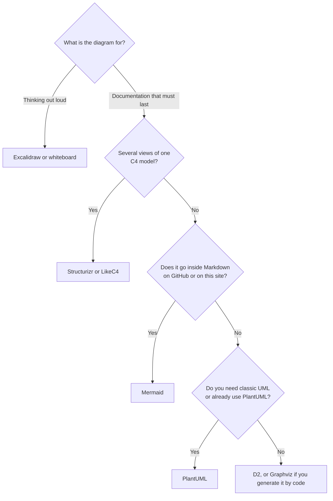
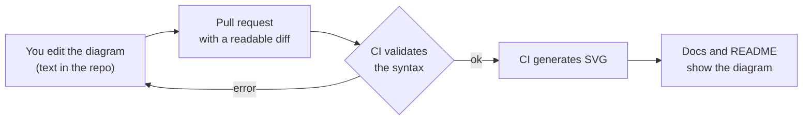

# Diagrams as code: document with version control

A diagram exported as an image starts aging the day it is saved. The file has no useful history:
nobody can see what changed between the March version and the October one, nobody reviews it in a
pull request and nobody knows whether it still describes the real system. By the time someone
notices it lies, the editable original no longer exists.

This article explains why it pays to write diagrams as text, which principles make them useful and
how **Mermaid, Structurizr, D2, PlantUML and Graphviz** compare when they draw the same small
system; LikeC4 and Excalidraw appear in the comparison table. It then covers how to validate and
publish them from CI, how to keep them alive and what changes when an AI agent edits them too. The
code fragments are guides to shape and naming, not templates to copy.

<Callout tone="info" title="Cutoff date and how it was tested">
  Data is from October 2026. Every fragment in this article was validated with the real tool:
  Mermaid 12.1.0 (the one this site uses), D2 0.9.0 (released on September 7, 2026), PlantUML
  1.2026.8, Graphviz 14.0.1 and the official `structurizr/structurizr` Docker image. Structurizr's
  products change: check its documentation before choosing.
</Callout>

## Why write diagrams as text

A text diagram lives in the repository, next to the code it describes, and inherits everything git
already knows how to do.

| What matters     | Exported image                                      | Diagram as text                                       |
| ---------------- | --------------------------------------------------- | ----------------------------------------------------- |
| **History**      | Cannot be compared across versions                  | `git diff` shows which arrow or box changed           |
| **Review**       | An image is attached to the PR, if anyone remembers | Reviewed line by line, together with the code change  |
| **Validation**   | None                                                | A parser rejects a broken diagram in CI               |
| **Who can edit** | Whoever has the tool and the source file            | Anyone with a text editor, or an AI agent             |
| **Reuse**        | Copy and paste                                      | With a model, several views come from the same source |

There is a price. A text diagram hands **layout** over to an automatic engine, so you lose fine
control over where each box lands. For a whiteboard sketch that is a bad deal; for documentation
that must last, it almost always pays off.

<Callout tone="warning" title="A diagram without an audience is decoration">
  Turning a diagram into code does not make it useful. Avoid the "map of everything" nobody can
  read, the diagram that answers no concrete question and the one nobody maintains. If you do not
  know who will consult it or which decision it helps make, do not write it.
</Callout>

## Principles of a good diagram

These rules hold with any tool. The most important ones come from the
[C4 model](/docs/c4-model).

1. **One question and one audience per diagram.** Title it with the question it answers: "Which
   containers make up the shop and who do they talk to?" is better than "Architecture".
2. **A single level of abstraction.** Do not mix users, services, tables and classes in the same
   image. C4 solves this with four levels: context, containers, components and code.
3. **Every element with a name, a type and a technology.** "API · Node.js" says more than
   "Backend".
4. **Every arrow with a verb** (and the protocol if it matters): "Requests charges · HTTPS", not a
   mute arrow.
5. **Always a title and a legend.** If a shape or a color carries meaning, explain it.
6. **Diagram names are code names.** If the service is called `orders` in the repository, do not
   call it "Order manager" in the diagram.

The boundaries you draw matter as much as the boxes: a bounded context from
[DDD](/docs/domain-driven-design) or a port of the
[hexagonal architecture](/docs/arquitectura-hexagonal) are good candidates for visible borders.

## Drawing the diagram or describing the model

There are two families of tools, and the difference matters more than the syntax. The C4 model
site tells them apart: **diagramming** tools work with boxes and lines, which limits validation
and querying and tends to produce formats that are hard to compare; **modelling** tools store a
single non-visual model and generate the views from it, and its list marks them as "Modelling
(recommended)".

| —                  | Diagram as code                              | Model as code                                        |
| ------------------ | -------------------------------------------- | ---------------------------------------------------- |
| **Examples**       | Mermaid, D2, PlantUML, Graphviz              | Structurizr, LikeC4                                  |
| **What you write** | One concrete diagram                         | Elements and relationships once, and the views apart |
| **If you rename**  | You change it in every diagram it appears in | You change it in one place                           |
| **Learning curve** | Low: you start in minutes                    | Higher: you learn a modelling language               |
| **Best when**      | You need one or a few diagrams               | You maintain several views of the same system        |

## The same system in five tools

To compare them for real, all of them draw the same system, the shop from the
[C4 article](/docs/c4-model): a customer, a web app, an API and a database, with three
relationships. The fragments are partial on purpose (no payment gateway, no styles): they let you
see **how each tool declares an element, a relationship and a grouping**.

Notice what does not change: the identifiers (`cliente`, `web`, `api`, `db`) are short, lowercase
and equal to the ones in the code; the readable label goes apart, as text. That way, a rename in
the repository shows up with a simple search across the diagrams.

### Mermaid

Mermaid turns text into diagrams in the browser and is the only one on the list that this site
renders directly. It supports dozens of types (flow, sequence, class, state, ER, Gantt, C4 and
`architecture`, among others). The C4 type is marked as **experimental**: the documentation warns
that the syntax may change, that the layout follows the order of the statements and that the
legend, sprites and custom tags are not yet supported.

```text
C4Container
  title Contenedores de Tienda Aurora
  Person(cliente, "Cliente", "Compra desde el navegador")
  System_Boundary(tienda, "Tienda Aurora") {
    Container(web, "Aplicación web", "React", "Catálogo y carrito")
    Container(api, "API", "Node.js", "Reglas de negocio")
    ContainerDb(db, "Base de datos", "PostgreSQL", "Pedidos y catálogo")
  }
  Rel(cliente, web, "Compra", "HTTPS")
  Rel(web, api, "Llama a", "JSON/HTTPS")
  Rel(api, db, "Lee y escribe", "SQL")
```

If you paste that text into a `mermaid` block, this site draws it. The shape is one function per
element: type, identifier, name, technology and description, in that order.

In the other Mermaid types, such as `flowchart` or `sequenceDiagram`, layout is automatic.
According to the layouts page of the current documentation, ELK is the default algorithm for
flowcharts, state, class and ER diagrams (bundled since version 12.0.0), and you can go back to
dagre with `layout: dagre` in the diagram configuration. The published documentation may be ahead
of the version you pin: check yours.

### Structurizr DSL

Structurizr is the reference implementation of C4 and the clear example of **model as code**: you
declare people, systems and containers once, and the views select what to show.

```text
workspace "Tienda Aurora" {
  model {
    cliente = person "Cliente"
    tienda = softwareSystem "Tienda Aurora" {
      web = container "Aplicación web" "Catálogo y carrito" "React"
      api = container "API" "Reglas de negocio" "Node.js"
      db = container "Base de datos" "Pedidos y catálogo" "PostgreSQL"
    }
    cliente -> web "Compra" "HTTPS"
    web -> api "Llama a" "JSON/HTTPS"
    api -> db "Lee y escribe" "SQL"
  }
  views {
    container tienda "Contenedores" {
      include *
    }
  }
}
```

Two blocks tell the story: `model` (what exists and how it relates) and `views` (what is shown),
plus the styles, which are omitted here. With `!identifiers hierarchical` identifiers are written
with a path (`tienda.web`), which avoids clashes as the model grows; it is left out here to keep
it short. The official Docker image offers `validate` and `export`; the latter supports, among
others, the `mermaid`, `plantuml`, `static`, `png` and `svg` formats, and requires the output
directory to exist and be writable.

<Callout tone="warning" title="The status of Structurizr's products changed">
  The current documentation lists Structurizr Lite, the on-premises installation, the cloud service
  and the old CLI in an "End of life" section. `structurizr local` is presented as the equivalent of
  Lite and `structurizr server` as the one for on-premises; the `server` command requires a license
  if you use the precompiled binaries, and the rest of the commands are free. To try it without
  installing anything there is an online playground.
</Callout>

### D2

D2 is a declarative diagramming language with themes, a sketch mode and a local CLI that works
offline. It is open source (MPL-2.0).

```text
direction: right

cliente: Cliente {shape: person}

tienda: Tienda Aurora {
  web: Aplicación web
  api: API
  db: Base de datos {shape: cylinder}
}

cliente -> tienda.web: Compra
tienda.web -> tienda.api: Llama a (JSON/HTTPS)
tienda.api -> tienda.db: Lee y escribe
```

Grouping is a nested block and access is with a dot (`tienda.web`). In version 0.9.0, `d2 layout`
shows three bundled engines: dagre, ELK and TALA, the latter described as D2's engine for software
architecture diagrams. D2 does not understand C4 by itself: you draw boxes and containers, and the
discipline of levels is up to you.

### PlantUML with C4-PlantUML

PlantUML covers classic UML (sequence, use case, class, component, deployment, state) and many
other diagram types. The C4-PlantUML library (MIT) adds C4 macros and is included from the
standard library, with no network:

```text
@startuml
!include <C4/C4_Container>

Person(cliente, "Cliente", "Compra desde el navegador")
System_Boundary(tienda, "Tienda Aurora") {
  Container(web, "Aplicación web", "React", "Catálogo y carrito")
  Container(api, "API", "Node.js", "Reglas de negocio")
  ContainerDb(db, "Base de datos", "PostgreSQL", "Pedidos y catálogo")
}

Rel(cliente, web, "Compra", "HTTPS")
Rel(web, api, "Llama a", "JSON/HTTPS")
Rel(api, db, "Lee y escribe", "SQL")
@enduml
```

With the C4-PlantUML macros the body is almost identical to the Mermaid one: the difference lies in
the wrapper (`@startuml`, `!include`) and in the ecosystem. PlantUML is distributed mainly under
the GPL (there are LGPL, Apache, EPL and MIT variants with fewer features) and uses Graphviz as its
default layout engine.

### Graphviz (DOT)

Graphviz is the layout engine PlantUML uses by default, and D2's dagre is based on its DOT
algorithm. The DOT language knows nothing about C4: it is nodes and edges. Its value is in
**generating graphs from code**.

```text
digraph tienda {
  rankdir=LR;
  cliente [shape=ellipse];

  subgraph cluster_tienda {
    label="Tienda Aurora";
    web; api; db [shape=cylinder];
  }

  cliente -> web [label="Compra"];
  web -> api [label="Llama a"];
  api -> db [label="Lee y escribe"];
}
```

It is the most austere of the five: no element types or technology, just names and arrows. That is
why it works well as the output of a program and badly as hand-written documentation.

## An honest comparison

| Tool            | Approach   | Status in October 2026                                                                                            | Use it when                                                     | Avoid it when                                                                        |
| --------------- | ---------- | ----------------------------------------------------------------------------------------------------------------- | --------------------------------------------------------------- | ------------------------------------------------------------------------------------ |
| **Mermaid**     | Diagram    | Very widespread; GitHub renders it; the C4 type is experimental                                                   | The diagram lives in Markdown (README, PR, this site)           | You need fine layout control or C4 legends                                           |
| **Structurizr** | Model      | Active DSL (binaries v2026.09.19); Lite, on-premises, cloud and old CLI in "End of life"; `server` with a license | You maintain several C4 views of the same system                | You want a single loose diagram or want to avoid Docker                              |
| **D2**          | Diagram    | v0.9.0 (Sep 7, 2026); MPL-2.0; dagre, ELK and TALA included                                                       | You want good looks, themes and a local CLI that works offline  | Your team needs classic UML or C4 with semantics                                     |
| **PlantUML**    | Diagram    | 1.2026.8; GPL with variants; wide catalog of diagram types                                                        | You already use it, or you need classic UML (sequence, classes) | You start from scratch and do not want Java or Graphviz                              |
| **Graphviz**    | Diagram    | 14.0.1; Eclipse Public License 2.0                                                                                | You generate the graph from code (dependencies, modules)        | You write it by hand for narrative documentation                                     |
| **LikeC4**      | Model      | MIT; modelling language with live preview (`npx likec4 start`) and a VS Code extension                            | You want "architecture as code" with interactive views          | You need a documented export path to many formats (its README does not describe one) |
| **Excalidraw**  | Whiteboard | MIT; open JSON format; exports to PNG and SVG                                                                     | Sketches with the team, ideas in the moment                     | The diagram must be reviewed in a PR and kept as documentation                       |

A note on LikeC4: I do not include an example of it because I could not validate it with its CLI;
the data in the table comes from its site and its README.

## How to choose



If in doubt, start with Mermaid: GitHub renders it without installing anything and it is reviewed
in any PR. Move to a model (Structurizr or LikeC4) when you notice you copy the same names and
relationships across several diagrams.

## Integrate them into your workflow

### Next to the code and the ADRs

Keep the diagrams in the repository, close to what they describe. One possible organization, only
as a guide to location and naming:

```text
docs/arquitectura/
  workspace.dsl            single model (if you use Structurizr)
  contenedores.mmd         loose view in Mermaid
  adr/0007-pagos.md        links to the view that shows the change
```

When a decision changes the structure, the [ADR](/docs/adr) links to the view that shows the before
and after, and the code change and the diagram change travel in the same pull request. Name files
for **the question they answer** (`contenedores`, `despliegue`), not for the tool or the date.

### Rendering and publishing

GitHub renders `mermaid` blocks in issues, discussions, pull requests, wikis and Markdown files; if
you doubt the version, write `info` inside the block. The other tools generate SVG in CI with the
"Render" column of the table in the next section. Publish the SVG next to the documentation.

### Validating in CI

A broken diagram should break the build, just like a test. Commands checked with the versions in
the cutoff note:

| Tool        | Validate                            | Render                                            | If there is a syntax error        |
| ----------- | ----------------------------------- | ------------------------------------------------- | --------------------------------- |
| Mermaid     | `mermaid.parse()` (needs a DOM)     | `mmdc -i diagrama.mmd -o diagrama.svg`            | Throws an exception with the line |
| Structurizr | `validate -workspace workspace.dsl` | `export -workspace workspace.dsl -format mermaid` | Code 1 and the reason             |
| D2          | `d2 validate archivo.d2`            | `d2 archivo.d2 archivo.svg`                       | Code 1 and the error line         |
| PlantUML    | `plantuml -checkonly archivo.puml`  | `plantuml -tsvg archivo.puml`                     | Code 100 or 200 in the tests      |
| Graphviz    | `dot -Tsvg archivo.dot > /dev/null` | `dot -Tsvg archivo.dot -o archivo.svg`            | Code 1 and the error line         |

The Structurizr commands correspond to the official Docker image, and the output of its `export` to
Mermaid or PlantUML is then rendered with those tools.

For Mermaid inside MDX, as on this site, it is enough to extract the blocks and pass them through
`mermaid.parse`. It needs a DOM even if it only validates, because Mermaid sanitizes the text with
DOMPurify: without one, the call fails with "DOMPurify.addHook is not a function". A common
solution is to spin one up with `jsdom` before importing Mermaid. This check was run over all the
`mermaid` blocks of the site's documents without finding errors.

The whole flow, from editing to the published diagram:



Validation only guarantees that the diagram **compiles**, not that it is **true**. That still
depends on human review.

## Keep them alive

- **Code change, diagram change.** Add to the pull request checklist: "does this change alter any
  container, component or relationship that is drawn?".
- **Generate them when you can.** A diagram generated from the code cannot fall out of date.
  `dependency-cruiser` emits dependency graphs in `dot`, `mermaid` and `d2` through its
  `--output-type` option, and with `dot` you can turn them into SVG. It is the same idea as
  [fitness functions](/docs/fitness-functions): what is checked is what stays maintained.
- **Model once.** If the same system appears in four diagrams, a model (Structurizr or LikeC4)
  saves you from renaming four times.
- **One owner per diagram,** and a visible last-review date in the title or the legend.
- **Delete what no longer answers anything.** An outdated diagram is worse than none.

## Diagrams and AI agents

Since they are text, an agent can read and edit them with the same tools it uses to edit code. That
opens two useful uses:

- **Updating the diagram together with the change.** In the prompt or in the project's instruction
  file, ask that, if the change touches a container or a relationship, it also edits the diagram
  that shows it.
- **Proposing a first draft** from existing code, which a person corrects.

Apply the same criterion as in an [agent harness](/docs/harness-engineering-claude-code): syntax
validation is a cheap **computational sensor** (the commands in the table above), and checking
that the diagram tells the truth is an **inferential** or human sensor. A rule written in the
instruction file is a suggestion; the CI check is what is always enforced.

## Common mistakes

- **The diagram that shows everything.** If it does not fit on a screen or answer a question,
  split it into views.
- **Mixing levels of abstraction.** Services, tables and classes in the same image confuse more
  than they clarify.
- **Arrows without a verb or protocol.** A mute arrow forces you to guess.
- **Not validating in CI.** A broken diagram is discovered when someone needs it.
- **Trusting that "it is in the repo" means "it is up to date".** Without review in the PR, it
  rots too.
- **Depending on an experimental C4 view for something critical.** Pin the Mermaid version and
  re-validate when you update.

## Checklist for your diagrams

- [ ] Each diagram answers a concrete question for a concrete audience.
- [ ] It has a title, a legend, names equal to the code's and arrows with a verb.
- [ ] It lives in the repository, next to the code or documentation it describes.
- [ ] CI validates the syntax and fails if the diagram does not compile.
- [ ] CI generates and publishes the SVG, or the Markdown renders it directly.
- [ ] The pull request checklist asks whether the change alters any diagram.
- [ ] Each diagram has an owner and a review date.
- [ ] Graphs that can be generated from the code are generated.
- [ ] ADRs link to the views that explain the decision.
- [ ] An AI agent can update them, and a person checks they are still true.

## Sources

Consulted in October 2026; the documentation of these tools changes often, so check each fact
against the official source.

- [Mermaid: introduction and diagram types](https://mermaid.js.org/intro/)
- [Mermaid: C4 diagrams (experimental)](https://mermaid.js.org/syntax/c4.html)
- [Mermaid: layout algorithms](https://mermaid.js.org/config/layouts.html)
- [Mermaid: architecture diagrams](https://mermaid.js.org/syntax/architecture.html)
- [mermaid-cli](https://github.com/mermaid-js/mermaid-cli)
- [GitHub Docs: creating diagrams in Markdown](https://docs.github.com/en/get-started/writing-on-github/working-with-advanced-formatting/creating-diagrams)
- [Structurizr: documentation](https://docs.structurizr.com/)
- [Structurizr: DSL language reference](https://docs.structurizr.com/dsl/language)
- [Structurizr: DSL tutorial](https://docs.structurizr.com/dsl/tutorial)
- [Structurizr: commands](https://docs.structurizr.com/commands)
- [Structurizr: export](https://docs.structurizr.com/export)
- [Structurizr local: quickstart](https://docs.structurizr.com/local/quickstart)
- [C4 model: tooling](https://c4model.com/tooling)
- [D2](https://d2lang.com/)
- [D2: layout engines](https://d2lang.com/tour/layouts/)
- [D2 on GitHub](https://github.com/terrastruct/d2)
- [PlantUML](https://plantuml.com/)
- [PlantUML: command line](https://plantuml.com/command-line)
- [PlantUML: FAQ (license)](https://plantuml.com/faq)
- [C4-PlantUML](https://github.com/plantuml-stdlib/C4-PlantUML)
- [Graphviz](https://graphviz.org/)
- [Graphviz: license](https://graphviz.org/license/)
- [LikeC4](https://likec4.dev/) and [its repository](https://github.com/likec4/likec4)
- [Excalidraw](https://github.com/excalidraw/excalidraw)
- [dependency-cruiser: CLI](https://github.com/sverweij/dependency-cruiser/blob/main/doc/cli.md)
