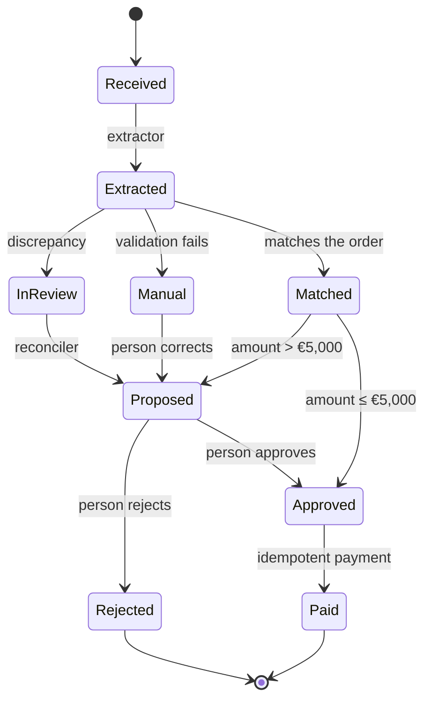
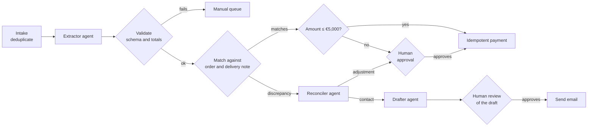

# Designing workflows with AI agents

Picture a finance team that wires an agent to the invoice inbox. In the demo, the agent reads the
PDF, finds the purchase order, reconciles the amounts and schedules the payment. Three weeks into
production, the first duplicate payment shows up: the agent retried after a timeout, and nobody
knew the payment tool was not idempotent. When someone asks why an invoice was approved with a
price that differs from the order, there is no way to tell: only the final result was kept.

The model was not the problem. The workflow was: a single agent with every tool, no checkpoints,
no state of its own and no traces. **Designing a workflow with agents means deciding, step by
step, what deterministic code does and what a model does, and where the system validates, asks
for approval or stops.**

This lesson stays at the level of the business workflow. The internal architecture of an agent
lives in [LLM and agent application architecture](/docs/arquitectura-agentes-llm); how much
autonomy to grant, in [controlling AI](/docs/controlar-la-ia-gobierno-y-autonomia); and where work
gets stuck, in [value flow and bottlenecks](/docs/flujo-de-valor-y-cuellos-de-botella).

<Callout tone="info" title="Cutoff date">
  Data checked in October 2026. The pattern names come from "Building effective agents" (Erik
  Schluntz and Barry Zhang, Anthropic, 19 December 2024); the page itself warns that some of the
  tooling it describes has changed. The figures in the worked example are assumptions, not prices
  from any provider.
</Callout>

## Deterministic or agent: decide per step

The usual starting mistake is deciding "we use an agent" for the whole process. The unit of
decision is the step. One workflow can have steps that are a SQL query, steps that are a single
model call, and one step, maybe only one, where an agent with tools adds something code cannot.

Anthropic separates _workflows_ (predefined code paths) from agents (the model directs its own
process). According to the authors, the former offer predictability and consistency for
well-defined tasks, the latter fit when you need flexibility, and you should start with the
simplest solution.

In the workflow, the practical rule is to start with everything in code, move to the model only
what code cannot do, and leave the agent the narrowest possible slice: if an "agent" step can be
described as a fixed list of calls, it is a _workflow_, and it will be cheaper and easier to
debug. The criteria for choosing between a single model call, a _workflow_ and an agent, and for
when not to use an agent, are in
[LLM and agent application architecture](/docs/arquitectura-agentes-llm).

## Workflow patterns and where to control them

Anthropic describes five workflow patterns: prompt chaining, routing, parallelization (with
sectioning and voting variants), orchestrator-workers and evaluator-optimizer, plus the autonomous
agent. Their definitions and use cases are in
[LLM and agent application architecture](/docs/arquitectura-agentes-llm). The question here is a
different one: what control does each pattern call for?

| Pattern              | Natural checkpoint                                      | What to measure               | Design risk                               |
| -------------------- | ------------------------------------------------------- | ----------------------------- | ----------------------------------------- |
| Prompt chaining      | A check between steps before passing the output on      | Which step breaks the chain   | An early error propagates to all steps    |
| Routing              | Classification confidence; default route to a person    | Share of cases per route      | A hard case lands on the cheap route      |
| Parallelization      | The aggregation: agreement threshold across branches    | Disagreement between branches | Cost multiplied by the number of branches |
| Orchestrator-workers | Validate the plan before delegating; cap on subtasks    | Subtasks generated per run    | Runaway subtasks and cost                 |
| Evaluator-optimizer  | Stopping criterion: quality threshold or max rounds     | Rounds until convergence      | A loop that never converges               |
| Autonomous agent     | Stopping conditions and approval of high-impact actions | Steps and tools per run       | Errors compounding unnoticed              |

The article calls the programmatic checks between chained steps _gates_: they confirm the process
is still on track. For agents, it mentions two control mechanisms: pausing for human feedback at
checkpoints or when the agent hits a blocker, and stopping conditions such as a maximum number of
iterations.

Patterns combine: the worked example is a chain with rule-based routing and a single agent step.

## Checkpoints: validate, approve, stop

A checkpoint is a place in the workflow where the system stops trusting the previous step's
output and decides whether to continue. There are three kinds, with different owners:

| Kind     | Who decides               | Where to put it                              | Example                                      |
| -------- | ------------------------- | -------------------------------------------- | -------------------------------------------- |
| Validate | Deterministic code        | After every model step                       | Schema, totals that add up, the order exists |
| Approve  | A person with context     | Before an irreversible or high-impact action | Reviewing a price adjustment before paying   |
| Stop     | The orchestrator's limits | Always, as a safety net                      | Budget spent, maximum steps, deadline        |

### Validate

Model output is untrusted input. Validate it with what code can check: a schema, sums that must
add up, identifiers that must exist in the source system, values within a range. Whatever fails
does not move forward: it goes back to the step or to a person.

### Approve

In the workflow, approval points sit right before the steps that cannot be undone, which is where
the cost of an error exceeds the cost of the review; how much autonomy to give each action and how
to design the approval are covered in [controlling AI](/docs/controlar-la-ia-gobierno-y-autonomia).
The OWASP LLM Top 10, 2025 edition (superseded in August 2026 by the 2026 edition), lists this risk
as Excessive Agency (LLM06): excessive functionality, permissions or autonomy.

### Stop

Every run needs bounded exits: maximum steps, a token or cost budget, a total deadline and a
failure count. How those limits work inside the agent loop is covered in
[LLM and agent application architecture](/docs/arquitectura-agentes-llm). At the workflow level,
add one more rule: stopping is not failing silently. A stopped case goes to a queue with its state
and its trace, and someone handles it.

## Reversibility and compensation

Classify each step by what it costs to undo. That classification decides where approval goes.

| Class        | What it means                             | Invoice example                      | Minimum control          |
| ------------ | ----------------------------------------- | ------------------------------------ | ------------------------ |
| Read         | Changes nothing                           | Looking up orders and delivery notes | Read-only permission     |
| Reversible   | Undone with no external effect            | Saving a draft email                 | Validation               |
| Compensable  | Canceled by another action , at some cost | Marking the invoice as approved      | Validation and a record  |
| Irreversible | No way back, or the way back is external  | Executing the payment, sending email | Approval and idempotency |

It is the same logic as sagas: compensable steps first, then a pivot, then steps that can be
retried. The details (compensating is not undoing, lack of isolation) are in
[sagas, outbox and idempotency](/docs/sagas-outbox-idempotencia). Applied to agents, it leaves two
rules:

- **The agent proposes; code executes.** Irreversible actions are not agent tools. The agent
  produces a structured proposal, and a deterministic step executes it after the checkpoint.
- **Approval goes right before the pivot.** Any step with an external effect after approval must
  be retryable and idempotent.

## State, memory and idempotency

Workflow state lives outside the model. The agent's context is working memory for one run; the
source of truth is a persistent record per case and per step. That lets you resume after a
failure without redoing work, audit a decision months later and switch models without losing
history.



Each transition is stored with its input, its output and who decided it (rule, model or person).
The shape of that record can be as simple as this:

```ts
type StepRecord = {
  flowId: string; // one case: one invoice
  step: 'extract' | 'validate' | 'reconcile' | 'approve' | 'pay';
  actor: 'rule' | 'model' | 'agent' | 'human';
  inputHash: string; // detects reprocessing with the same input
  output: unknown; // structured, validated proposal
  decision: string; // readable reason: rule applied or agent summary
  idempotencyKey?: string; // only on steps with external effects
  costEur: number;
  durationMs: number;
  // …
};
```

**Idempotency** is what makes retries safe. Agents retry by design: after a timeout, after a tool
error, or because the orchestrator resumes from the last step. Every action with an external
effect needs a stable key derived from the case, not from the attempt (for example, supplier plus
invoice number), and the target system must reject the repeat or return the earlier result.
Idempotency keys, the outbox and consumer-side deduplication are explained in
[sagas, outbox and idempotency](/docs/sagas-outbox-idempotencia).

## Observability: traces, cost and decisions

A workflow without traces cannot be debugged or improved. You need three signals per step:

| Signal                 | What it answers                               | Example                                      |
| ---------------------- | --------------------------------------------- | -------------------------------------------- |
| Trace per step         | What happened in this case, and in what order | One span per step and per tool call          |
| Cost and time per step | Where the money goes and where the case waits | Tokens, estimated cost and duration per step |
| Decision log           | Why the agent proposed what it proposed       | Tools used, evidence cited, reason           |

OpenTelemetry maintains semantic conventions for generative AI in the `semantic-conventions-genai`
repository. They include spans for invoking an agent (`invoke_agent`), executing a tool
(`execute_tool`) and invoking a workflow (`invoke_workflow`), and usage attributes such as
`gen_ai.usage.input_tokens`. As of October 2026 they are marked _Development_: they may change, so
pin the version you use.

Two design decisions worth making early:

- **What content goes into the trace.** Prompts and documents can hold personal or financial
  data. Record identifiers, metrics and the structured decision; keep full content only where you
  have grounds to, with bounded retention.
- **Cost per case as a product metric.** If the average cost per case multiplies, you want to see
  it on a dashboard before the provider's bill does ([FinOps](/docs/finops-costo-como-atributo)).

## Worked example: invoice review with three agents

A hypothetical case with explicit assumptions. A company receives **2,000 invoices a month** and
reviews them by hand at about 6 minutes each: 12,000 minutes, roughly 200 hours a month. It wants
to automate without risking wrong payments.

**Decision 1: three agents with minimal tools, none allowed to pay.**

| Agent      | Task                                      | Tools                                | What it cannot do         |
| ---------- | ----------------------------------------- | ------------------------------------ | ------------------------- |
| Extractor  | Read the PDF and return structured fields | Read the document                    | Query or write to the ERP |
| Reconciler | Explain a discrepancy and propose a fix   | Read orders, delivery notes, history | Approve, pay or write     |
| Drafter    | Draft the email to the supplier           | Create a draft                       | Send the email            |

The extractor could be a single model call; the reconciler is the only one that needs to be an
agent, because it cannot know upfront which documents it will have to look up.

**Decision 2: the workflow.** Intake, deduplication, validation, matching and amount-based routing
are code. A person approves any payment outside the automatic route and every email.



**Volume assumptions** (they must add up):

| Step                          |    In | Out per branch                                      |
| ----------------------------- | ----: | --------------------------------------------------- |
| Intake and deduplication      | 2,000 | 40 duplicates dropped (2%); 1,960 continue          |
| Extractor and validation      | 1,960 | 60 to the manual queue (3%); 1,900 continue         |
| Match with order and delivery | 1,900 | 1,520 match (80%); 380 with a discrepancy           |
| Amount-based routing          | 1,520 | 1,440 paid automatically; 80 to approval (> €5,000) |
| Reconciler                    |   380 | 228 adjustment proposals (60%); 152 to contact      |
| Drafter                       |   152 | 152 drafts to review                                |

**Human workload:** 60 manual cases at 6 minutes (360), 80 amount approvals at 2 minutes (160),
228 adjustments at 3 minutes (684) and 152 drafts at 2 minutes (304). Total: 1,508 minutes, about
25 hours a month against the original 200.

**Model cost (per-case assumptions, not provider prices):** extractor €0.02 × 1,960 = €39.20;
reconciler €0.15 × 380 = €57.00; drafter €0.05 × 152 = €7.60. Total: €103.80 a month, about €0.05
per invoice. Step times (assumed: 8 s, 40 s and 10 s) go into the same trace, so you can see
whether the bottleneck is the model or the approval queue.

**Decision 3: idempotency and traces.** The payment key is the supplier's tax ID plus the invoice
number; a retry returns the existing payment. Each case has a `flowId` that ties together the
spans of the three agents, the validations and the approval.

**Accepted consequences:** 25 hours of review a month, concentrated before payment; automatic
payment only when the invoice matches the order and delivery note and stays under €5,000; and that
threshold is reviewed every quarter against the errors caught in approval, as recorded in an
[ADR](/docs/adr).

## When to use it and when not to

At the workflow level, an agent step is justified when its output can be validated before the
next step, its irreversible actions stay out of its tools, the cost per case fits the process
margin and the team can staff the approval queue the design creates; if the rules can be written
down, a deterministic step will be cheaper and easier to debug. The general criteria for when not
to use an agent are in [LLM and agent application architecture](/docs/arquitectura-agentes-llm).

<Callout tone="warning" title="Approval saturates too">
  If the workflow sends more cases to review than the team can handle, approval turns into either a
  rubber stamp or a bottleneck. Size the approval queue like any other capacity in the system.
</Callout>

## Common mistakes

- **One agent for everything.** With every tool and the whole process in a single prompt, there is
  nowhere to validate and nothing to measure, and a failure in one step contaminates the rest.
- **Agents without tool limits.** An agent allowed to pay or send turns a reasoning error into an
  external effect. This is OWASP's Excessive Agency.
- **Workflows without traces.** Without a span per step and a decision log, you cannot tell why a
  case was approved or where the cost goes.
- **Trusting a step's output without validating it.** An extraction with a misread total flows as
  truth into every later step.
- **Approvals without context.** The person sees "Approve?" with no evidence and approves out of
  habit.
- **Retries without idempotency.** Retrying a step with an external effect duplicates the effect.
- **Stopping with nowhere to go.** A case that exceeds its budget and vanishes is worse than one
  that fails with its state and trace.

## Checklist

- [ ] Every step is classified as code, a single model call or an agent, with the reason.
- [ ] Every model step is followed by deterministic validation of its output.
- [ ] Irreversible actions are not tools of any agent and come after an approval.
- [ ] Each agent has the minimum list of tools, and read-only permissions where that is enough.
- [ ] The workflow has limits on steps, cost and time, plus a queue for stopped cases.
- [ ] Each case's state lives in a persistent per-step record, outside the model's context.
- [ ] Every action with an external effect uses an idempotency key derived from the case.
- [ ] There are traces per step with cost, duration and the reason for the decision.

## Sources

Checked in October 2026.

- [Building effective agents (Erik Schluntz and Barry Zhang, Anthropic, 19 December 2024)](https://www.anthropic.com/engineering/building-effective-agents)
- [LLM06:2025 Excessive Agency (OWASP Top 10 for LLM Applications 2025, superseded in August 2026 by the 2026 edition)](https://genai.owasp.org/llmrisk/llm062025-excessive-agency/)
- [Semantic Conventions for GenAI agent and framework spans (OpenTelemetry)](https://github.com/open-telemetry/semantic-conventions-genai/blob/main/docs/gen-ai/gen-ai-agent-spans.md)
- [OpenTelemetry semantic-conventions-genai](https://github.com/open-telemetry/semantic-conventions-genai)
