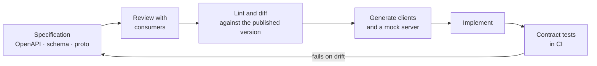
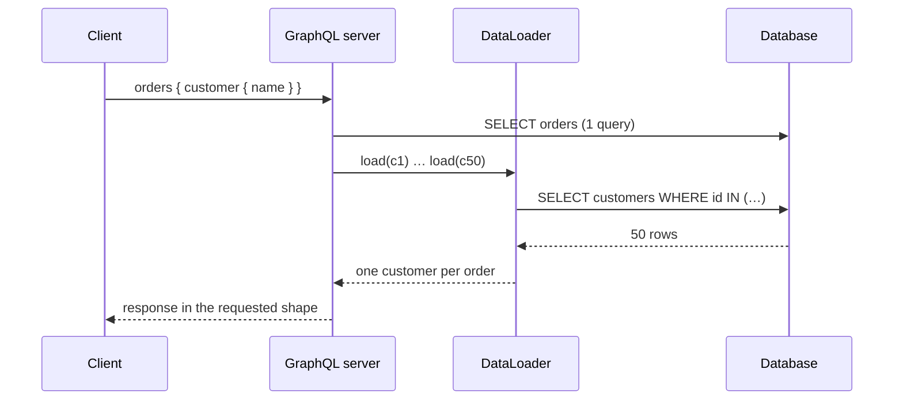
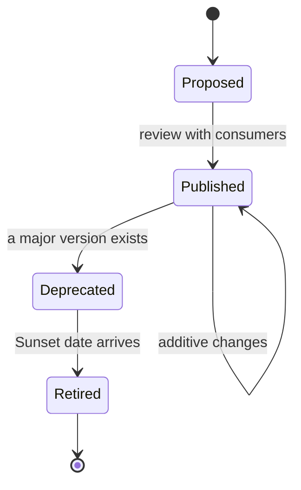
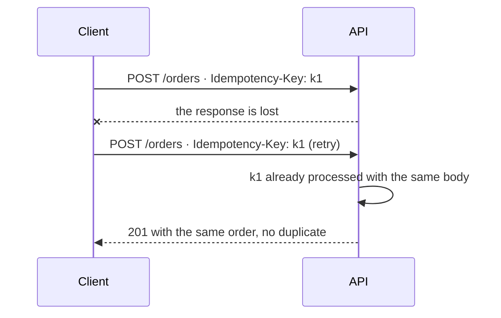

# API design: contracts that last

You rename a field from `status` to `state` because the new name reads better. Tests pass, the deploy is clean, and the next morning the version of the mobile app that thousands of people installed a year ago stops showing orders. You can't force them to update, and the partner who integrated your API through a nightly batch has nobody free this week. The server code was yours; the contract no longer entirely was.

**An API is a published contract: a promise that certain requests produce certain responses, relied on by consumers you don't control and impossible to withdraw whenever it suits you.**

This article treats that contract as the product it is. It compares REST, GraphQL and gRPC by how they express and evolve the contract, explains which changes break consumers and which don't, and gets down to the decisions that come up again and again: pagination, error format, safe retries for `POST`, and rate limits. The code only shows contract shapes, not implementations.

<Callout tone="info" title="Cut-off date">
  Specifications checked in October 2026. The `RateLimit` and `RateLimit-Policy` header fields are
  still an IETF draft (version 11, May 2026), and the `Idempotency-Key` draft is listed as expired;
  neither is an RFC yet.
</Callout>

## The contract as a product

A contract covers more than what you write in the specification. Hyrum Wright, then an engineer at Google, captured it in the observation Titus Winters named Hyrum's Law: with enough users of an API, it doesn't matter what you promise in the contract; somebody will depend on every observable behavior of your system. The order of a list, the text of an error message or the response time become part of the de facto contract, documented or not.

The practical consequence is that designing an API is mostly about deciding **what you promise and what you keep to yourself**. Whatever you don't promise explicitly (ordering, identifier format, internal fields) should either not be observable or be documented as not guaranteed.

### Contract-first or code-first

There are two ways to arrive at the contract. With **contract-first**, the team writes the specification (OpenAPI, a GraphQL schema or a `.proto` file), reviews it with consumers, and generates clients, mock servers and validation from it. With **code-first**, the specification is derived from annotations or types in the code.

| —                     | Contract-first                                   | Code-first                                      |
| --------------------- | ------------------------------------------------ | ----------------------------------------------- |
| Source of truth       | The specification, versioned in the repository   | The code; the specification is a by-product     |
| Review with consumers | Before implementation, on a readable document    | After the endpoint already exists               |
| Main risk             | Spec and code drift apart if nothing checks them | Implementation details leak into the contract   |
| Fits when             | There are external consumers or several teams    | Internal API, one consumer, very fast iteration |

Contract-first doesn't require bureaucracy. It requires the contract to be a reviewable artifact and an automated check that stops the code from drifting away from it.



## REST: resources over HTTP

Roy Fielding described REST in chapter 5 of his doctoral dissertation, _Architectural Styles and the Design of Network-based Software Architectures_ (University of California, Irvine, 2000). He defines it as an architectural style made of constraints: client-server, stateless, cache, uniform interface, layered system and, optionally, code on demand. The uniform interface itself has four constraints: identification of resources, manipulation through representations, self-descriptive messages, and hypermedia as the engine of application state.

Many APIs called REST meet the first constraints and skip hypermedia. That's not a sin, but it pays to be precise: what usually gets built is a resource-oriented HTTP API, and most of its value comes from using the semantics HTTP already defines.

### Methods and their semantics

RFC 9110 (June 2022) defines HTTP semantics. It separates **safe** methods, whose semantics are essentially read-only, from **idempotent** ones, where the intended effect of several identical requests is the same as that of a single one. `PATCH` isn't in RFC 9110: RFC 5789 (March 2010) defines it and states it is neither safe nor idempotent.

| Method   | Safe | Idempotent | Typical use                                  |
| -------- | ---- | ---------- | -------------------------------------------- |
| `GET`    | Yes  | Yes        | Read a resource or a collection              |
| `HEAD`   | Yes  | Yes        | Metadata without a body                      |
| `PUT`    | No   | Yes        | Replace the full state of a resource         |
| `DELETE` | No   | Yes        | Remove a resource                            |
| `POST`   | No   | No         | Create in a collection or trigger processing |
| `PATCH`  | No   | No         | Change part of a resource                    |

Idempotency matters because it decides what a client can safely retry when a response never arrives. `POST` needs an extra mechanism, covered below.

### Resources and status codes

Model business nouns (`/orders`, `/orders/{id}/lines`), not implementation verbs. Avoid nesting more than one level deep: if a resource has its own identity, give it its own path. And use status codes for what they mean in RFC 9110, not out of habit:

| Code  | When to use it                                                                          |
| ----- | --------------------------------------------------------------------------------------- |
| `201` | A resource was created; the `Location` header says where it lives                       |
| `400` | The request is malformed                                                                |
| `401` | Valid credentials are missing; sent with `WWW-Authenticate`                             |
| `403` | The server understood the request and refuses it; the same credentials won't help       |
| `404` | The resource doesn't exist, or you'd rather not reveal that it does                     |
| `409` | Conflict with the resource's current state, such as a forbidden state transition        |
| `412` | A request precondition, such as `If-Match`, evaluated to false                          |
| `422` | Valid syntax, but the server can't process what it asks for (a business rule isn't met) |
| `429` | Too many requests in a given period (RFC 6585)                                          |

`If-Match` with the `ETag` from your last read is the standard way to prevent lost updates: if another client changed the resource between your read and your write, the precondition fails with `412` and nothing gets overwritten.

## GraphQL: the client picks the shape

GraphQL is a query language with a typed schema. The GraphQL Foundation maintains the specification; the September 2025 edition is the first since October 2021. The server publishes types and fields, and each query asks for exactly the fields it needs, usually through a single endpoint.

Shifting that power to the client pays off when there are many consumers with different needs (mobile screens, web, integrations) and a rich data graph. It also has costs you should take on deliberately:

- **The N+1 problem.** Each field is resolved by its own function. A list of 50 orders that asks for each order's customer will, without extra care, run one query for the list and one per order. The usual fix is **DataLoader**: it groups the `load(key)` calls made in the same tick of the event loop into a single batch call and memoizes results for the duration of the request. According to its documentation, it's a port of the _Loader_ API developed at Facebook in 2010.
- **Variable query cost.** A client can ask for a very deep tree. Limiting depth or assigning a cost to each query is common practice.
- **Less useful HTTP caching.** If everything travels as `POST` to a single endpoint, URL-based HTTP caching stops helping and caching moves to the client or to a layer of your own.



GraphQL evolves without explicit versions: you add fields and mark old ones with the `@deprecated` directive, defined in the specification and exposed through introspection so tools can warn whoever still uses them.

## gRPC and Protocol Buffers

gRPC describes the service and its messages with Protocol Buffers by default. It supports four kinds of call (unary, server streaming, client streaming and bidirectional streaming) and lets the client set a deadline: when it runs out, the call ends with `DEADLINE_EXCEEDED`. It fits well between internal services with strict contracts and heavy traffic.

In Protocol Buffers the wire contract is defined by **field numbers**, not names. That leads to very concrete evolution rules, according to the official proto3 guide:

- A field's number can't change once the message is in use; renumbering is the same as deleting a field and adding a new one.
- Numbers are never reused. When you delete a field, reserve its number and its name, so JSON and text encodings keep working.
- Adding fields, deleting fields without reusing their number, and adding enum values are wire-safe. Even so, a new enum value can break a consumer's exhaustive `switch`.
- Unknown fields are preserved when parsing and re-serializing in binary, but can be lost when converting to JSON.
- Renaming a field doesn't change the binary format, but it breaks anyone using the JSON encoding.

```protobuf
message Order {
  reserved 4;              // formerly: string legacy_code
  reserved "legacy_code";
  string id = 1;
  OrderStatus status = 2;
  int64 total_cents = 3;
  optional string delivery_window = 5;  // added in v2
}
```

Numbers 1 through 15 take one byte on the wire, so keep them for the most frequently set fields. In proto3, a scalar without `optional` can't tell "not sent" apart from "sent with the default value"; if that difference matters, declare it `optional`.

## REST, GraphQL and gRPC side by side

| —                  | REST over HTTP                                | GraphQL                                   | gRPC                                 |
| ------------------ | --------------------------------------------- | ----------------------------------------- | ------------------------------------ |
| Contract           | OpenAPI (optional, but advisable)             | Typed schema, mandatory                   | `.proto` file, mandatory             |
| Who sets the shape | The server                                    | The client, within the schema             | The server                           |
| Usual evolution    | Additive changes, major version when breaking | New fields and `@deprecated`, no versions | Stable field numbers and `reserved`  |
| Caching            | Standard HTTP caching on `GET`                | Mostly on the client                      | Application-specific                 |
| Typical weak spot  | Over- or under-fetching per endpoint          | N+1 and variable query cost               | Less convenient from the browser     |
| Best fit           | Public and partner APIs                       | Many clients with different needs         | Service to service, strict contracts |

They aren't mutually exclusive: it's common to expose REST to partners, GraphQL as a layer for your own front ends, and gRPC between internal services.

## OpenAPI as a verifiable contract

OpenAPI is the specification for describing HTTP APIs in a machine-readable document. The OpenAPI Initiative maintains it under the Linux Foundation; version 3.2.0 was released in September 2025. Its value isn't pretty documentation but turning the contract into something you can **check**:

- **Lint** the specification against the team's style rules (naming, pagination, errors).
- **Diff** the proposed specification against the published one to catch breaking changes before merging.
- **Validate** real requests and responses against the schema in tests.
- **Generate** clients and mock servers so consumers can start before the implementation exists.

**Consumer-driven contracts**, described by Ian Robinson in 2006, flip the question: each consumer states which parts of the contract it relies on and the provider runs those expectations in its CI. That way it knows what it can change without breaking anyone. Any of these checks is a [fitness function](/docs/fitness-functions) for the API.

```yaml
# openapi.yaml (shape, not full content)
openapi: 3.2.0
paths:
  /orders:
    post:
      operationId: createOrder
      # requestBody, responses 201 / 409 / 422 …
components:
  schemas:
    Order: # …
    Problem: # application/problem+json
```

## Compatibility and versioning

### What breaks and what doesn't

A change breaks when a consumer that used to work stops working without touching its code. The type substitution behind this idea is covered in [SOLID](/docs/solid); here the operational rule is enough: **you may accept more and return more, but not require more or return less**.

| Change                                              | Breaks?     | Why                                               |
| --------------------------------------------------- | ----------- | ------------------------------------------------- |
| Add an endpoint or operation                        | No          | Nobody depended on it                             |
| Add an optional field to the response               | Usually not | A tolerant reader ignores it                      |
| Add a required field to the request                 | Yes         | Existing clients don't send it                    |
| Remove or rename a response field                   | Yes         | Somebody reads it                                 |
| Change a field's type or format                     | Yes         | It breaks the consumer's parsing or logic         |
| Tighten input validation                            | Yes         | Previously valid requests now fail                |
| Add a value to a response enum                      | It depends  | It breaks anyone treating the list as closed      |
| Change a field's meaning without changing its shape | Yes         | The schema can't see it, but the consumer notices |

The last row is the most dangerous: no specification diff catches it. Only consumer contract tests find it, or, worse, the consumers themselves.

### The tolerant reader

In 2011 Martin Fowler described the **tolerant reader** pattern: the consumer reads only what it needs and ignores the rest, so the provider can add fields without breaking it. He ties it to Postel's law: be conservative in what you do, be liberal in what you accept from others. As a provider you don't control how consumers read, but you can document that new fields and new enum values are compatible changes, and write your own SDKs as tolerant readers.

### Versioning without multiplying maintenance

When a break is unavoidable, a major version (in the path as `/v2`, in a header or in the media type) lets the old and new versions coexist. Every live version is code, tests and support, so the goal is to keep few of them and retire them on a known schedule. HTTP offers two header fields to say so: `Deprecation` (RFC 9745, March 2025) signals that the resource is or will be deprecated, and `Sunset` (RFC 8594, May 2019) announces when it will stop responding, which can't be earlier than the deprecation date.



Your organization's versioning strategy deserves an [ADR](/docs/adr): it's decided once and affects every API.

## Pagination: offset or cursor

| —                     | Offset (`offset` and `limit`)     | Cursor (opaque `after`)                             |
| --------------------- | --------------------------------- | --------------------------------------------------- |
| Jump to page 37       | Yes                               | No: only next and previous                          |
| Inserts between pages | Shift results: duplicates or gaps | Stable: the cursor marks a position                 |
| Cost on large tables  | Tends to grow with the offset     | Stable if the ordering uses an index                |
| Server freedom        | The client knows the mechanism    | An opaque cursor lets you change the implementation |
| Fits                  | Small admin tables                | Feeds, sync, large collections                      |

The GraphQL guide recommends opaque cursors (base64-encoded, for instance) precisely so clients don't depend on their format, and the _connection_ pattern (with `edges`, `node`, `cursor` and `pageInfo.hasNextPage`) has become the usual way to expose them. The same idea works in REST: return an opaque `next` and document that clients must not interpret it.

## A single error model

RFC 9457 (July 2023), by Mark Nottingham, Erik Wilde and Sanjay Dalal, obsoletes RFC 7807 and defines _problem details_: a common format for describing errors in HTTP APIs, with the `application/problem+json` media type.

| Member     | What it holds                                                        |
| ---------- | -------------------------------------------------------------------- |
| `type`     | A URI identifying the problem type; when absent, it is `about:blank` |
| `title`    | A short, human-readable summary of the problem type                  |
| `status`   | The HTTP status code of this response, as advisory information       |
| `detail`   | An explanation of this specific occurrence, aimed at helping fix it  |
| `instance` | A URI identifying this specific occurrence                           |

You can add extension members (for example, a list of invalid fields), and the RFC requires clients to ignore the ones they don't recognize, which makes the format a good example of a tolerant reader. What matters is the discipline: **one error format across the whole API**, stable and documented problem types, and never internal stack traces in `detail`.

## Idempotency for `POST`

The client sends `POST /orders`, the network drops before the response arrives, and it doesn't know whether the order was created. Retrying might duplicate it; not retrying might lose it. Since `POST` isn't idempotent, the contract has to add the guarantee.

The usual pattern is an **idempotency key**: the client generates a unique identifier per logical operation and sends it on every attempt. The IETF `Idempotency-Key` draft suggests `400` when the key is missing on an operation that requires it, `422` when it's reused with a different body, and `409` when the first attempt is still being processed. It's an expired draft, so treat it as a design reference, not a standard.



Where the key is stored, for how long, and how it's combined with writing the resource is covered in [sagas, outbox and idempotency](/docs/sagas-outbox-idempotencia).

## Rate limits

RFC 6585 (April 2012) defines `429 Too Many Requests`, which may come with `Retry-After` to say how long to wait. To advertise quota before it runs out, the `draft-ietf-httpapi-ratelimit-headers` draft defines `RateLimit-Policy` (the quota policy) and `RateLimit` (the quota available right now); when they appear alongside `Retry-After`, the latter takes precedence. Until it becomes an RFC you'll find provider-specific headers, so document yours as part of the contract.

On the client side, a `429` should be treated as a signal to wait, not as an error to retry immediately. Retries with growing backoff and circuit breakers are covered in [resilience in distributed systems](/docs/resiliencia-sistemas-distribuidos).

## When to use what

| Situation                                               | Reasonable decision                                              |
| ------------------------------------------------------- | ---------------------------------------------------------------- |
| Public or partner API, with consumers you don't control | REST with OpenAPI, contract-first and a diff in CI               |
| Many screens combining data from several domains        | GraphQL as an aggregation layer, with DataLoader and cost limits |
| High-traffic internal communication between services    | gRPC with Protocol Buffers evolution rules                       |
| A single consumer, same team, deployed together         | Code-first; the formal contract can wait                         |
| An unavoidable change in meaning                        | Major version, `Deprecation` and `Sunset` with real dates        |
| An internal API with two consumers                      | Skip versions: coordinate an additive change and a migration     |

## Common mistakes

- **Exposing the database model.** The contract inherits every schema change; publish a model designed for the consumer.
- **Assuming nobody uses a field.** Hyrum's Law says otherwise; measure usage before removing it.
- **Versioning on every change.** Each live version has a cost; exhaust additive changes first.
- **A different error format per endpoint.** Every consumer has to write a parser per case.
- **`200` with an error in the body.** It breaks caching, retries and observability, which all rely on the status code.
- **Offset pagination on growing collections.** It produces duplicates and gaps when rows are inserted.
- **`POST` without an idempotency key for money or stock.** A reasonable retry turns into a double charge.
- **Reusing a field number in Protocol Buffers.** Old clients will read new data with the old meaning.

## Worked example: the orders API

A team exposes orders to its website, to a mobile app with old versions still in use, and to three partners who integrate in batches. They need to add a delivery window and replace the `SHIPPED` status with two finer-grained states.

1. **Contract.** Partners can't be coordinated: REST with OpenAPI, contract-first, and a diff against the published version on every pull request.
2. **Delivery window.** It's a new optional response field: an additive change, no new version. The docs state that clients must ignore unknown fields.
3. **New states.** Replacing `SHIPPED` breaks anyone filtering on that value, and adding values breaks anyone treating the enum as closed. The team keeps `SHIPPED` in v1 and publishes the finer states in `/v2/orders`.
4. **Retirement.** v1 responds with `Deprecation` from v2's launch day and with `Sunset` nine months out. A dashboard tracks which consumers still call v1.
5. **Listing.** The partner listing moves to an opaque cursor, because partners sync collections that change while they paginate.
6. **Creation.** `POST /orders` requires an idempotency key; errors use `application/problem+json` with documented types.
7. **Record.** The versioning and retirement decisions go into an ADR so the next API doesn't relitigate them.

## Checklist

- [ ] The contract is a versioned artifact, reviewed before implementation.
- [ ] An automated diff in CI blocks breaking changes without a major version.
- [ ] Known consumers have contract tests that the provider runs.
- [ ] Every error uses a single format, ideally RFC 9457.
- [ ] Growing collections are paginated with opaque cursors.
- [ ] `POST` operations with significant side effects accept an idempotency key.
- [ ] Rate limits answer `429`, say when to retry and are documented.
- [ ] Every deprecated version has a retirement date announced with `Deprecation` and `Sunset`.

## Sources

Checked in October 2026.

- [Architectural Styles and the Design of Network-based Software Architectures, chapter 5 (Roy T. Fielding, 2000)](https://ics.uci.edu/~fielding/pubs/dissertation/rest_arch_style.htm)
- [RFC 9110: HTTP Semantics (June 2022)](https://www.rfc-editor.org/rfc/rfc9110.html)
- [RFC 5789: PATCH Method for HTTP (March 2010)](https://www.rfc-editor.org/rfc/rfc5789.html)
- [RFC 6585: Additional HTTP Status Codes (April 2012)](https://www.rfc-editor.org/rfc/rfc6585.html)
- [RFC 9457: Problem Details for HTTP APIs (July 2023)](https://www.rfc-editor.org/rfc/rfc9457.html)
- [RFC 9745: The Deprecation HTTP Response Header Field (March 2025)](https://www.rfc-editor.org/rfc/rfc9745.html) and [RFC 8594: The Sunset HTTP Header Field (May 2019)](https://www.rfc-editor.org/rfc/rfc8594.html)
- [RateLimit header fields for HTTP, draft version 11](https://datatracker.ietf.org/doc/html/draft-ietf-httpapi-ratelimit-headers-11)
- [The Idempotency-Key HTTP Header Field, draft](https://datatracker.ietf.org/doc/draft-ietf-httpapi-idempotency-key-header/)
- [Announcing the September 2025 edition of the GraphQL specification](https://graphql.org/blog/2025-09-08-september-edition/) and the [GraphQL pagination guide](https://graphql.org/learn/pagination/)
- [DataLoader](https://github.com/graphql/dataloader)
- [Language Guide (proto3)](https://protobuf.dev/programming-guides/proto3/) and [gRPC core concepts](https://grpc.io/docs/what-is-grpc/core-concepts/)
- [OpenAPI Specification v3.2.0](https://spec.openapis.org/oas/v3.2)
- [Consumer-Driven Contracts (Ian Robinson, 2006)](https://martinfowler.com/articles/consumerDrivenContracts.html)
- [TolerantReader (Martin Fowler, 2011)](https://martinfowler.com/bliki/TolerantReader.html)
- [Hyrum's Law](https://www.hyrumslaw.com/)
