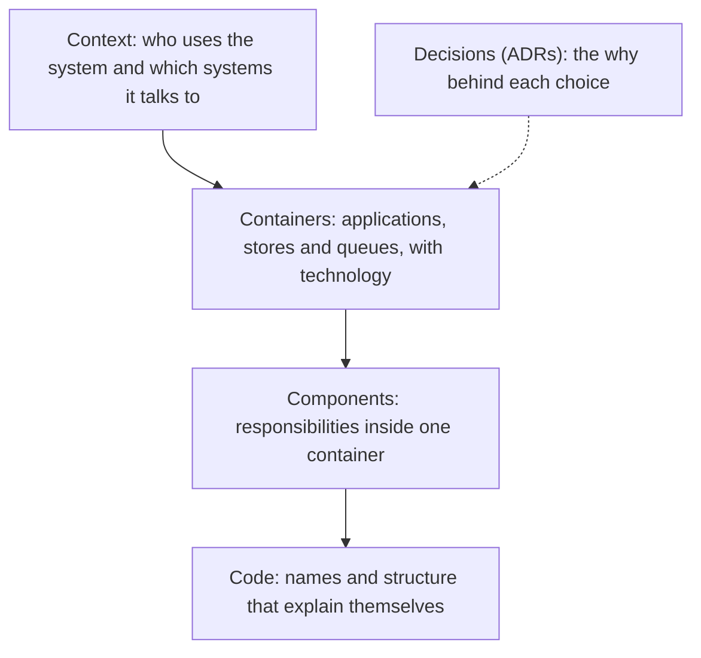

Almost every team has architecture documentation, and almost nobody reads it. It is usually a diagram from two years
ago with four boxes that no longer exist, a fifty-page document nobody finished, and a wiki of decisions with no context.
The problem is not the lack of documents. Most of them do not answer any concrete question that someone has to solve.

The thesis of this article is that **architecture documentation is justified by the questions it answers**, not by the
fact that it exists. If you do not know which question a document answers, who will consult it and when, it probably
should not exist. A useful document is short, has an owner, lives next to the code and is reviewed when the system
changes. The rest is well-meant noise.

## Which questions it must answer

Four questions architecture documentation must answer well. The first is **orientation**: what does this system do, what
parts does it have and how do they relate? Someone new to the team needs a map, not the detail of every class. The second
is **decision**: why is the system like this? Without the why, each person who touches it questions it again, and every
change of team erases the memory.

The third is **operation**: which components must be watched, what depends on what, and what happens if one falls over?
This is the question most often forgotten and the one that costs most during an incident. The fourth is **change**: if I
need to modify this part, what else is affected and what constraints apply? Each question asks for a different kind of
document, and mixing them into one produces a document that answers all of them badly.

<Callout tone="info" title="The question test">
  Write down the question a document must answer before writing a single line. If you cannot phrase
  it in one sentence, the document has no function yet and it is better not to write it.
</Callout>

## Levels of detail: from general to specific

Useful documentation is organised in levels, and each level has an audience. The top level shows the system in its
context: which people and which other systems use it. Anyone in the organisation can read that diagram. The next level
shows the containers, the applications and stores that make up the system, with their technologies and responsibilities.
It is the level for the teams that build and run it. The third level breaks a container into components, and it only makes
sense for whoever is going to change that part. The fourth level, code, is documented by the code itself through clear names.

The C4 model proposes exactly this separation, and its biggest contribution is the limit it sets: do not draw more detail
than the level needs. A context diagram with internal classes serves nobody; a component diagram without context does not
explain why it exists. Each level should be readable on its own.

A practical rule for choosing the level: document down to where decisions change. If a part is rewritten every year, do not
give it detailed component diagrams; if it stays stable for a decade, it may deserve one. The frequency of change is a better
guide than the feeling of importance.

## Decisions: the record that outlives the team

The decision record is the documentation that pays off most after a few years. In 2011 Michael Nygard proposed a lightweight
form for recording significant architecture decisions, with five sections: title, context, decision, status and consequences.
The central idea is that the record explains the forces that led to the choice, not only the outcome. Someone reading a
decision three years later needs to know which constraints existed then, so they can judge whether they still hold.

Consequences deserve special attention. A record that lists only advantages is no use for reviewing the decision, because half
of its value lies in the costs accepted: what is lost, what becomes harder, what debt remains. If no negative consequences
appear, the record was probably written to justify the choice rather than to make it.

The format matters less than the habit. One numbered record per decision, in the repository, with a status that changes
(proposed, accepted, superseded) is enough. The life cycle of those records has its own article, in
[ADR: the life cycle of a decision](/docs/adr-ciclo-de-vida); here it is enough to remember that a superseded decision must
point to its replacement, so nobody follows an old one by mistake.

<Callout tone="tip" title="Decide in writing, not afterwards">
  Writing the record before implementing forces you to state the alternatives you rejected. If it is
  written at the end, it tends to reconstruct the decision already taken and leaves out the options
  that were never considered.
</Callout>

## Next to the code, not somewhere else

Documentation that lives outside the code goes stale. The repository is where change goes through review, so that is where
the things that change with the code should live: container diagrams, decision records and the description of each service.
When a change alters the architecture, the review should include the update to the document, just as it includes tests.

Diagrams as code make this easier. A diagram written as text is versioned, reviewed in a pull request and regenerated without
effort, whereas a diagram drawn by hand in an external tool stays at the version its author left. Learning the syntax costs
little, and the benefit is that the diagram stops being a separate artefact. If the diagram is not updated in the same change
as the code it represents, the practice is not working, whatever the tool.

## What to remove, and how to know it has expired

Architecture documents expire silently. Nobody deletes them, nobody corrects them, and over time they contain more falsehoods
than information. The defence is that each document has a **last-reviewed date and a named owner**, and that the review is part
of the change that alters what it describes. A simple check is to list the documents whose date is older than the last change
to the part they describe.

Removing is also documenting. A document that describes a retired system must be marked as historical or archived with a link
to its replacement. Leaving it unmarked is worse than not having it, because whoever finds it will take it as current.

## An entry document: the reading path

For someone new, the most useful thing is not an index of documents but a **reading path**: what to read first, what to skip and
why. A half-page entry page can say: read the system context, then the container diagram, then the three decision records that
explain why the system is the way it is, and then the service for your first task. That path reduces the number of documents the
person must open, which is the real limit on reading.

The reading path also needs an owner, and it is worth reviewing it at every onboarding. If newcomers always get stuck at the same step, the document behind that
step is what is failing, not the person. Noting where each new member stopped during their first week is a cheap way to find the document that needs rewriting.

The entry document should also say what is deliberately not documented. A sentence such as "the billing layer has no diagram
because it will be replaced in 2027" stops the reader from searching for something that does not exist and asking why.

## Measuring whether anyone uses it

Documentation is justified by its use, and use can be measured with little effort. Three indicators are enough. The first is the
**time to the first change** by someone new: if the documentation works, that time falls. The second is **repeated questions**
in the team channel: if the same question appears every month, the answer should be in a document and is not yet, or it exists
and nobody finds it. The third is the **frequency of change** of each document: a document nobody touches for a year, or one
edited every week, deserves a review of its usefulness.

From time to time, also ask whoever took a recent decision whether they found the record that explains it. That question reveals
more about the real state of the documentation than any metric.

## A case: a newcomer's first days

Think of someone joining a shipping team. They do not know the system and must make their first change within the week. The documentation
cannot give them the whole system, but it must give them a path to understand it without interrupting the entire team.

In the first half hour, the entry page points to the route: the system context, the container diagram and three decision records. The context
diagram tells them that their service receives orders from the catalogue and issues shipping labels. The container diagram shows that the event
queue is the boundary with the warehouse, and that the two sides do not share a database. With that, the newcomer knows which questions to ask and whom.

On the second day, they notice that retries towards the warehouse are slow. They search the records and find a decision titled retries with exponential
backoff and jitter. Its consequences state that late deliveries are accepted during peaks, in exchange for not overloading the warehouse. The newcomer
understands that this is not a bug but a written trade-off. A question that would have cost a half-hour conversation on another team is resolved in ten minutes.

The documentation also fails sometimes, and the case shows that too. The warehouse component diagram is two years old and shows a tool that no longer exists.
The newcomer asks in the team channel, someone answers with the real picture, and the team marks the document as outdated with a date and a link to its
replacement. That step takes five minutes and saves the next person an afternoon.

On the third day, their first change adds a consumer to the queue. The review asks for an update to the container diagram, and they make it in the same
change. That is the point of the case: the documentation stayed alive because the review treated it as part of the code.

The case leaves one criterion: a useful document follows a real path of work, not a list of everything that exists. And the sign of health is not that the
document is complete, but that its reader knows when not to trust it.

## What not to document

Not everything deserves a document. What the code says by itself, such as the logic of a function or the name of a variable, does
not need a separate text. Nor do details that change every sprint, such as the number of replicas of a service or the exact version
of a library, which belong in configuration rather than in a document that will be out of date within a week. The rule is to document
what is costly to discover and changes slowly: the why, the map and the constraints.

## Common mistakes

The first mistake is **documenting for the archive**: writing a lot to store it in a repository nobody consults. A document that does
not answer a concrete question for someone does not justify its maintenance cost.

The second is **mixing levels** in one diagram. A drawing that shows context, containers and classes at once serves nobody, because each
reader looks for a different level.

The third is **writing decisions without alternatives or consequences**. A record that only describes the option chosen does not let you
review the decision when conditions change.

The fourth is **keeping documentation outside the change flow**. If updating it is not part of the review, there will always be an excuse
to postpone it, and the gap between document and system grows without anyone seeing it.

A useful criterion for deciding when to write a decision record is reversibility. If the decision can be reversed in an afternoon, such as the name of a folder or
a minor library version, it does not deserve a record. If reversing it means migrating data, changing contracts or rewriting several services, the record is
mandatory, because within a year nobody will remember why that path was chosen. Between those extremes, the practical question is whether someone who arrives in
two years might want to undo it and would not know why it should not be undone.

## Tools

A repository with text files is enough for the decision records, a diagrams-as-code format for the context and container levels, and a
template with date, owner and status for each document. A site generated from those files makes reading easier, but it is not essential.
Wiki tools suit process documents, not architecture, because their history is not reviewed with the code and their state is not governed
by the same rules.

## Checklist

- [ ] Each document answers one concrete question of orientation, decision, operation or change, stated in one sentence.
- [ ] Diagrams are organised in levels, and each level can be understood on its own.
- [ ] Each significant decision has a record with context, decision, status and consequences, including the negative ones.
- [ ] Diagrams and records live in the repository and are updated in the same change that alters the system.
- [ ] Each document has a last-reviewed date and a named owner.
- [ ] A reading path exists for newcomers, with a note on what is deliberately not documented.
- [ ] Retired material is marked as historical and links to its replacement.
- [ ] Whether anyone uses the documentation is measured at least once a quarter.

## Sources

- Michael Nygard, [Documenting Architecture Decisions](https://thinkrelevance.com/blog/2011/11/15/documenting-architecture-decisions), published on 15 November 2011. Its content is confirmed through secondary summaries; the original text has not been reviewed directly.
