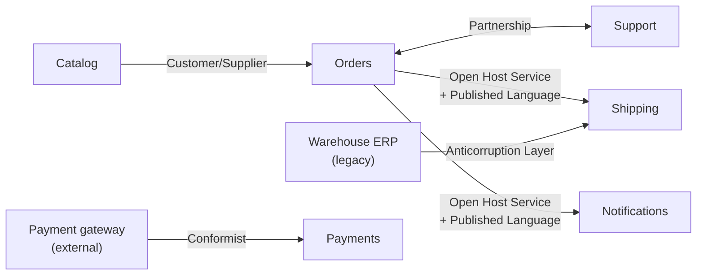
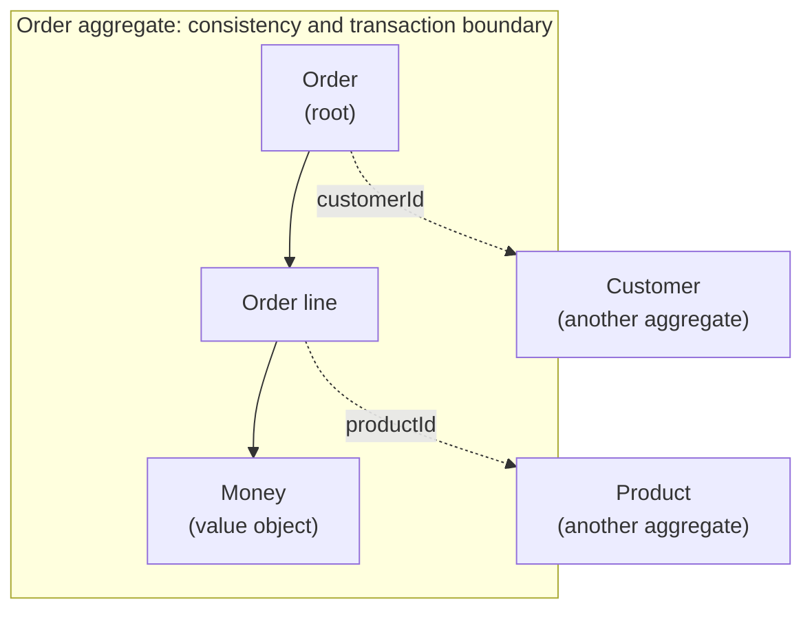

# Domain-Driven Design: design from the domain

Most of the complexity in a business system is not in the technology but in the domain: rules
that change, words that mean different things depending on who says them, and models that blend
together until nobody knows where each decision lives. **Domain-Driven Design** (DDD) is a set of
ideas and patterns, formulated by Eric Evans, so that the code expresses the domain instead of
hiding it.

This article covers **strategic** design (subdomains, ubiquitous language, bounded contexts and
context maps), **tactical** design (entities, value objects, aggregates, repositories and
events), how to discover the domain with Event Storming, how to translate contexts into modules
and [C4](/docs/c4-model) containers, and which tools help keep the boundaries in place. The
examples use the **Aurora Store** from the C4 article, an invented system.

<Callout tone="info" title="Cutoff date">
  The state of the tools is as of October 2026. The DDD definitions come from Evans' _DDD Reference_
  (2015) and from Vaughn Vernon's essays on aggregates, which were read directly; anything that
  comes from third-party summaries is flagged in the text.
</Callout>

## What problem it solves, and when not to use it

Evans sums DDD up in three ideas: focus on the **core domain**, explore models in creative
collaboration between the people who know the domain and the people who write software, and
speak a **ubiquitous language** within an **explicitly bounded context**. It is not an
architecture or a framework: it is a way of deciding where to invest modeling effort.

That investment does not always pay off. Use this as a guide:

| Signal                                                          | What it suggests                                           |
| --------------------------------------------------------------- | ---------------------------------------------------------- |
| Rich, changing business rules that are debated daily            | Full DDD: strategic and tactical                           |
| The same word means different things depending on the area      | At least the strategic part: bounded contexts and language |
| Screens that save and list data with trivial validation (CRUD)  | You do not need it: a data model and validation suffice    |
| A subdomain every company solves the same way (payments, email) | Buy or integrate a solution; do not model it by hand       |

<Callout tone="warning" title="DDD has a cost">
  It demands sustained conversations with business experts, continuous refactoring of the model and
  discipline with language. Evans is blunt about it: not every part of the design is going to be
  equally refined, so priorities must be set and any other investment justified by how it supports
  the core.
</Callout>

## Strategic design

### Domain and subdomains

The **domain** is the business area the software serves. It splits into subdomains, and they are
not all worth the same. Evans defines two: the **core domain**, the most valuable and specialized
part of the business, which deserves your best developers, and **generic subdomains**, which add
complexity without capturing specialized knowledge and for which off-the-shelf solutions are
worth considering. The third category, the **supporting** subdomain, was popularized by later
authors such as Vlad Khononov (according to summaries of _Learning Domain-Driven Design_):
necessary for the business, no competitive advantage and simple logic.

| Type       | What it is                     | In Aurora Store (illustrative)  | How to treat it             |
| ---------- | ------------------------------ | ------------------------------- | --------------------------- |
| Core       | What sets you apart            | Coffee selection and freshness  | Deep model, strongest team  |
| Supporting | Necessary, not differentiating | Orders and returns              | Simple; built or outsourced |
| Generic    | Everybody does it the same way | Payments, email, authentication | Buy or integrate            |

The classification is not permanent: according to those same summaries, a subdomain can change
type over time, and a core can end up generic.

### Ubiquitous language

Evans asks you to use the model as the backbone of a shared language: the same one in
conversations, diagrams and, above all, code. And he adds the consequence that is most often
overlooked: **a change in the language is a change to the model**, so you refactor the code so
that names follow the new language.

An Aurora Store example (invented): for Sales, an _order_ is a purchase confirmed by the
customer; for the warehouse, an _order_ is the list of products to pick from the stockroom. One
word, two models. It is not solved with a "unified" model that serves both badly, but by
recognizing that they are two contexts.

### Bounded context

Evans defines it this way: you explicitly delimit the context in which a model applies, in
terms of team organization, usage within specific parts of the application and physical
manifestations such as code bases and database schemas. Inside the context the language is
strict; outside, the same term may mean something else.

Do not confuse it with the subdomain. The subdomain describes the business **problem**; the
bounded context is a **design decision** about where a model holds. Ideally they coincide, but
with a legacy system they often do not. And note that the definition talks about code bases and
schemas, not processes: a bounded context is a model boundary, not necessarily a deployment
boundary.

### Context map

An isolated context leaves one problem open: how it relates to the others. The **context map**
identifies each model in play, names it and describes the points of contact, with explicit
translation where there is any. Evans insists that you first map the terrain **as it is** and
leave transformations for later.



The arrow goes from the **upstream** context (the one that conditions) to the **downstream**
one. The relationship names are those of the _DDD Reference_:

| Pattern              | Idea                                                                                                       | Use it when                                                                |
| -------------------- | ---------------------------------------------------------------------------------------------------------- | -------------------------------------------------------------------------- |
| Partnership          | Two teams that succeed or fail together plan and manage the integration jointly                            | One's delivery depends on the other                                        |
| Shared Kernel        | A small subset of the model and code that both teams share; not changed without consulting                 | Continuous integration across contexts is viable and the common core small |
| Customer/Supplier    | The downstream's priorities enter the upstream's planning; joint acceptance tests                          | The upstream can serve the downstream                                      |
| Conformist           | The downstream adopts the upstream's model as is, without translating                                      | The upstream has no motivation to adapt and its model is acceptable        |
| Anticorruption Layer | An isolating layer translates the other model into your own                                                | You integrate legacy or weak-model systems                                 |
| Open Host Service    | An open protocol, exposed as a set of services, for whoever needs to integrate                             | Many clients need to integrate with your context                           |
| Published Language   | A well-documented common language (often an interchange standard); usually combined with Open Host Service | The internal model should not be frozen as an interchange format           |
| Separate Ways        | No integration: each context solves its own problem                                                        | The benefit of integrating does not justify its cost                       |
| Big Ball of Mud      | A boundary is drawn around the mess and no sophisticated modeling is applied inside                        | You are describing a system with no clear boundaries                       |

Partnership, Big Ball of Mud and domain events are terms Evans added to the _Reference_ after
the 2004 book.

The anticorruption layer is the pattern you will appreciate most in practice. Its value is that the
translation lives in **a single place**: a small unit, for example an adapter inside
`shipping/infrastructure/`, that converts the ERP's vocabulary (status codes, column names) into the
context's own, so the foreign model does not leak into the rest of the system. Two conventions keep
it clean: the adapter carries the name of the foreign system and its input types are not exported;
only types from the ubiquitous language come out, such as `ShipmentStatus` (pending, shipped,
cancelled). The alternative, **Conformist**, is cheaper at first, but every change in the ERP
becomes a change in your model.

## Tactical design

The tactical building blocks keep the code aligned with the model. Before using them, Evans asks
you to isolate domain logic from the user interface, the database and the infrastructure
(layered architecture) and clarifies that patterns such as
[hexagonal architecture](/docs/arquitectura-hexagonal) work as well or better, as long as the
domain depends on nothing technical.

- **Entity:** an object defined by its **identity**, not its attributes. It has a lifecycle and
  the model must define what it means to be "the same thing".
- **Value object:** describes something by its attributes and **has no identity**. It is treated
  as immutable, with side-effect-free operations.
- **Domain event:** something that happened and that experts care about. It is modeled as an
  object, normally immutable, with a timestamp and the identities involved.
- **Domain service:** a significant operation that is not a natural responsibility of an entity
  or value object. It is named in the ubiquitous language.
- **Factory:** encapsulates the creation of complex objects or aggregates, which are born
  complete and with their invariants satisfied.
- **Repository:** gives the illusion of an in-memory collection of aggregate roots, with queries
  expressed in domain terms. It exists only for the roots that need it.
- **Module:** part of the model, with names that belong to the ubiquitous language.
  [Cohesion and coupling](/docs/acoplamiento-cohesion) are judged by concepts that can be
  understood independently, not just by metrics.

### Aggregates: the piece most often done wrong

An **aggregate** groups entities and value objects under a **root** and a boundary. According to
Evans, outside objects may only hold references to the root; the root (or a designated
mechanism) enforces the **invariants** of the whole; and the same boundary governs transactions:
inside it, consistency is synchronous; across aggregates, asynchronous.

Vernon distills four rules in his _Effective Aggregate Design_ essays:

1. **Model true invariants in consistency boundaries.** An invariant is a business rule that must
   always hold transactionally; only with them do you decide which objects go in the same
   aggregate.
2. **Design small aggregates.** The root plus the minimum attributes needed; a large one neither
   scales nor performs, and comes from "false invariants" and the convenience of composing
   objects.
3. **Reference other aggregates by identity**, not by object.
4. **Use eventual consistency outside the boundary.** A rule that spans aggregates does not have
   to be up to date at all times; it is resolved with events or other mechanisms. Vernon is
   wary of cases that seem to require modifying several aggregates in a single transaction.



### How each building block is named

In DDD **the ubiquitous language is the team's own**: the examples are in English because that is
how this team would talk. What matters is the convention, not the language:

| Building block | How it is named                                          | Tienda Aurora examples (illustrative)   |
| -------------- | -------------------------------------------------------- | --------------------------------------- |
| Entity / root  | Business noun, singular, no technical suffixes           | `Order`, `Customer` (not `OrderEntity`) |
| Value object   | By its meaning in the business, immutable                | `Money`, `Quantity`, `ShippingAddress`  |
| Domain event   | Past participle: something that already happened         | `OrderConfirmed`, `PaymentAuthorized`   |
| Use case       | Verb plus object                                         | `confirmOrder`                          |
| Repository     | Aggregate name plus Repository; collection-style methods | `OrderRepository`: `byId`, `save`       |
| Factory        | Static method with a business verb                       | `Order.start`                           |

### The Order aggregate at a glance

You do not need to see the implementation: what matters is what the root exposes and what it is
called.

```typescript
// Aggregate root: every change goes through its methods.
export declare class Order {
  readonly id: OrderId;
  readonly customerId: CustomerId; // another aggregate: referenced by identity

  static start(id: OrderId, customerId: CustomerId, currency: Currency): Order; // born valid
  addLine(productId: ProductId, quantity: number, price: Money): void;
  // invariants: draft only, integer quantity of at least 1, same currency, at most 50 lines
  confirm(now: Date): void; // invariant: not empty; records OrderConfirmed
  total(): Money;
  pullEvents(): readonly OrderConfirmed[];
}
```

The decisions this design rests on:

- **Private state, methods named with business verbs.** The invariants (no confirming an empty
  order, no changing a confirmed one, a single currency, a maximum number of lines) cannot be
  bypassed because there is no other door. The alternative, public fields with a separate
  validator, is precisely the anemic model. The limit of 50 lines is an illustrative value.
- **Identifiers with their own type.** `OrderId` and `CustomerId` are distinct types (the _branded
  types_ technique), so the compiler stops you from passing one where the other is expected. In
  exchange, there is some ceremony at the boundaries.
- **Other aggregates by identity.** `customerId` is a reference by identity, not an embedded
  `Customer` object.
- **The factory prevents half-built states.** An order never exists without a customer and a
  currency.
- **The clock comes in as a parameter** (`now`): the domain is deterministic and easy to test.
- **The aggregate accumulates its events; it does not publish them.** Publishing is the
  application layer's job. `Money` completes the picture: an immutable value object, validated on
  construction and compared by its amount and currency.

### The application service and the transaction

The `confirmOrder` use case lives outside the domain, in `application/`, and always follows the same
script. It marks the transaction boundary: **one transaction, one aggregate**.

1. **Load** the root by identity from the `OrderRepository`.
2. **Ask it to make the change** (`order.confirm`): the rules live in the domain, not in this service.
3. **Save** the aggregate in a single transaction.
4. **Publish** the events the root accumulated.

The repository, the event publisher and the clock come in as dependencies: they are the _ports_ of
the [hexagonal architecture](/docs/arquitectura-hexagonal), which is why the use case can be tested
without infrastructure.

<Callout tone="warning" title="Saving and publishing are not atomic">
  If the process dies between saving and publishing, the event is lost. The _transactional outbox_
  pattern solves it: the message is stored in the same local transaction that changes the entities
  and a separate component publishes it. In exchange, duplicates are possible, so consumers must be
  idempotent.
</Callout>

## Discovering the domain with Event Storming

The model is not deduced from the tables; it is discovered by talking to the people who know the
business. **EventStorming**, by Alberto Brandolini, is a workshop for collaboratively exploring
complex domains: the process is told as a timeline of **domain events** on sticky notes across a
long wall. According to Wikipedia it was born during Vernon's IDDD Tour.

Brandolini describes three formats, from broad to concrete:

| Format            | Scope                                | Result                                                    |
| ----------------- | ------------------------------------ | --------------------------------------------------------- |
| Big Picture       | A whole business or line of business | The shape of the landscape, bottlenecks and disagreements |
| Process Modelling | One specific process                 | Commands, actors, policies and read models                |
| Software Design   | One piece of software                | Aggregates, transactions and candidate context boundaries |

The official page for the book _Introducing EventStorming_ calls the middle one _Process Design_
and warns that the book is unfinished: the Big Picture mechanics are fairly well covered; Process
and Software Design are still incomplete. That is why the descriptions of those two formats come
from practitioners' accounts and not from the book.

A widespread convention uses **orange** notes for events, **blue** for commands and **yellow**
for aggregates (that is how Wikipedia describes it). The DDD Crew community glossary uses a
different palette for some elements (lilac policies, pink external systems, green read models)
and marks points of disagreement as neon-pink _hot spots_. Treat the palette as a team
convention, not a standard. For Aurora Store, one stretch of the wall would be:

| Command (blue)    | Aggregate (yellow) | Event (orange)    |
| ----------------- | ------------------ | ----------------- |
| Start cart        | Cart               | CartStarted       |
| Confirm order     | Order              | OrderConfirmed    |
| Authorize payment | Payment            | PaymentAuthorized |
| Prepare shipment  | Shipment           | ShipmentPrepared  |

Two signals for reading the wall: when two areas use the same word with different meanings,
there are probably two models and therefore two contexts (the "order" case above); and every hot
spot is an unanswered question worth taking to the experts. **Domain Storytelling** is an
alternative technique, centered on telling stories between experts and the development team,
with the open tool Egon.io.

## From bounded contexts to modules and C4 containers

A bounded context is a **model** boundary; how many processes run it is another decision. A
reasonable starting point, and the usual one at the beginning, is a **modular monolith**: one
deployment, one module per context and boundaries that are checked. You extract a context into
its own container when there is a concrete reason, such as a different pace of change, scale or
team. Record that decision in an [ADR](/docs/adr) and reflect the result in the container level
of the [C4 model](/docs/c4-model).

| Aurora context | Reasonable start                               | Signal to extract it                              |
| -------------- | ---------------------------------------------- | ------------------------------------------------- |
| Orders         | Module of the monolith                         | Very different scale or rate of change            |
| Shipping       | Module with an anticorruption layer to the ERP | The ERP drives deployment and failures            |
| Notifications  | Module or _worker_ (generic subdomain)         | Load spikes or an interchangeable external vendor |

A boundary that is not checked erodes. A structure per context, with one public API per module,
lets you enforce it with a tool:

```text
src/
  orders/
    domain/             Order, Money, OrderConfirmed
    application/        confirmOrder
    infrastructure/     OrderRepository (adapter), publisher
    index.ts            the context's public API
  shipping/
    ...
```

With dependency-cruiser, the rule forbids importing the inside of another context and only
admits its `index.ts`. The `$1` in `pathNot` repeats the context name captured in `from`. If you
have an explicit Shared Kernel, exclude it here too. For TypeScript, the configuration must point
to your `tsconfig.json` (`options.tsConfig`):

```javascript
{
  name: 'only-through-the-public-api-of-another-context',
  severity: 'error',
  from: { path: '^src/([^/]+)/' },
  to: { path: '^src/([^/]+)/', pathNot: '^src/($1/|[^/]+/index\\.ts$)' },
}
```

The rule was tested with dependency-cruiser 18.6.0 on a minimal project: it flags an import into
another context's internals and lets through the `index.ts` and same-context imports. It is a
[fitness function](/docs/fitness-functions): an architecture rule that runs in CI.

## DDD and AI agents

A coding agent starts each session without knowing your domain and tends to invent names. The
ubiquitous language is exactly the context it lacks. A short glossary in `CLAUDE.md` or
`AGENTS.md`, per context, keeps it from mixing "order" and "picking order":

```markdown
## Ubiquitous language

- **Order** (Orders context): a purchase confirmed by the customer. Do not say "purchase" or "request".
- **Picking order** (Shipping context): the warehouse's preparation list. Never call it "order".
- An aggregate is changed only through its root's methods; never assign fields from outside.
- A module imports from another only through its `index.ts`.
```

The last two rules are "suggestions" to the agent. The dependency-cruiser rule above is the
**sensor** that enforces them: if the agent breaks it, the failure comes back as feedback. That is
the idea behind the [Claude Code harness](/docs/harness-engineering-claude-code). And, as always
with instructions, keep them concise and check that they do not contradict each other.

## Tools

| Tool               | What it does                                                                                  | Verified state (Oct. 2026)                                                                                                                         | Use it when                                              | Avoid it when                       |
| ------------------ | --------------------------------------------------------------------------------------------- | -------------------------------------------------------------------------------------------------------------------------------------------------- | -------------------------------------------------------- | ----------------------------------- |
| EventStorming      | Discovery workshop with notes on a wall (physical or digital)                                 | A technique, not software; Brandolini's book is still unfinished                                                                                   | You are starting to explore a domain                     | You already know the domain well    |
| Context Mapper     | DSL (CML) for context maps; generates Graphviz, PlantUML and MDSL contracts                   | Latest version 6.12.0 (Aug. 30, 2024) per its releases page; VS Code, Eclipse, Java library                                                        | You want the map as versioned code                       | You need nothing generated          |
| Structurizr        | C4 models as code with its DSL; diagrams from a single model                                  | Binaries v2026.09.19; its docs list Lite, on-premises, cloud and CLI as _End of life_; the `server` command needs a license with prebuilt binaries | You document containers and components per context       | A one-off Mermaid diagram is enough |
| EventCatalog       | Docs-as-code catalog of domains, services and events; generators for OpenAPI, AsyncAPI, Kafka | Open source and self-hosted; the page does not state the license                                                                                   | You have many events and teams that must discover them   | A small system with few events      |
| ArchUnit           | Java architecture rules as unit tests (packages, layers, cycles)                              | Version 1.5.x (August 2026)                                                                                                                        | Your code is Java and you want to protect boundaries     | Your code is not Java               |
| dependency-cruiser | Validates and visualizes dependencies in JavaScript and TypeScript; also reports in Mermaid   | MIT license; tested with v18.6.0. Its warning says it does not yet support TypeScript 7 (it wants a version below 7.0.0)                           | Your code is JS or TS and you want to protect boundaries | You only need a one-off graph       |
| Egon.io            | Open web tool for Domain Storytelling                                                         | Linked from domainstorytelling.org                                                                                                                 | You tell stories with experts without technology         | You already have the event model    |

For diagrams as code in general, see [diagrams as code](/docs/diagramas-como-codigo).

## Common mistakes

- **Anemic model.** Entities that are data bags with the logic elsewhere. Evans describes it as
  the effect of unconstrained queries and logic leaking into the application layer. Symptom:
  anyone can write `order.status = 'confirmed'` without checking anything.
- **Giant aggregates.** Everything hangs off "Customer" or "Product" for the convenience of
  navigating objects. It is Vernon's _large-cluster aggregate_: it does not scale and causes
  transaction failures.
- **One bounded context per table or per technical layer.** Contexts are delimited by model and
  language, not by tables or by "frontend and backend".
- **A ubiquitous language nobody uses.** If the code says `Order` and the business says
  "request", there is an implicit model in every head. Rename the code.
- **Tactical only.** Repositories and factories without having identified the core or the
  contexts: ceremony with no value.
- **Hand-modeling the generic subdomains.** An in-house payment system is rarely an advantage.
- **Object references between aggregates, and transactions that touch several.** Reference by
  identity and use events.
- **Publishing events without an outbox**, in systems where losing them matters.

## Checklist for your next model

- [ ] You identified the core domain and distinguish it from supporting and generic subdomains.
- [ ] There is a ubiquitous-language glossary per context, and the code uses it.
- [ ] Each bounded context has a name, a responsible team and a code boundary.
- [ ] There is a context map with the relationship type between each pair.
- [ ] Integrations with legacy systems go through an anticorruption layer.
- [ ] Each aggregate protects real invariants, is small and is referenced by identity.
- [ ] A transaction changes a single aggregate; everything else goes through events.
- [ ] Boundaries between modules are checked automatically in CI.
- [ ] The decision between a modular monolith and separate containers is in an ADR.

## Sources

Consulted in October 2026. The Evans and Vernon PDFs were read in their original text; everything
else, unless noted, was verified on each project's official page.

- [DDD Reference (Eric Evans, 2015, PDF)](https://www.domainlanguage.com/wp-content/uploads/2016/05/DDD_Reference_2015-03.pdf) and its [page](https://www.domainlanguage.com/ddd/reference/)
- Vaughn Vernon, _Effective Aggregate Design_: [part I](https://dddcommunity.org/wp-content/uploads/files/pdf_articles/Vernon_2011_1.pdf) and [part II](https://dddcommunity.org/wp-content/uploads/files/pdf_articles/Vernon_2011_2.pdf)
- [EventStorming](https://www.eventstorming.com/) and [its book](https://www.eventstorming.com/book/)
- [Event storming (Wikipedia)](https://en.wikipedia.org/wiki/Event_storming)
- [EventStorming glossary cheat sheet (DDD Crew)](https://github.com/ddd-crew/eventstorming-glossary-cheat-sheet)
- Supporting subdomains and types according to Khononov: summaries obtained through search, for example [the closing of _Learning Domain-Driven Design_ on O'Reilly](https://www.oreilly.com/library/view/learning-domain-driven-design/9781098100124/afterword01.html); the book itself was not opened
- [Domain Storytelling](https://domainstorytelling.org/)
- [Context Mapper](https://contextmapper.org/) and its [releases](https://github.com/ContextMapper/context-mapper-dsl/releases)
- [Structurizr](https://docs.structurizr.com/)
- [EventCatalog](https://www.eventcatalog.dev/)
- [ArchUnit](https://www.archunit.org/)
- [dependency-cruiser](https://github.com/sverweij/dependency-cruiser) and its [rules reference](https://github.com/sverweij/dependency-cruiser/blob/main/doc/rules-reference.md)
- [Transactional outbox (microservices.io)](https://microservices.io/patterns/data/transactional-outbox.html)
