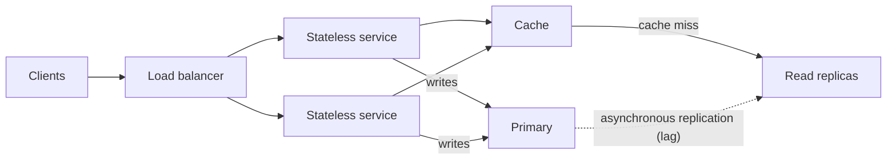
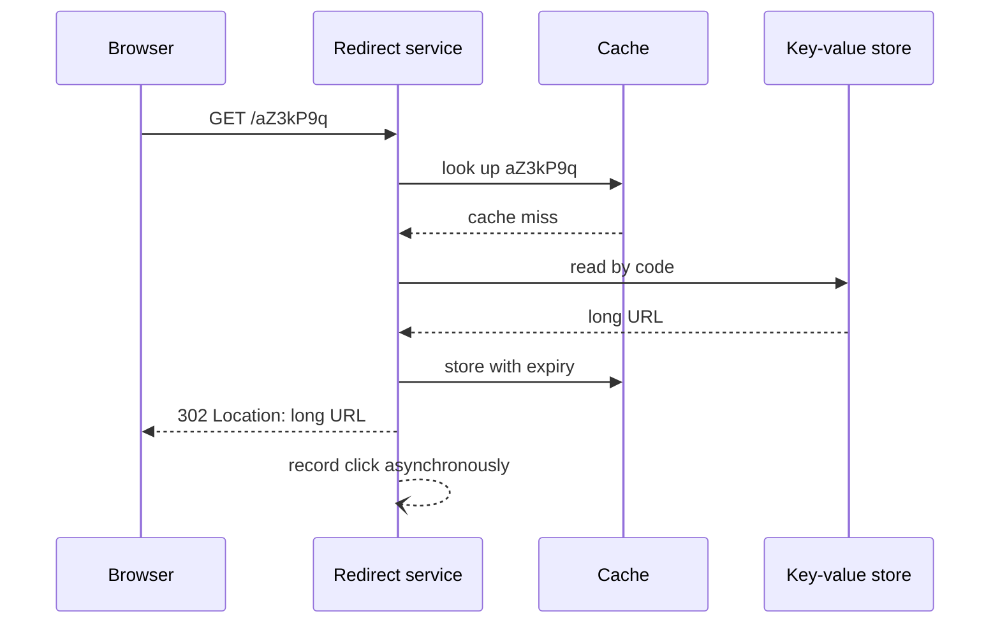
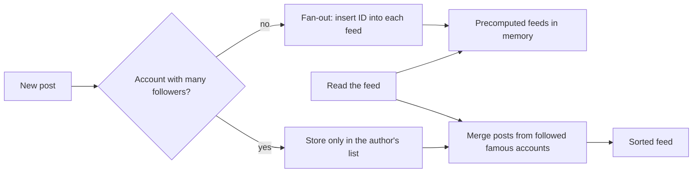

# Scalability and classic design cases

Someone opens a meeting with "it has to scale", and ten minutes later the whiteboard already holds Kafka, three databases and a distributed cache. Nobody has said how many requests per second arrive, how big a record is, or which operation must never fail. The usual outcome is an expensive system that scales along exactly the dimension that did not need it. This article argues the opposite: **scaling means first estimating the load that matters, then choosing the simplest technique that absorbs it, knowing which bottleneck will show up next**.

The method comes first (requirements, order-of-magnitude estimation and the four techniques that keep coming back), followed by three complete cases: a URL shortener, a rate limiter and a news feed. Every case follows the same script: requirements, estimate, high-level design and trade-offs.

<Callout tone="info" title="Example figures">
  Every figure marked as an **assumption** is illustrative: it is there to practise the arithmetic,
  not to describe a real system. Figures from Twitter, Stripe, Cloudflare or AWS come from their
  sources, listed at the end, and carry the date of those sources.
</Callout>

## Method before solution

A scalable design starts with a list of what the system must do and what it must withstand. Without that list there is no way to tell whether a cache, a replica or a partition solves anything.

### Functional and non-functional requirements

**Functional requirements** state which operations exist: shorten a URL, redirect, show statistics. **Non-functional requirements** state how well: target latency, availability, durability, consistency, cost. They are the usual [quality attributes](/docs/atributos-de-calidad), except that here they need numbers.

| Question                                    | Why it matters                                                    |
| ------------------------------------------- | ----------------------------------------------------------------- |
| Which two or three operations are critical? | The design is optimised for them; the rest can take another path  |
| What is the read-to-write ratio?            | Decides whether caching and replicas or partitioning pay off more |
| Target latency, and at which percentile?    | A 50 ms p99 rules out extra hops that a 500 ms p50 tolerates      |
| How long is data kept?                      | Multiplies storage and sets the size of identifiers               |
| What happens if data is lost or delayed?    | Separates what needs strong consistency from what can wait        |

### Order-of-magnitude estimation

You are not after precision, you are after the power of ten. If the arithmetic says 2,000 or 3,000 requests per second, the decision is the same; if it says 200 or 200,000, it is not. A few equivalences and fearless rounding are enough.

| Power of two | Approximate value | Unit (binary)     | Quick reading |
| ------------ | ----------------- | ----------------- | ------------- |
| 2^10         | 10^3              | KB (strictly KiB) | Thousand      |
| 2^20         | 10^6              | MB                | Million       |
| 2^30         | 10^9              | GB                | Billion       |
| 2^40         | 10^12             | TB                | Trillion      |
| 2^50         | 10^15             | PB                | Quadrillion   |

Three constants cover almost every calculation: a day has 86,400 seconds (round to 10^5 and remember that this underestimates by about 14%), a year has roughly 3.15 × 10^7 seconds, and one million events a day is about 12 per second.

### A full calculation, step by step

Assumption: an application with 10 million daily active users; each makes 20 reads and 2 writes a day; each write stores 1 KB and each read returns 10 KB; peak is three times the average.

| Quantity                   | Calculation                   | Result                   |
| -------------------------- | ----------------------------- | ------------------------ |
| Reads per second (average) | 10^7 × 20 / 86,400            | ≈ 2,300/s                |
| Reads per second (peak)    | 2,300 × 3                     | ≈ 7,000/s                |
| Writes per second          | 10^7 × 2 / 86,400             | ≈ 230/s (peak ≈ 700/s)   |
| Storage per day            | 2 × 10^7 writes × 1 KB        | 20 GB                    |
| Storage per year           | 20 GB × 365, times 3 replicas | ≈ 7.3 TB, ≈ 22 TB        |
| Outbound bandwidth         | 2,300/s × 10 KB               | ≈ 23 MB/s (≈ 185 Mbit/s) |

What the table says is not "we need N servers". It says reads dominate ten to one, the dataset grows by several terabytes a year, and bandwidth is not the problem. That already points somewhere: caching and read replicas before partitioning, and a retention policy before storage takes over.

## The four techniques that keep coming back

### Vertical versus horizontal scaling

| Criterion    | Vertical (bigger machine)                 | Horizontal (more machines)                       |
| ------------ | ----------------------------------------- | ------------------------------------------------ |
| Code changes | None                                      | Requires stateless services or spread-out data   |
| Limit        | The provider's catalogue and the price    | Coordination between nodes                       |
| Failure      | One big node is a single point of failure | A lost node reduces capacity, it does not end it |
| Good fit     | Single-writer databases, early on         | Stateless tiers, loads that do not fit one node  |

Scaling vertically is not bad practice: it is the cheapest option in complexity for as long as the load fits. It stops being enough when the estimate exceeds the largest reasonable machine or when a single node can no longer meet the required availability.

### Stateless services

A **stateless** service keeps nothing in memory that the next request needs: the session, the cart or the progress live in a shared store. The Twelve-Factor App methodology states it as its sixth factor: processes are stateless and share nothing, and anything that must persist goes to a backing service, typically a database. It treats sticky sessions as a violation of the method.

The payoff is that the load balancer can send any request to any replica, and adding or removing replicas stops being an event. State does not disappear: it moves to the data tier, which is where the next bottleneck shows up.

### Partitioning and hot keys

When data or writes do not fit one node, they are spread by a **partition key**. The basic strategies:

| Strategy           | How it spreads                       | For                                             | Against                                    |
| ------------------ | ------------------------------------ | ----------------------------------------------- | ------------------------------------------ |
| By hash            | `hash(key)` picks the partition      | Even spread if the key is even                  | Range queries hit every partition          |
| By range           | Contiguous intervals of the key      | Cheap range queries                             | Increasing keys (dates) concentrate writes |
| Consistent hashing | Keys and nodes on the same hash ring | Adding a node moves only a fraction of the keys | Needs virtual nodes to balance             |

Consistent hashing comes from the paper by Karger and co-authors at STOC 1997, designed precisely to relieve hot spots in web caches.

An even spread of keys does not guarantee an even spread of **load**. A **hot key** is a single key that receives a disproportionate share of the traffic: the viral link, the famous account, the product on sale. Since a key lives in a single partition, no number of extra partitions helps it. DynamoDB makes this explicit: each partition accepts at most 3,000 read units and 1,000 write units per second, regardless of the table's total capacity.

The usual defences are a cache in front of the partition (for hot reads), a random suffix on the key that spreads writes across N sub-keys (at the cost of aggregating them on read), read replicas of that partition and, for a handful of known keys, a dedicated code path. Cache mechanics (patterns, invalidation, stampedes) are covered in [caching, queues and streaming](/docs/caching-colas-streaming); here it is enough to know that a cache is the first defence against hot reads.

### Read replicas and their lag

A read replica receives changes from the primary and serves queries, so it multiplies read capacity without touching writes. The price is **lag**: the PostgreSQL documentation states that streaming replication is asynchronous by default, with a small delay between commit on the primary and visibility on the standby, typically under one second if the standby keeps up. If the primary fails, transactions not yet replicated can be lost.

The classic symptom is a user who saves a change, reloads, and does not see it because the read went to a lagging replica. The ways out (read from the primary after writing, pin the session to a replica, minimum versions) are consistency decisions and are covered in [CAP, PACELC and consistency](/docs/cap-pacelc).

## Case 1: URL shortener

### Shortener requirements and estimate

Functional: create a short code for a long URL and redirect the code to its target; optionally, count clicks. Non-functional: redirects must be fast and highly available, codes must not collide, and links live for years. Assumption: 10 million new URLs a day, 100 redirects per URL created, 500 bytes per record and 10 years of retention.

| Quantity                 | Calculation          | Result                              |
| ------------------------ | -------------------- | ----------------------------------- |
| Creations per second     | 10^7 / 86,400        | ≈ 116/s (peak ≈ 350/s)              |
| Redirects per second     | 10^9 / 86,400        | ≈ 11,600/s (peak ≈ 35,000/s)        |
| Records over 10 years    | 10^7 × 3,650         | 3.65 × 10^10                        |
| Storage over 10 years    | 3.65 × 10^10 × 500 B | ≈ 18 TB, before replicas            |
| 6-character base62 codes | 62^6                 | ≈ 5.7 × 10^10 (1.5× headroom)       |
| 7-character base62 codes | 62^7                 | ≈ 3.5 × 10^12 (about 100× headroom) |

Conclusion: this is a read system, with a modest dataset and little bandwidth (about 6 MB/s of redirects). The bottleneck is reads by code, and viral links in particular.

### Generating identifiers

| Strategy                       | How it works                                      | For                                   | Against                                                                |
| ------------------------------ | ------------------------------------------------- | ------------------------------------- | ---------------------------------------------------------------------- |
| Truncated hash of the URL      | Hash the long URL, keep 7 base62 characters       | The same URL yields the same code     | Collisions: check and retry with another seed                          |
| Counter plus base62            | A global counter encoded in base62                | Short codes, no collisions            | Predictable codes and a central counter; mitigate with ranges per node |
| Snowflake-style identifier     | 41 bits of time, 10 of machine and 12 of sequence | No per-request coordination, sortable | A 64-bit integer takes up to 11 base62 characters                      |
| Random with conditional insert | Random code, insert only if absent                | Impossible to enumerate               | Retries grow as the space fills up                                     |

The Snowflake layout comes from the version Twitter published in 2010: 41 bits of milliseconds since a custom epoch, 10 machine bits (up to 1,024) and 12 sequence bits per millisecond. With random 7-character codes, by the end of the 10-year horizon each new code would have roughly a 1% chance of colliding (3.65 × 10^10 taken out of 3.5 × 10^12 possible), which is why the insert must be conditional, never "generate and hope".

### 301 versus 302

The redirect status code is not cosmetic: it decides what your analytics see. Per RFC 9110, a 301 (_Moved Permanently_) response is heuristically cacheable, meaning a browser or proxy may store it without explicit headers; a 302 (_Found_) says the target is temporary and that the client should keep using the original URL.

| Code      | Semantics         | Default caching            | Effect on the shortener                                                   |
| --------- | ----------------- | -------------------------- | ------------------------------------------------------------------------- |
| 301       | Permanent move    | Heuristically cacheable    | Less load, but repeat clicks may never arrive and analytics undercount    |
| 302       | Temporary target  | Only with explicit headers | Every click goes through the service: reliable analytics, editable target |
| 308 / 307 | Same as 301 / 302 | Same as 301 / 302          | Require keeping the method; for GET redirects they change nothing         |

If counting clicks or changing the target later is a requirement, 302 is the consistent choice and the extra load is absorbed by a server-side cache. If the shortener only exists to save characters, 301 offloads work to clients. Either way you can set `Cache-Control` explicitly rather than rely on each browser's heuristics.

### High-level design and trade-offs

The decisions holding the design up: stateless redirect services behind a load balancer; a key-value store partitioned by hash of the code (access is always by exact key); a cache in front for hot links; and click recording off the critical path, through a queue, so analytics never slow down a redirect. The main trade-off is 301 against 302; the second is how much click loss you accept if the queue saturates.

## Case 2: rate limiter

### Limiter requirements and estimate

Functional: limit how many requests each client (API key, user or IP) makes per unit of time, allow reasonable bursts, and respond so the client knows when to come back. RFC 6585 defines status 429 (_Too Many Requests_) for this, optionally with `Retry-After`. Non-functional: the limiter adds latency to **every** request, so it must be cheap, and it must behave the same with one or fifty edge nodes. Assumption: 50,000 requests per second spread across several gateway nodes, one million active keys, and a limit of 100 requests per second per key with bursts up to 500.

| Quantity                     | Calculation        | Result                                  |
| ---------------------------- | ------------------ | --------------------------------------- |
| State per key (token bucket) | 2 numbers plus key | ≈ 100 B (assumption, with overhead)     |
| Total state                  | 10^6 × 100 B       | ≈ 100 MB: fits in one node's memory     |
| Operations against the store | 1 per request      | 50,000/s, each with its own network hop |

State is small; what is expensive is **coordination**: one remote atomic operation per request. That is what you have to design.

### Algorithms

| Algorithm              | State per key             | Bursts                                                      | Precision and cost             |
| ---------------------- | ------------------------- | ----------------------------------------------------------- | ------------------------------ |
| Fixed window           | One counter               | Up to twice the limit gets through at a window boundary     | Cheap, imprecise at boundaries |
| Sliding log            | One timestamp per request | Exact                                                       | Memory proportional to traffic |
| Sliding window counter | Two counters              | Smooths the boundary                                        | Approximate, very cheap        |
| Token bucket           | Tokens and last refill    | Allows bursts up to the bucket capacity                     | Two knobs: rate and capacity   |
| Leaky bucket           | Level and last drain      | Lets requests out at a constant rate; excess waits or fails | Smooth output, adds waiting    |

The **token bucket** refills tokens at a fixed rate up to a maximum capacity; each request spends one and, with no tokens left, is rejected. It is the algorithm Stripe describes for its per-user limiter. The **leaky bucket** is a close relative: requests fill a bucket that drains at a constant rate; it is the method documented by the NGINX `limit_req` module. The approximate **sliding window** is the one Cloudflare explained in 2017: with a limit of 50 per minute, if the previous minute had 42 requests and the current one, which started 15 seconds ago, has 18, the estimated rate is 42 × (45/60) + 18 = 49.5. In their analysis of 400 million requests, only 0.003% were wrongly allowed or rate limited.

### Distributed counters

With several gateway nodes, each sees part of every key's traffic. There are three ways out:

| Approach                        | How                                                       | For                         | Against                                                 |
| ------------------------------- | --------------------------------------------------------- | --------------------------- | ------------------------------------------------------- |
| Central store with an atomic op | A script that reads, decides and writes in one step       | Exact                       | One network hop per request; the store becomes critical |
| Synchronised local counters     | Each node counts and shares totals every few milliseconds | No hop on the critical path | Extra traffic slips through during the sync window      |
| Routing by key                  | The same key always reaches the same node                 | Exact local counter         | A hot key saturates its node; rebalancing is costly     |

The usual trap is reading the counter, deciding in the application and writing afterwards: between the two steps another request reads the same value and both get through. Stripe avoids the race by running the token bucket logic as a Redis script, which executes atomically. Cloudflare, restricted to memcached `GET`, `SET` and `INCR`, chose the sliding window precisely because each increment is a single `INCR`.

### More than one limiter, and what to do when it fails

Stripe's 2017 engineering post by Paul Tarjan describes four layered mechanisms: a per-user request rate limiter (token bucket), a concurrent requests limiter, a fleet usage load shedder that reserves capacity for critical traffic (charges over reports), and a worker utilisation load shedder as the last resort. The first two respond 429; the load shedders respond 503 in its example code. Its advice for load shedding is to act slowly: do not drop traffic until the problem has lasted a while, and do not bring it back all at once.

Two decisions that Stripe's example code makes explicit and that are worth recording in an [ADR](/docs/adr):

- **Fail open or closed.** If the limiter's store does not respond, Stripe lets the request through, so the limiter does not become a hard dependency. Failing closed protects the backend more but takes the whole API down with the store.
- **What the client does with a 429.** Retrying without waiting makes saturation worse. Retries with exponential backoff and jitter are covered in [resilience in distributed systems](/docs/resiliencia-sistemas-distribuidos).

## Case 3: news feed

### Feed requirements and estimate

Functional: publish a post and see a feed with the recent posts of the accounts you follow, in order. Non-functional: opening the feed must be very fast, a post may take a few seconds to appear, and the follower graph is highly skewed. Assumption: 50 million daily active users, 10 million posts a day, 200 followers on average, 10 feed opens per user per day, and one famous account with 30 million followers.

| Quantity                        | Calculation              | Result                                      |
| ------------------------------- | ------------------------ | ------------------------------------------- |
| Posts per second                | 10^7 / 86,400            | ≈ 116/s                                     |
| Feed reads per second           | 5 × 10^8 / 86,400        | ≈ 5,800/s (peak ≈ 17,000/s)                 |
| Fan-out inserts per second      | 10^7 × 200 / 86,400      | ≈ 23,000/s                                  |
| Fan-out of a single famous post | 3 × 10^7 inserts         | ≈ 22 minutes of that whole average capacity |
| Precomputed feeds in memory     | 5 × 10^7 × 800 IDs × 8 B | ≈ 320 GB, identifiers only                  |

Twitter's real numbers point the same way. According to High Scalability's 2013 summary of Raffi Krikorian's talk _Timelines at Scale_ at QCon San Francisco 2012, Twitter served about 300,000 timeline read queries per second against about 6,000 writes per second, kept each home timeline in a Redis cluster capped at 800 entries, and aimed to deliver a post in under 5 seconds, a target it missed for accounts with tens of millions of followers.

### Fan-out on write versus fan-out on read

| Criterion          | Fan-out on write (_push_)                | Fan-out on read (_pull_)                          |
| ------------------ | ---------------------------------------- | ------------------------------------------------- |
| On publish         | Insert the ID into every follower's feed | Store only the author's post                      |
| On read            | Read a ready-made list                   | Gather and sort posts from every followed account |
| Cost of publishing | Proportional to followers                | Constant                                          |
| Cost of reading    | Constant and low                         | Proportional to followed accounts                 |
| Weak spot          | Heavily followed accounts                | Users who follow many accounts                    |
| Fits when          | Reads far outnumber posts                | Posting is heavy or hardly anyone reads           |

### The heavily followed account problem

With fan-out on write, a single post from an account with 30 million followers means 30 million inserts. Under the assumption above that is about 22 minutes of the entire average fan-out capacity, and meanwhile some followers see the post and others do not. The summary of Krikorian's talk reports the same symptom: replies arriving before the original post.

The way out Twitter was adopting at the time is **hybrid**: fan-out on write for most accounts and, for accounts with huge followings, no fan-out at all; their posts are merged into the precomputed feed at read time. The _Feeding Frenzy_ paper (Silberstein and co-authors, SIGMOD 2010) reached a general rule: decide push or pull for each producer-consumer pair based on the ratio between the producer's posting rate and the consumer's viewing rate.

The underlying trade-off: the hybrid mode makes famous posts cheap, but every read does more work and the system has two paths to keep consistent. The "famous account" threshold is a parameter to measure, not a universal number.

## The three cases compared

| Case          | Dominant load             | Bottleneck                 | Key decision                          | Main trade-off                         |
| ------------- | ------------------------- | -------------------------- | ------------------------------------- | -------------------------------------- |
| URL shortener | Reads by exact key        | Viral links                | ID generation and 301 or 302          | Reliable analytics versus service load |
| Rate limiter  | One operation per request | Coordination between nodes | Algorithm and where the counter lives | Accuracy versus added latency          |
| News feed     | Feed reads                | Fan-out of famous accounts | Push, pull or hybrid                  | Cost of posting versus cost of reading |

## When to use it and when not to

| Situation                                                | Reasonable decision                                                  |
| -------------------------------------------------------- | -------------------------------------------------------------------- |
| The estimate fits comfortably on one node with a replica | Scale vertically and spend the effort elsewhere                      |
| Reads dominate ten to one or more                        | Caching and read replicas before partitioning                        |
| Writes or data do not fit one node                       | Partition, and choose the key with the queries in mind               |
| One key concentrates the traffic                         | Treat it separately: cache, suffixes or a special path               |
| The service keeps sessions in memory                     | Move them to a shared store before adding replicas                   |
| You do not know the figures                              | Estimate with explicit assumptions and check them against production |

Partitioning or moving to microservices because it will be needed "some day" buys complexity on credit. How that decision relates to the shape of the system is covered in [monolith versus microservices](/docs/monolito-vs-microservicios).

## Common mistakes

- **Designing without estimating.** Without figures, every component looks necessary and none can be ruled out.
- **Estimating the average and forgetting the peak.** Systems fall over at peak, not on average.
- **"Stateless" services with hidden state.** Local caches, temporary files or in-memory sessions silently break horizontal scaling.
- **Ignoring replica lag.** The bug shows up as "sometimes I don't see what I just saved".
- **A limiter with separate read and write.** The race lets bursts through exactly when it matters most.
- **Choosing 301 without thinking about analytics.** Finding out months later that repeat clicks are not counted.
- **Fan-out on write for every account.** It works until the first celebrity.

## Worked example: partition the shortener from day one?

A team must decide whether the shortener's store starts out partitioned. With the assumptions from case 1:

1. **Writes:** about 350 per second at peak. Many single-primary databases can handle that load; confirm it with your own load test, not the brochure.
2. **Reads:** about 35,000 per second at peak, by exact key. A cache in front absorbs most of them if traffic concentrates on a few links; replicas cover the rest.
3. **Data:** about 1.8 TB a year. The first year fits on one node; a few years in, it does not.
4. **Cost of changing later:** access is always by exact code, so spreading by `hash(code)` later is a bounded migration, with no range queries to rewrite.

Decision: start with one primary, read replicas and a cache; pick from the start a schema that allows partitioning by hash of the code; and set a measurable trigger (for example, storage at 60% or write p99 above target) for carrying out the partitioning. Record it in an [ADR](/docs/adr) and watch the trigger with a [fitness function](/docs/fitness-functions). For weighing options like these, see [trade-offs and decisions](/docs/trade-offs-y-decisiones).

## Checklist

- [ ] The critical operations and their latency and availability targets are written down as numbers.
- [ ] There is an estimate of average and peak traffic, storage and bandwidth, with explicit assumptions.
- [ ] Application-tier services keep no in-memory state between requests.
- [ ] The partition key was chosen with the queries and the foreseeable hot keys in mind.
- [ ] Reads that cannot tolerate lag know which node to go to.
- [ ] The rate limiter is atomic, responds 429 with `Retry-After`, and has a decided fail-open or fail-closed policy.
- [ ] Every major trade-off (301 or 302, push or pull) is recorded with its rationale.
- [ ] Assumptions are checked against real metrics as soon as there is production traffic.

## Sources

Consulted in October 2026. The Stripe post could not be opened directly (the connection was reset); its content was checked against the code gist that accompanies the post, published by its author on 29 March 2017, and against a third-party summary (Arpit Bhayani).

- [RFC 9110, HTTP Semantics](https://www.rfc-editor.org/rfc/rfc9110): sections 15.4.2 (301), 15.4.3 (302) and 10.2.3 (Retry-After)
- [RFC 6585, Additional HTTP Status Codes (April 2012)](https://www.rfc-editor.org/rfc/rfc6585): status 429
- [Scaling your API with rate limiters (Paul Tarjan, Stripe, 2017)](https://stripe.com/blog/rate-limiters) and its [example gist](https://gist.github.com/ptarjan/e38f45f2dfe601419ca3af937fff574d)
- [How we built rate limiting capable of scaling to millions of domains (Cloudflare, 7 June 2017)](https://blog.cloudflare.com/counting-things-a-lot-of-different-things/)
- [NGINX ngx_http_limit_req_module](https://nginx.org/en/docs/http/ngx_http_limit_req_module.html)
- [The Architecture Twitter Uses to Deal with 150M Active Users (High Scalability, 8 July 2013)](https://highscalability.com/the-architecture-twitter-uses-to-deal-with-150m-active-users/), a summary of the talk _Timelines at Scale_ (QCon SF 2012)
- [Feeding Frenzy: Selectively Materializing Users' Event Feeds (Silberstein et al., SIGMOD 2010)](https://sns.cs.princeton.edu/assets/papers/2010-sigmod-silberstein.pdf)
- [Snowflake, 2010 version (Twitter)](https://github.com/twitter-archive/snowflake/tree/snowflake-2010)
- [The Twelve-Factor App: VI. Processes](https://12factor.net/processes)
- [PostgreSQL: log-shipping standby servers and streaming replication](https://www.postgresql.org/docs/current/warm-standby.html)
- [DynamoDB burst and adaptive capacity (AWS)](https://docs.aws.amazon.com/amazondynamodb/latest/developerguide/burst-adaptive-capacity.html)
- [Consistent hashing and random trees (Karger et al., STOC 1997)](https://cs.brown.edu/courses/csci2950-u/f09/papers/chash97stoc.pdf)
