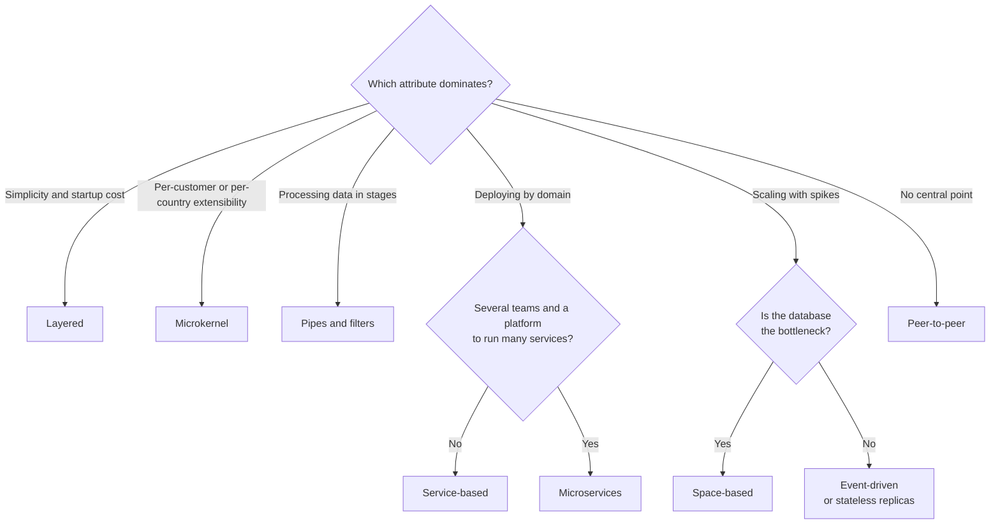

# Architectural styles

In the first design meeting for a new system, someone says "let's do microservices", someone else suggests "let's use Kafka", and a third person asks for "hexagonal architecture". The three sound like the same kind of decision, but they are not: the first picks an overall shape for the system, the second picks a product, and the third organizes the code inside one deployable unit. Until you pull them apart, the discussion goes in circles and the loudest voice decides.

An **architectural style is a recognizable way of organizing a system: which kinds of components it has, which connectors they interact through, and which constraints govern those interactions**. This article traces where that definition comes from, separates styles from patterns and technologies, walks through nine styles with their promise, their cost and their typical fit, and proposes a way to choose that starts from quality attributes rather than fashion.

<Callout tone="info" title="Sources and cut-off date">
  Checked in October 2026. Garlan and Shaw's paper was read in its original Carnegie Mellon version.
  Mark Richards' 2015 report was read from a PDF copy; its second edition (2022) was not read, and
  what is said about it comes from the publisher's listing. The book by Richards and Ford could not
  be opened (O'Reilly's site returned 403): what this article says about it comes from its table of
  contents, previews and university notes that cite it, and is flagged as such. The axes table and
  the comparison table are our own classifications; they do not reproduce Richards'.
</Callout>

## What a style is

The definition still in use today comes from David Garlan and Mary Shaw, in _An Introduction to Software Architecture_ (published in 1993 in a World Scientific volume and as Carnegie Mellon technical report CMU-CS-94-166 in January 1994). Their framework is simple: the architecture of a specific system is a set of **components** (the parts that compute) and **connectors** (the interactions between them), which you can draw as a graph. Connectors can be as different as a procedure call, an event broadcast, a database query or a pipe.

On top of that framework, a style defines a family of systems that share a pattern of structural organization. Paraphrasing the authors: a style fixes the vocabulary of components and connectors you may use, plus a set of constraints on how they can be combined. Some constraints are topological (for example, no cycles) and others concern execution semantics.

Garlan and Shaw also propose six questions for understanding any style, and they remain a good template for evaluating one:

1. What is the structural pattern: components, connectors and constraints?
2. What is the underlying computational model?
3. What are its essential invariants?
4. What are common examples of its use?
5. What are its advantages and disadvantages?
6. What are its common specializations?

The authors themselves note that the boundaries between styles can overlap, and that this should not stop you from identifying a style's main features from its central examples. It is a useful warning: styles are prototypes, not categories with crisp edges.

### Style, pattern and technology

The three words get used interchangeably in conversations and in books, so it pays to fix the level of each before arguing.

| Level      | What it decides                                               | Examples                                  | Question it answers                            |
| ---------- | ------------------------------------------------------------- | ----------------------------------------- | ---------------------------------------------- |
| Style      | The overall shape: kinds of parts, connectors and their rules | Event-driven, pipes and filters, layered  | How is the system organized as a whole?        |
| Pattern    | A proven solution to a recurring problem in a local context   | Outbox, saga, repository, circuit breaker | How do I solve this problem inside that shape? |
| Technology | The product that implements components or connectors          | Kafka, gRPC, PostgreSQL, Kubernetes       | Which tool do I build and run it with?         |

The vocabulary is not settled. Mark Richards' report _Software Architecture Patterns_ (O'Reilly, 2015) calls "patterns" what this article calls styles; according to the publisher's listing, its second edition (2022) presents them as styles and adds a section on the difference between the two terms. Earlier, _Pattern-Oriented Software Architecture_ (Buschmann et al., 1996) cataloged Layers, Pipes and Filters and Broker as "architectural patterns". The label matters less than the scope: a style shapes the whole system; a pattern solves a problem inside it. Code-level design patterns have their own article in [design patterns](/docs/patrones-de-diseno).

A borderline case: hexagonal, onion and clean architecture organize the code **inside** a deployable unit around the domain. They are covered in [hexagonal architecture](/docs/arquitectura-hexagonal) and in [layers, Clean and Onion](/docs/arquitectura-en-capas-clean-onion); here only layered architecture appears, as a system-level style.

### Two axes that order the catalog

Two questions separate almost every style before you get into details. The second edition of Richards' report treats both as topics of their own, according to the publisher's description; the table that maps each style onto the two axes, however, is our own classification, not Richards':

- **Monolithic or distributed?** Whether the system is deployed as one unit or as several that talk over a network. Everything distributed pays for latency, partial failures and more expensive observability.
- **Technical or domain partitioning?** Whether the main parts are split by technical function (presentation, business, data) or by business area (orders, payments, catalog). This decides how many parts a typical business change touches.

**Our own classification by axes** (this article's assessment, not taken from Richards):

| Style             | Usual deployment | Main partitioning                  |
| ----------------- | ---------------- | ---------------------------------- |
| Layered           | Monolithic       | Technical                          |
| Pipes and filters | Either           | Technical (per stage)              |
| Microkernel       | Monolithic       | Technical core plus plug-ins       |
| Service-based     | Distributed      | Domain                             |
| Event-driven      | Distributed      | Technical or domain                |
| Space-based       | Distributed      | Technical (processing unit)        |
| Microservices     | Distributed      | Domain                             |
| Client-server     | Distributed      | Role (who serves and who requests) |
| Peer-to-peer      | Distributed      | Symmetric roles                    |

## The catalog: nine styles

Each style is summarized with Garlan and Shaw's questions boiled down to three: what it promises, what it costs and where it fits naturally. Where another article already covers it in depth, it is linked instead of repeated.

### Layered monolith

Components arranged in horizontal layers (presentation, business, persistence) inside a single deployable unit. Garlan and Shaw describe it as a hierarchical system in which each layer serves the one above and is a client of the one below, with the topological constraint that interactions stay between adjacent layers; their best-known example is layered communication protocols.

- **Promise:** separation of technical concerns, a structure almost every team knows, and a cheap start.
- **Cost:** partitioning is technical, so a business change usually cuts through every layer; it is deployed and scaled as a whole.
- **Typical fit:** small or medium business applications with a single team.

The dependency rule, the layer sinkhole and the concentric variants live in [layers, Clean and Onion](/docs/arquitectura-en-capas-clean-onion).

### Pipes and filters

Components are **filters** that read streams of data on their inputs and produce streams on their outputs, incrementally; connectors are **pipes** that carry one filter's output to another's input. Garlan and Shaw set two invariants: filters share no state, and they do not know the identity of the filters before or after them. Their classic examples are Unix shell pipelines and compilers seen as a sequence of phases.

- **Promise:** overall behavior is the composition of the filters; filters can be reused, replaced and run in parallel.
- **Cost:** according to the same authors, it tends toward batch processing, fits interactive applications poorly, and can force a lowest-common-denominator data format that makes every filter parse and unparse its data.
- **Typical fit:** ETL, media processing, compilers, continuous integration pipelines.

### Microkernel (plug-in)

A minimal **core** with the essential functionality, and **plug-ins** that add capabilities through a stable contract and a registry. Richards also calls it the plug-in pattern and, in his 2015 report, presents it as a natural fit for product-based applications sold with variants. Earlier, _Pattern-Oriented Software Architecture_ had already cataloged it, alongside Reflection, among the patterns for adaptable systems (_Adaptable Systems_).

- **Promise:** extensibility and isolation of optional features; you can add or remove a plug-in without touching the core.
- **Cost:** the core contract becomes very hard to change; versioning plug-ins and testing their combinations takes work; it is usually deployed as a whole, which limits scaling.
- **Typical fit:** editors and IDEs with extensions, products with rules that differ per customer or per country.

### Service-based architecture

A user interface, **a few coarse-grained domain services** deployed separately and, often, one shared database. Richards and Ford present it in _Fundamentals of Software Architecture_ (O'Reilly, 2020) as a pragmatic hybrid of microservices. According to the chapter preview, because the services usually share a single database, an application generally has between 4 and 12 services, with an average of about 7; it is guidance, not a fixed limit.

- **Promise:** domain partitioning and independent deployments without paying the full operational complexity of microservices; each service can keep local transactions over its part of the data.
- **Cost:** the shared database couples the data: if one service changes a shared table, every other service that uses it must change too, and testing each change widens. The same notes suggest partitioning the database logically per service to contain this.
- **Typical fit:** medium-sized bespoke business systems, built by one or two teams.

### Event-driven

Components **announce events** and others register to react to them. Garlan and Shaw describe this as implicit invocation, and its main invariant is that whoever announces an event does not know which components it will affect. Richards' report distinguishes two topologies: **mediator**, when an event needs several steps orchestrated from a central point, and **broker**, when events are chained without a coordinator.

- **Promise:** producers and consumers evolve separately; adding a new reaction does not force a change on the publisher.
- **Cost:** the full flow no longer reads in one place, processing order is not guaranteed, and errors and eventual consistency need explicit design.
- **Typical fit:** a business fact that many different consumers care about (a confirmed order that triggers billing, stock and notifications).

Event types, CQRS and Event Sourcing are covered in [events, CQRS and Event Sourcing](/docs/event-driven-cqrs-event-sourcing); reliable delivery, in [sagas, outbox and idempotency](/docs/sagas-outbox-idempotencia).

### Space-based

The name comes from the tuple space of Linda, the coordination model David Gelernter published in 1985 in _ACM Transactions on Programming Languages and Systems_. In this style, several **processing units** keep data in memory, replicated among them, and **virtualized middleware** coordinates them. The central database is no longer on every request's path: data is processed in memory and reaches the database through separate channels (the table of contents of Richards and Ford's chapter calls them _data pumps_).

- **Promise:** elasticity under high, hard-to-predict load spikes, because the central database bottleneck leaves the critical path.
- **Cost:** it is among the most complex styles to build and to test at scale; collisions between replicas and the amount of data that fits in memory are real limits.
- **Typical fit:** ticket sales and online auctions, which are precisely the examples in Richards and Ford's chapter according to its table of contents.

### Microservices

James Lewis and Martin Fowler described the style on 25 March 2014 as a way of building a single application as a suite of small services, each running in its own process, communicating through lightweight mechanisms, organized around business capabilities and independently deployable. The article itself admits there is no precise definition and offers common characteristics instead, including decentralized control of data.

- **Promise:** deployment and scaling per service, and team autonomy when boundaries are well drawn.
- **Cost:** everything the network brings (latency, partial failures, eventual consistency) plus an operational platform someone has to run.
- **Typical fit:** organizations with several teams that need different deployment rhythms.

The comparison with the monolith and the modular monolith, cost by cost, is in [monolith or microservices](/docs/monolito-vs-microservicios).

### Client-server

Garlan and Shaw cite it as a common form of distributed architecture: a server provides services to other processes, usually without knowing in advance how many clients or which ones will use it; clients do know the server (or find it out) and call it remotely.

- **Promise:** centralized data and control, a security model that is easy to reason about, and thin clients.
- **Cost:** the server concentrates the load and is a single point of failure until it is replicated, and replicating it brings the problems of any distributed system.
- **Typical fit:** almost any web or mobile application seen from outside, and database access.

It rarely appears alone: a web application is client-server on the outside and often layered on the inside.

### Peer-to-peer

Each participant shares part of its resources (compute, storage, network) and acts as both provider and consumer, without the fixed split of roles found in client-server. Napster, launched in June 1999, popularized it for file sharing.

- **Promise:** no central point of failure, and total capacity grows with the number of participants.
- **Cost:** discovering peers, deciding whom to trust, keeping data consistent and observing the system are open problems in every design.
- **Typical fit:** file distribution and syncing between devices without a server that controls everything.

## Qualitative comparison

Richards pairs each style with a scorecard of quality attributes. The table below follows the same idea, but with our own assessment and the criteria that weigh most when choosing. Read it by rows to understand a style and by columns to see what you give up when you prioritize an attribute. The ratings describe the style applied well; a poor implementation changes any cell.

| Style             | Partial deployment | Scalability | Complexity | Testability                   | Data coupling                  |
| ----------------- | ------------------ | ----------- | ---------- | ----------------------------- | ------------------------------ |
| Layered           | Low                | Low         | Low        | Medium                        | High: one database             |
| Pipes and filters | Medium             | Medium      | Low        | High per filter               | Medium: common format          |
| Microkernel       | Medium: plug-ins   | Low         | Medium     | High per plug-in              | Medium                         |
| Service-based     | High               | Medium      | Medium     | Medium                        | High if the database is shared |
| Event-driven      | High               | High        | High       | Low across the whole flow     | Low: event contract            |
| Space-based       | Medium             | Very high   | Very high  | Low                           | Medium: in-memory replicas     |
| Microservices     | High               | High        | High       | High per service, low overall | Low: data per service          |
| Client-server     | Medium             | Medium      | Low        | Medium                        | High on the server             |
| Peer-to-peer      | High               | High        | High       | Low                           | Low: shared protocol           |

No row wins every column, and that is no accident: styles that split the system into more parts buy deployment and scaling with complexity. Why you cannot maximize every attribute at once is explained in [quality attributes](/docs/atributos-de-calidad).

## How to choose a style

The style is chosen last, not first. The order that works is the same as in any architecture decision with [trade-offs](/docs/trade-offs-y-decisiones):

1. **Prioritize three to five quality attributes** and write them as measurable scenarios. If everything is a priority, you have no criterion to choose with.
2. **Write down the constraints**: size and number of teams, the platform you already run, data requirements (transactions, residency, volume).
3. **Shortlist two or three styles** whose promise matches the dominant attribute and whose cost you can pay under those constraints.
4. **Evaluate them against the scenarios**, not against their happy path: what happens with a load spike, a business-rule change, or one part going down?
5. **Record the decision** in an [ADR](/docs/adr) with its review condition, and protect it with [fitness functions](/docs/fitness-functions).

The diagram summarizes the first branches of that conversation. It is a starting point for a shortlist, not a verdict:

### Combining styles with a boundary

Garlan and Shaw already observed that most systems combine several styles, and described three ways of doing it; the clearest is hierarchy: a component organized in one style can have an internal structure built in a completely different one. That is the healthy way to mix: each style lives inside an explicit boundary (a service, a module, a stage) and the outer style does not leak inward. A billing service can be a microkernel with one plug-in per payment gateway, even if the whole system is service-based.

## When to use it and when not to

Naming and deciding a style explicitly is a tool, not a ritual.

**When to do it:**

- When starting a system that will live for years or grow in teams.
- When the dominant attribute changes: from getting to market fast to sustaining load spikes, for example.
- Before splitting a monolith or merging services, so the direction of change has a destination.
- When several teams need a shared vocabulary to talk about the shape of the system.

**When not to:**

- For a script, a prototype lasting a few weeks or a small internal tool: whatever the framework gives you is enough.
- To fix a local problem: a slow module gets fixed in that module, not by changing the style of the whole system.
- To fix an organizational or process problem: a distributed style does not fix teams that do not coordinate.

## Common mistakes

- **Choosing by fashion.** The style a well-known company uses solved its constraints, not yours. If nobody can name the quality attribute the style buys, the choice is résumé-driven.
- **Mixing styles without a boundary.** Events for some things, synchronous calls for others and one database shared by everyone, with no rule about where each applies. The result is not a hybrid style; it is the absence of one.
- **Confusing style with deployment.** Putting a monolith in containers does not make it microservices, and splitting a system into services that share tables and deploy together is a distributed monolith. A style is defined by its components, connectors and constraints, not by the tool that runs them.
- **Confusing style with technology.** Using a message broker does not make a system event-driven if it uses the broker as a queue of synchronous commands in disguise.
- **Deciding by default.** Richards' report devotes a section to the _architecture by implication_ anti-pattern: choosing no style and ending up with whatever emerges. It is almost always a monolith with no boundaries.
- **Evaluating the happy path.** Every style works in the demo; the difference shows up with the load spike, the partial failure or the change that cuts across three modules.

## Worked example: bookings for a network of clinics

**Context.** A network of twenty clinics wants its own system for appointments, patient administrative records, billing and reminders. A single team of six builds it, possibly growing to two teams within a year. Billing changes often because each country has its own payment gateway and tax rules.

**Prioritized attributes.** Deployability of the billing module (weekly changes without stopping appointments); availability of the schedule during clinic hours; modifiability of per-country rules. Scalability matters little: volume is moderate and predictable.

**Shortlisted options.**

| Criterion                                | Layered                    | Service-based                   | Microservices                    |
| ---------------------------------------- | -------------------------- | ------------------------------- | -------------------------------- |
| Deploy billing on its own                | No                         | Yes                             | Yes                              |
| Operating cost with one team             | Low                        | Medium                          | High                             |
| Per-country rules                        | Conditionals spread around | Isolated in the billing service | Isolated, with more parts to run |
| Transactions across schedule and payment | Local                      | Local within each service       | Sagas across services            |

**Decision.** Service-based architecture with four coarse-grained services (schedule, patients, billing and reminders) and a shared database partitioned logically: each service owns its tables and only a small set of reference data is common. Inside billing, a microkernel: the core computes the invoice and each country contributes a plug-in with its gateway and rules. The mix has a boundary: the microkernel never leaves the billing service.

The shared database here does not contradict the mistake described in [monolith or microservices](/docs/monolito-vs-microservicios): service-based architecture accepts it because there are few services, from one domain and owned by the same team, which changes the schema and deploys without coordinating with anyone else; with tables that have an owner, that coupling is a known, bounded cost.

**Consequences and review.** The team accepts the data coupling of the shared database in exchange for not running a microservices platform with six people. The ADR sets two conditions for revisiting the decision: a second team with its own deployment rhythm, or the schedule needing to scale separately. A CI rule stops any service from reading another service's tables.

## Checklist

- [ ] The team distinguishes style, pattern and technology in the proposal.
- [ ] Three to five quality attributes are prioritized and written as scenarios.
- [ ] Team, platform and data constraints are written down before choosing.
- [ ] At least two styles were compared against the scenarios, not their happy path.
- [ ] Every mix of styles has an explicit, documented boundary.
- [ ] The chosen style is recorded in an ADR with its review condition.
- [ ] An executable rule protects the style's main constraints.

## Sources

Checked in October 2026. Garlan and Shaw's text was read in full; Lewis and Fowler's, on its original page. Richards' 2015 report was read from a PDF copy; its second edition (2022) and the book by Richards and Ford could not be opened: what is cited from them comes from the publisher's listing, the table of contents, previews indexed by search engines, and the University of Queensland notes. The microkernel's place in POSA 1 was checked against summaries of the book's contents, not the book itself.

- [An Introduction to Software Architecture (David Garlan and Mary Shaw, 1993; report CMU-CS-94-166, 1994)](https://www.cs.cmu.edu/~able/publications/intro_softarch/)
- [Software Architecture Patterns (Mark Richards, O'Reilly, 2015)](https://www.oreilly.com/library/view/software-architecture-patterns/9781491971437/) read from a PDF copy, and its [second edition (2022)](https://www.oreilly.com/library/view/software-architecture-patterns/9781098134280/), consulted only through the publisher's listing
- [Fundamentals of Software Architecture (Mark Richards and Neal Ford, O'Reilly, 2020)](https://www.oreilly.com/library/view/fundamentals-of-software/9781492043447/): table of contents and previews, including chapter 13 on service-based architecture
- [Service-Based Architecture (Richard Thomas, lecture notes for the University of Queensland software architecture course)](https://csse6400.uqcloud.net/handouts/service-based.pdf)
- [Microservices (James Lewis and Martin Fowler, 25 March 2014)](https://martinfowler.com/articles/microservices.html)
- [Generative Communication in Linda (David Gelernter, ACM TOPLAS 7(1), 1985)](https://dl.acm.org/doi/10.1145/2363.2433)
- Pattern-Oriented Software Architecture, volume 1 (Frank Buschmann et al., Wiley, 1996), with its classification summarized in [Buschmann et al. (1996): Architectural Patterns (University of Calgary)](https://ksi.cpsc.ucalgary.ca/courses/451-97/patterns/BuschmannArch.html)
- [Peer-to-peer on Wikipedia](https://en.wikipedia.org/wiki/Peer-to-peer)
