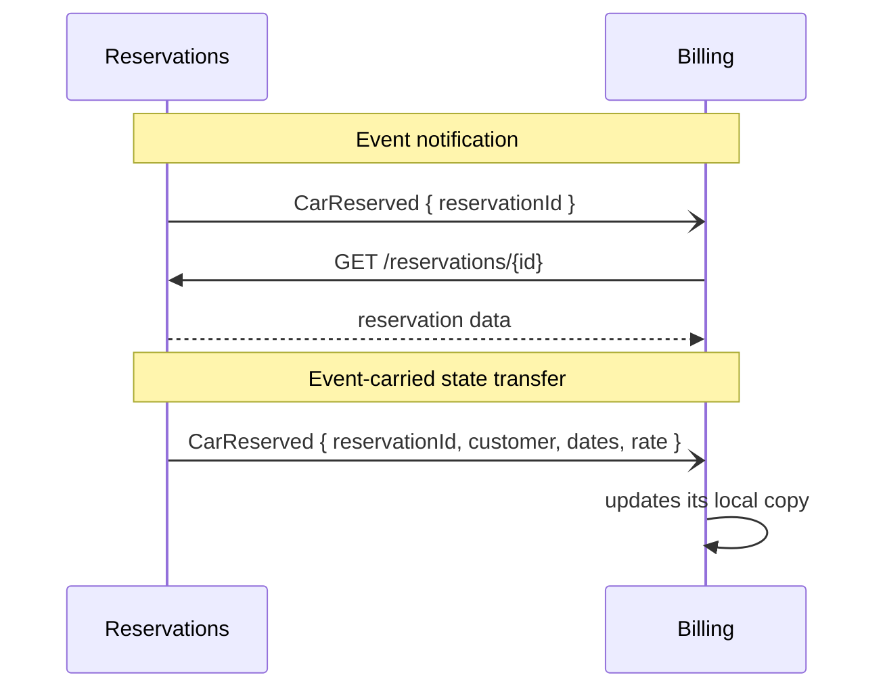
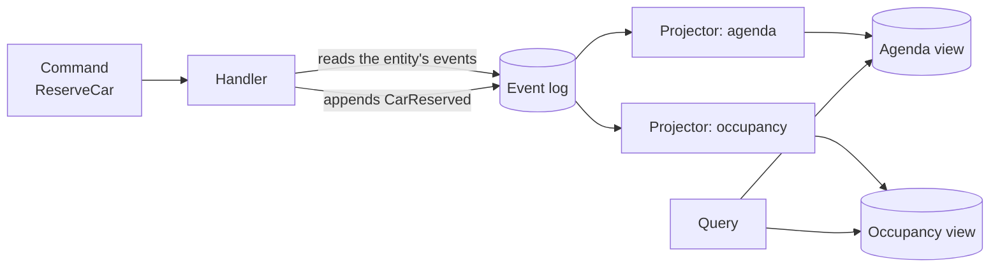

# Event-driven, CQRS and Event Sourcing

The orders team has two problems at once. The operations screen, which joins orders, shipments and returns, takes several seconds because it queries the same normalized model the writes use. And when support asks who changed an order's delivery address and when, nobody knows: the table only keeps the latest value. Someone suggests "going event-driven", someone else says "CQRS", a third person says "Event Sourcing", as if they were the same thing. They are not: **an event-driven system communicates that something has already happened; CQRS separates the model you write with from the model you read with; and Event Sourcing stores state as the sequence of events that produced it**. They combine well, but each one solves a different problem and charges a different price.

This article pulls the concepts apart, explains when each pattern pays off and what it costs, and ends with a worked decision. The code only shows names and shapes, not implementations.

<Callout tone="info" title="Scope and cutoff date">
  Sources checked in October 2026. This article does not cover sagas or compensation across services
  (see [sagas, outbox and idempotency](/docs/sagas-outbox-idempotencia)), brokers, queues and
  streaming in depth (see [caching, queues and streaming](/docs/caching-colas-streaming)), or
  consistency models (see [CAP, PACELC and consistency](/docs/cap-pacelc)).
</Callout>

## Message, command and event

A **message** is only the envelope: data travelling from a sender to a receiver. What matters is the intent inside it. The _Enterprise Integration Patterns_ catalog by Gregor Hohpe and Bobby Woolf (2003) names three intents: a command message asks the receiver to run an operation, a document message transfers data without saying what to do with it, and an event message announces that something changed on the sender's side without telling the receiver how to react.

| —                        | Command                                    | Event                                            | Query                                         |
| ------------------------ | ------------------------------------------ | ------------------------------------------------ | --------------------------------------------- |
| Tense                    | Imperative: "reserve this car"             | Past: "car reserved"                             | Question: "which bookings exist?"             |
| Recipients               | One, which knows how to do it              | Zero, one or many; the sender does not know them | One                                           |
| Can it be rejected?      | Yes: validation, rules, permissions        | No: it already happened; at most it is ignored   | It changes nothing, it answers                |
| Who decides what happens | The sender expects a specific outcome      | Each receiver decides how to react               | The sender decides what to do with the answer |
| Coupling it introduces   | The sender knows the receiver's capability | The receiver knows the sender's format           | The sender knows the read model               |
| Example name             | `ReserveCar`, `ChangeDeliveryAddress`      | `CarReserved`, `DeliveryAddressChanged`          | `GetReservationsByBranch`                     |

Greg Young stresses tense in his _CQRS Documents_ (2010): commands are imperative and events are in the past tense. The reason is semantic, not cosmetic. It is natural for the domain to reject "reserve a car"; it makes no sense for it to tell anyone that something which already happened did not happen. If an event name sounds like an order (`SendInvoice`), it is probably a command in disguise. The concept of a domain event and how to name it in the ubiquitous language are covered in [Domain-Driven Design](/docs/domain-driven-design).

```text
commands/   ReserveCar, CancelReservation, ChangeDeliveryAddress
events/     CarReserved, ReservationCancelled, DeliveryAddressChanged
queries/    GetReservation, GetReservationsByBranch, GetFleetOccupancy
```

## Four patterns behind one word

On 7 February 2017 Martin Fowler published _What do you mean by "Event-Driven"?_, which separates four patterns that tend to get mixed up: event notification, event-carried state transfer, Event Sourcing and CQRS. His point is that confusing them makes problems hard to diagnose. The first two are about **how systems communicate**; the last two, about **how state is stored and read** inside one of them.

### Event notification

The sender announces that something changed and expects no reply. The event can be minimal: an identifier and a link so the receiver can fetch the details if it cares. Fowler highlights its low coupling and how easy it is to set up, and also its cost: the overall logical flow is not written down anywhere, so understanding, debugging or changing it means watching the running system.

### Event-carried state transfer

The event carries the data that changed, so the receiver keeps its own copy and does not need to call the sender. According to Fowler, you gain resilience (the receiver keeps working if the sender is down), lower latency and less load on the source. You pay with data duplicated across many copies and with more logic in the receiver, which now manages state of its own.



| —                     | Event notification                   | Event-carried state transfer                 |
| --------------------- | ------------------------------------ | -------------------------------------------- |
| What travels          | An identifier and sometimes a link   | The relevant data of the change              |
| If the sender is down | The receiver cannot finish its work  | The receiver carries on with its copy        |
| Load on the sender    | One query per processed event        | None extra                                   |
| Contract you freeze   | The event name and the query API     | The full payload schema                      |
| Main risk             | Invisible flow, cascading call-backs | Stale copies and personal data spread around |

Fowler points out a trap with notifications: the event used as a "passive-aggressive command", where the sender actually expects the receiver to do something specific. If the sender needs something to happen, that is a command and should be named as one.

## CQRS: one model to write, another to read

CQRS (Command Query Responsibility Segregation) builds on Bertrand Meyer's command-query separation principle from his book _Object-Oriented Software Construction_: a method either changes state or returns a value, but not both. Young writes in his _CQRS Documents_ that CQRS was discussed for a long time as "CQS at a higher level" until it was accepted as a separate pattern; the difference is that the object is split in two, one with the commands and one with the queries. Fowler described it on his bliki on 14 July 2011 and credits Young as the first person he heard describe it.

The value shows up when writes and reads have different needs. Young puts it this way: on the command side it is far easier to process transactions against consistent data, while most systems can be eventually consistent on the query side; the write side prefers a normalized model and the read side a denormalized one that avoids joins.

```typescript
// Write side: behavior, invariants, one aggregate per command
export type ReservationCommands = {
  reserveCar(command: ReserveCar): Promise<void>;
  cancel(command: CancelReservation): Promise<void>;
};

// Read side: flat views, no business rules
export type ReservationQueries = {
  byBranch(branchId: string, day: string): Promise<readonly BranchReservationRow[]>;
};
```

### Three degrees of separation

CQRS does not imply two databases. Azure's pattern guide distinguishes between separate models over one data store and separate stores kept in sync by events. It helps to see it as a ladder:

| Degree                             | What changes                                                    | Read consistency   | Cost                                 |
| ---------------------------------- | --------------------------------------------------------------- | ------------------ | ------------------------------------ |
| Separate models, same database     | Different classes or modules; reads use tailored SQL            | Immediate          | Low: it is code organization         |
| Materialized views in the database | The database maintains denormalized tables or views for reading | Immediate or close | Medium: more schema to maintain      |
| Separate stores                    | Writes publish changes and a projector updates the read side    | Eventual           | High: sync, retries, lag, operations |

Climb a rung only when the one below is not enough. The third one also requires publishing changes reliably; the outbox pattern and idempotent consumers that make it work are in [sagas, outbox and idempotency](/docs/sagas-outbox-idempotencia).

### Fowler's warning

In the same 2011 article Fowler urges real caution: he considers the domains where CQRS fits to be the minority, believes that for most systems it adds risky complexity, and says it should be applied to specific portions of a system, a bounded context, not to the whole thing. Azure's guide agrees: it does not recommend CQRS when the domain or business rules are simple and CRUD-style interfaces and data access are enough.

## Event Sourcing: state as history

With Event Sourcing you do not store the current state and overwrite it: you store every change as an event in an append-only log, and the current state comes from applying those events in order. Fowler described it in 2005 and listed what it enables: rebuilding state from scratch, querying what it looked like at a past date, and reprocessing events to fix a mistake. Azure's guide calls it _rehydration_ when it happens while handling a command.

Young covers it in a section titled "There is no Delete": you cannot delete an event any more than you can go back in time. A cancellation is a new event (`ReservationCancelled`), and so is undoing a mistake. The history stays complete, which is both its biggest strength and its biggest burden.

### Projections

The log answers one question well: give me the events of this entity. Young says so explicitly: with Event Sourcing you cannot ask for "all users whose first name is Greg" because there is no representation of current state. That is why CQRS almost always shows up next to it. Each **projection** is a consumer that reads the log and maintains a view built for one query: the agenda per branch, fleet occupancy, the monthly report.



A useful consequence: if tomorrow you need a new view, you write another projector and run it over the whole history. No data migration, no "did we even store that?".

### Snapshots and replay

Replaying thousands of events every time you handle a command is expensive. A **snapshot** stores an entity's state at a point in the log; to rehydrate it you load the latest snapshot and apply only the events after it. Young calls them _rolling snapshots_ and stresses that they are a heuristic: conceptually, the log remains the source of truth and the snapshot can be regenerated. Not every entity needs them; start without them and measure.

**Replay** has a trap that Fowler describes in detail: external effects. If reprocessing sends the email again or charges the card again, the system lies to the world. His proposal is to wrap external systems in gateways that are disabled during replay, and to record the responses of external queries (an exchange rate, for example) so the original value is used, not today's.

### Event versioning

A stored event is a contract with the future: code written three years from now will have to understand it. Young wrote a book on the subject, _Versioning in an Event Sourced System_ (Leanpub); what follows comes from InfoQ's report on his DDD eXchange 2017 talk and from Azure's guide.

| Strategy           | How it works                                                                 | When to use it                                          |
| ------------------ | ---------------------------------------------------------------------------- | ------------------------------------------------------- |
| Weak schema        | Map by name; missing fields take a default, extra ones are ignored           | Additive changes; Young's preferred option              |
| Explicit version   | The type or the metadata carries the version and the consumer picks a reader | When producers of several versions coexist              |
| Upcasting          | On read, a function converts the old version into the current one            | So the code only knows the latest shape                 |
| Copy and transform | Read the old stream, transform it and write a new one during a release       | Changes that cannot be converted on the fly             |
| Rewrite in place   | Modify the stored events                                                     | Last resort: it breaks immutability and the audit trail |

According to InfoQ's report, Young sets two rules for weak schemas: do not rename properties and do not change their meaning. And if a new version cannot be derived from the previous one, it is not a version: it is a different event.

### The tension with erasing personal data

An immutable log clashes with the obligation to erase personal data, such as the GDPR right to erasure. Azure's guide asks you to design for this tension from the start, and there are two common patterns, both described by Mathias Verraes in May 2019:

- **Forgettable payload**: personal data lives in a separate store and the event only keeps a reference. On an erasure request you delete the payload and the events stay untouched. Cost: the log stops being the single source of truth, and consumers that copied data must delete it too.
- **Crypto-shredding**: personal fields are encrypted with a per-person key stored outside the log; deleting the key makes every copy unreadable, backups included; whether that guarantee counts as erasure is disputed (see the note).

<Callout tone="warning" title="Not legal advice">
  Harrison J. Brown added an update to Verraes's post with an objection: in his view, encrypted
  personal data is still personal data even if nobody holds the key, and deleting the key is not the
  same as erasing. For that reason he recommends forgettable payloads for personal data too. Verraes
  does not endorse that recommendation. I did not find a primary source that settles the question:
  decide it with your legal team.
</Callout>

## Eventual consistency of the read model

As soon as reads come from another store, there is a lag between the moment a command is accepted and the moment the view reflects it. Azure's guide is blunt about it: read data may be stale, and you have to design for users acting on it. What "eventual" means formally is in [CAP, PACELC and consistency](/docs/cap-pacelc); here the question is how to handle it and how to explain it.

Common techniques, from cheapest to most expensive:

- **Return what the command already knows.** The command's response includes the identifier and the resulting state, and the UI shows it without waiting for the view.
- **Honest states.** "Booking received, confirming" is true; "confirmed" too early is not.
- **Read your own changes from the write side.** Right after a change, the detail page for that entity is rehydrated from the log; lists still come from the view.
- **Wait for a position.** The command returns the event's position in the log and the query waits until the projection reaches it, with a timeout.
- **Measure the lag.** Publish the distance between the head of the log and each projection, and alert on a percentile (p99), not on the average.

Do not talk to the business about eventual consistency: talk about acceptable staleness. Useful questions are concrete:

| Question for the business                                   | Technical decision it unlocks                     |
| ----------------------------------------------------------- | ------------------------------------------------- |
| How long may a booking take to show up in the agenda?       | Lag target for the projection and its alert       |
| What happens if two people book the same car at once?       | The rule lives on the write side, not in the view |
| Are there decisions that cannot use data a few seconds old? | Those queries read from the write model           |
| What should the customer see while it is being processed?   | Intermediate states in the UI                     |

The bank statement analogy usually works: nobody expects a card payment to appear on the statement within the same millisecond, but everyone expects the available balance to stop them from spending the same money twice.

## Comparison

| —                 | Notification       | State transfer     | CQRS                                | Event Sourcing                         |
| ----------------- | ------------------ | ------------------ | ----------------------------------- | -------------------------------------- |
| Problem it solves | Decoupling systems | Receiver autonomy  | Diverging reads and writes          | History, audit, new views              |
| Scope             | Between systems    | Between systems    | Inside one context                  | Inside one context                     |
| Requires async?   | Usually yes        | Usually yes        | No                                  | No                                     |
| Main cost         | Invisible flow     | Copies and schemas | Two models and keeping them in sync | Versioning, projections, erasure       |
| Reversibility     | High               | Medium             | Medium                              | Low: migrating to or from it is costly |

Fowler insists that neither CQRS nor Event Sourcing requires asynchronous communication; it is a common source of complexity, not a mandatory part.

## When to use it and when not to

| Situation                                                                  | Reasonable decision                                              |
| -------------------------------------------------------------------------- | ---------------------------------------------------------------- |
| Several systems must react to a change and the sender should not know them | Notification or state-carrying events                            |
| A receiver needs the data even when the sender is down                     | Event-carried state transfer                                     |
| Screens join many entities and writes have rich rules                      | CQRS in that context, starting at the lowest degree              |
| Audit or rebuilding past states is a real requirement                      | Event Sourcing in that context                                   |
| CRUD forms, catalogs or configuration                                      | None of them: a single model is cheaper and enough               |
| Short-lived prototype or MVP                                               | None; keep the door open by publishing domain events             |
| The team has never operated an event-driven system                         | Start with notifications in a bounded case before Event Sourcing |

To record the decision and its alternatives, use an [ADR](/docs/adr); to weigh cost against benefit, see [trade-offs and decisions](/docs/trade-offs-y-decisiones).

## Common mistakes

- **CQRS everywhere.** Applying it to the whole system, CRUD modules included, multiplies code and lag with no benefit. Fowler asks you to limit it to specific contexts.
- **Events as disguised RPC.** A `SendWelcomeEmail` published as an event, with the sender waiting for someone to do it, is a command with worse traceability.
- **Not versioning events.** Changing a field's meaning without changing the type breaks projections and replays months later.
- **Events that are rows.** A `ReservationUpdated` carrying the whole record does not say what happened; Azure's guide recommends capturing the intent of the change.
- **Mistaking the broker for the log.** Azure warns that a message broker is not a substitute for an event store: it usually lacks per-entity queries and optimistic concurrency.
- **Non-idempotent projections.** With at-least-once delivery, a duplicate event must not count twice.
- **External effects during replay.** Reprocessing without disabling gateways resends emails and charges.
- **Personal data inside events.** Honoring an erasure request becomes very hard afterwards.

## Worked example: car rental

A rental company has three modules: customer records, the fleet catalog and reservations. The requirements that matter are these: the regulator demands to know who changed each reservation and when; operations wants a per-branch agenda and an occupancy dashboard that currently take several seconds; billing must be able to issue invoices even while reservations is under maintenance; and customers can request erasure of their data.

1. **Customers and catalog:** CRUD on a single model. There are no complex rules and no history requirement.
2. **Reservations:** Event Sourcing. Audit is a requirement, not a wish, and the events (`CarReserved`, `ReservationExtended`, `ReservationCancelled`) are the business's own language.
3. **Reading reservations:** CQRS with two projections, agenda and occupancy, in a separate store. Target agreed with operations: the agenda reflects a booking in under two seconds at p99.
4. **Integration with billing:** event-carried state transfer, with rate and dates, so billing does not depend on reservations being available.
5. **Personal data:** kept out of events. The event stores the customer identifier and the data lives in the customer record, which can be deleted.
6. **Versioning:** weak schema from day one and a review rule that forbids renaming fields of events already published.

The decision keeps two of the three modules out of Event Sourcing. That is not a compromise: it is applying each pattern where its cost buys something.

## Checklist

- [ ] Commands are imperative, events are in the past tense, and no event expects a specific action.
- [ ] You know whether each event is a notification or carries state, and so does the consumer.
- [ ] CQRS and Event Sourcing apply to specific contexts, with the decision recorded in an ADR.
- [ ] Each projection's lag has a target agreed with the business, and it is measured.
- [ ] Projections are idempotent and can be rebuilt from the log.
- [ ] There is an event versioning strategy before the first deployment.
- [ ] Replay does not trigger external effects.
- [ ] Personal data does not live inside immutable events.

## Sources

Checked in October 2026. Young's versioning book could not be opened (HTTP 403): what is said about it comes from InfoQ's report.

- [What do you mean by "Event-Driven"? (Martin Fowler, 7 February 2017)](https://martinfowler.com/articles/201701-event-driven.html)
- [CQRS (Martin Fowler, 14 July 2011)](https://martinfowler.com/bliki/CQRS.html)
- [Event Sourcing (Martin Fowler, 12 December 2005)](https://martinfowler.com/eaaDev/EventSourcing.html)
- [Command Query Separation (Martin Fowler, bliki)](https://martinfowler.com/bliki/CommandQuerySeparation.html)
- [CQRS Documents (Greg Young, 2010)](https://cqrs.wordpress.com/wp-content/uploads/2010/11/cqrs_documents.pdf)
- [Versioning in an Event Sourced System (Greg Young, Leanpub)](https://leanpub.com/esversioning): not accessible from this check
- [InfoQ report on Greg Young's DDD eXchange 2017 talk (Jan Stenberg, 17 July 2017)](https://www.infoq.com/news/2017/07/versioning-event-sourcing)
- [Enterprise Integration Patterns: Event Message (Hohpe and Woolf)](https://www.enterpriseintegrationpatterns.com/patterns/messaging/EventMessage.html)
- [CQRS pattern (Azure Architecture Center)](https://learn.microsoft.com/en-us/azure/architecture/patterns/cqrs)
- [Event Sourcing pattern (Azure Architecture Center)](https://learn.microsoft.com/en-us/azure/architecture/patterns/event-sourcing)
- [Eventsourcing Patterns: Forgettable Payloads (Mathias Verraes, 13 May 2019)](https://verraes.net/2019/05/eventsourcing-patterns-forgettable-payloads/)
- [Eventsourcing Patterns: Crypto-Shredding (Mathias Verraes, 13 May 2019)](https://verraes.net/2019/05/eventsourcing-patterns-throw-away-the-key/)
