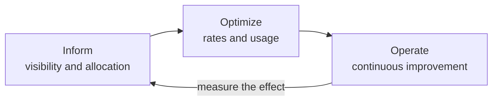
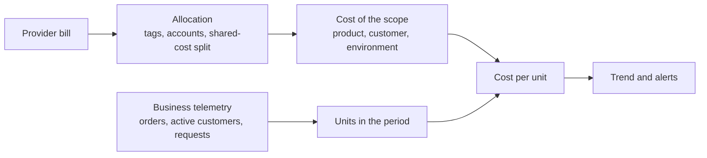
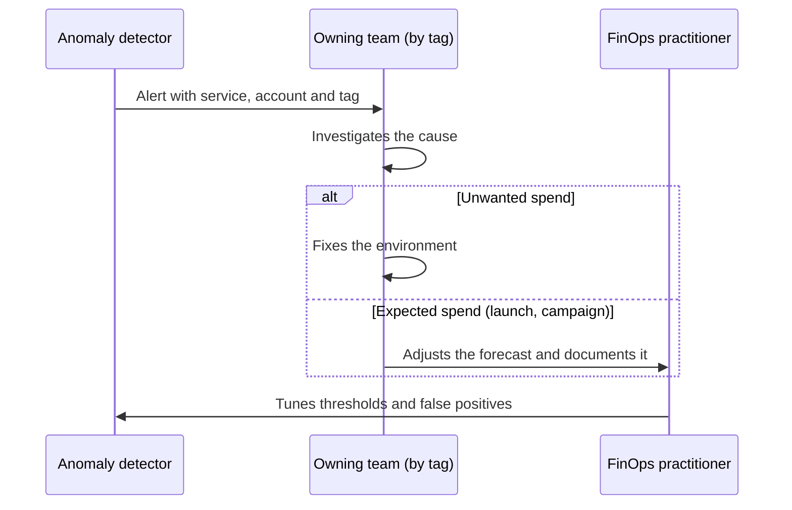

# FinOps: cost as an architecture attribute

The monthly bill arrives and it has grown much faster than traffic. Nobody can explain why: half the resources have no owner, the shared cluster shows up as a single line item, and finance wants to know whether the new product makes money. The team reacts the usual way: it shuts down test environments, buys reserved capacity for whatever is running and promises to look at the logs. Three months later the bill climbs again. The problem was never a lack of savings. **Cost had not been designed: nobody had stated it as a requirement, measured it per business unit or assigned it to the people whose decisions create it.**

**FinOps is the practice that turns technology spend into a decision shared by engineering, finance and the business, and for an architect it means treating cost as one more quality attribute, with requirements, measures and trade-offs.** This article covers the FinOps Foundation framework, pricing models as concepts, how to compute unit cost, why tagging is an architecture decision, the costs that tend to stay out of diagrams, and how to govern all of it without slowing teams down.

Three topics have their own lesson and stay out of scope here: the cost model of serverless is in [serverless and managed compute](/docs/serverless-y-computacion-gestionada), exit costs and vendor dependency are in [married to a provider](/docs/casado-a-un-proveedor), and performance measurement is in [performance numbers and laws](/docs/numeros-y-leyes-de-rendimiento).

<Callout tone="info" title="Cut-off date and figures">
  Sources were checked in October 2026. The provider data in this article are the one- or three-year
  term of AWS Savings Plans, the interruption notices for AWS and Azure Spot capacity, the delay of
  Azure billing data, the AWS price for cross-zone transfer, and whether AWS, Google Cloud and Azure
  charge for that traffic at all. They come from each provider's official documentation, are linked
  where they are cited and may change. Every other number is an illustrative assumption and is
  labeled as such.
</Callout>

## What FinOps is, and what it is not

The FinOps Foundation defines it this way: "FinOps is an operational framework and cultural practice which maximizes the business value of technology, enables timely data-driven decision making, and creates financial accountability through collaboration between engineering, finance, and business teams." That is the Technical Advisory Council definition, updated in March 2026. Earlier versions talked about the value of "cloud"; the current one says "technology" because the practice now covers SaaS, licensing and data centers too.

The name blends _Finance_ and _DevOps_. The foundation is explicit that FinOps is not about spending less but about knowing which technology investments return the most value; sometimes the right answer is to spend more. The Linux Foundation announced in June 2020 that it would host the FinOps Foundation, and the framework is published under a CC BY 4.0 license.

### The framework in one table

| Component    | What it contains                                                                                                      | Why it matters to an architect                                                               |
| ------------ | --------------------------------------------------------------------------------------------------------------------- | -------------------------------------------------------------------------------------------- |
| Principles   | Six, including "business value drives technology decisions" and "everyone takes ownership for their technology usage" | They ask for cost to be considered from design onward, not in a later cleanup                |
| Phases       | _Inform_, _Optimize_, _Operate_, run as a cycle rather than a straight line                                           | Design touches all three: it produces the data, opens the options and keeps them in place    |
| Domains      | Understand usage and cost, quantify business value, optimize usage and cost, manage the practice                      | They separate seeing, valuing and improving; without the first, the rest is guesswork        |
| Capabilities | Allocation, anomaly management, budgeting, unit economics, rate optimization, architecting and workload placement…    | Several depend on design choices: what metadata each resource carries, what telemetry exists |
| Personas     | FinOps practitioner, engineering, finance, leadership, procurement, product                                           | The architect translates between engineering and finance; nobody else sees both halves       |

The three phases describe a loop you run often and in small steps:



Two ideas in the framework change how you design. The first separates **usage optimization** (using fewer resources for an acceptable outcome, an engineering job) from **rate optimization** (paying an appropriate price for what you do need, a job for procurement and leadership). The second asks for **commitments and discounts to be managed centrally** to take advantage of scale, so teams can focus on their usage. Architects work mostly on the first, but their decisions determine which rates are even possible.

## Cost as a quality attribute

Performance, availability and security get written as measurable requirements; cost usually arrives as an annual budget figure nobody connects to the design. Treating it as a [quality attribute](/docs/atributos-de-calidad) means giving it the same treatment: a scenario with a stimulus and a measure, a place in the utility tree and an explicit trade-off against the other attributes.

This is not a FinOps-only idea. The first of the seven laws in _The Frugal Architect_, which Werner Vogels introduced at re:Invent 2023, is to make cost a non-functional requirement. The AWS Well-Architected Framework devotes one of its [six pillars](https://docs.aws.amazon.com/wellarchitected/latest/framework/the-pillars-of-the-framework.html) to cost optimization, and the equivalent frameworks from Azure and Google Cloud include it as well.

A cost scenario has the same shape as a performance one:

| Scenario part       | Example (assumed)                                                         |
| ------------------- | ------------------------------------------------------------------------- |
| Source and stimulus | Order volume doubles during peak season                                   |
| Environment         | Production, with the current architecture                                 |
| Response            | The system scales without manual intervention                             |
| Measure             | Cost per order rises no more than 10% over the previous quarter's average |

The measure is expressed per business unit, not as a total: a bill that doubles when the business doubles is healthy; a cost per order that doubles is not. You can watch that scenario automatically as a [fitness function](/docs/fitness-functions) that reads allocated cost and the order counter.

Like any attribute, cost competes with the others. A replica in another zone buys availability and is paid for in storage and, with some providers, in transfer; a cache buys latency and is paid for in memory. The lesson from [trade-offs and decisions](/docs/trade-offs-y-decisiones) applies unchanged: the decision is not "cheap or expensive" but how much of an attribute you buy per unit of cost.

## Pricing models as concepts

Product names change; the three underlying models do not. What differs is which risk you carry and which one the provider carries.

| Model                  | What you buy                                                         | Risk you take on                                             | Fits when                                                                | Names at AWS, Azure and Google Cloud                                              |
| ---------------------- | -------------------------------------------------------------------- | ------------------------------------------------------------ | ------------------------------------------------------------------------ | --------------------------------------------------------------------------------- |
| Pay as you go          | Capacity when you ask for it, with no commitment                     | No volume risk; you pay the highest rate                     | Demand is uncertain, new or highly variable                              | On-Demand; pay-as-you-go; on-demand pricing                                       |
| Usage commitment       | A lower rate in exchange for committing to usage or spend for a term | Paying for the commitment even if you don't use it (vacancy) | There is a stable baseline you have measured for long enough             | Reserved Instances and Savings Plans; Azure Reservations; committed use discounts |
| Interruptible capacity | Spare capacity at a lower price                                      | The provider reclaiming it on short notice                   | The work tolerates interruption: batch, analytics, CI, test environments | Spot Instances; Azure Spot Virtual Machines; Spot VMs                             |

A few provider details help pin the concept down, all as of October 2026: [AWS Savings Plans](https://docs.aws.amazon.com/savingsplans/latest/userguide/what-is-savings-plans.html) are committed for one or three years; [AWS Spot Instances](https://docs.aws.amazon.com/AWSEC2/latest/UserGuide/spot-instance-termination-notices.html) get a two-minute interruption notice, and [Azure Spot Virtual Machines](https://learn.microsoft.com/en-us/azure/virtual-machines/spot-vms) are evicted with 30 seconds' notice and no SLA. The FinOps Foundation also distinguishes **resource-based** commitments (a machine family in a region) from **spend-based** ones (an amount per hour, which is more flexible).

The practical rule that follows is a layered mix: the **stable baseline** you have been measuring goes on commitment, the **variable slice** stays on pay as you go, and **work that tolerates interruption** goes on interruptible capacity. Design decides how much work lands in that last layer: a batch process that checkpoints its progress and can resume is a candidate; one that loses hours of work when cut off is not.

## Unit economics: cost per business unit

The bill total tells you little. A 30% rise in cost can be good news if customers grew 60%. The framework's unit economics capability relates what you spend to the value it produces: cost per transaction, per customer, per request or per case resolved, depending on what matters to the product.

The calculation takes a numerator from the bill and a denominator from telemetry:



An example with assumed numbers. The orders product has these costs allocated for one month:

| Line item (assumed)             | Monthly cost |
| ------------------------------- | -----------: |
| Compute                         |       €4,200 |
| Database                        |       €2,600 |
| Storage                         |         €700 |
| Data transfer                   |         €900 |
| Observability (logs and traces) |       €1,100 |
| Allocated share of shared costs |         €500 |
| **Total**                       |  **€10,000** |

Telemetry records 2,000,000 orders and 400 active customers in the same month. Cost per order is 10,000 / 2,000,000 = €0.005 (€5 per thousand orders), and cost per customer is 10,000 / 400 = €25. The useful part is not one month's value but its **trend**: if next month orders go up and cost per order goes down, the architecture scales well; if it goes up, something is growing faster than the business.

Three common traps in the calculation:

- **Misaligned periods.** Billing data arrives late while telemetry is almost immediate. Azure, for example, says in its [Cost Management documentation](https://learn.microsoft.com/en-us/azure/cost-management-billing/costs/understand-cost-mgt-data) that for EA and MCA accounts that data is typically available within 8 to 24 hours, as of October 2026. Compare closed periods.
- **Unsplit shared costs.** If the cluster or the common network is not split, unit cost comes out low and misleads you. Pick a split rule (by measured usage, evenly, proportionally) and write it down.
- **Mixing up average and marginal cost.** Average cost per order includes a fixed share; the cost of one more order can be much lower. Pricing and discount decisions need the marginal figure.

## Tagging and cost allocation

Without allocation there is no unit cost, no owner and no alert that reaches someone who can act. The framework describes allocation as using accounts, tags and metadata to assign costs to whoever generates them, and asks for three strategies: allocation (which groupings all spend is assigned to), tagging (which tags and conventions identify each grouping) and shared cost (how to split what several groups use).

Those data feed two kinds of report. **Showback** shows each team what its scope costs, at any level of detail. **Chargeback** books that cost officially against each area's accounting budget. According to the foundation, the difference is the formality of sending expenses to the accounting system, and neither is more mature than the other.

### Why missing tags are an architecture problem

It usually gets filed as an operations slip, but the cause sits in the design:

- **The allocation unit is a design decision.** If the product is your unit-economics unit, every resource must be attributable to a product. A database shared by three products cannot carry a single product tag; it has to be split using telemetry, and that telemetry has to exist.
- **Shared resources hide cost.** A container cluster or a [multi-tenant](/docs/multi-tenancy) database shows up as one line; cost per tenant or per service only exists if the platform measures each one's consumption.
- **A tag not enforced at creation arrives late.** A resource created without tags stays unallocated until someone fixes it, and in AWS cost allocation tags must be activated before they show up in Cost Explorer and in reports.

The answer is to treat tagging as a contract enforced in infrastructure as code and checked automatically. The shape of the policy, not an implementation:

```yaml
# Mandatory tag policy (shape, sample values)
required_tags:
  cost-center: … # finance cost center
  product: … # unit-economics unit
  environment: prod | staging | dev
  owner: … # team that answers the alert
  data-retention: … # applicable retention policy
```

A pipeline check that rejects resources without these tags is one more fitness function, and it keeps ownerless spend from growing.

## Hidden costs the diagram does not show

Architecture diagrams show boxes; the bill also charges for the arrows, the data that piles up and the copies.

| Cost                                 | Why it shows up                                                                                                                                          | What to decide in the design                                           |
| ------------------------------------ | -------------------------------------------------------------------------------------------------------------------------------------------------------- | ---------------------------------------------------------------------- |
| Cross-zone and cross-region transfer | Calls between regions may be billed by volume; between zones, some providers (AWS or Google Cloud, for example) charge for the traffic and others do not | Keep chatty components together; measure cross-zone traffic            |
| Logs and traces                      | Volume grows with traffic and with verbosity                                                                                                             | Trace sampling, log levels per environment, retention per data type    |
| Storage with no retention            | Data only grows if nobody decides when it is archived or deleted                                                                                         | A lifecycle policy from day one: hot, cold, deleted                    |
| Replicas and backups                 | Each replica multiplies storage and traffic; backups pile up                                                                                             | A replica count justified by a requirement; a written backup retention |
| Multicloud complexity                | Duplicated tooling, egress between providers, more specialists                                                                                           | Justify each extra provider with a requirement, not a preference       |
| Orphaned resources                   | Detached disks, reserved IP addresses, snapshots, forgotten environments                                                                                 | Owner and expiry tags; automatic cleanup of anything without them      |

Cross-zone transfer deserves a concrete example, because each provider treats it differently. AWS charges traffic for EC2, RDS and other services across Availability Zones in the same region at USD 0.01 per GB in each direction, according to its [EC2 pricing page](https://aws.amazon.com/ec2/pricing/on-demand/), a provider figure as of October 2026. [Google Cloud](https://cloud.google.com/vpc/network-pricing) also charges for traffic between zones in the same region. [Azure](https://learn.microsoft.com/en-us/azure/reliability/availability-zones-overview), by contrast, says it does not charge for data transfer between availability zones in the same region. Deploying across zones is a sound resilience decision (covered in [regions, zones and recovery](/docs/regiones-zonas-y-recuperacion)); where that traffic is charged, a service that calls another one in a different zone on every request pays for that transfer millions of times. Check your provider's rate before you estimate it.

On the complexity of running with several providers, the lesson [multicloud: when it makes sense](/docs/multinube-cuando-tiene-sentido) makes the full argument; here it is enough to record it as a recurring cost and not only as a migration cost.

## Elasticity versus fixed cost

The cloud sells elasticity: you pay in proportion to what you use. Fixed or committed capacity costs the same whether you use it or not, but its unit price is lower. Which one wins depends on volume, and two straight lines are enough to reason about it:

- **Variable cost:** `p · q`, where `p` is the unit price and `q` the volume. It starts at zero.
- **Fixed cost:** `F + v · q`, where `F` is what you pay with zero traffic and `v` is the remaining marginal cost (storage, network). It starts at `F` and grows more slowly.

The lines cross at `q* = F / (p − v)`. Below `q*` the variable option is cheaper; above it, the fixed one. That is what the article's figure shows: the fixed line starts at `F`, the variable one at zero, and the crossing point is where the better choice flips.

Three caveats keep you from applying the formula blindly:

- **Volume is not a number, it is a distribution.** If demand has peaks, the fixed option has to be sized for the peak or combined with variable capacity for the overflow.
- **Fixed capacity never runs at 100%.** As [performance numbers and laws](/docs/numeros-y-leyes-de-rendimiento) explains, latency explodes near saturation; you need headroom, and that headroom raises the effective unit cost.
- **Elasticity has option value.** Paying more per unit buys the possibility of paying nothing if the product fails. Before you have measurements, that option is usually worth more than the savings.

## Governance: budgets, anomalies and cost in design

Cost governance is not a committee that approves spend; it is a set of mechanisms that make cost visible in time and route it to whoever decides.

### Budgets and alerts

A budget in the provider console warns; it does not stop anything. Azure's documentation says so explicitly: when a threshold is crossed, notifications go out, but resources are not affected and consumption is not stopped. Stopping spend takes an extra action and a business decision about what to turn off. Useful budgets are defined per allocated scope (product, team, environment) and alert on forecast cost, not only on actual cost.

### Anomaly detection

An anomaly is spend that differs from what was expected, nearly always upward. Providers offer detection based on machine learning models (AWS Cost Anomaly Detection is one example), and the framework points out that detection is only useful if allocation metadata tells you who should investigate. The lifecycle of an alert, following the anomaly management capability:



A planned launch also triggers alerts, because the detector compares against the past. Announcing it beforehand saves other teams wasted work.

### Cost in design review

The decision with the largest effect on cost is made before anything is deployed. That is why significant decisions go into an [ADR](/docs/adr) that includes the estimated cost, the business unit it will be measured by and when it must be revisited. The shape of that section:

```markdown
## Estimated cost

- Unit of measure: cost per 1,000 documents processed
- Initial estimate: … (assumptions: volume, rate mix, retention)
- Costs beyond compute: transfer, logs, backups
- Review threshold: cost per unit rises more than …% in two months
- Tracking owner: …
```

The estimate will be imprecise, and that is fine: its value lies in writing the assumptions down so you can compare them with reality.

## When it pays off and when it does not

| Situation                                                             | What to do                                                                |
| --------------------------------------------------------------------- | ------------------------------------------------------------------------- |
| Cloud spend is small compared with the cost of the team               | Basic tagging, budgets and alerts; do not build a full practice yet       |
| Several teams share accounts and nobody knows what each product costs | Start with allocation: without it, the rest is guesswork                  |
| A new product with uncertain demand                                   | Pay as you go, and measure unit cost from the first month                 |
| A stable consumption baseline measured over months                    | A usage commitment for that baseline, managed centrally                   |
| Batch work that can resume                                            | Interruptible capacity, with the design ready for the interruption notice |
| The bill grows faster than the business                               | Look at unit cost and hidden costs before negotiating rates               |

## Common mistakes

- **Optimizing the bill without looking at cost per business unit.** Cutting the total can make the product worse; a larger bill with a lower cost per order is an improvement.
- **Reserving capacity before measuring.** A commitment on consumption you do not know turns a technical uncertainty into a one- or three-year financial debt.
- **Leaving orphaned resources behind.** Disks, snapshots, IP addresses and test environments with no owner or expiry date get billed every month.
- **Tagging by hand, after the fact.** If the tag is not required when the resource is created, allocation never reaches 100%.
- **Ignoring the arrows in the diagram.** Traffic between zones, regions and providers does not appear in the resource inventory, but it can appear on the bill.
- **Keeping everything forever.** Logs, traces and backups without a retention policy grow even when the business does not.
- **Treating FinOps as a cost-cutting squad.** If teams only see cost when someone asks them to save, they never build it into their design decisions.

## Worked example: reserve capacity or keep paying as you go?

A team processes documents (scanned invoices) and has to decide how to pay for compute. **Every number here is an assumption chosen to illustrate the reasoning.**

- **Option A, variable:** a managed pay-as-you-go service, `p` = €2.50 per 1,000 documents.
- **Option B, fixed:** committed capacity with a fixed cost `F` = €1,500 per month, able to process up to 1,500,000 documents, plus a marginal cost `v` = €0.50 per 1,000 documents (storage and network).

The crossing point is `q* = 1,500 / (2.50 − 0.50) = 750` thousand documents per month. The table checks the arithmetic:

| Monthly volume (assumed) | Option A: 2.50 × thousands | Option B: 1,500 + 0.50 × thousands | Cheaper |
| ------------------------ | -------------------------: | ---------------------------------: | ------- |
| 200,000                  |                       €500 |                             €1,600 | A       |
| 400,000                  |                     €1,000 |                             €1,700 | A       |
| 750,000                  |                     €1,875 |                             €1,875 | Tie     |
| 1,200,000                |                     €3,000 |                             €2,100 | B       |

Today the volume is 400,000 documents a month and the business forecast is 1,200,000 within a year. Choosing B now would cost €700 more per month (1,700 against 1,000); if the forecast comes true, staying on A at that point would cost €900 more per month (3,000 against 2,100). And if volume drops to 200,000, B would cost €1,100 more than A (1,600 against 500), because the fixed cost is paid regardless.

The sensible decision is to stay on A while volume is below `q*`, measure cost per thousand documents every month, and move to B once volume stays above `q*` with some margin for an agreed period (for example, three consecutive months, also an assumption). The decision goes into an ADR with that review threshold, and the trigger is watched automatically. If volume has seasonal peaks, a mix (B sized for the baseline, A for the overflow) deserves its own calculation with the same formula.

## Checklist

- [ ] Cost has at least one quality scenario expressed per business unit.
- [ ] Every resource has an owner, a product and an environment, and the tag policy is enforced at creation time.
- [ ] Shared costs have a written split rule measured with telemetry.
- [ ] Unit cost is calculated monthly over closed periods and its trend is tracked.
- [ ] Usage commitments cover only a measured consumption baseline, and their vacancy is reviewed.
- [ ] Cross-zone and cross-region transfer, logs, backups and retention are estimated in the design.
- [ ] There are budgets per scope and anomaly alerts that reach the owning team.
- [ ] Significant decisions record their estimated cost and review threshold in an ADR.

## Back to the start of the series

This is the last lesson in the cloud series. To go through it from the beginning, start with [cloud services for architects](/docs/servicios-nube-para-arquitectos).

## Sources

Checked in October 2026.

- [What is FinOps? (FinOps Foundation)](https://www.finops.org/introduction/what-is-finops/): Technical Advisory Council definition, updated March 2026
- [FinOps Framework](https://www.finops.org/framework/), [principles](https://www.finops.org/framework/principles/) and [phases](https://www.finops.org/framework/phases/) (FinOps Foundation, CC BY 4.0)
- Framework capabilities: [Unit Economics](https://www.finops.org/framework/capabilities/unit-economics/), [Allocation](https://www.finops.org/framework/capabilities/allocation/), [Invoicing & Chargeback](https://www.finops.org/framework/capabilities/invoicing-chargeback/), [Anomaly Management](https://www.finops.org/framework/capabilities/anomaly-management/), [Rate Optimization](https://www.finops.org/framework/capabilities/rate-optimization/)
- [The Linux Foundation Brings Together IT and Finance Teams to Advance Cloud Financial Management and Education (Linux Foundation, June 2020)](https://www.linuxfoundation.org/press/press-release/the-linux-foundation-brings-together-it-and-finance-teams-to-advance-cloud-financial-management-and-education)
- [The Frugal Architect](https://thefrugalarchitect.com/): the seven laws Werner Vogels introduced at re:Invent 2023
- [Cost Optimization Pillar, AWS Well-Architected Framework](https://docs.aws.amazon.com/wellarchitected/latest/cost-optimization-pillar/welcome.html), [Azure Well-Architected Framework: Cost Optimization](https://learn.microsoft.com/en-us/azure/well-architected/cost-optimization/) and [Google Cloud Well-Architected Framework: Cost optimization pillar](https://cloud.google.com/architecture/framework/cost-optimization)
- [The pillars of the framework (AWS Well-Architected)](https://docs.aws.amazon.com/wellarchitected/latest/framework/the-pillars-of-the-framework.html)
- [What are Savings Plans? (AWS)](https://docs.aws.amazon.com/savingsplans/latest/userguide/what-is-savings-plans.html), [Spot Instances (AWS)](https://docs.aws.amazon.com/AWSEC2/latest/UserGuide/using-spot-instances.html) and [Spot Instance interruption notices (AWS)](https://docs.aws.amazon.com/AWSEC2/latest/UserGuide/spot-instance-termination-notices.html)
- [Azure Spot Virtual Machines (Microsoft Learn)](https://learn.microsoft.com/en-us/azure/virtual-machines/spot-vms) and [Azure Reservations (Microsoft Learn)](https://learn.microsoft.com/en-us/azure/cost-management-billing/reservations/save-compute-costs-reservations)
- [Spot VMs (Google Cloud)](https://cloud.google.com/compute/docs/instances/spot) and [committed use discounts (Google Cloud)](https://cloud.google.com/compute/docs/instances/committed-use-discounts-overview)
- [Amazon EC2 On-Demand Pricing](https://aws.amazon.com/ec2/pricing/on-demand/): data transfer within the same region; [VPC network pricing (Google Cloud)](https://cloud.google.com/vpc/network-pricing); [What are Azure availability zones? (Microsoft Learn)](https://learn.microsoft.com/en-us/azure/reliability/availability-zones-overview), section "Inter-zone networking"
- [Understand Cost Management data (Microsoft Learn)](https://learn.microsoft.com/en-us/azure/cost-management-billing/costs/understand-cost-mgt-data): availability of cost and usage data
- [AWS cost allocation tags](https://docs.aws.amazon.com/awsaccountbilling/latest/aboutv2/cost-alloc-tags.html), [AWS Cost Anomaly Detection](https://docs.aws.amazon.com/cost-management/latest/userguide/manage-ad.html) and [budgets in Microsoft Cost Management](https://learn.microsoft.com/en-us/azure/cost-management-billing/costs/tutorial-acm-create-budgets)
- [Cloud FinOps, 2nd edition (J.R. Storment and Mike Fuller, O'Reilly, January 2023)](https://www.oreilly.com/library/view/cloud-finops-2nd/9781492098348/)
