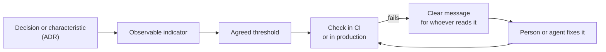

# Fitness functions and evolutionary architecture

An architecture degrades the same way in almost every team: someone takes a reasonable shortcut,
someone else copies it, and six months later the rule "layers are not skipped" is still written in
a document nobody reads while the code says the opposite. The problem is not a lack of rules, but
that **nothing checks them**.

A _fitness function_ is the practical answer: turn an architecture characteristic into an
objective, automated check that runs alongside the rest of the code. This article explains where
the idea comes from, how fitness functions are classified, how to go from a vague wish to a
metric, examples with real tools, and how to introduce them without blocking a team that works on a
legacy system.

<Callout tone="info" title="Cutoff date">
  The data is from October 2026. The tools mentioned change version often: check the syntax against
  the official documentation before adopting them in your project.
</Callout>

## Where the concept comes from

The term is borrowed from **evolutionary computing**. In a genetic algorithm, the fitness function
defines what "better" means and summarizes how close a solution is to the set goals. Neal Ford,
Rebecca Parsons and Patrick Kua carried it over to architecture in the book _Building Evolutionary
Architectures_ (first edition, 2017). The second edition is listed with four authors (Parsons,
Ford, Kua and Sadalage) and the subtitle _Automated Software Governance_. According to its
publisher, that second edition dives deeper into fitness functions and into how to use them to
automate architectural governance.

The definition that circulates, attributed to the book by InfoQ, is this: an architectural
fitness function is **any mechanism that provides an objective integrity assessment of some
architectural characteristic**. Thoughtworks placed it on its Technology Radar as a technique in
the _Trial_ ring in the November 2017 edition and again in May 2018; it no longer appears in the
current edition, which does not invalidate it: the practice went from novelty to part of the
craft.

An _evolutionary architecture_, in the words of Ford's slides, is one that supports guided,
incremental change across multiple dimensions. Fitness functions are the **guidance**: without
them, change is incremental but drifts.

## What a fitness function is and is not

The property that defines it is **objectivity**: in the authors' own words in a Thoughtworks
podcast, what matters is that nobody argues about the result. That is why a wish does not qualify:

- "The system must be maintainable" is **not** a fitness function. There is no way to measure it
  without opinions.
- "The cyclomatic complexity of every function is lower than five" **is** one: anyone gets the
  same result.

You do not need to invent tools either. The Radar points out that these checks can lean on
existing methods: unit tests, metrics and monitors. A linter with a defined threshold and a fast
result is a fitness function; the same linter run once in a while with no consequences is not.
The difference is not the tool, but that the result **reliably blocks or reports**.

And automation changes the conversation: if a check runs in the build, nobody has to review
dependency cycles by hand in every pull request, because you know they cannot get through.

## How they are classified

The second edition's table of contents organizes the categories along six axes. This table
summarizes each one with its practical meaning:

| Axis            | Options                          | What it means in practice                                                                  |
| --------------- | -------------------------------- | ------------------------------------------------------------------------------------------ |
| **Scope**       | Atomic or holistic               | A single isolated characteristic, or several interacting in a shared context               |
| **Cadence**     | Triggered, continual or temporal | On an event (commit, build), permanently in production, or every so often                  |
| **Result**      | Static or dynamic                | A fixed pass-or-fail threshold, or a threshold that depends on context (for example, load) |
| **Invocation**  | Automated or manual              | The pipeline runs it, or a person does (for example, a security review)                    |
| **Proactivity** | Intentional or emergent          | You design it from the start, or you discover it after a real problem                      |
| **Coverage**    | Domain-specific                  | Checks that only make sense in your business (for example, a regulatory rule)              |

Ford's slides use a shorter version of the same idea: atomic versus holistic and batch versus
continuous, and they warn that holistic ones must run in a shared context. To get started, two
questions are enough: **does it measure one thing or several?** and **does it run on every change
or in production?**

## From characteristic to check

The hard step is not the tool but translating a concern into a measure. A simple method:

1. **Name the characteristic** you care about (modifiability, performance, security,
   operability).
2. **Pick an observable indicator:** which number or fact changes when the characteristic
   degrades.
3. **Set a threshold** the team accepts before seeing the result.
4. **Decide when it runs** and what happens on failure: it blocks, it warns or it just logs.



These are examples of that translation:

| Characteristic  | Indicator                                | Example threshold            | Typical tool                         |
| --------------- | ---------------------------------------- | ---------------------------- | ------------------------------------ |
| Modularity      | Dependencies between layers              | Zero upward dependencies     | ArchUnit, dependency-cruiser, ESLint |
| Coupling        | Cycles between modules                   | Zero cycles                  | ArchUnit, dependency-cruiser         |
| Maintainability | Size and complexity per file or function | Maximum lines and complexity | ESLint, SonarQube                    |
| Test quality    | Coverage or mutants detected             | Above an agreed minimum      | Coverage, mutation testing           |
| Performance     | Load metrics (Web Vitals)                | Maximum LCP in milliseconds  | Lighthouse CI                        |
| Compatibility   | Contracts between consumer and provider  | Zero broken contracts        | Contract tests                       |
| Reliability     | Error rate in production                 | Under 1% after a deployment  | Monitors, SLOs                       |
| Security        | Secrets or vulnerable dependencies       | Zero findings                | Secret and CVE scanners              |

## Examples with real tools

### Layer and dependency rules

This is the most common and cheapest case. All the tools follow the same idea: declare what may
depend on what and fail when the code contradicts it. What changes is **where the rule lives**:

| Tool               | Language                  | How the rule is declared                                                                                               |
| ------------------ | ------------------------- | ---------------------------------------------------------------------------------------------------------------------- |
| ArchUnit           | Java                      | JUnit 5 test code: `layeredArchitecture()` with `.layer(...)` and `.whereLayer(...)`                                   |
| NetArchTest        | .NET                      | Fluent API inside any unit-test framework: `Types.InCurrentDomain().That().ResideInNamespace(...)`                     |
| import-linter      | Python                    | Contracts in a configuration file (`.importlinter`): `type = forbidden`, with `source_modules` and `forbidden_modules` |
| dependency-cruiser | JavaScript and TypeScript | `forbidden` rules with `from` and `to`, in a configuration file                                                        |
| ESLint             | TypeScript                | `import-x/no-restricted-paths` with zones: no new tool needed                                                          |

The choice depends on where you want the rule to live: as **test code** (ArchUnit, NetArchTest), as
**declarative configuration** (import-linter, dependency-cruiser) or inside the **linter you
already use** (ESLint). Which one matters less than the fact that it runs in CI and fails with a
clear message.

To see the shape, this is an ArchUnit rule from its official documentation, used inside a class
with `@AnalyzeClasses` and `@ArchTest` fields:

```java
layeredArchitecture().consideringAllDependencies()
    .layer("Controller").definedBy("..controller..")
    .layer("Service").definedBy("..service..")
    .whereLayer("Service").mayOnlyBeAccessedByLayers("Controller")
```

And this is the dependency-cruiser one from its README, which prevents code outside `test` from
depending on `test`:

```json
{
  "name": "not-to-test",
  "severity": "error",
  "from": { "pathNot": "^test" },
  "to": { "path": "^test" }
}
```

### Dependency cycles

Cycles are an easy-to-measure coupling indicator, and the reasonable threshold is zero. ArchUnit
expresses it with a _slices_ rule (`slices().matching(...).should().beFreeOfCycles()`) and
dependency-cruiser with the `no-circular` rule, which targets `"circular": true` in the `to` field.

### Size and complexity

Size and complexity limits are atomic, static, automated fitness functions. This repository sets in
`eslint.config.ts` a maximum of 300 lines per file (`max-lines`, not counting blank lines or
comments). Its `AGENTS.md` adds that cognitive complexity is watched with
`sonarjs/cognitive-complexity`. InfoQ's warning applies here: static analysis tools (PMD,
SpotBugs, ESLint, SonarQube) only become fitness functions when they give the developer **fast
feedback** and have defined limits. A monthly report with hundreds of warnings is not one.

### Performance and bundle size

Lighthouse CI lets you set budgets as assertions in `lighthouserc.json` (or `.js`) and run
`lhci autorun`, which launches collection, assertions and upload. An illustrative example: a
minimum score of 0.9 on `categories:performance` and a maximum of 2500 ms on
`largest-contentful-paint`, both with severity `warn`. It comes close to a **dynamic** fitness
function: the result depends on the measuring environment, so fix the conditions and repeat the
runs before turning it into a barrier.

### Tests, contracts and SLOs

Not everything is static analysis. These checks are also fitness functions when they have an
objective threshold:

- **Coverage and mutation testing.** Thoughtworks cites coverage above 90% as an example quality
  gate. Mutation testing is more expensive, so Böckeler recommends running it after integration,
  not on every save.
- **Consumer-driven contract tests.** Ford's slides include them as a fitness function for
  compatibility between services.
- **SLOs and monitors.** A goal like "error rate under 1% during a deployment", one of the examples
  in Thoughtworks' 2019 article, is a **continual** fitness function: it runs in production, not
  at commit time.

## A real example: this repository's layers

This site applies the idea without naming it. Its components follow an atomic design (atoms,
molecules, organisms, templates), and the dependency rule does not live in a paragraph: it lives in
the ESLint configuration. This is the shape of `architectureZones` in `eslint.config.ts`: each zone
names a `target`, the `from` layers it cannot import and a `message` that explains the rule
("atoms cannot depend on higher layers", "lib must stay independent of any higher layer").

```ts
const architectureZones = [
  { target: './src/components/atoms', from: ['./src/components/molecules' /* … */], message: '…' },
  { target: './src/lib', from: ['./src/components' /* … */], message: '…' },
];
// enabled with: 'import-x/no-restricted-paths': ['error', { zones: architectureZones }]
```

If an atom imports from a molecule, `eslint` fails with the message written by whoever defined the
zone (in Spanish, the repository's working language). Nobody has to review by hand or remember the
rule.

That rule is not alone. This table shows which other checks in the repository play the role of
fitness function and where they run:

| Check                                                   | What it protects                                       | Where it runs                   |
| ------------------------------------------------------- | ------------------------------------------------------ | ------------------------------- |
| `import-x/no-restricted-paths` with `architectureZones` | Dependencies between layers                            | `bun run lint`, `bun run check` |
| `max-lines` (300) and cognitive complexity              | Size and complexity of files and functions             | `bun run lint`                  |
| `bun run audit`                                         | MDX content, internal links, translations and routes   | `pre-push` and `bun run check`  |
| Full `bun run check`                                    | Format, lint, types, audit, tests and dead code (knip) | Deployment workflow in CI       |

The audit (`tools/audit.ts`) exits with code 1 when there are errors, so it blocks the push. It is
a **domain-specific** fitness function: it validates things that only make sense on this site, such
as every document having its translation or a route's id matching its file.

## Where to run them

A fitness function is worth as much as the moment it fails. Some practical rules:

- **Cheap early.** Layer, cycle and size rules run in the editor, at commit and in the pipeline.
  The expensive ones (mutation and performance tests) go after integration.
- **Fail with a useful message.** The message of an ESLint zone or an import-linter contract is
  documentation that shows up exactly when needed. Böckeler stresses this: sensor output written
  for a model to read, for example with instructions to fix the problem, is especially useful.
- **A rule that lives where it runs does not go stale silently.** A paragraph in a document ages
  without anyone noticing; a rule in the pipeline forces you to update it or justify the
  exception.
- **Git hooks are not enough.** Local hooks can be skipped; the CI pipeline is the barrier that
  does not depend on goodwill. This repository runs `bun run check` as a quality gate before
  publishing.

## Introducing them in a legacy system

Turning on a strict rule over code with hundreds of violations only produces noise. The alternative
is to record the current violations and **block only new ones**. dependency-cruiser documents it
like this:

```sh
dependency-cruiser src --baseline       # records the existing violations
dependency-cruiser src --ignore-known   # in CI: ignores the known ones and fails on new ones
```

With `--ignore-known`, the recorded violations drop to severity `ignore` and the error reporters
show only a warning with the count; `--no-ignore-known` shows them again. According to its
documentation, this is the recommended approach when there are already many cycles.

The general idea is called a _ratchet_: the exception list **can only shrink**. To make it really
work:

1. Fail the build if the list grows, not only if there are new violations outside it.
2. Delete the list entry when the spot is fixed, in the same change.
3. Review the list size periodically as a debt metric, which is also objective.

## Fitness functions, ADRs and AI agents

### Every decision can carry its check

An [ADR](/docs/adr) records why something was decided. A fitness function records **whether it is
still being followed**. Together they close the loop: the decision ("atoms do not depend on upper
layers") and the check that protects it live in the same change. When an ADR cannot be accompanied
by anything measurable, it is a hint that the decision is more a preference than a constraint.

### They are the harness's computational sensors

In the [harness engineering](/docs/harness-engineering-claude-code) article, Böckeler separates
guides (before acting) from sensors (after). Fitness functions are **computational sensors**:
deterministic, fast and cheap, suitable for running on every change. An AI agent that breaks a layer
rule receives the linter failure as feedback and can fix itself, with no person involved. The same
holds for projects that rely on agents to write code: the cheapest harness is the one you already
have in CI. For designing applications that use models, see also
[architecture of LLM and agent applications](/docs/arquitectura-agentes-llm).

Böckeler adds a nuance: computational sensors cover **maintainability** well and part of
architecture fitness, but **behaviour** remains the least solved category. Fitness functions do not
replace human review of what the system _should do_.

## Common mistakes

- **Turning a wish into a rule.** "Clean code" cannot be measured; function size can. Start with
  what is objective and lean on [clean code](/docs/clean-code) and [SOLID](/docs/solid) to decide
  what deserves a metric.
- **Thresholds nobody agreed on.** A barrier imposed without consensus gets switched off at the
  first pressure. Set the threshold with the team before seeing the result.
- **Rules nobody reads when they fail.** A cryptic message is the same as none. Explain what broke
  and what the alternative is.
- **Switching them all on at once in a legacy system.** It generates noise and ends in
  `// eslint-disable`. Use a baseline and a ratchet.
- **Everything in the slow pipeline.** If feedback takes twenty minutes, people stop waiting for
  it. Separate the fast from the expensive.
- **Measuring what is easy rather than what is important.** High coverage does not say the
  behaviour is correct. Combine metrics with contract and acceptance tests.
- **Fitness functions nobody maintains.** Review the rules when the architecture changes, for
  example in the [C4](/docs/c4-model) model, and update or delete those that no longer apply.

## Checklist for your first fitness function

- [ ] Name the characteristic you want to protect and why it matters to the business.
- [ ] Define an observable indicator and a threshold the team has accepted.
- [ ] Pick the tool you already have (ESLint, ArchUnit, import-linter, dependency-cruiser…).
- [ ] Write a failure message that explains the rule and the right alternative.
- [ ] Decide when it runs: editor, commit, pipeline or production.
- [ ] If the system is legacy, record a baseline and block only what is new.
- [ ] Link the check to the ADR that justifies it.
- [ ] Review from time to time that the rule is still useful and does not produce false positives.

## Sources

Consulted in October 2026; check each fact against the official source before deciding.

- [Building Evolutionary Architectures, 2nd edition (Thoughtworks)](https://www.thoughtworks.com/en-br/insights/books/building-evolutionaryarchitectures-second-edition)
- [Building Evolutionary Architectures, 2nd edition (O'Reilly)](https://oreilly.com/library/view/building-evolutionary-architectures/9781492097532)
- [Chapter 2, Fitness Functions (O'Reilly)](https://oreilly.com/library/view/building-evolutionary-architectures/9781492097532/ch02.html)
- [Podcast: Rethinking software governance (Thoughtworks)](https://thoughtworks.com/insights/podcasts/technology-podcasts/rethinking-software-governance-reflecting-second-edition-building-evolutionary-architectures)
- [Architectural fitness function (Thoughtworks Technology Radar)](https://thoughtworks.com/radar/techniques/architectural-fitness-function)
- [Fitness function-driven development (Paula Paul and Rosemary Wang, Thoughtworks, 2019)](https://www.thoughtworks.com/insights/articles/fitness-function-driven-development)
- [Fitness functions for your architecture (Thomas Much, InfoQ, April 2025)](https://www.infoq.com/articles/fitness-functions-architecture/)
- [Evolutionary Architectures (Neal Ford, slides)](https://nealford.com/downloads/Evolutionary_Architectures_by_Neal_Ford.pdf)
- [Harness engineering for coding agent users (Birgitta Böckeler)](https://martinfowler.com/articles/harness-engineering.html)
- [ArchUnit user guide](https://www.archunit.org/userguide/html/000_Index.html)
- [NetArchTest](https://github.com/BenMorris/NetArchTest)
- [import-linter](https://import-linter.readthedocs.io/en/stable/)
- [dependency-cruiser](https://github.com/sverweij/dependency-cruiser)
- [Lighthouse CI configuration](https://googlechrome.github.io/lighthouse-ci/docs/configuration.html)
