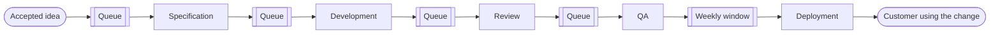
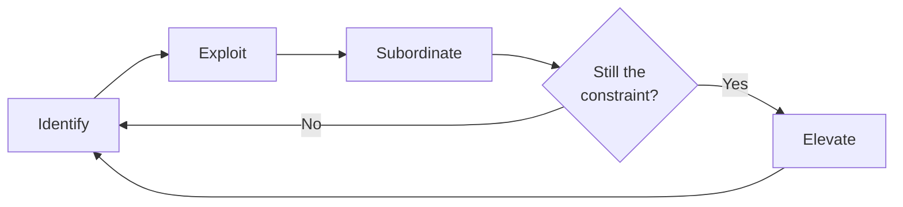

# Value stream and bottlenecks

A small change, two days of work, takes a month to reach customers. Nobody on the team is idle: each developer has three tasks open, the one QA person is swamped, and the weekly meeting ends with the same diagnosis, "we need more people". The team hires another developer and, three months later, the small change still takes a month. The problem was never a lack of effort. Nobody was looking at where the work sat waiting.

**The value stream is the full sequence of steps, value-adding or not, that an idea goes through until a customer uses it, and a bottleneck is the step with the least slack, the one that sets the pace for the whole stream.**

This lesson shows how to draw that stream, how to separate the time someone works on an item from the time it waits, how to find the bottleneck with the theory of constraints, and how to use Little's law and work-in-progress limits to decide where to act. It ends with a five-stage example whose assumed times add up.

<Callout tone="info" title="Cut-off date and scope">
  Sources checked in October 2026. The figures in the examples are assumptions and are labeled as
  such. No industry reference values are given for flow efficiency or for the DORA metrics: they
  depend on who measures, how, and where the start and end of the stream are set.
</Callout>

## What a value stream map is

Value stream mapping comes from manufacturing. Mike Rother and John Shook popularized it in _Learning to See_, a Lean Enterprise Institute workbook that documents how Toyota drew its flows. The book works through a fictional company, Acme Stamping: you first map the current state, then a future state with less waste, and finally a plan to get from one to the other.

In the institute's own description, the map is a pencil-and-paper picture of every process in the material and information flow, with the key data for each step. What sets it apart from a process diagram is that it also captures the activities that create no value and the information flow that triggers the work. The Lean Enterprise Institute defines the value stream as the set of actions, value-creating or not, needed to bring a product from concept to launch and from order to delivery.

In software, the "material" is the work itself: a story, a change, an incident. The map answers three questions that no tracking tool answers on its own:

- **Where the stream starts and ends.** From the moment someone accepts an idea to the moment a customer uses it, not from the moment a branch is opened.
- **Which steps exist and who does them.** Including approvals, deployment windows and waits on other teams.
- **How long each step is worked on and how long it waits.** The gap between the two is almost always the most revealing part.



### How to draw it, step by step

1. **Pick one family of work.** Small product changes, incidents or requests from another team: each family has its own stream, and mixing them averages things that do not resemble each other.
2. **Write down the start and the end.** For example, "idea accepted at prioritization" and "change live for all customers". Every later metric depends on this boundary.
3. **Walk the stream with the people who do the work.** You draw the map with the people at each stage, not from the official process description; the real waits are rarely documented.
4. **Record for each stage** the process time, the wait before it, how many people staff it and what share of the work goes back because of defects or missing information.
5. **Add up the timeline.** At the bottom of the map, a stepped line with waiting on top and processing below, stage by stage, and the total at the end. It is the staircase in this lesson's figure.
6. **Draw the future state only afterwards.** First understand the current stream; design the future one by attacking the largest wait, not the most visible stage.

## Process time versus wait time

A work item spends its life in two states: someone is working on it, or it is waiting. **Process time** is the sum of the stretches when someone touches it; **wait time** is everything else: queues, blockers, pending approvals, Thursday's deployment window. **Lead time** is the sum of both, measured from the start to the end you fixed on the map.

**Flow efficiency** is the share of lead time in which the work moves forward: process time divided by lead time. Niklas Modig and Pär Åhlström contrast it in _This Is Lean_ with **resource efficiency**, which measures how busy people and machines are. You cannot maximize both at once: a team with every member at full capacity builds up queues, and the work waits more than it moves.

### How to measure it without making up numbers

Flow efficiency is easy to define and hard to measure well. A few rules so the number means something:

1. **Split active and waiting states on the board.** Each stage needs two columns, "in progress" and "done, waiting for the next one". Without that split, all the time in a column counts as work.
2. **Flag blockers.** An item "in progress" that is waiting for an answer from another team is waiting, not moving.
3. **Use timestamps, not estimates.** Column transitions are recorded in almost any tracking tool; rebuilding times from memory tends to inflate the work and forget the wait.
4. **Measure a sample of finished items**, not the ones in flight, and report the median and the spread, not just the mean.
5. **Compare yourself with yourself over time.** The absolute value depends on where you put the start and end, so it does not compare across teams.

The minimal shape of a record that lets you compute all of the above is small:

```yaml
# one event per column change
- item: PAY-412
  from: dev.in-progress # source column
  to: dev.done # "done, waiting for review"
  at: 2026-10-05T14:20
  blocked: false # true if waiting on a third party
# …
```

<Callout tone="warning" title="Reference figures in circulation">
  You will often read that the flow efficiency of knowledge work sits around some specific low
  percentage. That figure depends on where the start and end of the stream are set and on how work
  is separated from waiting, so none is given here. What helps is your own baseline and its trend.
</Callout>

## Flow metrics: what each one measures

| Metric                  | What it measures                                  | How you get it                                        | Common trap                                                    |
| ----------------------- | ------------------------------------------------- | ----------------------------------------------------- | -------------------------------------------------------------- |
| Lead time               | How long an item takes end to end                 | Entry and exit timestamps for the stream              | Starting at the commit and ignoring the wait before it         |
| Process time            | How much the item is actually worked on           | Sum of time in active columns, excluding blockers     | Counting time in an "in progress" column as work               |
| Flow efficiency         | Which share of lead time the work moves forward   | Process time divided by lead time                     | Comparing it with teams that measure with other boundaries     |
| Throughput              | How many items leave per unit of time             | Count of finished items per week                      | Mixing items of very different sizes                           |
| Work in progress (WIP)  | How many items have started and not finished      | Count on the board at a point in time                 | Leaving out "invisible" work: urgent requests, support, favors |
| Utilization             | What fraction of its capacity a stage uses        | Demand times process time divided by available people | Chasing 100%: queues grow non-linearly                         |
| Change lead time (DORA) | Time from commit in version control to production | Repository and deployment system history              | Treating it as the whole stream: it misses work before commit  |

The last row deserves a note. DORA's change lead time covers only the delivery leg. If most of the waiting happens between "idea accepted" and "first commit", that metric will not see it; the map will.

## Bottlenecks and the theory of constraints

Eliyahu M. Goldratt introduced the theory of constraints in _The Goal_, a novel written with Jeff Cox and published in 1984. The protagonist runs a struggling plant and discovers that the output of the whole factory is set by a few saturated resources, and that improving any other resource does not change the result. The underlying idea: every system has at least one constraint that limits its performance; time lost at the constraint is lost for the whole system, and time gained at a resource that does not limit it does not improve the result.

The theory is applied through the **five focusing steps**, which the constraints literature associates with _The Goal_ and with Goldratt's later work (secondary source: the Wikipedia article on the theory of constraints, listed in Sources):

1. **Identify** the system's constraint.
2. **Exploit** it: get the most out of it without investing, for example by keeping it from stopping or from doing work someone else could do.
3. **Subordinate** everything else to that decision: the rest of the system works at the constraint's pace, even if that leaves other resources below their capacity.
4. **Elevate** it: only if the above is not enough, add capacity through investment.
5. **Go back to step 1** if the constraint has been broken, without letting inertia become the new constraint.



Order matters. Exploiting and subordinating are usually cheap and often enough; elevating costs money and time, and if you do it first you pay for capacity the system cannot use.

### What a bottleneck looks like in software

In a plant, the bottleneck is a machine. In a software team it can be anything with a queue in front of it:

- **A low-capacity stage**: one person doing QA, a platform team shared by ten product teams.
- **One expert**: the only person who knows the billing module reviews everything that touches it.
- **A policy**: a weekly deployment window, a change board that meets on Tuesdays. Capacity is not missing; frequency is.
- **A technical resource**: a single shared test environment, a test suite that takes hours.

The most reliable signal is the queue: work piles up **in front of** the bottleneck, and the stages **after** it wait with nothing to do. A stage with a lot of accumulated work and high utilization is a candidate; confirm it with the map's wait times before acting.

## Little's law: work in progress sets the wait

Little's law relates three averages of a stable system: average work in progress equals average throughput times the average time each item spends inside. John D. C. Little published the general proof in 1961; the derivation, the formula and its capacity uses are in [performance numbers and laws](/docs/numeros-y-leyes-de-rendimiento). Here it matters in the form used in operations management: **average lead time = average work in progress / average throughput**.

It serves two purposes in a value stream:

- **Estimating lead time** without tracking each item: with 30 items in progress on average and 6 leaving per week, each one takes about 5 weeks on average.
- **Checking that your measurements add up**: if the board shows 30 in progress, throughput is 6 per week and measured lead time is 2 weeks, something is mismeasured or some work is not being counted.

The conditions are not a footnote. The relationship holds for **long-run averages** of a **stable system**, where roughly as much enters as leaves during the window you measure, and with **the same boundary** for all three values. It does not depend on the distribution of arrivals or service times, but it does not apply if work in progress keeps growing, if the window is too short, or if you count the WIP of one stage and the lead time of the whole stream.

The practical consequence is direct: **at the same throughput, less work in progress means shorter lead time.** Starting more things does not make them finish sooner; with throughput fixed, it only lengthens each item's wait.

## Kanban: WIP limits as a lever

David J. Anderson described the Kanban method for technology work in _Kanban: Successful Evolutionary Change for Your Technology Business_ (Blue Hole Press, 2010). Its core mechanism is to visualize the flow and **limit work in progress** per column: when a column reaches its limit, the previous stage cannot push more work, and whoever is free helps clear the jam instead of starting something new.

WIP limits connect the two previous ideas. By Little's law, they lower lead time if throughput holds. By the theory of constraints, they are a way to **subordinate**: they stop fast stages from flooding the bottleneck's queue. Three rules for setting them:

- **Start from the WIP you observe today** and lower it gradually; a limit that is too low starves the bottleneck and cuts throughput.
- **Protect the constraint with a small queue in front of it**, so it never sits idle waiting.
- **When a column hits its limit, treat it as a signal**, not a failure: it shows where the bottleneck is today.

## DORA metrics and the delivery flow

The DORA metrics, their current definitions and how to use them without turning them into individual targets are covered in [DevOps and its culture](/docs/devops-cultura). For the value stream, one point of scope matters: according to DORA's official guide, change lead time is measured from the moment a change is committed to version control until it is deployed in production. It therefore describes only the final leg of the stream; waiting for prioritization, specification or approvals before the commit falls outside it, and you need the map to see it.

DORA groups change lead time, deployment frequency and failed deployment recovery time as throughput metrics, and change fail rate and deployment rework rate as instability metrics. That is why flow metrics are best read alongside the instability ones: a flow improvement that raises the failure rate has only traded waiting for rework.

## When to use it and when not to

**Use value stream mapping and the theory of constraints when:**

- Lead time is long and nobody can explain where it goes.
- The recurring fix is "more people" or "work faster", and it does not work.
- Several teams take part in the same stream and each one optimizes its own piece.
- You are about to invest in capacity (people, tools, automation) and want to know where it will pay off.

**It is not the right tool when:**

- The work is pure exploration with no repeatable steps: there is no stream to map, only experiments. For that case, see [continuous improvement and experiments](/docs/mejora-continua-y-experimentos).
- Volume is so low that there are no stable averages: Little's law does not hold with three items a month.
- The problem is not flow but what gets built: shipping the wrong thing quickly. That is decided with goals and outcome metrics, as covered in [measuring decisions with OKRs and KPIs](/docs/medir-decisiones-okr-kpi).

## Common mistakes

- **Optimizing a stage that is not the bottleneck.** Speeding up development when the queue sits in front of QA only grows that queue; lead time does not change.
- **Adding capacity to a resource that does not limit the system.** Hiring, buying or automating outside the constraint is step four applied in the wrong place: it costs money and does not show in the result.
- **Measuring only individual productivity.** Counting closed tasks per person pushes everyone to start more work, raises WIP and lengthens everyone's wait. Flow is measured at the system level.
- **Chasing 100% utilization.** Near saturation, queues grow very fast; slack at the constraint is not waste, it is what keeps work flowing.
- **Mapping only the technical leg.** If the map starts at the commit, waiting for prioritization, design or approvals is left out, and it is often the largest part.
- **Elevating before exploiting.** Buying capacity before removing unnecessary work from the constraint pays for something a team rule could have fixed for free.
- **Forgetting that the constraint moves.** Once a bottleneck is resolved, another appears. A map from a year ago describes a different system.
- **Confusing flow with debt.** If a stage is slow because the code is hard to change, the remedy is a design one: see [technical debt and evolution](/docs/deuda-tecnica-evolucion).

## Worked example: where to put the money

A product team ships small changes to a payments service. Management offers budget for one more developer. Before accepting, the team draws the map using the timestamps from the last three months. All figures are **assumptions** and are expressed in working days.

**Assumptions:** demand is stable at 4 items per week, that is, 0.8 per working day. Each stage has the capacity shown in the table, computed as dedicated people divided by process time. Deployment happens in a weekly window, so an item that is ready waits half a week on average, 2.5 days.

| Stage         | Wait before | Process | People           | Capacity (per day) | Utilization |
| ------------- | ----------- | ------- | ---------------- | ------------------ | ----------- |
| Specification | 2           | 0.5     | 1                | 2                  | 40%         |
| Development   | 2.5         | 1.5     | 3                | 2                  | 40%         |
| Review        | 2           | 0.5     | 1 (rotating)     | 2                  | 40%         |
| QA            | 7           | 1       | 1                | 1                  | 80%         |
| Deployment    | 2.5         | 0.5     | 1, weekly window | 2                  | 40%         |
| **Total**     | **16**      | **4**   | —                | —                  | —           |

Utilization is demand times process time divided by people: for QA, 0.8 × 1 / 1 = 80%; for development, 0.8 × 1.5 / 3 = 40%.

**Diagnosis.** Lead time is 16 + 4 = 20 days and flow efficiency is 4 / 20 = 20%. By Little's law, average work in progress should be 0.8 × 20 = 16 items; the board shows between 15 and 17, so the measurements add up. QA accounts for 7 of the 16 days of waiting and is the only stage at 80%. Strictly speaking, throughput is limited by demand today, because every stage can handle 0.8 items a day; but QA is the stage with the least slack, the one that dominates lead time and the first that will cap throughput if demand rises to 1 per day.

**Options evaluated:**

1. **Hire a fourth developer.** Development capacity goes from 2 to about 2.7 per day and its utilization drops to 30%. Since the main queue is in front of QA, items would reach that queue sooner and wait there. It is the mistake of elevating a resource that does not limit the system: high cost, almost no effect on the 20 days.
2. **Exploit and subordinate QA.** QA stops doing what others can do: developers automate regression checks and prepare test data, and the "ready for QA" column gets a limit of 3 items; whoever hits the limit helps test. Assumed estimate: QA process time drops from 1 to 0.6 days, its utilization to 48% and the wait before QA from 7 to about 2 days. The total becomes 3.6 of processing and 11 of waiting: 14.6 days, with flow efficiency close to 25%.
3. **Change the deployment policy.** Moving from a weekly window to daily deployments cuts the average wait before deployment from 2.5 to about 0.5 days. It is not a capacity constraint but a policy one, and it does not require hiring anyone.

**Decision.** Option 2 goes first, followed by option 3. With both, estimated lead time is 3.6 + 9 = 12.6 days, flow efficiency is around 29% and, by Little's law, expected work in progress drops to about 10 items. The hire is turned down for now, and the condition to revisit it is recorded: if after two months demand stays above 1 item per day, elevating QA gets evaluated. The estimate of the wait before QA does not come from a formula: the queue depends on the variability of arrivals, so it is measured again with the same method after four weeks.

## Checklist

- [ ] The map starts at the accepted idea and ends with the customer using the change, not at the commit or the deployment.
- [ ] Each stage on the board separates "in progress" from "done, waiting", and blockers are flagged.
- [ ] Times come from timestamps of finished items, with median and spread.
- [ ] Little's law matches what you measured: work in progress, throughput and lead time use the same boundary.
- [ ] The bottleneck is identified by its queue and its utilization, not by who complains the most.
- [ ] Before investing, the constraint has been exploited and the rest of the stream subordinated to it.
- [ ] There are WIP limits and a small queue that protects the constraint.
- [ ] Flow metrics are measured per system and paired with the change fail rate.

## Sources

Checked in October 2026. Secondary source for the Lean Enterprise Institute's value stream definition and for Modig and Åhlström's flow efficiency definition: publisher descriptions and third-party summaries of the books.

- [Learning to See (Mike Rother and John Shook, Lean Enterprise Institute)](https://www.lean.org/store/book/learning-to-see/): publisher's page
- [Value Streams and VSM, University of Michigan guide quoting the Lean Enterprise Institute definition](https://kresgeguides.bus.umich.edu/Lean-ValueStreams/Value-Streams-VSM-Mapping)
- [Theory of constraints on Wikipedia](https://en.wikipedia.org/wiki/Theory_of_constraints): _The Goal_ (Goldratt and Cox, 1984) and the five focusing steps
- [The Goal on Wikipedia](<https://en.wikipedia.org/wiki/The_Goal_(novel)>): revised editions of 1986 and 1992
- [A Proof for the Queuing Formula: L = λW (John D. C. Little, _Operations Research_ 9(3), 1961)](https://doi.org/10.1287/opre.9.3.383)
- [Little's Law: A Practical Approach to Understanding Production System Performance (Project Production Institute)](https://projectproduction.org/journal/littles-law-a-practical-approach-to-understanding-production-system-performance/): stability and long-run average conditions
- [Kanban: Successful Evolutionary Change for Your Technology Business (David J. Anderson, Blue Hole Press, 2010), catalog record](https://search.ub.tum.de/vufind/Record/DE-604.BV036572231)
- [This Is Lean: Resolving the Efficiency Paradox (Modig and Åhlström), Lean Construction Institute review](https://leanconstruction.org/?p=12946)
- [DORA metrics (official guide)](https://dora.dev/guides/dora-metrics/): scope of change lead time and the throughput and instability groups
