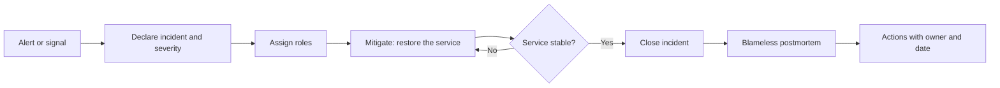

An incident is not the moment to find out who wrote the code that failed. It is the moment to restore
the service with the information you have, and afterwards, calmly, to understand why the system let
it happen. That split, mitigate first and explain later, is the thesis of this article. Incident
management and the postmortem are two processes with different goals, and mixing them is the most
common way to lose both.

The practice comes from Google's reliability engineering. The book _Site Reliability Engineering_
(O'Reilly, 2016) covers incident management in chapter 14 and postmortem culture in chapter 15, and
defines a postmortem as a written record of the impact, the mitigation actions, the root causes and
the follow-up actions. What follows is how to apply that idea in a product team without turning it
into an empty ritual.

<Callout tone="info" title="What we mean by incident">
  An incident is any event that degrades a service beyond what was agreed, or that forces a response
  outside normal work. Nothing has to be down: latency that burns through an SLO's error budget is
  already an incident in most teams.
</Callout>

## Severity: decide before you know

In the first minutes the cause is almost never known. That is why severity does not describe the
cause. It describes impact and urgency, and it has to be assigned with criteria that whoever is on
call can apply without asking anyone. A useful scale has three or four levels, and each level answers
three questions: how many users are affected, is data at risk, and is there a workaround?

| Level | Typical criterion                                    | Expected response                                   |
| ----- | ---------------------------------------------------- | --------------------------------------------------- |
| SEV1  | Full outage or data loss; paying customers affected  | Whole team, external communication within minutes   |
| SEV2  | Key feature degraded for a meaningful share of users | Immediate response from the owning team and on-call |
| SEV3  | Bounded degradation with a working workaround        | Handled in working hours, nobody woken up           |
| SEV4  | Anomaly with no visible impact to the user           | Ticket and review afterwards                        |

The rule that helps most is to raise severity when in doubt and lower it once the scope is confirmed.
Downgrading an incident is cheap; discovering three hours in that it should have been a SEV1 is not.
The severity should be changeable at any time, with a note on who changed it and why, because that
record later shows whether the response was proportionate.

Severity also decides whom you call. If a SEV2 requires the platform team and legal, that belongs in
the written procedure, not in the head of whoever is on call that day.

## Roles: who does what during an incident

The most frequent failure in a serious incident is not technical but coordinating: five people debug
the same process, nobody updates customers, and nobody writes down what has been tried. The usual fix
is to separate the roles, even if one person has to hold two of them, because each role solves a
different problem.

- **Incident commander**: sets priorities, assigns tasks and keeps the overall picture. They do not
  debug. Their success is measured by the clarity of their decisions.
- **Technical lead**: directs the investigation and the mitigation. Proposes hypotheses and chooses
  what to test next.
- **Communications lead**: writes internal and external updates on a fixed schedule, and is the only
  person talking to customers or executives during the incident.
- **Scribe**: keeps a timeline with time, action and result. It is the most underrated role, and the
  one that later lets you write the postmortem without rebuilding anyone's memory.

In small teams the commander can also be the technical lead, but then the incident should be
declared explicitly, and communications should still belong to someone else. An incident with no
assigned roles always ends the same way: someone stops debugging to answer messages, and the
investigation slows down exactly when it is most needed.

## Communication: channel, cadence and updates

Communication during an incident has two audiences with opposite needs. The team needs technical
detail and speed. Customers and executives need impact, status and the time of the next update.
Mixing both in one thread confuses both.

A practice that works is to open a dedicated channel per incident, with a name and a link to the
tracking document, and to publish external updates on a known cadence: for example every 30 minutes
during a SEV1, even when nothing has changed. "We are still investigating; the next update is at
15:30" is better than silence, because silence makes customers ask and makes responders answer.

A useful update answers four questions: what is affected, what is known, what is being done and when
the next update comes. Avoid speculating about the cause until there is evidence. "A configuration
change on the load balancer looks related; we are verifying it" is honest. "It is an attack" without
proof is not, and it will have to be corrected.

## Mitigate first, explain later

During the incident the question is how to bring the service back to an acceptable state, not why it
failed. Rolling back a deployment, turning a feature off with a flag, redirecting traffic or adding
capacity are usually faster than understanding the cause, and carry less risk. A mitigation does not
need to be elegant. It needs to be reversible and measurable.

This connects with the [error budget](/docs/observabilidad-slo-presupuesto-error): if an SLO is
consuming its budget fast enough to exhaust it within hours, the decision to mitigate is not open for
debate. It also connects with [progressive delivery](/docs/entrega-progresiva-flags-canary), where
rolling back is a change of percentage rather than a rebuild.

The scribe should record each mitigation action with its time and its observed effect. A change applied
without a record forces people to guess afterwards what caused the recovery, and people tend to credit
the last thing they did.

## The postmortem: what it must contain

A postmortem serves three purposes: to document what happened, to understand why the system allowed it,
and to decide what to change. If it does none of these, it is a summary and not a postmortem. The
minimum structure we recommend has six parts:

1. **Summary**: what happened, how long it lasted, how many users it affected and what the severity
   was, in one paragraph that someone in leadership can read without context.
2. **Impact**: concrete measures. Minutes of downtime, failed requests, orders not processed, error
   budget consumed. Without numbers the postmortem cannot justify the investment it proposes.
3. **Timeline**: from the first signal to the return to normal, with times in a single time zone and
   detection marked explicitly. The gap between the cause and its detection is often more revealing
   than the recovery time.
4. **Causes**: an analysis of why it happened, guided by the question "what conditions made this
   possible?". A postmortem can have several causes that combine; hunting for one root cause usually
   produces a culprit instead of learning.
5. **What went well and what went badly**: the response, the communication and the tooling. Including
   what worked matters, because it shows which practices to keep.
6. **Actions**: a list of concrete changes, each with an owner, a date and a way to check it was done.

A fictional example shows the difference. "The operator deleted the table by mistake" describes an
event and leaves the next operator in the same position. "A cleanup script accepted an unvalidated
environment argument; production did not require confirmation, and there was no restorable backup
within four hours" describes a system that can be fixed. The first sentence looks for someone to
blame; the second asks what to change.

## Blame, human error and a blameless culture

"Blameless" is often misread as "without accountability". It does not mean that. It means the analysis
focuses on how the system, its tools and its processes allowed the error, not on punishing the person
who made it. The person who made the change is still responsible for telling the story honestly and
for taking part in the improvements.

The practical reason is that people who fear punishment hide information. A postmortem that conceals
the exact order of commands or omits a doubtful decision produces the wrong actions. Sidney Dekker, in
_Just Culture: Balancing Safety and Accountability_ (Ashgate, 2007), distinguishes honest error, which
is corrected with better design, from reckless conduct, which needs a different response. The boundary
between the two has to be defined in advance, so that it is not decided case by case depending on who
is involved.

When human error appears in a postmortem, the next question is always the same: what made it easy to
commit? If a destructive action did not ask for confirmation, if two environments had the same name, or
if the runbook described a procedure nobody actually ran, the failure belongs to the system, and those
are the actions worth taking.

## From actions to real improvement

A postmortem without actions is an archive document. A postmortem with fifteen unowned actions is not
much better, because nobody will do them. The criterion that works is to limit actions to those that
reduce the likelihood of recurrence or its impact, prioritising those that remove a cause over those
that only detect it earlier.

Each action needs three things: a named owner, a date and a way to verify it. "Improve monitoring" is
not an action. "Add an alert on error-budget burn for the payments service, paging the on-call engineer,
and verify it with a game day before 30 November" is. The game day, or the regression test, is the
proof that the action exists in reality and not only in the document.

Open actions should be reviewed every week, in the same meeting where service indicators are reviewed.
Actions postponed again and again are a signal: either they were too large or they were not a priority,
and either way that has to be decided explicitly. Incidents that repeat with the same cause mean the
previous postmortem did not close its loop, and that is a process problem, not a people problem.

There is a link with [technical debt](/docs/deuda-tecnica-evolucion): many postmortem actions are in
fact payments of debt the team had postponed. Recording them as such helps justify them against
pressure to ship features.

## Tools

Tools matter less than the procedure, but some reduce the cost of following it:

- **An incident management tool** with roles, severity and timeline built in, or at least a template in
  the team's documentation system that everyone knows.
- **A fixed communication channel** and a procedure to create it, with alert integration so that the
  channel opens by itself when an alert crosses a threshold.
- **A change log** that can be queried by time, to correlate deployments, configuration changes and
  signals on the same timeline.
- **A postmortem repository** with tags for service, cause and type of action, to detect patterns that
  no single postmortem shows.

The tool most often abused is the postmortem document itself. A template with forty mandatory fields
produces empty documents that nobody reads. A six-part template, with the option to leave a section
blank and justify it, produces useful ones.

## Common mistakes

- **Confusing mitigation with the fix.** Reverting the change that caused the incident restores the
  service, but does not close the postmortem: you still have to understand how that change could reach
  production.
- **Writing the postmortem for leadership and not for the team.** The summary is for leadership; the
  body is for whoever will operate the system afterwards. If the body is vague, leadership gets a
  reassuring summary and the team learns nothing.
- **Looking for a single root cause.** Complex systems fail through combinations. A postmortem that ends
  with "the developer did not review the code" stopped the analysis too early.
- **Writing the postmortem a week later.** Memory fades and gets rewritten. The scribe and the timeline
  exist to prevent that.
- **Not measuring impact.** Without numbers, every action looks equally urgent, and priorities end up
  set by whoever insists most.
- **Treating the postmortem as a formality.** If open actions are never reviewed, the document becomes
  a record that changes nothing.

## Checklist

- [ ] Severity has written criteria and can be changed during the incident.
- [ ] Every declared incident has an incident commander, a technical lead and a scribe, even if one
      person holds two roles on smaller incidents.
- [ ] External updates follow a known cadence and say what is known, what is being done and when the
      next update comes.
- [ ] Mitigation takes priority over explanation, and each action is recorded with its time.
- [ ] The postmortem has a summary, measured impact, a timeline, causes, what went well and actions.
- [ ] Each action has an owner, a date and a verifiable way to check it.
- [ ] Open actions are reviewed weekly, and repeated incidents trigger a review of the process.
- [ ] The postmortem is written while the team still remembers the facts, not weeks later.

## Sources

Checked in October 2026. The chapter titles and the postmortem definition come from the Google SRE book
(chapters 14 and 15), confirmed against the table of contents and the online text of chapter 15. The
Dekker reference is cited by title, publisher and year; the full book was not consulted.

- [Google SRE: Postmortem Culture: Learning from Failure (chapter 15)](https://sre.google/sre-book/postmortem-culture/)
- [Google SRE: table of contents of the book (includes "Managing Incidents", chapter 14)](https://sre.google/sre-book/table-of-contents/)
- Sidney Dekker, _Just Culture: Balancing Safety and Accountability_ (Ashgate, 2007).
