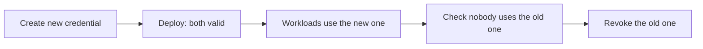

A secret is any piece of data that grants access in the wrong hands: a database password, an API token,
a signing key, a private certificate. Most serious leaks do not come from sophisticated attacks. They come
from a secret someone pasted into a configuration file, pushed to a repository or left in a log. The
thesis of this article is that secrets management comes down to two design decisions: the code never
contains them, and workloads prove who they are instead of presenting a fixed password. Vaults, rotation
and auditing follow from those two.

That separation between who is authenticated and what is handed over matches the key-management guidance
from NIST (SP 800-57, part 1, revision 5, 2020), which treats keys as assets with a lifecycle. This
article brings that idea down to the practice of a product team.

<Callout tone="info" title="A leaked secret is compromised">
  Deleting it from the repository in the next commit does not recover it. The history, forks, CI
  caches and logs keep copies. The right order is to revoke or rotate the secret first, and then
  clean the history.
</Callout>

## Why the secret cannot live in the repository

The repository is the artefact with the most copies of a project. It is cloned to every laptop, replicated
in CI, cached in container images and kept in history forever. Anyone with read access, including former
contributors and connected external systems, can see what is in it. A secret in the repository is therefore
a design problem, not a configuration one: the artefact that gets copied most should contain it least.

Three places where a secret usually ends up by mistake are worth naming in the team:

- **Source code**: a literal string in a module, a sample configuration file with a real value, or a test
  script that points at production.
- **Deployment variables**: they live in the CI system, but they leak into logs when someone runs a debug
  command, or they are passed as arguments visible in the process list.
- **Artefacts**: a container image that copies an `.env` file during the build keeps the secret in its
  layers, even if the file is deleted later.

The practical rule is that the repository contains the **names** of secrets and never their values. A
configuration file can say that a credential called `payments/db` exists, while the value arrives at
runtime.

## Workload identity before static secrets

The safest way to avoid a secret is not to need one. A workload, meaning a service, a job or a container,
can prove who it is to the vault using the identity its platform gives it: the instance role, the
Kubernetes service account, or a certificate issued by an identity system. The vault checks that identity
and grants access to the secrets assigned to that workload.

The SPIFFE standard describes this model with verifiable identities called SVIDs (SPIFFE Verifiable
Identity Documents), in X.509 or JWT form. The underlying idea is that identity is bound to the workload
and not to a password that gets copied. Cloud providers offer variants of the same principle: temporarily
assumed roles, federation with the identity provider of CI, or service accounts with no exported keys.

This changes the question from "where do we store the password?" to "what can this workload prove, and
what access do we give it?". Once identity replaces the secret, rotation stops being an emergency operation
and becomes routine.

## Dynamic secrets and leases

A static secret lives until someone remembers to change it. A dynamic secret is created on demand for a
specific workload and expires on its own. HashiCorp Vault models this with _leases_: each dynamic secret has
a time to live (TTL), a maximum TTL after which it cannot be renewed, and it is revoked automatically on
expiry. The workload has to renew its lease while it uses the secret, and if it stops renewing, access
disappears without anyone acting.

This gives three properties that are worth more than any written policy. Access is bounded in time,
revocation becomes a normal event rather than a crisis, and audit can say who had which access and when,
because every credential has its own identity.

The cost shows up in the application. If the database client cannot renew or reconnect when the credential
changes, the service fails when the lease expires. That is why the integration design, with pool
reconnection, retries and reading the secret at startup or on an interval, is part of the security work and
not an implementation detail.

## Envelope encryption and the master key

A vault stores encrypted secrets, and the key that encrypts them is itself a secret. That is the master-key
problem: if the master key sits in the same vault, the encryption protects nothing. The usual answer is
envelope encryption: each secret is encrypted with a data key, and that data key is encrypted with a master
key that lives in a separate key manager, with its own access controls and logging.

In this article's figure, the vault holds the secrets and the key manager holds the master key in a separate
box. The separation is not decorative. An attacker who obtains a dump of the vault cannot decrypt anything
without access to the key manager, and the master key can be rotated by re-wrapping the data keys, without
touching every secret.

Which key manager to use depends on the cloud, on the compliance you must meet and on who needs to use the
key. What matters is that the team knows where each key lives and who can use it.

## Rotation without cutting the service

Rotating a secret means changing it, and the problem is that the change has to reach every workload using it
before the old value stops working. If you change it in the vault and workloads take five minutes to reload,
you have five minutes of errors. A pattern that avoids this is two-phase rotation:

First the new credential is created without revoking the old one. Then the change is deployed so workloads
start using it, and only when usage of the old credential reaches zero is it revoked. The overlap window is
the time the system needs to converge, not a fixed number: measure it from usage data.

Cloud providers automate part of this. AWS Secrets Manager supports rotation either managed by the service
itself or through a Lambda function, and since 2022 it can schedule rotations as often as every four hours.
That frequency only makes sense if the application rereads the secret without restarting; otherwise automatic
rotation produces scheduled interruptions.

Two rules make rotation routine: it can run without human intervention, and it can be rehearsed in a staging
environment with the same procedure. A rotation done once, by hand, in production, is not a team capability.
It is luck.

## Catching leaks before they become incidents

No design removes human error, so it helps to have two defences. The first is secret scanning in the
repository and its history, which detects known credential patterns. The second is blocking pushes that
contain a secret before they reach the server. GitHub offers push protection with secret scanning: it rejects
pushes containing recognised secrets, whether from the CLI, the web or the API. If someone bypasses the block,
the reason is recorded and an alert is raised.

Scanning also covers existing debt. An old repository almost always has secrets in its history, and the first
audit usually finds more than the team expected. That list becomes the base of the rotation plan, with each
entry marked as revoked, rotated or justified.

When a leak is confirmed, the order of work matters. First the credential is revoked or rotated, because every
minute it stays active is a window for whoever holds it. Then the access log is checked to establish since when
the credential was used, from which origins and with which operations, because that decides whether there is data
to review or customers to inform. Only at the end is the repository and its history cleaned. Rewriting history is
necessary, but it breaks every collaborator's local copies, so it should be coordinated with them and treated as a
planned operation.

One step is often forgotten: the credential's dependants. If the same secret was used by another service, a nightly
job or an external provider, its rotation has to be coordinated too, and the list of consumers should come from the
inventory, not from someone's memory. A written plan for this case, with owners and steps in order, prevents
improvising under pressure. Like any response procedure, it is worth rehearsing in a staging environment before it
is needed.

Rotating the master key follows different logic. Because that key protects the data keys rather than the secrets
directly, rotating it means re-wrapping the data keys with the new master key and keeping the previous one for as long
as any data encrypted with it exists. It is a slower operation, but it does not interrupt workloads, because the
secrets in use do not change. The rule that protects it is not to destroy an old master key until nothing depends on
it: destroying it early makes data unrecoverable, and that mistake cannot be undone.

Auditing closes the loop. An access log is of little use if nobody reviews it, and most teams discover their unexpected
access only once there is an incident. It helps to define which events are reviewed routinely: reads of secrets outside
working hours, access from identities that do not match the expected workload, repeated denied attempts and policy changes.
That review does not have to be manual for everything; alerts on a few patterns plus a periodic review of the rest will do.
The goal is that any anomalous access has an owner who can explain it within a day.

## Tools

- **A vault** with dynamic secrets or automatic rotation, and a queryable access log.
- **Platform workload identities** (roles, service accounts, CI federation) instead of exported keys.
- **Secret scanning** in the repository, in pull requests and in container images.
- **Push protection** or an equivalent hook that blocks the push before it reaches the server.
- **A key manager** separate from the vault for the master key, with documented rotation.

No tool replaces the decision not to write a secret anywhere except the vault. Tools catch mistakes; workload
identity keeps the mistakes from existing.

## Common mistakes

- **Deleting the secret from the code and calling the problem solved.** History, forks and logs keep the copy.
  Without revocation, the leak is still live.
- **Putting the secret in a container image.** Every layer keeps its content even if a later layer deletes it.
  The secret should enter at runtime, not at build time.
- **Rotating without measuring the old credential's use.** Revoking before checking that nobody uses it turns
  rotation into a scheduled incident.
- **Keeping the master key in the same vault as the secrets.** Encryption stops protecting against a stolen
  vault.
- **Trusting long-lived secrets because they "have never caused trouble".** The cost shows up at the first
  leak, and then rotation is urgent and risky.
- **Treating CI secrets as safe by default.** A step that prints variables, or a pull request from a fork that
  runs the pipeline, can expose them.

## Checklist

- [ ] The repository contains secret names, never values, and scanning checks every pull request.
- [ ] Push protection or an equivalent block is active, and exceptions are recorded.
- [ ] Workloads authenticate with their platform identity wherever possible.
- [ ] Dynamic or rotated secrets have a TTL or expiry date, and the application can renew or reconnect without
      a restart.
- [ ] The master key lives in a key manager separate from the vault, with its own rotation.
- [ ] Each secret has an owner, a rotation procedure rehearsed in staging and a measured overlap window.
- [ ] There is a plan to revoke a leaked secret within one hour, covering history and caches.
- [ ] Rotation runs on a schedule and its result is recorded.

## Sources

Checked in October 2026. Vault's capabilities (leases, TTL and max TTL) were confirmed against its concept
documentation. AWS Secrets Manager rotation was confirmed with the 2022 launch note on rotations as often as
every four hours. GitHub's push protection was confirmed against its documentation. The SPIFFE identity model
and the SVID format were confirmed against the project; its CNCF graduation date was not verified. The NIST
guide is cited by number and revision.

- [HashiCorp Vault: leases and dynamic secrets (concept)](https://developer.hashicorp.com/vault/docs/concepts/lease)
- [AWS Secrets Manager: rotation as often as every four hours (launch note, 2022)](https://aws.amazon.com/about-aws/whats-new/2022/11/aws-secrets-manager-rotation-secrets-as-often-as-four-hours)
- [GitHub: push protection for secret scanning](https://docs.github.com/en/code-security/secret-scanning/introduction/about-push-protection)
- [The SPIFFE project](https://github.com/spiffe/spiffe)
- NIST SP 800-57, _Recommendation for Key Management_, part 1, revision 5 (2020).
