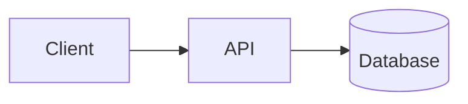

# Getting started

This document is a **smoke test** of the content pipeline. It exists to validate MDX,
frontmatter, search, indexing and SEO before writing real content.

## Recommended path

1. Read the [SOLID principles](/docs/solid) to sharpen your design vocabulary.
2. Learn to communicate architecture with the [C4 model](/docs/c4-model#levels).
3. Polish your code with the [clean code](/docs/clean-code) ideas.

## Highlighted code

```ts title="example.ts"
export function createArchitecture(name: string): string {
  return `Architecture: ${name}`;
}
```

## Mermaid diagram



<Callout tone="tip" title="Embedded components">
  Design system components are available inside MDX without importing them manually.
</Callout>

## Next steps

- Replace this document with real content.
- Link internally with absolute paths: `/docs/<slug>` and anchors `#section`.
- Keep descriptions between 40 and 160 characters and run `bun run audit`.
