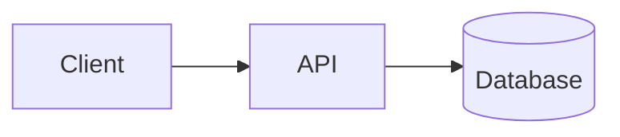

# Getting started

This site is a living library on **software architecture**, written for developers who want to
go from "making it work" to "designing it so it keeps working". Each document is a practical
guide with examples, diagrams, checklists and exercises, available in Spanish and English, with
built-in search and offline support.

This page orients you: what we mean by architecture, what is in the library, in what order to
read it depending on where you start, how to get the most out of the site and, if you want to
contribute, how to create your first document.

## What this site is and who it is for

It is designed for three profiles:

- **Developers growing toward architecture.** They already build features and want to make
  better design decisions.
- **Tech leads.** They need a shared vocabulary, review criteria and ways to communicate
  decisions to the team and to the business.
- **Experienced architects.** They look for an organized, up-to-date reference to consult and
  share.

The documents are not abstract theory. Each one follows the same logic: **what it is, what
problem it solves, what it looks like well and badly applied, and how to practice it tomorrow.**

## What we mean by architecture

Architecture is not drawing boxes or picking the trendy technology. A useful definition:

> Architecture is the set of decisions that are **expensive to change**.

Choosing how modules are divided, where data lives, what is communicated synchronously or
asynchronously, or which language each piece uses are architecture decisions precisely because
undoing them later costs a lot. That is why much of the craft consists of:

1. **Recognizing** which decisions are hard to reverse.
2. **Delaying** them until there is enough information, when possible.
3. **Documenting** them with their reason, so the team does not repeat them or undo them by
   accident.
4. **Protecting** them with automatic rules so they do not erode.

Architecture plays out at **three scales** worth mastering separately: the **code** (how each
piece reads and changes), the **modules** (how they relate to each other) and the **system**
(which executable pieces exist and how they communicate). The library is organized to walk
through those scales.

## Content map

The library is grouped into topics. Each topic answers a different question:

| Topic                   | Question it answers                                                   | Documents                                         |
| ----------------------- | --------------------------------------------------------------------- | ------------------------------------------------- |
| **Foundations**         | Which principles sustain a good design?                               | [SOLID principles](/docs/solid)                   |
| **System design**       | How do I communicate and decide a system's structure?                 | [C4 model](/docs/c4-model)                        |
| **Practices & quality** | How do I keep the code healthy day to day?                            | [Clean code](/docs/clean-code)                    |
| **Trends**              | What is changing in the industry and how does it affect my decisions? | [Languages in the AI era](/docs/lenguajes-era-ia) |

Topics grow with the content: when a new document is added, it shows up on its own in the side
index, the filters and the home page.

## Learning paths by profile

Order matters less than practice, but these routes avoid gaps.

### If you are starting out in design

Go from small to large, so each scale builds on the previous one:

1. [Clean code](/docs/clean-code): names, functions, errors and refactoring. It is the base of
   everything.
2. [SOLID principles](/docs/solid): how modules relate to each other.
3. [C4 model](/docs/c4-model): how the whole system looks and is communicated.
4. [Languages in the AI era](/docs/lenguajes-era-ia): where the industry is heading.

### If you lead a technical team

Prioritize what helps you **align and decide**:

1. [C4 model](/docs/c4-model#level-1-context): start with the context level to align
   expectations with the business.
2. [Clean code](/docs/clean-code#code-review): use the review section as a conversation guide
   in pull requests.
3. [SOLID principles](/docs/solid): to discuss design with shared criteria.
4. [Languages in the AI era](/docs/lenguajes-era-ia#how-to-decide): to ground technology
   decisions.

### If you are already an architect

Use the library as a **reference and as material for your team**: look things up with search,
share specific fragments with direct links, and review the common-mistakes sections and
checklists for your own review processes.

## Four-week plan

A realistic pace for someone working full time. The key is to **apply each topic to your real
code** before moving on to the next.

| Week | Focus                | Reading                 | Practice                                                       |
| ---- | -------------------- | ----------------------- | -------------------------------------------------------------- |
| 1    | Clean code           | Clean code              | Do the guided exercise with a real function from your project  |
| 2    | Module design        | SOLID principles        | Spot a violation in your code and refactor it in small steps   |
| 3    | System view          | C4 model                | Draw the context and containers of your system and commit them |
| 4    | Decisions and future | Languages in the AI era | Write a decision record (ADR) comparing two alternatives       |

After four weeks you should have: an improved function, a refactoring reviewed by your team,
versioned diagrams and an ADR. That is worth more than having read everything.

## Getting the most out of the site

The library is meant to be consulted, not just read start to finish.

- **Command palette.** Press `Ctrl + K` (`⌘ + K` on Mac) or `/` from any page, or tap the
  "Search" button in the header. It understands accents, combines title, tags, headings and
  description, and takes you straight to the section containing what you are looking for.
  Move with `↑` `↓`, open with `Enter` and close with `Esc`.
- **Filter by tag.** Type `#` to see the tags, or `#solid liskov` to search only within one
  tag. Tapping a tag on an article or on the home page opens the palette already filtered.
- **More than search.** With nothing typed, the palette offers documents, topics, tags and
  actions such as switching theme or language.
- **"On this page" index.** On large screens it appears in the margin and highlights the active
  section; on mobile it is a collapsible block at the start of the document.
- **Text selection.** If you select a fragment, a toolbar appears to copy it, copy it as a
  quote, get a direct link to that fragment, share it or open a GitHub comment with the quote
  included.
- **Anchors.** The `#` symbol next to each heading copies its link.
- **Sharing.** At the end of each article you can copy the link, use the device's native share
  sheet or send it via X, LinkedIn or email.
- **Light, dark or system theme.** The header selector cycles through the three.
- **Language.** Switch between Spanish and English from the header selector.
- **Offline.** The site is an installable web app that stores content in the browser cache, so
  you can read offline, including deep links.
- **Subscribing.** Each language has its own RSS feed at `/<language>/feed.xml`.

<Callout tone="tip" title="Read with a goal">
  Before opening a document, write down a concrete question from your project ("how do I separate
  these two responsibilities?"). Reading with a question in mind retains far more than reading out
  of curiosity.
</Callout>

## Essential vocabulary

These terms come up again and again. It helps to have them clear before starting.

| Term                  | Short meaning                                                                           |
| --------------------- | --------------------------------------------------------------------------------------- |
| **Coupling**          | How much one module depends on another. Less is better: changes do not propagate.       |
| **Cohesion**          | How related the responsibilities inside a module are. More is better.                   |
| **Abstraction**       | Hiding details behind an interface so you depend on what is essential.                  |
| **Container (C4)**    | An application or data store that runs separately; not a Docker container.              |
| **Quality attribute** | A property such as performance, security or maintainability that constrains design.     |
| **ADR**               | A record of an architecture decision: context, decision and consequences.               |
| **Technical debt**    | The future cost of today's shortcut. Not bad if deliberate, visible and repaid.         |
| **Refactoring**       | Changing the structure of code without changing its behavior.                           |
| **Trade-off**         | A compromise: gaining in one quality at the expense of another. Every decision has one. |

## How to study so it sticks

Reading alone produces familiarity, not skill. A simple method that works:

1. **Read** a document in a single sitting, unhurried, with your question in mind.
2. **Apply it** the same day to something real: a function, a diagram, a review.
3. **Write it down:** a note or an ADR with what you decided and why.
4. **Share it** with someone on the team. Explaining is the best test of understanding.
5. **Come back** after a few weeks and check whether the decision still makes sense.

A single real refactoring teaches more than five readings.

## Contributing content

If you want to contribute a document or improve an existing one, this section explains how the
site is built. Each page combines text, highlighted code, Mermaid diagrams and embedded
components.

### Anatomy of a document

A document is **one MDX file per language**: `src/content/docs/<language>/<slug>.mdx`. The
`slug` is lowercase with hyphens and must be **identical across all languages**; the audit
warns you if a translation is missing.

It starts with automatically validated frontmatter:

```yaml title="example.mdx"
---
title: 'A clear title for the document'
description: 'A summary between 40 and 160 characters, used by search engines and in site search.'
category: fundamentos
tags:
  - architecture
  - example
order: 3
updatedAt: 2026-10-12
---
```

| Field         | Rule                                                          |
| ------------- | ------------------------------------------------------------- |
| `title`       | Between 3 and 60 characters                                   |
| `description` | Between 40 and 160 characters                                 |
| `category`    | Id of a section that exists in the taxonomy                   |
| `tags`        | Up to 5, lowercase with hyphens and without repeats           |
| `order`       | Integer greater than or equal to 0; orders within the section |
| `updatedAt`   | `YYYY-MM-DD` date, cannot be in the future                    |
| `publishedAt` | Optional, `YYYY-MM-DD` date                                   |

<Callout tone="warning" title="Quote titles and descriptions that contain a colon">
  If a title or description contains `: ` (colon and space), the frontmatter is invalid YAML unless
  you quote it. When in doubt, use double quotes.
</Callout>

The body follows structure rules that the audit checks:

- At least one `h2` heading and **no level jumps** (from `h2` to `h4`).
- **Unique anchors:** do not repeat the text of two headings.
- Internal links with an absolute path (`/docs/<slug>`) and anchors that exist at the target.
- Code blocks always closed.

Within the text you can use code blocks with a title, Mermaid diagrams and callouts:

````md
```ts title="example.ts"
export function createArchitecture(name: string): string {
  return `Architecture: ${name}`;
}
```



<Callout tone="tip" title="A callout">
  The available tones are `info`, `tip` and `warning`.
</Callout>
````

### Workflow

1. Create the document file in **each language**.
2. Regenerate the index: `bun run content:index`.
3. Check the structure: `bun run audit`.
4. Run all checks: `bun run check` (format, lint, types, audit, tests).
5. Commit with a conventional message, for example `docs(content): add ADR guide`.

For a new topic, just add its entry to `src/lib/content/taxonomy.json`: it shows up on its own on
the home page, the side index and the filters. All the project's rules live in `AGENTS.md`, at
the repository root. At the end of each document you will find the **Edit on GitHub** link to
propose changes directly.

## Next steps

- Start today: open [Clean code](/docs/clean-code) and pick a function from your project.
- When you want to see the whole system, move on to the [C4 model](/docs/c4-model).
- If you need to ground a technology decision, see
  [languages in the AI era](/docs/lenguajes-era-ia).
- If something is unclear, select the text and open a comment: questions improve the library.
