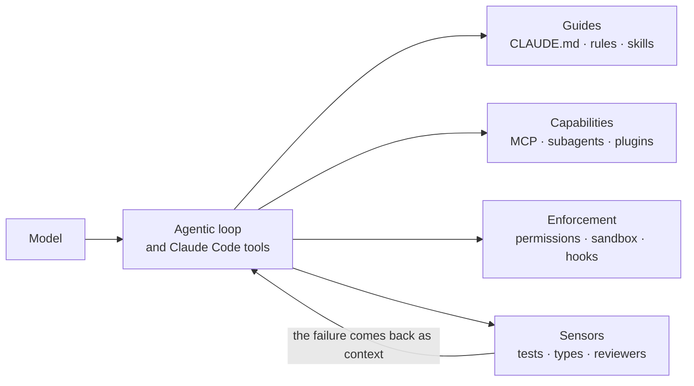
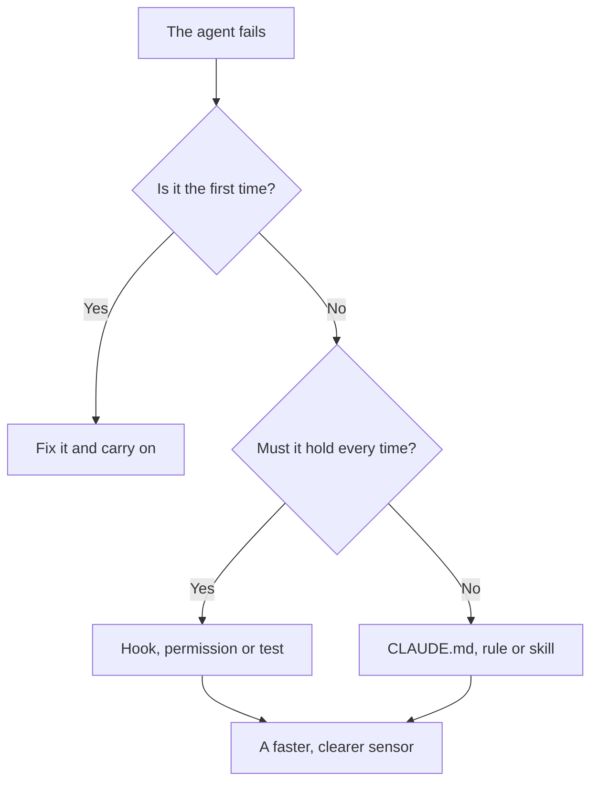

# Harness engineering with Claude Code

The model is only half of an agent. The other half is everything around it: what it knows when
it starts, which tools it can reach, what it is allowed to do, what gets checked on its behalf
and what gets recorded. That other half is called the **harness**, and designing it is an
architecture decision, not a configuration detail.

This article walks through the Claude Code pieces that make up that harness (memory, hooks,
permissions, sandbox, skills, subagents, plugins and dynamic workflows), when to use each one
and what has changed in recent releases. At the end there is a real case, an order for building
it without over-engineering, and a checklist.

<Callout tone="info" title="Cutoff date">
  The data is from October 2026 (Claude Code v2.1.296, released on October 9). Anthropic uses the
  word "harness" in its engineering posts, but its product documentation talks about memory, hooks,
  skills or permissions; this article joins both vocabularies. Versions move fast: check the
  [official changelog](https://code.claude.com/docs/en/changelog).
</Callout>

## What a harness is

Birgitta Böckeler (Thoughtworks) defines it on martinfowler.com as "everything in an AI agent
except the model itself". Her article separates two layers: the harness the tool already ships
with (in Claude Code, the agentic loop and its built-in tools) and the **outer harness** you
build on top of it. That outer layer has two goals: make the first attempt come out right more
often, and catch errors before a person sees them.

A formula that circulates in the community is _agent = model + harness_. It deserves to be taken
seriously because of a practical consequence: when an agent fails repeatedly, the fix is rarely
"a better prompt". It is **improving the harness** so that failure cannot happen again.

There is also an idea that connects to the rest of this library. Böckeler talks about
_harnessability_: some codebases are easier to harness than others. Strict types, clear module
boundaries and layers with checkable dependencies are "ambient affordances" that make code
legible to an agent. In other words, [SOLID](/docs/solid), [clean code](/docs/clean-code) and a
good [C4 model](/docs/c4-model) remain the best upfront investment; and
[types](/docs/lenguajes-era-ia) work as context shared between the model and the compiler.

## Guides and sensors

The same article proposes a classification that helps decide what to build:

- **Guides (feedforward):** steer the agent _before_ it acts. Conventions, instructions,
  reference docs, templates.
- **Sensors (feedback):** observe _after_ it acts and let it self-correct. Linters, tests, types,
  reviewers.
- **Computational:** deterministic and fast (tests, types, structural analysis). Cheap enough to
  run on every change.
- **Inferential:** semantic and probabilistic (AI review, LLM-as-judge). Slower and costlier, but
  they add judgment.

Without sensors, rules get written and nobody checks them; without guides, the agent repeats the
same mistakes until a sensor stops it. This is how they map to Claude Code:

| —                 | Guide (before acting)                                     | Sensor (after acting)                                                                                |
| ----------------- | --------------------------------------------------------- | ---------------------------------------------------------------------------------------------------- |
| **Computational** | `SessionStart` hook with context, code intelligence (LSP) | `PostToolUse` hook with linter or types, tests, `Stop` hook that runs checks                         |
| **Inferential**   | `CLAUDE.md`, rules, skills, output styles                 | Reviewer subagent, `/code-review`, `prompt` and `agent` hooks, adversarial verification in workflows |

Böckeler also sorts what you want to regulate into three categories: **maintainability** (the
easiest, many tools exist), **architecture fitness** (fitness functions) and **behaviour** (the
least solved: specifications as guides and generated tests as sensors, with manual review behind
them).

## The Claude Code map

Each mechanism sits in a different place in the agent loop. What matters for design is separating
what **suggests** from what **guarantees**.



| Mechanism           | What it is for                             | When it loads                               | Guarantee         |
| ------------------- | ------------------------------------------ | ------------------------------------------- | ----------------- |
| `CLAUDE.md`         | Conventions and commands that always apply | At session start, in full                   | Suggestion        |
| `.claude/rules/`    | Rules per file type or folder              | At start, or when matching files are opened | Suggestion        |
| Skills              | On-demand knowledge and workflows          | Description always; body when used          | Suggestion        |
| Subagents           | Work in an isolated context                | When spawned                                | Isolation         |
| Dynamic workflows   | Orchestrate dozens of agents with a script | When launched                               | Structure         |
| MCP                 | Connect external systems                   | Names at start, schemas on demand           | Capability        |
| Hooks               | Automate and block on lifecycle events     | When the event fires                        | **Deterministic** |
| Permissions/sandbox | What it may do and what it may reach       | Always active                               | **Deterministic** |
| Plugins             | Package and distribute all of the above    | Depends on their components                 | —                 |

The golden rule comes from the documentation itself: Claude treats `CLAUDE.md` as context, not as
enforced configuration. Anything that must hold **every time** goes in a hook or a permission, not
in a prompt.

## Layer 1: memory (`CLAUDE.md`, rules and auto memory)

Every session starts with an empty context window. Two mechanisms carry knowledge from one
session to the next:

- **`CLAUDE.md`:** instructions you write. They load from managed policy, the user
  (`~/.claude/CLAUDE.md`), the project (`./CLAUDE.md` or `./.claude/CLAUDE.md`) and local files
  (`./CLAUDE.local.md`, kept out of git). Files are **concatenated**, not overridden; those in
  subdirectories load when Claude touches files in that folder.
- **Auto memory:** notes Claude writes from your corrections. At startup the first 200 lines or
  25 KB are loaded.

If your repository already uses `AGENTS.md` for other agents, Claude Code can read it in place of
a `CLAUDE.md`. `@path` imports expand other files at launch (up to four hops), but they **do not
reduce the context cost**: imported files load too.

How to write it well:

- **Under 200 lines per file.** Longer files consume context and lower adherence.
- **Verifiable instructions:** "use 2-space indentation" instead of "format code properly".
- **No contradictions:** if two rules clash, Claude may pick one arbitrarily. Run
  `/doctor prompt-audit` (since v2.1.283) to find outdated rules, paths that do not exist or
  files that contradict each other.
- **Notes for humans** go in block-level HTML comments: they are stripped before reaching the
  context.
- **What matters only for one part** of the code goes in a rule with `paths` or in a skill.

```markdown
---
paths: ['src/routes/**/*.tsx']
---

- In route options, `loader` goes before `head`.
```

The criterion for adding something is empirical: when Claude makes the same mistake a second
time, when a code review catches something it should have known, or when you type the same
correction as last session. That is a memory edit, not a one-off correction in chat.

## Layer 2: hooks, deterministic enforcement

A hook is a command, an HTTP request, an MCP tool call, a prompt or a subagent that Claude Code
runs at a point in its lifecycle. Claude does not decide whether it runs: it **always** fires on
its event. That is why hooks are the central piece of the harness.

The documentation defines **33 events**. These are the ones that matter most when designing a
harness:

| Event                | When it fires                                 | Can it block?                 |
| -------------------- | --------------------------------------------- | ----------------------------- |
| `SessionStart`       | When the session starts or resumes            | No (can add context)          |
| `UserPromptSubmit`   | When a prompt is submitted, before processing | Yes                           |
| `PreToolUse`         | Before a tool call executes                   | Yes                           |
| `PermissionRequest`  | When a tool call needs a permission decision  | No (use `decision`)           |
| `PostToolUse`        | After a tool call succeeds                    | No (gives feedback to Claude) |
| `PostToolBatch`      | After a batch of parallel tool calls resolves | Yes                           |
| `SubagentStop`       | When a subagent finishes                      | Yes                           |
| `Stop`               | When Claude finishes responding               | Yes                           |
| `PreCompact`         | Before context compaction                     | Yes                           |
| `ConfigChange`       | When configuration changes during a session   | Yes                           |
| `InstructionsLoaded` | When `CLAUDE.md` or a rule is loaded          | No                            |

There are five handler types: `command` (receives JSON on stdin), `http`, `mcp_tool`, `prompt` (a
model evaluates in a single turn) and `agent` (a subagent verifies with tools; marked
experimental). They are declared in `~/.claude/settings.json`, `.claude/settings.json` (shared
through git), `.claude/settings.local.json`, managed policy, a plugin's `hooks/hooks.json`, or the
frontmatter of a skill or subagent. Hooks from all sources **add up**: all of them run.

### Blocking: the `PreToolUse` pattern

A hook that exits with code **2** stops the action and returns its `stderr` to Claude as the
reason, so it can correct course. The pattern works to protect generated files, commands or paths.
First it is declared in `.claude/settings.json`, associating a tool _matcher_ with the script:

```json
"PreToolUse": [{
  "matcher": "Edit|Write",
  "hooks": [{ "type": "command", "command": "${CLAUDE_PROJECT_DIR}/.claude/hooks/block-generated.sh" }]
}]
```

The script only needs to honor this contract:

| Piece  | Contract                                                                         |
| ------ | -------------------------------------------------------------------------------- |
| Input  | JSON on stdin with `tool_name` and `tool_input` (for example `file_path`)        |
| Exit 0 | No opinion: the action follows the normal permission flow                        |
| Exit 2 | Blocks the action; whatever is written to `stderr` goes back to Claude as reason |

```bash
FILE=$(jq -r '.tool_input.file_path // empty')
# …if FILE is a generated file: message to stderr with the command that regenerates it, and exit 2
```

Name the script after what it protects (`block-generated.sh`) and make the error message say what
to do instead: Claude reads it and corrects itself.

The same outcome can be expressed with JSON on stdout and exit 0: `permissionDecision` accepts
`allow`, `deny`, `ask` and `defer`, and `updatedInput` rewrites the arguments before execution.
Pick one approach per hook: do not mix them.

<Callout tone="warning" title="A guard that fails, lets things through">
  With any exit code other than 0 and 2, the action **proceeds** and only a notice appears. If the
  hook is a safety barrier, a crashing script opens it. Since v2.1.295, `command` and `http` hooks
  accept `"onFailure": "block"` in their definition: if they cannot start, time out or exit with an
  unexpected code, the action is blocked instead of going through.
</Callout>

### Sensing: `PostToolUse` and `Stop`

Computational sensors live here. A `PostToolUse` with a linter feeds the result back to Claude as
text it can read and fix. A `Stop` hook keeps Claude from declaring the work done while the fast
checks fail. The contract of `stop-gate.sh`: it reads `stop_hook_active` from the input and, if it
is `true`, exits without doing anything; otherwise it runs the fast checks (here, audit and types)
and, if they fail, writes the tail of their output to `stderr` and exits with 2 so Claude keeps
working.

```bash
[ "$(jq -r '.stop_hook_active')" = "true" ] && exit 0 # avoids the loop
# …fast checks; if they fail: tail of the output to stderr and exit 2
```

Claude Code overrides a `Stop` hook that blocks eight times in a row with no tool call from
Claude in between, so checking `stop_hook_active` is mandatory. And Böckeler's rule about timing
applies: cheap sensors go early (here, audit and types); expensive ones, like the full suite, go
after integration.

## Layer 3: permissions and sandbox

Permissions decide what happens without asking you; the sandbox limits what a command can reach
even when it is approved. They are different controls and they complement each other.

### Permission modes

| Mode                | What runs without asking                      | Best for                        |
| ------------------- | --------------------------------------------- | ------------------------------- |
| `default` (Manual)  | Reads only                                    | Reviewing every action          |
| `acceptEdits`       | Reads, edits and basic filesystem commands    | Iterating on code you review    |
| `plan`              | Reads                                         | Exploring before changing       |
| `auto`              | Everything, with background safety checks     | Long tasks, fewer interruptions |
| `dontAsk`           | Only what is pre-approved; the rest is denied | Locked-down CI and scripts      |
| `bypassPermissions` | Everything                                    | Isolated containers or VMs only |

In `auto` mode, a second model (the _classifier_) reviews actions before they run and blocks what
goes beyond what you asked, targets unrecognized infrastructure, or appears driven by hostile
content Claude read. Since v2.1.283 it is the starting mode for interactive terminal and VS Code
sessions.

On top of the mode, **permission rules** apply, evaluated in the order **deny, ask, allow**: the
first match wins. `deny` rules block in every mode, even `bypassPermissions`.

```json
"permissions": {
  "deny": ["Bash(npm *)", "Bash(npx *)", "Edit(/src/routeTree.gen.ts)"]
}
```

`Edit` and `Read` paths use gitignore-style syntax: `/path` is relative to the project root,
`//path` is absolute and `~/path` starts from the home directory.

### Sandbox

The Bash sandbox is a boundary enforced by the **operating system** around shell commands and the
processes they start: macOS uses Seatbelt; Linux and WSL2 use `bubblewrap` and `socat`. Network
traffic goes through a proxy that only admits the domains in `network.allowedDomains`, which
starts empty.

Pay attention to what stays **outside**: file and web tools (Read, Edit, Write, WebFetch,
WebSearch) follow permission rules rather than the sandbox, and MCP servers and hooks also run
outside it. On native Windows, commands run unsandboxed. Defense in depth means combining the
three layers: permission rules for file tools, the sandbox for commands, and hooks for your own
policies.

## Layer 4: skills, subagents and plugins

### Skills: on-demand knowledge

A skill is a directory with a `SKILL.md`. It loads **progressively**: the name and description
are always in context, the body enters when it is invoked, and supporting files load only when
the body points to them. Keep `SKILL.md` under 500 lines.

```markdown
---
name: release
description: Prepare a release: changelog, version and verification. Use it when publishing.
disable-model-invocation: true
---
```

The body is the procedure's steps, in a few lines: run the checks and stop if they fail, update
the changelog from the conventional commits and propose the version following SemVer.

The frontmatter fields that pay off most: `disable-model-invocation` (only you invoke it; use it
for anything with side effects), `allowed-tools`, `context: fork` (runs in a subagent), `paths`
(limits automatic activation) and `hooks` (registers hooks while it is active). Custom commands
were merged into skills: `.claude/commands/deploy.md` and `.claude/skills/deploy/SKILL.md` create
the same `/deploy`, and skills are preferred for new work.

### Subagents: isolating context

A subagent is a Markdown file in `.claude/agents/` whose body is the system prompt. It runs in its
own context window and returns a summary, so reading dozens of files does not pollute your
conversation.

```markdown
---
name: rule-auditor
description: Audits a diff against AGENTS.md. Use it before opening a PR.
disallowedTools: Edit, Write
model: sonnet
---
```

The body is the system prompt: it asks to list only concrete violations of the rules, with file
and line, and to close with a verdict of FIT or NOT FIT. Note the `description`: it is what Claude
reads to decide when to delegate, so say when to use it, not just what it does.

What to know when designing:

- **Restrict tools:** `tools` is an allowlist and `disallowedTools` a denylist, applied first.
- **Isolate writes:** `isolation: worktree` runs the subagent in a temporary git worktree.
- **Pick the model per task.** Resolution order: the invocation parameter, the `model`
  frontmatter, the `CLAUDE_CODE_SUBAGENT_MODEL` variable and, last, the conversation's model.
- **Forks:** the `fork` subagent inherits the whole conversation and shares the prompt cache; it
  is on by default in interactive sessions.
- **Limits:** up to 20 concurrent subagents and three levels of nesting, adjustable with
  environment variables.

### Plugins: distributing the harness

A plugin packages skills, hooks, subagents and MCP servers into one installable unit, with
namespaced names (`/my-plugin:review`). It is the way to bring the same harness to a second
repository or to a whole team through a _marketplace_. Since v2.1.292,
`claude plugin install --marketplace <source>` adds the marketplace if needed and installs in one
step.

## Layer 5: dynamic workflows

This is the newest piece, described by Anthropic on its blog on June 2, 2026. A workflow is a
**JavaScript script** that orchestrates many subagents. Claude writes it for your task and a
runtime executes it in the background while your session stays free.

What sets it apart from the other pieces is **who holds the plan**:

| —                         | Subagents             | Skills                       | Workflows                    |
| ------------------------- | --------------------- | ---------------------------- | ---------------------------- |
| Who decides the next step | Claude, turn by turn  | Claude, following the prompt | The script                   |
| Where results live        | In the context window | In the context window        | In script variables          |
| Scale                     | A few delegated tasks | Same as subagents            | Dozens to hundreds of agents |
| What is repeatable        | The worker definition | The instructions             | The orchestration itself     |

The authors point to three failure modes of a single long context window: **agentic laziness**
(declaring a big job done after resolving 35 of 50 items), **self-preferential bias** (favoring
its own results when judging them) and **goal drift** (every compaction loses fidelity). With
isolated subagents and a script that verifies, the main context only receives the final result.

This is the shape of a saved workflow: `agent()` spawns one subagent, `pipeline()` runs each item
through several stages and `parallel()` runs tasks at the same time. The structure (list,
analyze, verify) matters more than the text of each prompt, and `slugsSchema` is a JSON Schema
that forces a list of strings to be returned:

```javascript
export const meta = { name: 'audit-docs-i18n', description: 'es/en parity per document' };

const listing = await agent('List the slugs in src/content/docs/es.', { schema: slugsSchema });
const verified = await pipeline(
  listing.slugs,
  (slug) => agent(`Compare es/${slug}.mdx with en/${slug}.mdx`), // stage 1: findings
  (findings) => agent(`Try to refute: ${JSON.stringify(findings)}`), // stage 2: verification
);
return verified.filter(Boolean);
```

Anthropic's article names six composition patterns: **classify and act**, **fan out and
synthesize**, **adversarial verification** (another agent checks each output), **generate and
filter**, **tournament** (pairwise comparisons, more reliable than absolute scoring) and **loop
until done**. For untrusted content, the _quarantine_ pattern helps: reader agents with read-only
tools summarize the content and a higher-privilege agent acts only on those summaries.

How they are used:

- Ask for one in your own words ("use a workflow to…") or with the keyword `ultracode`. With
  `/effort ultracode`, Claude plans a workflow for every substantive task in the session.
- The first launch asks for approval according to your permission mode; you can read the script
  first with **View raw script**. With `claude -p` and the Agent SDK there is no prompt: your
  rules apply (for example, `Workflow` in `allow`).
- `/workflows` shows progress by phase; with `s` you save the script as a command in
  `.claude/workflows/` (shared through git) or in `~/.claude/workflows/` (personal). It can also
  be distributed inside a plugin.
- It is resumable within the same session: completed agents return their saved result.
  `Date.now()` and `Math.random()` are not allowed inside the script, precisely so that a resume
  repeats the same calls.

Runtime limits: 16 concurrent agents by default (up to 256 with
`CLAUDE_CODE_WORKFLOW_MAX_CONCURRENT_AGENTS`), 4,096 items per `parallel()` or `pipeline()` and
1,000 agents per run. The script has no direct access to the filesystem or the shell: the agents
do that.

<Callout tone="warning" title="Parallelism has to earn its cost">
  A workflow uses noticeably more tokens than the same task in conversation. Claude Code shows a
  "Large workflow" warning past 25 agents or 1.5 million projected tokens. The authors say it
  themselves: routine tasks do not need a panel of five reviewers. Try a small slice before
  launching it on the whole repository.
</Callout>

One security detail: the `ultracode` keyword only starts a workflow in a prompt you type
yourself. It does not when it arrives through `-p`, a scheduled task, or the body of a webhook or
a pull request comment (since v2.1.210). An attacker cannot start massive orchestrations with
injected text.

## The latest (October 2026)

What has changed around the harness, according to the official changelog:

| Version | What is new                                                                                                                                                                                                                 |
| ------- | --------------------------------------------------------------------------------------------------------------------------------------------------------------------------------------------------------------------------- |
| 2.1.283 | `auto` is the starting mode in interactive terminal and VS Code; `/doctor prompt-audit` arrives                                                                                                                             |
| 2.1.292 | `effort` parameter on the Agent tool; `claude plugin install --marketplace`; security fix for UNC network-path reads                                                                                                        |
| 2.1.294 | Fixed `prompt` and `agent` hooks written as instructions that let through what they should block                                                                                                                            |
| 2.1.295 | `onFailure: "block"` for `command` and `http` hooks; subagents preload at most 32 skills                                                                                                                                    |
| 2.1.296 | `CLAUDE_CODE_WORKFLOW_SUBAGENT_MODEL` pins one model for workflow agents; `autoCompactWindow` in subagent frontmatter; a managed `PreToolUse` that denies with `"continue": false` refuses the call without ending the turn |

The trend is clear: more **deterministic** pieces (hooks that fail closed, managed policies that
cannot be bypassed) and more **structured** orchestration (workflows with a model per stage),
instead of relying on the model to remember the rules.

## A real example: this repository's harness

This site uses OpenCode, not Claude Code, but its harness has exactly the same shape. It is a good
translation exercise:

| Piece in this repo                                                               | Role                 | Claude Code equivalent                        |
| -------------------------------------------------------------------------------- | -------------------- | --------------------------------------------- |
| `AGENTS.md`: single standard, injected into every session                        | Guide                | `CLAUDE.md` (or `AGENTS.md`) plus rules       |
| `opencode.json`: denies editing generated files, `npm`, `--no-verify`, `--force` | Enforcement          | `permissions.deny`                            |
| Plugin that throws in `tool.execute.before`                                      | Enforcement          | `PreToolUse` hook with exit 2                 |
| Read-only `rule-auditor` agent (`edit: deny`)                                    | Inferential sensor   | Subagent with `disallowedTools: Edit, Write`  |
| `bun run check`: format, lint, types, audit, tests, knip                         | Computational sensor | `Stop` or `PostToolUse` hook plus CI          |
| Husky: `pre-commit`, `commit-msg`, `pre-push`                                    | Sensor and barrier   | Git hooks, which Claude Code does not replace |
| Layer rules with `import-x/no-restricted-paths`                                  | Architecture sensor  | Same: it is an executable _fitness function_  |

Look at the last row. The component layers (atoms, molecules, organisms) are not held up by a
paragraph in `AGENTS.md`, but by an ESLint rule that breaks the build when violated. That is
harness engineering applied to architecture: **the rule lives where it runs**.

## How to build it without over-engineering

You do not need to configure everything on day one. The documentation itself recommends adding
each piece when its trigger shows up:

| Trigger                                                   | Add                   |
| --------------------------------------------------------- | --------------------- |
| Claude gets a convention or command wrong twice           | A line in `CLAUDE.md` |
| You paste the same procedure into chat for the third time | A skill               |
| You want something to happen every time, without asking   | A hook                |
| A side task floods the conversation with output           | A subagent            |
| You need data from a system Claude cannot see             | An MCP server         |
| A second repository needs the same setup                  | A plugin              |
| A job exceeds what a handful of subagents can coordinate  | A dynamic workflow    |

And keep the steering loop going: every repeated failure becomes an improvement to the harness.



## Common mistakes

- **Writing a rule and considering it done.** If no sensor checks it, it is a wish. Turn critical
  rules into hooks, permissions or tests.
- **An encyclopedic `CLAUDE.md`.** Going past 200 lines dilutes what matters. Split it between
  rules with `paths` and skills.
- **Hooks that fail open.** A guard that crashes lets the action through. Use `exit 2` on purpose
  and `onFailure: "block"` on safety barriers.
- **`bypassPermissions` outside a container.** It is meant for isolated environments; elsewhere,
  use `auto` or explicit rules.
- **Workflows for everything.** Parallelism costs tokens and coordination. Use them when the task
  overflows one context or needs cross-checking.
- **Hooks without `stop_hook_active`.** A `Stop` that always blocks creates a loop.
- **Configuration nobody reviews.** Rules age: run `/doctor prompt-audit` regularly.

## Checklist for your harness

- [ ] There is a short, concrete `CLAUDE.md` (or `AGENTS.md`) with real build and test commands.
- [ ] What must hold every time lives in hooks or `deny` rules, not just in prose.
- [ ] Generated files are protected against manual edits.
- [ ] A fast computational sensor exists that Claude can run before calling something done.
- [ ] There is a read-only reviewer (subagent or skill) for the judgment tests do not cover.
- [ ] Hooks that are safety barriers fail closed and handle `stop_hook_active`.
- [ ] You know which permission mode each environment uses and where the sandbox applies.
- [ ] The harness is versioned in git (`.claude/`) and reviewed like any other code.
- [ ] Every repeated failure ends in a harness improvement, not a longer prompt.

## Sources

Consulted in October 2026; the Claude Code documentation changes often, so check each fact
against the official source.

- [Harness engineering for coding agent users (Birgitta Böckeler, martinfowler.com)](https://martinfowler.com/articles/harness-engineering.html)
- [A harness for every task: dynamic workflows in Claude Code (Anthropic)](https://claude.com/blog/a-harness-for-every-task-dynamic-workflows-in-claude-code)
- [Effective harnesses for long-running agents (Anthropic Engineering)](https://anthropic.com/engineering/effective-harnesses-for-long-running-agents)
- [Extend Claude Code: when to use each mechanism](https://code.claude.com/docs/en/features-overview)
- [How Claude remembers your project: CLAUDE.md and auto memory](https://code.claude.com/docs/en/memory)
- [Hooks reference](https://code.claude.com/docs/en/hooks)
- [Permissions](https://code.claude.com/docs/en/permissions) and [permission modes](https://code.claude.com/docs/en/permission-modes)
- [Bash sandbox](https://code.claude.com/docs/en/sandboxing)
- [Skills](https://code.claude.com/docs/en/skills) and [subagents](https://code.claude.com/docs/en/sub-agents)
- [Dynamic workflows](https://code.claude.com/docs/en/workflows)
- [Claude Code changelog](https://code.claude.com/docs/en/changelog)
