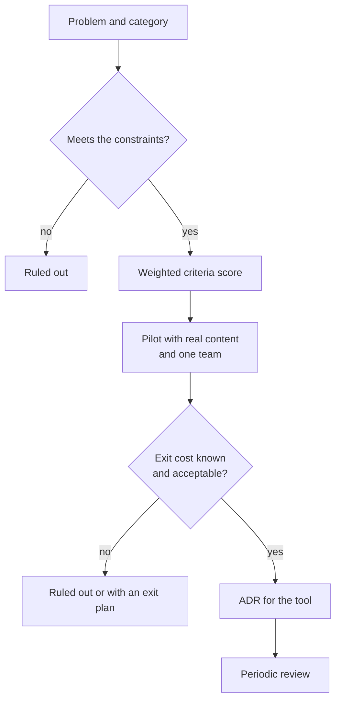
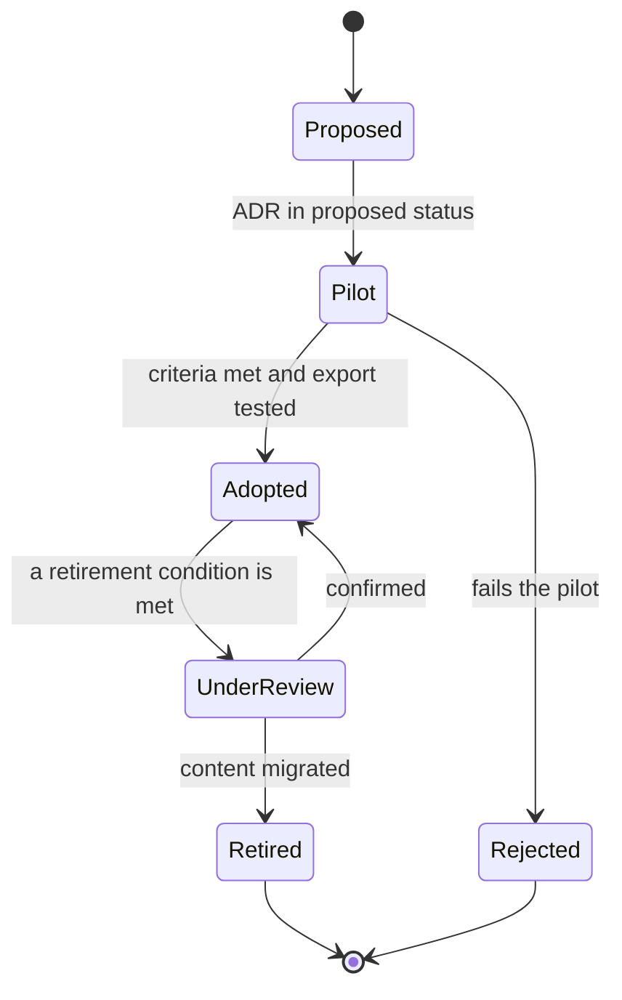

# Tools to decide and document

You have probably seen this. Architecture decisions live in three places: some in a wiki, some in repository folders and some in chat threads. One team has two boards because a new one was adopted "to try it out" and nobody retired the old one. Last quarter someone proposed a new documentation tool after seeing it at a conference, and the migration stalled halfway. When a new engineer asks why the team chose its database, the answer is "search for it, it's somewhere".

**Choosing a tool to decide or document is an architecture decision: judge it by the problem it solves, by how it fits with everything else and by how much it costs to leave, not by how popular it is.**

This lesson gives you a framework for making that choice without following the hype. It covers six tool categories (decision records, living documentation, workflow boards, initiative and backlog management, diagrams as code, and evaluation and observability for AI systems), five criteria to compare them, total cost of ownership, access and sensitive data, and how to record the choice in an ADR. It ends with a worked example using weighted criteria.

<Callout tone="info" title="Cut-off date and scope">
  Checked in October 2026. This lesson is about categories, not products. The few concrete examples
  only illustrate a category, were checked against their official pages and are not recommendations.
  There are no prices or plan limits: they change often and depend on the contract.
</Callout>

## The problem it solves

Collaboration tools are easy to adopt: someone signs up, invites the team and within a week there is content inside. That ease is both their strength and their risk. Nobody writes an ADR to start using a board, yet two years later that board holds the history of product decisions and moving away is no longer trivial.

| Symptom                                                        | The decision nobody made explicitly                     |
| -------------------------------------------------------------- | ------------------------------------------------------- |
| The same information lives in two tools and they disagree      | Which tool is the source of truth for each kind of data |
| Nobody knows who administers a tool or who pays for it         | Who owns it and who decides to retire it                |
| A former employee still has wiki access months later           | How access is granted and revoked                       |
| Finding a past decision means asking the right person          | Where people search and what gets indexed               |
| Moving the content to another tool looks like a whole project  | Which format the content must be able to leave in       |
| Customer data gets pasted into documents or into model prompts | Which data may enter each tool                          |

## Six categories and the problem each one solves

Name the category before you compare products. Many tool debates are really debates about which problem you want to solve, and two tools from different categories don't compete even if their demos look alike.

| Category                          | Problem it solves                                         | Main artifact                                  | Go deeper                                                                 |
| --------------------------------- | --------------------------------------------------------- | ---------------------------------------------- | ------------------------------------------------------------------------- |
| Decision records                  | Remember why something was chosen and what was rejected   | One immutable record per decision              | [ADR](/docs/adr)                                                          |
| Living documentation              | Knowledge that can be found and stays true                | Pages or files with an owner and a review date | This lesson                                                               |
| Workflow boards                   | See where each piece of work is and where it gets stuck   | Cards with states and limits                   | [Value stream and bottlenecks](/docs/flujo-de-valor-y-cuellos-de-botella) |
| Initiative and backlog management | Decide what goes first and why                            | Initiatives prioritized with a rationale       | [Prioritization frameworks](/docs/marcos-de-priorizacion)                 |
| Diagrams as code                  | Version and review diagrams the way you do code           | Text sources that render images                | [Diagrams as code](/docs/diagramas-como-codigo)                           |
| AI evaluation and observability   | Know whether a system built on models behaves as expected | Evaluation sets, traces, metrics               | [Controlling AI](/docs/controlar-la-ia-gobierno-y-autonomia)              |

### Decision records (ADR)

**What it solves.** It keeps the context, options and consequences of each significant decision. The template, the life cycle and where to store records are covered in the [ADR](/docs/adr) lesson; here the only question is which medium to pick.

**How to choose.** The simplest medium is a folder of Markdown files in the repository, reviewed through pull requests. Some command-line utilities only number and create files, such as `adr-tools` (the `npryce/adr-tools` repository on GitHub), which stores records as Markdown in a project folder. A dedicated tool pays off when the people who decide don't work in the repository, or when you need to search decisions across many repositories at once.

**Signs you don't need it.** There are fewer recorded decisions than fields in the tool's form; nobody opens it outside the architecture meeting; or the log lives somewhere the code doesn't, and it ages without anyone noticing.

### Living documentation: wikis and docs as code

**What it solves.** Making knowledge findable when it's needed and keeping it true. There are two families. **Wikis** favor instant editing in the browser and access for people who don't write code. **Docs as code** applies code tooling to documentation: Write the Docs describes it as writing documentation with the same tools as code, namely issue trackers, version control, plain text markup, code review and automated tests.

**How to choose.** Ask who writes and who reads. If the documentation describes a service and the people who maintain it write it, keeping it next to the code lets you review it in the same PR as the change. One example of this family is TechDocs, the Backstage feature that, according to its documentation, takes Markdown stored with each component's source code and turns it into a documentation site inside the portal, built with MkDocs. If non-technical teams write and read it, a wiki usually has less friction.

Whatever the medium, it helps to separate document types. Diátaxis, the framework by Daniele Procida, identifies four: tutorials, how-to guides, technical reference and explanation. Mixing them on one page is a common reason documentation never gets read to the end.

**Signs you don't need it.** Pages with no owner or review date, a large share of pages nobody has visited in months, or a second wiki created because the first one "is a mess".

### Workflow boards

**What it solves.** Making visible where each piece of work is, how long it takes and where it piles up. How to read a board and find the bottleneck is the subject of [value stream and bottlenecks](/docs/flujo-de-valor-y-cuellos-de-botella).

**How to choose.** The board's states should reflect the real process, and the data for each transition (when an item entered and left each state) should be exportable. Without that data you can't measure cycle times beyond whatever reports the tool chooses to give you.

**Signs you don't need it.** The board is only updated right before the weekly meeting, or every team runs its own board in a different tool and nobody sees the flow end to end.

### Initiative and backlog management

**What it solves.** Deciding what goes first, by which criterion and toward which goal. The prioritization criteria themselves are in [prioritization frameworks](/docs/marcos-de-priorizacion); the tool should only support them.

**How to choose.** It should let you link each initiative to its goal, to the decisions that affect it and to the work on the boards, instead of copying text between tools. The prioritization rationale should be a visible field, not a lost conversation.

**Signs you don't need it.** The backlog holds hundreds of items nobody reviews, real priorities are set elsewhere and the tool reflects them weeks late.

### Diagrams as code

**What it solves.** Versioning, reviewing and regenerating diagrams together with the code. The tool comparison and how to validate diagrams in CI are in [diagrams as code](/docs/diagramas-como-codigo).

**How to choose.** The source format should be readable text, rendering should work in your pipeline and in your repository viewer, and more than one tool should be able to read that format.

**Signs you don't need it.** The same view exists in a drawing tool and in code, and neither matches the system.

### Evaluation and observability for AI systems

**What it solves.** Knowing whether a system that uses language models answers as expected, at what cost and with which failures. It includes versioned evaluation sets, a trace of each call and quality and cost dashboards. NIST AI RMF 1.0 (January 2023) groups this activity under its _Measure_ function, alongside _Govern_, _Map_ and _Manage_. Setting limits and human oversight is covered in [controlling AI: governance and autonomy](/docs/controlar-la-ia-gobierno-y-autonomia), and the inner architecture of an agent in [LLM agent architecture](/docs/arquitectura-agentes-llm).

**How to choose.** Traces should be emitted and exported in an open format. OpenTelemetry publishes semantic conventions for generative AI, but as of October 2026 they are still in _Development_ status: attribute names may change, so pin the convention version you use. Above all, decide what gets stored: a full conversation trace can contain personal data or secrets.

**Signs you don't need it.** You keep traces nobody reads, or you evaluate in one tool and debug in another with no way to connect the results.

## Five shared criteria

All six categories share five criteria. For each one, the useful question is not "does it have it?" but "how do I check it before signing?".

| Criterion   | Question                                                             | How to check before adopting                                           | Warning sign                                        |
| ----------- | -------------------------------------------------------------------- | ---------------------------------------------------------------------- | --------------------------------------------------- |
| Integration | Does it connect to where the team already works?                     | Test the links with the repository, chat and task tracker              | Copy and paste between tools as the normal workflow |
| Data export | Do content, history and metadata come out complete?                  | Export a real space and open it without the tool                       | Partial export, PDF only, or only on request        |
| Exit cost   | What would it cost to leave in two or three years?                   | Estimate the content, links, automations and habits you'd have to move | Nobody can give an order of magnitude               |
| Permissions | Can you grant the minimum access needed and revoke it in time?       | Review roles, guest access, single sign-on and offboarding             | Per-person permissions, no groups, no audit log     |
| Search      | Can people find what exists, including attachments and other spaces? | Search for ten things you know are there and count the hits            | People ask in chat before searching                 |

Also separate **constraints** from **criteria**, as explained in [trade-offs and decisions](/docs/trade-offs-y-decisiones). A regulation that requires some data to stay in one region, or a security policy that mandates corporate single sign-on, is not scored. If a tool fails it, rule the tool out before comparing.

## The decision funnel

The header figure sums up the process as a funnel. Many candidates enter at the top; each filter lets fewer through. Constraints remove options without scoring; criteria weigh them; a pilot with real content confirms or refutes what the demo promised. The last filter, and the one most often forgotten, is **exit cost**: two tools that tie on everything else are not equivalent if one lets you leave with your data and the other doesn't. The weights in the right margin (×2, ×3) come from the worked example at the end.



The pilot deserves a rule: it runs for a fixed period, uses real content (not the sample content) and ends with a full export. If you can't get out what you put in by the end of the pilot, you've already learned something important about the exit cost.

## Total cost of ownership and exit cost

The license price is usually the smallest and most visible part. Total cost of ownership adds up everything the tool consumes over its useful life, and exit cost is what it would take to leave it.

| Component               | What it includes                                                             | How to estimate it with your own data                    |
| ----------------------- | ---------------------------------------------------------------------------- | -------------------------------------------------------- |
| License or subscription | Fees, users, guests, paid features                                           | Contract and the real number of active users             |
| Rollout                 | Configuration, templates, space structure, integrations                      | Person-weeks spent on the pilot, multiplied by the teams |
| Inbound migration       | Content brought over from the previous tool and its cleanup                  | Volume of pages or records and a sample migrated by hand |
| Administration          | Joiners and leavers, permissions, audits, upgrades                           | Hours per month of whoever administers it today          |
| Training and habit      | Learning curve and usage conventions                                         | Time until a team uses it without asking                 |
| Exit cost               | Exporting, converting formats, rebuilding links and integrations, relearning | A test export plus an inventory of integrations          |

For documentation and decision tools, exit cost has its own traits. Exporting the text isn't enough: the change **history**, internal **links** (which break when the domain or structure changes), **attachments**, **comments** where the deliberation often lives and each space's **permissions** all count. An export that loses the links turns a knowledge base into a pile of loose pages.

How to estimate exit cost component by component, and why it grows the longer you use a tool, is explained in [locked in to a vendor](/docs/casado-a-un-proveedor). The rule to bring from there: the goal is not to avoid every dependency, but to make the cost of switching known and accepted on purpose. If the tool holds knowledge that must survive several team changes, such as the decision log, that criterion outweighs first-year convenience.

## Access and sensitive data

A documentation tool concentrates internal knowledge: network diagrams, on-call runbooks, security decisions, sometimes credentials pasted by mistake. Treat it with the same care as any other system holding sensitive data; the general principles are in [security by design](/docs/seguridad-por-diseno).

- **Least privilege.** The principle appears in Saltzer and Schroeder's 1975 paper on protecting information: every program and every user should operate with the smallest set of privileges needed for the job. In practice: restricted spaces by default for sensitive content, broad read access for the rest, and permissions per group, not per person.
- **Automatic joiners and leavers.** If the tool supports single sign-on and provisioning through SCIM (RFC 7643 and RFC 7644, September 2015), company offboarding propagates without relying on someone remembering. If it doesn't, write down in the ADR who handles offboarding and how often access is reviewed.
- **Guests and public links.** Check who can share externally and whether public links expire. It is one of the most common paths to accidental exposure.
- **Data classification.** Decide which kinds of data must never go in: customer personal data, secrets, regulated information. A written rule plus a secret scanner on the repository is worth more than a warning banner on the wiki home page.
- **AI-powered tools.** Prompts and traces can contain the same things documents do. The OWASP LLM Top 10, 2025 edition (superseded in August 2026 by the 2026 edition), ranks sensitive information disclosure second (LLM02). Before connecting an assistant to the wiki or turning on full conversation logging, decide what gets redacted, what gets retained and for how long.

<Callout tone="warning" title="The permission nobody reviews">
  The most common risk is not a sophisticated attack but a space made public for a demo that stayed
  that way. Schedule a periodic review of public spaces, guests and admins, and record in the ADR
  who does it.
</Callout>

## Decide the tool with its own ADR

Adopting or replacing a shared tool passes the test from the [ADR](/docs/adr) lesson: there were reasonable alternatives and someone could propose another one a year from now. Use the method from [trade-offs and decisions](/docs/trade-offs-y-decisiones) (problem, constraints, options, weighted criteria, evaluation, reversibility) and record it with your usual template. A tool decision benefits from three sections that are usually missing:

```md
## Owner <!-- person or role who administers and answers for the tool -->

## Exit cost <!-- what gets exported, in which format, last test and date -->

## Retirement <!-- measurable conditions that reopen the decision -->
```

The **owner** isn't whoever proposed the tool, but whoever answers for it: permissions, usage conventions, periodic review and, eventually, retirement. A tool without an owner decays without anyone deciding it should.

### A tool's life cycle

A shared tool moves through states, just like a decision. Making them explicit avoids the most common case: a tool stuck in pilot forever, living alongside the previous one.



When you retire a tool, the work doesn't end with the migration: keep the old one read-only for an agreed period, redirect the most used links and announce a shutdown date. Without those steps, both tools live on indefinitely.

## When to adopt a new tool and when not to

| Situation                                                               | Reasonable decision                                         |
| ----------------------------------------------------------------------- | ----------------------------------------------------------- |
| The problem is real and measured, and the current tool doesn't solve it | Evaluate it through the funnel with a bounded pilot         |
| The current tool solves it, but nobody uses it well                     | Change conventions and training before changing the tool    |
| A team wants a different tool for something that already exists         | Ask for the ADR; if approved, state which tool gets retired |
| The content must outlive several team and vendor changes                | Favor open formats and a tested export                      |
| A temporary need (an event, a one-off audit)                            | Use what you have, or set the shutdown date on day one      |
| The tool will process personal data or send it to a model               | Treat access and retention as constraints, not criteria     |

## Common mistakes

- **Choosing by hype.** The tool shows up in every talk and gets adopted without naming the problem. It is the shiny-new-tool bias described in [trade-offs and decisions](/docs/trade-offs-y-decisiones). Remedy: write down the problem and the category first.
- **Tools without an owner.** Nobody manages permissions or conventions; content gets messy and people stop trusting it. Remedy: a named owner in the ADR.
- **Documentation nobody reads.** You measure how much gets written, not how much gets used or whether it is true. Remedy: an owner and a review date per page, and retire whatever has gone months without visits or edits.
- **Two tools for the same job.** The new one is adopted without retiring the old one, and each team uses its own. Remedy: every adoption ADR states what gets retired and when.
- **Comparing demos, not real use.** Demos use ideal content. Remedy: a pilot with your own content and an export at the end.
- **Ignoring exit cost because "it's just documentation".** Accumulated knowledge is the most expensive thing to move. Remedy: a tested export before adopting, repeated periodically.
- **Permissions inherited from the previous tool.** Spaces are migrated with their permissions, including the ones that no longer made sense. Remedy: review access as part of the migration.

## Worked example: where the decision log lives

A hypothetical case with explicit assumptions.

### Context

A company with four product teams and about thirty engineers has its ADRs scattered: some in folders in a few repositories, others on corporate wiki pages and several only in chat threads. Product and security take part in some decisions and don't work in the repositories. When new people join, nobody can hand them a link to the full log.

**Constraints:** access through the company's single sign-on; content must be exportable in full to an open text format. All three options under evaluation meet them.

### Options

- **A. Markdown in each repository**, reviewed through pull requests, with a central index built in CI that aggregates the records from every repository into a read-only site.
- **B. Corporate wiki** with an ADR template and one space per team.
- **C. Dedicated tool** for decision records, bought as a service.

### Criteria and evaluation

Weights from 1 to 3, agreed before scoring. Scores from 1 (poor) to 5 (good). The maximum possible total is 60.

| Criterion                                 | Weight | A. Repository | B. Wiki | C. Dedicated |
| ----------------------------------------- | ------ | ------------- | ------- | ------------ |
| Integration with the change workflow (PR) | 3      | 5             | 2       | 4            |
| Export to an open format                  | 2      | 5             | 3       | 3            |
| Exit cost                                 | 3      | 5             | 2       | 2            |
| Access for people outside the repository  | 2      | 2             | 5       | 4            |
| Cross-cutting search                      | 2      | 2             | 4       | 5            |
| **Weighted total**                        |        | **48**        | **36**  | **42**       |

The arithmetic: A = 15 + 10 + 15 + 4 + 4 = 48; B = 6 + 6 + 6 + 10 + 8 = 36; C = 12 + 6 + 6 + 8 + 10 = 42.

**Sensitivity.** If the exit cost weight drops from 3 to 1, A lands at 38, B at 32 and C at 38: a tie between A and C. The decision therefore hinges on how much the team values being able to leave; that's not a detail, it is the conversation to have. The team has it and keeps the weight at 3, because the decision log must survive tool and team changes for years.

**Mitigating A's weakness.** The central index built in CI targets exactly the two criteria where A scores low. If the pilot confirms the index makes every repository searchable, search goes up to 4 (A = 52), and product and security get access through read permissions on the index site, plus PR-based proposals with help from an engineer.

### Decision and consequences

**Decision:** option A, with a six-week pilot in two teams before rolling it out.

- **Accepted:** proposing an ADR requires a PR; product and security will do it with support from the platform team, which is also the **owner** of the index.
- **Retired:** the wiki's ADR space becomes read-only at the end of the pilot, with a notice linking to the new index.
- **Retirement conditions:** if after six months fewer than half of the significant decisions go through the log, or if the index stops being built for more than a week, the decision is reopened.

## Checklist

- [ ] The problem and the category are written down before looking at products.
- [ ] Constraints (access, data residency, single sign-on) were checked before scoring.
- [ ] Criteria and weights were agreed before evaluating, and their sensitivity was tested.
- [ ] There was a pilot with real content that ended with a full export.
- [ ] Exit cost is estimated: content, history, links, attachments and integrations.
- [ ] There is an ADR with an owner, exit cost and retirement conditions.
- [ ] Permissions follow least privilege, and offboarding propagates automatically or has an owner.
- [ ] If a tool is adopted for something that already existed, the old one has a retirement date.

## Sources

Checked in October 2026. Products are cited only as examples of a category; prices and plans were not checked.

- [Docs as Code (Write the Docs)](https://www.writethedocs.org/guide/docs-as-code/)
- [Diátaxis (Daniele Procida)](https://diataxis.fr/) and its [colophon](https://diataxis.fr/colophon/)
- [TechDocs (Backstage documentation)](https://backstage.io/docs/features/techdocs/)
- [adr-tools (npryce/adr-tools repository)](https://github.com/npryce/adr-tools)
- [OpenTelemetry semantic-conventions-genai (GitHub repository)](https://github.com/open-telemetry/semantic-conventions-genai): semantic conventions for generative AI, in _Development_ status as of October 2026
- [NIST AI Risk Management Framework (AI RMF 1.0, NIST AI 100-1, January 2023)](https://www.nist.gov/itl/ai-risk-management-framework)
- [LLM02:2025 Sensitive Information Disclosure (OWASP GenAI Security Project)](https://genai.owasp.org/llmrisk/llm02/)
- [RFC 7643: SCIM Core Schema](https://www.rfc-editor.org/info/rfc7643) and [RFC 7644: SCIM Protocol](https://www.rfc-editor.org/info/rfc7644)
- [The Protection of Information in Computer Systems (Saltzer and Schroeder, 1975)](https://web.mit.edu/Saltzer/www/publications/protection/)
