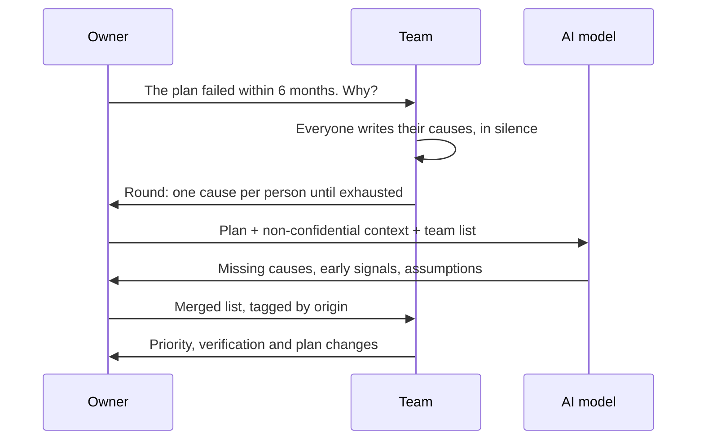
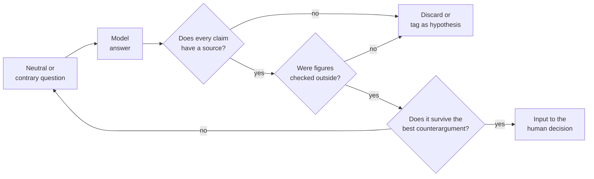

# AI for decisions: research, scenarios and pre-mortems

Someone on the steering committee pastes the question into an AI assistant: "should we launch a
self-service plan?". Ten seconds later there is a tidy answer with three upsides, two risks and an
"industry-typical" conversion rate. The number ends up in Monday's slide deck. Nobody knows where
it came from, and by the time someone asks, it is already part of the plan.

The problem is not using the model; it is using it as an oracle. **Using AI for decisions means
using a language model to widen and stress-test the reasoning of whoever decides (options,
scenarios, counterarguments, ways to fail) without handing it the choice or accepting as evidence
anything that has not been checked outside the model.**

This lesson covers the tasks where a model improves a decision, the ones where it quietly makes it
worse, how to use it in a pre-mortem, and the protocol for verifying what it contributes. AI
governance in the organization lives in [controlling AI](/docs/controlar-la-ia-gobierno-y-autonomia);
the architecture of an agent-based system, in [LLMs and agents](/docs/arquitectura-agentes-llm).

<Callout tone="info" title="Cut-off date and scope">
  Sources checked in October 2026. No products or prices are named: everything below applies to any
  assistant built on a language model.
</Callout>

## Helping to decide is not deciding

A business decision has three parts: understanding the situation, choosing between options
against explicit criteria, and owning the choice. A model can speed up the first and enrich the
second. The third cannot be assigned to it: the model does not sign anything and will not be at
the review a year from now.

How to reason about criteria, reversibility and timing is covered in
[trade-offs and decision-making](/docs/trade-offs-y-decisiones). The question here is narrower:
which part of that process a model can do better, and under which controls.

## Where a language model helps

The tasks where a model tends to add value share one trait: they produce **material to think
with**, not conclusions. The team can review the output with its own judgment before using it.

### Summarizing evidence you already have

Customer interviews, support tickets, meeting notes or a long contract: the model condenses them
and groups them by theme. It works well when you supply the material and ask it to quote the
source passage for every point, so you can check it. It works poorly when you ask it to summarize
"what is known" about a market without giving it any documents.

### Generating options and scenarios

Teams usually arrive with two options, sometimes one. Asking for five distinct alternatives,
including "do nothing" and a hybrid, widens the space before you narrow it. The same goes for a
base, a downside and an upside scenario, each with the conditions it needs. The team judges which
ones are plausible.

### Counterarguments and devil's advocate

Asking for the strongest argument against your preferred option is cheap and useful. Lord, Lepper
and Preston (1984) found that asking people to consider the opposite possibility reduced judgment
biases more than asking them to be impartial. A model pushes back at no social cost, if asked to.

### Testing assumptions

Every plan rests on assumptions ("small customers don't need training", "support will scale").
Asking the model to list the implicit assumptions in a document, and which data point would
confirm or refute each one, turns a hunch into a list you can check.

## Where it fails or misleads

The most dangerous failures are not the obvious ones but the ones that arrive well written.

### Invented figures and citations

NIST's generative AI profile (NIST AI 600-1, July 2024) calls it _confabulation_: erroneous or
false content stated with confidence, colloquially known as hallucinations. It also warns that a
model may add citations or logical steps that appear to justify a wrong answer. In Mata v. Avianca,
in June 2023, a federal court in New York sanctioned two lawyers for filing a brief that cited
non-existent judicial decisions generated by an assistant.

### False confidence and the single answer

A model tends to give a complete, confident answer even when the question has none. Kalai and
co-authors (September 2025) argue that training and evaluation reward guessing over acknowledging
uncertainty. The tone tells you nothing about reliability, and one clean recommendation hides the
alternatives nobody explored. OWASP (LLM09:2025) includes users' overreliance in this risk and
recommends cross-checking against external sources and human review.

### The question tilts the answer

Sharma and co-authors (Anthropic, October 2023) documented _sycophancy_: five AI assistants tended
to tailor their answers to the views the user expressed. Ask "isn't the self-service plan a good
idea?" and you are more likely to get reasons in favor. It is the asker's confirmation bias,
amplified. Human biases in general are covered in
[systems thinking and biases](/docs/pensamiento-sistemico-y-sesgos).

### Internal data the model does not have

The model does not know your churn rate or your contracts: if you don't provide them, it fills the
gap with generalities that sound like data. If you do, the question becomes what you may share.

## Tasks and risk at a glance

| Task                       | Typical contribution                 | Main risk                              | Minimum control                            |
| -------------------------- | ------------------------------------ | -------------------------------------- | ------------------------------------------ |
| Summarizing your documents | Saves hours of reading               | Drops or distorts an important nuance  | Ask for the source quote and spot-check    |
| Generating options         | Widens the option space              | Generic options with no context        | Filter against your real constraints       |
| Scenarios                  | Gives structure to uncertainty       | Invented probabilities                 | Scenarios without model-made percentages   |
| Counterarguments           | Stress-tests the preferred option    | Weak objections if asked gently        | Ask for "the strongest argument against"   |
| Pre-mortem                 | Varied failure causes                | Anchoring the team on the model's list | The team writes its own list first         |
| Market or industry data    | Points the research in a direction   | Unsourced or outdated figures          | Check every figure in a primary source     |
| Final recommendation       | Nothing the earlier steps don't give | Shifting accountability                | Don't ask, or treat it as one more opinion |

## The pre-mortem with an AI model

The technique (assume the plan has already failed and explain why), its origin and its steps are
covered in [systems thinking and biases](/docs/pensamiento-sistemico-y-sesgos#pre-mortem). Only
one thing changes here: the model joins as one more participant, under rules of its own.

In "Performing a Project Premortem" (Harvard Business Review, September 2007), Gary Klein states
that _prospective hindsight_ (imagining that a future event has already happened) improves the
ability to identify the reasons for an outcome by 30%, and attributes the figure to a 1989 study by
Deborah Mitchell, J. Edward Russo and Nancy Pennington. Some critical readings point out that the
study measured how many reasons people generated, not whether they were accurate. So the figure
does not vouch for the quality of the causes, whether they come from the team or from the model.

The model widens the list in minutes with different kinds of causes (technical, commercial,
regulatory), proposes an early signal for each one and names uncomfortable risks at no social
cost. In a pre-mortem it fails in four ways:

- **It anchors the team** if its list is read before the team's.
- **It gives generic causes**: it misses what only the team knows.
- **It confabulates**: it may invent precedents or "industry" failure rates.
- **It flatters**: if the question shows that people like the plan, the causes come out soft.

<Callout tone="info" title="A note on sources">
  Secondary source: the 30% figure and its attribution to the 1989 study are cited as given in
  Klein's article; the critique of what the study measured comes from later commentary. The role of
  the AI model is an adaptation, not part of the original technique.
</Callout>



Two rules answer those failures. The team writes **before** seeing the model's list; otherwise
that list anchors the conversation and what only the team knows never surfaces. And every cause is
tagged by origin: the model's go in as hypotheses, not findings.

## A verification protocol

Five rules cover most of the failures above; they need no tooling, only discipline.



### Ask against

Phrase the question without revealing your preference or, better, ask for the opposite case:
"give the three strongest arguments for not launching the plan". Then repeat the question with the
opposite preference; if the recommendation flips with the framing, it depended on the framing.

### Ask for the uncertainty

Explicitly ask what it does not know, what would have to be true for its analysis to fail, and
which alternatives it discarded. An answer with no doubt at all about an uncertain business
question is a warning sign, not a mark of quality.

### Require a source for every claim

Every factual claim needs an origin: the document you supplied (with the quote) or an external
source you can open. Without one, it is a hypothesis. A reference the model mentions does not
count until you have opened it either: it may not exist, or may not say that.

### Check figures outside the model

No number enters the decision without being checked in a primary source or your own data. The
arithmetic too: if the model computes a margin, redo it in a spreadsheet. That is faster than
arguing about where the number came from once it is in the deck.

### Log what you asked

Questions shape answers, so they are part of the evidence. A short record attached to the
decision is enough. One possible shape:

```yaml
# ai-query-0007.yaml (indicative shape)
decision: ADR-0042 self-service plan
tool: assistant approved by internal policy
data_shared: plan without customer figures # nothing confidential
questions:
  - 'Pre-mortem: the plan failed within 6 months. Why?'
  - 'Strongest arguments for not launching it'
used: [causes 3, 5 and 8 from the pre-mortem]
discarded: [unsourced conversion range]
verified_by: product owner
```

## Confidential data without a policy

Pasting a customer list or per-contract margins into an assistant can expose information the
company is required to protect. The 2025 OWASP Top 10 for LLM applications lists sensitive
information disclosure as LLM02 and recommends, among other measures, teaching users what not to
enter and having clear terms of use. Without a policy stating which tool and which data are
allowed, share only what you could publish. That policy is covered in
[controlling AI](/docs/controlar-la-ia-gobierno-y-autonomia); general protection, in
[security by design](/docs/seguridad-por-diseno).

## Accountability stays human

An AI-assisted decision is recorded like any other, with an owner and a date, and an
[ADR](/docs/adr) is the natural format. What AI adds is an appendix: what was asked, what was used,
what was discarded and who verified it.

If someone at the review asks why an option was chosen, "the model said so" is not an answer: you
need a criterion you can defend and evidence the team has checked.

## When to use it and when not to

| Situation                                                          | Reasonable use of the model                              |
| ------------------------------------------------------------------ | -------------------------------------------------------- |
| Many unknowns and little time to explore                           | Yes: options, scenarios and pre-mortem                   |
| You have long internal documents to read and compare               | Yes: summary with quotes to the source                   |
| The team agrees too quickly                                        | Yes: counterarguments and pre-mortem                     |
| The decision depends on current market figures                     | Only to direct the research; figures come from elsewhere |
| Personal data or trade secrets are involved and there is no policy | No, not until a policy exists                            |
| Small, reversible decision                                         | Rarely worth the verification time                       |
| Looking for backing for something already decided                  | No: the model's sycophancy will confirm it               |

## Common mistakes

- **Accepting the first answer.** It is one sample from a non-deterministic system; asking again,
  against, or from another angle often changes it.
- **Pasting confidential data without a policy.** The time saved does not make up for leaking
  customer or contract data.
- **Treating the synthesis as evidence.** A well-written summary is not a fact; the evidence is the
  document or data point behind it.
- **Putting the answer in the question.** "Isn't it true that…?" invites sycophancy.
- **Asking the model for probabilities.** A "70% chance of success" with no calculation behind it
  is an invented number dressed up as rigor.
- **Leaving no trail.** Without a record of the questions, nobody can reproduce or audit how the
  decision was reached.

## Worked example: a self-service plan

A company sells management software for car repair shops. It has 300 customers on a sales-assisted
plan at USD 120 a month (USD 36,000 in monthly recurring revenue). Leadership wants to decide
whether to launch a **self-service Basic plan** at USD 49 a month, with sign-up and no sales call.
All figures in this example are illustrative.

### Context and assumptions

Assumptions are written down before the model is consulted, each with its origin:

| Assumption                       | Value          | Origin                                                          |
| -------------------------------- | -------------- | --------------------------------------------------------------- |
| Free trials per month            | 500            | Marketing projection from current traffic                       |
| Trial-to-paid conversion         | 6%             | 8-week pilot: 200 trials, 12 paid                               |
| New customers per month          | 30             | 500 × 6%                                                        |
| Monthly churn                    | 5%             | Assumption: the pilot is too short to measure it                |
| Variable cost per customer/month | USD 13         | Support 1.5 tickets × USD 6 + USD 4 payments and infrastructure |
| Contribution margin per customer | USD 36 a month | 49 − 13                                                         |

With 30 new customers a month and 5% churn, the base grows like this: 30, 58.5, 85.6, 111.3, 135.7
and 158.9. By month six there are about 159 customers, contributing 159 × 36 = USD 5,724 a month.

### What the model says and what gets checked

The owner shares the plan without customer data and asks for scenarios and counterarguments:

- The model states that "typical" trial-to-paid conversion for business software is between 15%
  and 25%. It gives no source you can open. **Discarded**: the plan keeps the 6% measured in the
  pilot.
- The model flags **cannibalization**: existing customers downgrading to Basic. That is a
  hypothesis, so it is checked against internal data: 45 of the 300 customers only use features
  included in Basic. If all of them downgraded, the loss would be 45 × (120 − 49) = USD 3,195 a
  month.

### Assisted pre-mortem

The team writes its failure causes first: support gets overwhelmed, sign-up without a call leaves
customers badly configured, the sales team does not back the plan. Then the model adds causes the
team had not listed; two survive review: the cannibalization already quantified, and multi-currency
billing, which the pilot never tested. A third ("repair shops don't trust online payment") is tagged
as a hypothesis with no data and added to the watch list.

With full cannibalization, the downside scenario leaves 5,724 − 3,195 = USD 2,529 a month in net
contribution by month six: positive, but far from the base case.

### Decision and record

Product leadership decides to launch with safeguards: Basic excludes multi-branch management, and
an existing customer needs a call to switch plans. Stop criteria are set for review at 8 weeks:
conversion below 3%, more than 3 tickets per customer per month, or more than 10 downgrades in the
quarter. The ADR records the decision, who made it, the assumptions with their origin, and the
model query log with what was used and what was discarded.

## Checklist

- [ ] The question to the model does not reveal the preferred option, or asks for the opposite case.
- [ ] The team wrote its own list before seeing the model's.
- [ ] Every factual claim has an opened and checked source, or is tagged as a hypothesis.
- [ ] No figure from the model enters the decision without being checked outside it.
- [ ] Only data allowed by the organization's policy was shared.
- [ ] There is a record of what was asked, what was used and what was discarded.
- [ ] The decision has a named owner and is recorded in an ADR.

## Sources

- [Performing a Project Premortem (Gary Klein, Harvard Business Review, September 2007)](https://hbr.org/2007/09/performing-a-project-premortem): origin of the technique and of the 30% figure
- [Pre-mortem on Wikipedia](https://en.wikipedia.org/wiki/Pre-mortem): overview of the technique and its link to prospective hindsight
- [Back to the future: Temporal perspective in the explanation of events (Mitchell, Russo and Pennington, Journal of Behavioral Decision Making, 1989)](https://doi.org/10.1002/bdm.3960020103): study on prospective hindsight cited by Klein
- Lord, C. G., Lepper, M. R. and Preston, E. (1984). Considering the opposite: A corrective strategy for social judgment. Journal of Personality and Social Psychology, 47(6), 1231–1243
- [NIST AI 600-1: Generative Artificial Intelligence Profile (July 2024)](https://doi.org/10.6028/NIST.AI.600-1): definition of confabulation, section 2.2
- [Why Language Models Hallucinate (Kalai, Nachum, Vempala and Zhang, September 2025)](https://arxiv.org/abs/2509.04664)
- [Towards Understanding Sycophancy in Language Models (Sharma et al., October 2023)](https://arxiv.org/abs/2310.13548)
- [OWASP LLM02:2025 Sensitive Information Disclosure](https://genai.owasp.org/llmrisk/llm022025-sensitive-information-disclosure/) and [LLM09:2025 Misinformation](https://genai.owasp.org/llmrisk/llm092025-misinformation/)
- [Mata v. Avianca, Inc. on Wikipedia](https://en.wikipedia.org/wiki/Mata_v._Avianca,_Inc.): sanctions order of June 22, 2023
