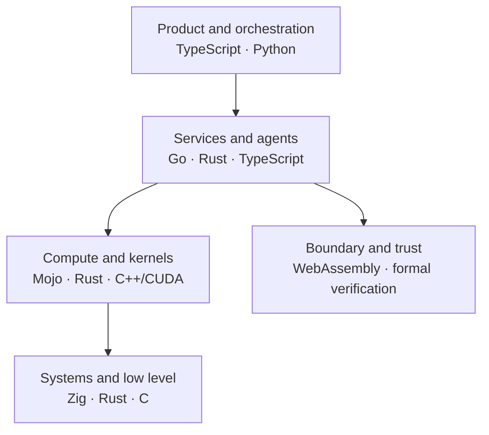
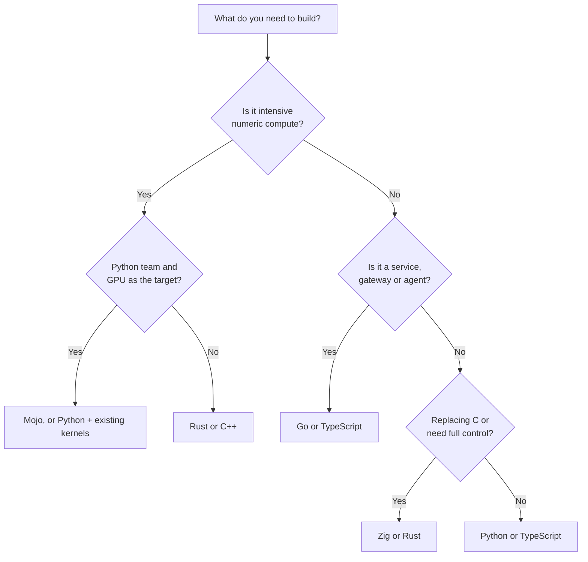

# Programming languages in the AI era

Writing code is no longer the bottleneck. An agent produces in minutes what used to take a
day, and that changes the architect's question: it is no longer "which language lets us write
this fast?" but "which language lets us **verify, operate and afford** this best over the next
five years?".

This article walks through the languages that matter most today for architecture decisions:
the established ones (Python, TypeScript), the ones gaining ground in infrastructure (Rust,
Go) and the newer ones aimed at the future of compute (Mojo, Zig). It closes with a short
watchlist and a method for deciding without chasing hype.

<Callout tone="info" title="Cut-off date">
  The data is from October 2026. This space moves fast: before locking in a decision, check each
  project's official release notes.
</Callout>

## What AI changes

Four new pressures drive language choice. They are worth naming because they are what
justifies (or not) every technology in this article.

- **Code is cheap, verification is expensive.** When an AI generates hundreds of lines per
  minute, the type system, the compiler and the tests become the safety net. A language that
  rejects mistakes at compile time turns the compiler into a tireless reviewer.
- **Compute is the dominant cost.** Training and serving models consumes GPUs, energy and
  money. Performance per watt and per dollar stopped being a tuning detail and entered the
  architecture.
- **Agents need concurrency and isolation.** A service orchestrating dozens of model and tool
  calls at once needs good concurrency, and one that runs generated code needs sandboxing.
- **Memory safety is a requirement.** Memory bugs remain a huge source of vulnerabilities,
  and more code now reaches production reviewed faster.

One telling consequence: GitHub tied TypeScript reaching first place by contributor count
(August 2025) partly to types working well with AI assistants. Types are not bureaucracy:
they are context that the model and the compiler share.

## Map of layers

There is no single "AI language". There are layers with different jobs, and each language
shines in one of them.

This ties into the [C4 model](/docs/c4-model): each container can have its own language, and
the boundary between them (API, process, Wasm module) is the real architectural decision.
Choosing a language per component, not per company, is the norm.

## The established ones: Python and TypeScript

**Python** remains the lingua franca of research and the AI ecosystem: PyTorch, most
notebooks and nearly every model SDK start there. Its historical limitation, the GIL, is
giving way: since Python 3.14 (October 2025) the _free-threaded_ build has officially
supported status (PEP 779), though it remains optional and separate from the default build.

**TypeScript** is the language of the product layer: interfaces, APIs, agent tooling and MCP
servers. Its edge in the AI era is structural typing, which gives models good context and
surfaces errors early.

- **Use them for:** prototyping, model orchestration, glue code, interfaces and business
  services.
- **Watch out for:** putting Python on hot, highly concurrent paths without measuring, and
  leaning on `any` in TypeScript (it cancels exactly the benefit you are after).

## Rust: memory safety without a garbage collector

Rust delivers performance close to C and C++ with compiler-enforced memory safety and no
garbage collector. Its strength in the AI era is that the compiler demands correctness before
anything runs, which is valuable when an agent writes part of the code.

Recent maturity signals:

- **Linux:** at the December 2025 Maintainers Summit, it was agreed that Rust would stop being
  experimental in the kernel.
- **Infrastructure:** Debian announced that APT will require Rust starting May 2026 (per trade
  press), and projects such as the Nova driver for NVIDIA GPUs are written in Rust.
- **AI:** [Candle](https://github.com/huggingface/candle), from Hugging Face, focuses on
  lightweight inference without heavy dependencies, and [Burn](https://burn.dev) bets on one
  codebase for several backends (CPU, GPU, WebAssembly). The ecosystem is much smaller than
  PyTorch's.

- **Use it for:** inference engines, high-performance servers, security components, CLIs,
  Python extensions and WebAssembly modules.
- **Watch out for:** the learning curve, build times and rewriting everything "for safety".
  Replace the component that hurts, not the whole system.

## Go: operational simplicity for agents and platforms

Go is deliberately boring, and that is a virtue. A static binary, goroutine concurrency and a
small language make it ideal for services, CLIs and agent platforms. Go 1.26 brings:

- the _Green Tea_ garbage collector enabled by default, with reported reductions of 10% to 40%
  in GC overhead for allocation-heavy programs (it depends on heap shape);
- roughly 30% lower cgo call overhead;
- a rewritten `go fix` with "modernizers", handy for keeping code current, including
  AI-generated code;
- opt-in experiments such as `simd/archsimd` and a `goroutineleak` profile that detects leaked
  goroutines, a classic problem in long-lived agent servers.

There is also an [official MCP SDK for Go](https://github.com/modelcontextprotocol/go-sdk),
maintained together with Google.

- **Use it for:** APIs, model gateways, agent orchestrators, infrastructure tooling and MCP
  servers.
- **Watch out for:** expecting top-tier numeric compute: Go does not compete with Rust, Mojo
  or C++ on GPU kernels.

## Mojo: Python for AI hardware

Mojo is Modular's language (from Chris Lattner, creator of LLVM and Swift). It aims to offer
Python-like syntax with low-level control for writing high-performance code on CPUs, GPUs and
accelerators without dropping into CUDA or C++.

Current state:

- **Mojo 1.0** arrived on August 11, 2026 with Modular 26.5. Modular says changes during the
  1.x series should be mostly additive.
- **Open source:** the standard library already was; according to Wikipedia and other sources,
  the compiler was released on August 18, 2026 under Apache 2.0 with LLVM exceptions. Verify
  the status and license of MAX components in the official repository.
- **Python interop:** it can import Python modules through CPython and expose functions to
  Python. It is **not** a Python superset: that original goal was postponed or abandoned.
- **GPU:** there is evidence of kernels competitive with CUDA and HIP on memory-bound
  workloads on NVIDIA and AMD (a 2025 Oak Ridge study).

- **Use it for:** model kernels and operators, high-performance inference, and Python teams
  that need to get close to the metal without rewriting in C++.
- **Watch out for:** a young ecosystem, single-vendor dependence (Modular) and parts of the
  serving stack under different licenses. A 1.0 promises language stability, not ecosystem
  maturity.

## Zig: C-level control, no hidden surprises

Zig is a systems language with no garbage collector and no hidden allocations, with
first-class cross-compilation and an integrated build system. It replaces C more than Rust:
it favors explicitness over compiler-enforced guarantees.

Zig **0.16.0** (April 14, 2026) introduced `std.Io`: every input/output operation receives an
`Io` object, so the same code can run on threads or on an event-driven engine, without
splitting the language into "colored" sync and async functions. Today the thread-based
implementation is the complete one; the event-driven one is still in development. Zig is
**not** at 1.0, so breaking changes between versions still happen.

- **Use it for:** runtimes, interpreters, engines, cross-compilation tooling, embedding in C
  projects and components where every allocation must be visible. Bun, the runtime this
  repository uses, is written in Zig.
- **Watch out for:** adopting it in long-lived systems without accepting frequent migrations
  until it reaches 1.0.

## On the radar

These are not decisions for this week, but they are worth recognizing.

| Technology           | What it is                                                                                                       | Why watch it                                           |
| -------------------- | ---------------------------------------------------------------------------------------------------------------- | ------------------------------------------------------ |
| **WebAssembly/WASI** | Portable, isolated modules outside the browser. WASI 0.3 (Jun. 2026) brings native async to the component model. | Sandboxing AI-generated code and plugin extensions.    |
| **Lean 4**           | Language and proof assistant. Mistral released Leanstral, an open-source Lean 4 agent (March 2026).              | AI-assisted formal verification for critical pieces.   |
| **Gleam**            | Typed language for the BEAM (Erlang) and JavaScript.                                                             | Concurrent, fault-tolerant services with strong types. |
| **Odin**             | A simple C/C++ alternative popular in games and graphics.                                                        | Systems and graphics without C++ complexity.           |
| **Carbon**           | Experimental Google project as a C++ successor with interoperability.                                            | Gradual migration of huge C++ codebases.               |
| **Bend / HVM**       | Functional language that parallelizes automatically on CPU and GPU.                                              | Research in implicit parallelism; still experimental.  |

Treat them as lines of observation: none of them justifies rewriting a production system
today.

## Quick comparison

| Language   | Best for                          | Maturity            | Main risk                                |
| ---------- | --------------------------------- | ------------------- | ---------------------------------------- |
| Python     | Research, AI orchestration        | Very high           | Performance and concurrency on hot paths |
| TypeScript | Product, APIs, tooling            | Very high           | Weak typing if `any` is overused         |
| Rust       | Inference, safety, systems        | High                | Learning curve and build times           |
| Go         | Services, agents, platforms       | Very high           | Poor fit for numeric compute             |
| Mojo       | AI kernels, heterogeneous compute | Medium (recent 1.0) | Young ecosystem and vendor dependence    |
| Zig        | Runtimes, systems, C replacement  | Medium (pre-1.0)    | Breaking changes between versions        |

## How to decide

Start from the problem, not the language.

Questions to answer before choosing:

1. **Who will maintain it in three years?** Available talent weighs more than a benchmark.
2. **What is the boundary?** If the component lives behind an API, a process or a Wasm module,
   changing its language later is cheap.
3. **Which part fails expensively?** Put the strong guarantees (Rust, types, verification)
   where a mistake costs money or security.
4. **Did we measure?** Build a proof of concept with real data before rewriting anything.
5. **Does the ecosystem exist?** Libraries, debugging, observability and CI count as much as
   the language.

## Common mistakes

- **Rewriting everything in the trendy language.** Isolate the bottleneck and replace only
  that.
- **Choosing by synthetic benchmark.** Measure your real workload, with your data and your
  hardware.
- **Ignoring hiring and training costs.** A new language is team debt.
- **Mistaking 1.0 for a mature ecosystem.** Language stability is not the same as libraries,
  tooling and community.
- **Polyglot without boundaries.** Every extra language needs a clear contract, CI and
  observability. Document each choice in an ADR.

## Checklist for your next ADR

- [ ] Describe the problem and constraints before naming the technology.
- [ ] Compare at least two alternatives, including the conservative option.
- [ ] Measure with a proof of concept on a real workload.
- [ ] Define the component boundary and how it gets replaced.
- [ ] Write down the exit plan if the technology does not mature.
- [ ] Confirm the project's license, governance and release cadence.

## Sources

Consulted in October 2026; cross-check each fact against the official source before deciding.

- [Mojo 1.0 and Modular 26.5](https://www.modular.com/blog/modular-26-5-mojo-1-0-is-here)
- [Mojo on Wikipedia](<https://en.wikipedia.org/wiki/Mojo_(programming_language)>)
- [Zig 0.16.0 release notes](https://ziglang.org/download/0.16.0/release-notes.html)
- [Go 1.26](https://go.dev/blog/go1.26)
- [Official MCP SDK for Go](https://github.com/modelcontextprotocol/go-sdk)
- [Octoverse: TypeScript #1 on GitHub](https://github.blog/news-insights/octoverse/octoverse-a-new-developer-joins-github-every-second-as-ai-leads-typescript-to-1/)
- [PEP 779: supported free-threaded Python](https://discuss.python.org/t/pep-779-criteria-for-supported-status-for-free-threaded-python/84319)
- [Rust made permanent in the Linux kernel](https://www.devclass.com/development/2025/12/15/rust-boosted-by-permanent-adoption-for-linux-kernel-code/1725322)
- [WASI 0.3](https://wasi.dev/releases/wasi-p3)
