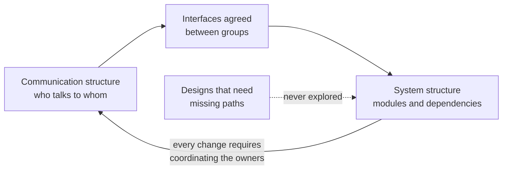
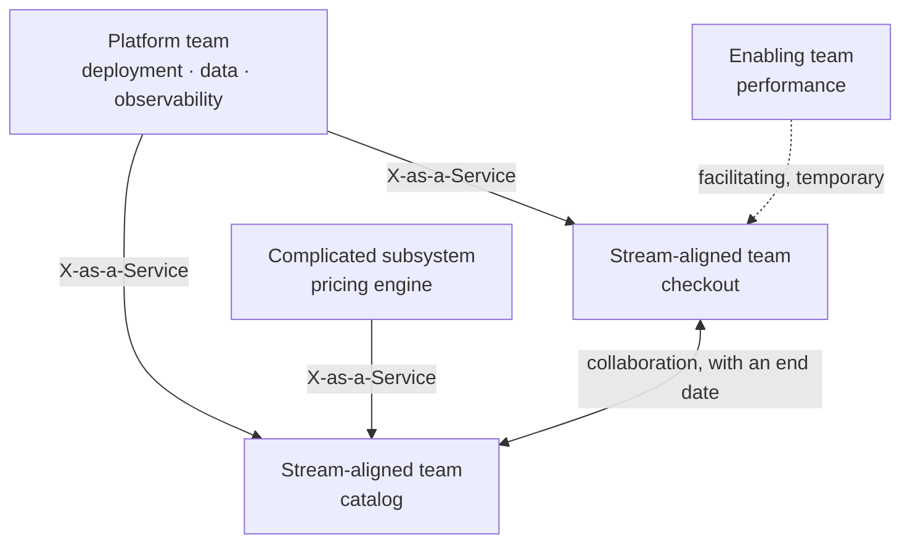

# Conway's law and Team Topologies

A small change to the checkout flow takes three weeks. Not because of the code, which is twenty lines, but because it touches a screen owned by the frontend team, a service owned by the backend team, and a table only the database team may alter. It takes three meetings, three priority queues and a coordinated release window. Nobody designed that architecture on purpose: it emerged on its own, in the exact shape of the org chart.

That phenomenon has had a name for more than half a century. **Conway's law says that the design of a system tends to copy the communication structure of the organization that builds it.** Team Topologies, the model by Matthew Skelton and Manuel Pais, starts from that observation and proposes how to design teams and their interactions so that the architecture you want is also the one the organization produces naturally.

This article covers the original formulation and its mechanism, the inverse maneuver, the team types and interaction modes of Team Topologies, cognitive load as a design constraint, and the most common mistakes when applying all of it. Choosing between a monolith and microservices has its own article, [monolith, modular monolith or microservices](/docs/monolito-vs-microservicios); here we only deal with the organizational side.

<Callout tone="info" title="Sources and cut-off date">
  Checked in October 2026. Conway's paper was read in the copy its author publishes. From the Team
  Topologies book, the official IT Revolution excerpt (chapters 1 to 3) was read; the interaction
  modes come from the model's official site and from Martin Fowler's entry. Quotes are given
  verbatim in their original language.
</Callout>

## What Conway wrote in 1968

Melvin Conway published "How Do Committees Invent?" in _Datamation_ in April 1968. As he tells it on his own site, he had first submitted it to _Harvard Business Review_, which rejected it on the grounds that he had not proved his thesis. It was Fred Brooks who, citing it in _The Mythical Man-Month_, named it "Conway's law".

The thesis, in the paper's own words:

> organizations which design systems (in the broad sense used here) are constrained to produce designs which are copies of the communication structures of these organizations.

Two nuances of the original that often get lost:

- **It is not only about software.** Conway uses "system" in a broad sense, and one of his examples is military: two military services directed by their Commander-in-Chief to develop a common weapon system which, after great effort, produced a copy of their organization chart.
- **It is a structural relationship, not a metaphor.** Conway describes it as a homomorphism: each subsystem corresponds to a design group, and each interface between subsystems to the communication between those groups.

The paper's best-known example is small and concrete. A contract research organization had eight people to write a COBOL compiler and an ALGOL compiler. After estimating the difficulty, it assigned five to COBOL and three to ALGOL. The COBOL compiler ended up running in five phases; the ALGOL compiler, in three.

### The conclusion Conway did draw

The paper does not stop at the observation. Conway notes that the design that occurs first is almost never the best possible, so the system concept may need to change, and for that the organization must be able to change too. His criterion is explicit: a design effort should be organized according to the need for communication. He also argues that design managers should be rewarded for keeping their organizations lean and flexible. More than fifty years later, Team Topologies starts from almost the same point.

## Why it happens

There is nothing mystical about the mechanism. Designing a system requires agreeing on interfaces, and agreements get made where communication flows easily. Conway puts it this way: for any given team organization, there is a class of design alternatives it cannot pursue effectively because the necessary communication paths do not exist.



The feedback loop matters: once the system has the shape of the organization, every change forces the owners of the affected modules to talk, which reinforces the existing communication paths. That is why the law becomes more visible over time, not less.

There is empirical evidence beyond the anecdote. In 2012 (_Research Policy_), MacCormack, Baldwin and Rusnak compared pairs of software products with similar functions, some built by tightly coupled organizations and others by loosely coupled ones. The products from loosely coupled organizations were significantly more modular, with differences of up to a factor of eight in how far a change propagates to other components. Management research calls this relationship the _mirroring hypothesis_.

Ruth Malan summed it up in a sentence that Team Topologies presents as the modern version of the law:

> If the architecture of the system and the architecture of the organization are at odds, the architecture of the organization wins.

The implication the book highlights is uncomfortable: whoever decides which teams exist and what each one owns is deciding the architecture, whether they realize it or not.

## The inverse Conway maneuver

If the organization pulls the system toward its own shape, you can use that force in your favor: **design the team structure and its communication channels so they favor the architecture you want**. That is the inverse Conway maneuver (also called the reverse Conway maneuver).

Three references about its origin are worth telling apart:

| Source                                         | What it says about the origin                                                                    |
| ---------------------------------------------- | ------------------------------------------------------------------------------------------------ |
| Martin Fowler, "Conway's Law" entry (Oct 2022) | Credits the term to Jonny LeRoy and Matt Simons, in the December 2010 issue of Cutter IT Journal |
| Thoughtworks Technology Radar                  | Places the technique in the _Trial_ ring in July 2014 and again in January 2015                  |
| Team Topologies (2019)                         | Describes a "revival" of the law around 2015, with James Lewis and others promoting the maneuver |

The attribution comes from Fowler; the original Cutter article is not open access. The book _Accelerate_ (Forsgren, Humble and Kim) backs the idea with DORA data: its research supports organizations evolving their team structure to achieve the desired architecture, so that teams can take their work from design through deployment without high-bandwidth communication with other teams.

Fowler summarizes the three possible responses to the law:

1. **Ignore it**, because you have not heard of it or think it does not apply.
2. **Accept it**: recognize its effect and make sure the architecture does not clash with the existing communication patterns.
3. **Invert it**: change the communication patterns to push toward the desired architecture.

Team Topologies illustrates the third with a deliberately simple example. Four teams of frontend and backend developers who hand data changes to a single database administrator tend to produce four two-tier applications on top of one shared database. If what you want are services with their own data stores, the maneuver is to put database skills inside each team instead of leaving them outside. The book insists there is no guarantee: changing communication paths only makes the intended design more likely to emerge.

## Team Topologies: a vocabulary for designing teams

_Team Topologies: Organizing Business and Technology Teams for Fast Flow_ (IT Revolution, September 2019) turns Conway's law into an organization design model. A second edition came out in September 2025; according to the publisher, it adds case studies from multiple industries and a new foreword.

The starting point is treating the **team as the unit of delivery**: a stable group of five to nine people working toward a shared goal. The book recommends assigning work to teams, not individuals, and ties the maximum size to the limits on trust described by Dunbar's number.

### Four team types

| Type                  | Purpose                                                                               | Sign it works                                               | Typical risk                                                   |
| --------------------- | ------------------------------------------------------------------------------------- | ----------------------------------------------------------- | -------------------------------------------------------------- |
| Stream-aligned        | Deliver a flow of work end to end, usually for a segment of the business              | Gets a change to production without waiting on another team | Carrying so much infrastructure that it stops delivering value |
| Platform              | Provide an internal product that speeds up stream-aligned teams                       | Teams use it on their own, without filing tickets           | Turning into a request queue with its own agenda               |
| Enabling              | Help a stream-aligned team overcome obstacles and spot missing capabilities           | The team it helps stops needing it                          | Becoming a permanent expert group everyone depends on          |
| Complicated-subsystem | Own a part that needs deep specialist knowledge (mathematics, calculation, technical) | Others consume the subsystem without knowing its internals  | Being used as an excuse to create component teams              |

The default type is stream-aligned; the other three exist to reduce its load. Fowler stresses this for platforms: their primary benefit is to reduce the cognitive load on stream-aligned teams.

### Three interaction modes

The model does not just name teams: it also constrains how they relate. According to the official site, there are three modes.

| Mode           | What it is                                                                   | When it fits                                          | Warning sign                                        |
| -------------- | ---------------------------------------------------------------------------- | ----------------------------------------------------- | --------------------------------------------------- |
| Collaboration  | Two teams work together for a defined period to discover things              | Uncertain boundaries, new technology or APIs          | It has run for months and nobody knows when it ends |
| X-as-a-Service | One team provides something and another consumes it with little coordination | The boundary is stable and the interface clear        | The consumer needs meetings for every use           |
| Facilitating   | One team helps and mentors another to build a capability                     | A skill is missing that the team should end up owning | The facilitator ends up doing the work itself       |

Collaboration is expensive on purpose: it blurs the boundary for a while to learn where it should be. Fowler describes this for new platforms, which start in collaboration with their users and should move to a service model as they mature. An interaction that fits none of the three modes usually means the boundary is drawn in the wrong place.



## Cognitive load as a design constraint

The model's most useful contribution for an architect is treating **cognitive load** as a design limit, just like latency or budget. The book takes John Sweller's 1988 definition: the total amount of mental effort being used in working memory. Sweller distinguishes three kinds, which the book maps to software:

| Kind       | Where it comes from                           | Example in a team                                | What to do with it                                 |
| ---------- | --------------------------------------------- | ------------------------------------------------ | -------------------------------------------------- |
| Intrinsic  | The fundamentals of the task                  | The language, the service's data model           | Reduce it with training and good technical choices |
| Extraneous | The environment the work happens in           | Remembering how to deploy or configure something | Eliminate it, mostly through automation            |
| Germane    | What needs attention to learn or perform well | The rules of the invoicing domain                | Leave it as much room as possible                  |

That leads to a rule with strong architectural consequences: **do not let a subsystem grow beyond the cognitive load of the team that owns it**. If it grows, split it or split the domain; do not add a second team to the same piece.

The book advises against measuring that load with lines of code or module counts and proposes reasoning about the relative complexity of domains instead. Its heuristics, offered as a starting point rather than a formula:

- Assign each domain to a single team; if it is too big, split it into subdomains before distributing it.
- A team can handle two or three simple domains.
- A team with a complex domain should have no other domain, not even a simple one.
- Avoid giving one team two complicated domains: in practice it behaves as two subteams.

The first measurement is a non-judgmental question to the team: do they feel effective and able to respond in a timely way to the work they are asked to do? If the answer is clearly no, it is time to review what they own.

## When the law shows up

Conway's law rarely announces itself. It appears as friction everyone has learned to accept as normal:

| Symptom                                                      | What the law is telling you                                                 |
| ------------------------------------------------------------ | --------------------------------------------------------------------------- |
| A business change needs three meetings and three deployments | The system boundary cuts a flow that should belong to a single team         |
| There is a shared database nobody dares to change            | There was a central data team every change had to go through                |
| The API between two services changes every sprint            | The two teams collaborate permanently: they may be a single domain          |
| There is a "common" layer everyone touches and nobody owns   | There is no owning team; communication happens by accident, in code reviews |
| After a merger, the system has two of everything             | The two organizations never came to share communication paths               |

It also shows up in tooling. Team Topologies notes that shared or separate tools shape communication: if you want two teams to collaborate, share tools; if you want a clear boundary, separate them.

## Using it on purpose

Designing with the law in mind does not mean reorganizing every quarter. It means treating system boundaries and team boundaries as a single decision:

1. **Start from the value stream and the domain.** The bounded contexts of [DDD](/docs/domain-driven-design) are good candidates for team boundaries; [coupling and cohesion](/docs/acoplamiento-cohesion) tell you what belongs together.
2. **Draw the target architecture and the org chart on the same sheet.** Every important interface should match a boundary between teams with a declared interaction mode.
3. **Check the cognitive load** of each proposed team against the heuristics above.
4. **Decide the mode of each interaction** and, if it is collaboration, give it an end date.
5. **Record the decision** like any other architecture decision, with its context, in an [ADR](/docs/adr); the reasoning in [trade-offs and decision-making](/docs/trade-offs-y-decisiones) applies just the same.

A lightweight way to make the result visible is one file per team in the repository, listing what it owns and how it relates to others. This is a local convention, not a format from the book:

```yaml
# teams/checkout.yaml
team: checkout
type: stream-aligned
owns: [checkout-web, payments-service, orders-db]
interactions:
  - with: platform
    mode: x-as-a-service
  - with: performance-enablers
    mode: facilitating
    until: 2026-12-31
```

## When it applies and when it does not

| Situation                                                        | What to do                                                                            |
| ---------------------------------------------------------------- | ------------------------------------------------------------------------------------- |
| A single small team                                              | The law barely shows; look after internal modularity and do not invent boundaries     |
| Several teams that routinely block each other                    | Review team and system boundaries together; this is the classic case for the maneuver |
| You are about to split a system into services                    | Decide first which team will own each one                                             |
| The organization is reorganizing for budget or hierarchy reasons | Make the architectural impact visible before the decision is made                     |
| External vendors build parts of the system                       | Assume the contract with each vendor will become a system boundary                    |
| A domain that is still poorly understood                         | Temporary collaboration before fixing boundaries                                      |

The law is a strong tendency, not determinism. A disciplined team can maintain a design its org chart does not favor, but it will pay for that discipline with every change.

## Common mistakes

- **Microservices without their own teams.** If one team maintains ten services, you pay for the network and the deployment coordination without gaining autonomy. The full case is in [monolith, modular monolith or microservices](/docs/monolito-vs-microservicios).
- **A platform that becomes a bottleneck.** If every use goes through a ticket, it is not X-as-a-Service: it is a dependency with a queue. A platform should be run as a product, with users and self-service; [DevOps and its culture](/docs/devops-cultura) describes how it degenerates into the "DevOps team" anti-pattern.
- **Teams by technical layer.** Frontend, backend and database as separate teams produce exactly those three layers, with every business change crossing all of them.
- **Component teams by reflex.** Team Topologies considers them necessary only in exceptional cases of deep specialist knowledge; stream-aligned teams are the default.
- **Permanent collaboration.** Two teams that have been "collaborating" for a year probably should be one team, or need a stable interface.
- **Reorganizing without technical input.** The book warns that frequent reorganizations for management convenience or headcount reduction destroy an organization's ability to build software.
- **Assuming the maneuver is done.** Changing the org chart does not change the code; the old system keeps pulling toward the old structure until it is migrated.

## Worked decision: the checkout flow

**Context.** An online store has three teams: web interface, services and data. Every checkout change crosses all three and takes about three weeks; the data team also handles requests for catalog, inventory and reporting. The business wants to try new payment methods every month.

**Diagnosis through Conway.** The system has the shape of the org chart: a web layer, a services layer and a shared database. The boundary that doubles communication sits between services and data: checkout needs schema changes that compete in the queue with everything else. The data team's cognitive load is high and almost entirely extraneous.

**Options.**

| Option                                                   | Advantage                              | Cost                                                   |
| -------------------------------------------------------- | -------------------------------------- | ------------------------------------------------------ |
| Keep the teams and add a coordinator                     | No organizational change               | More communication, same boundary                      |
| A stream-aligned checkout team with data skills inside   | One team can resolve a checkout change | Hiring or training; the checkout schema gets separated |
| Split checkout into a new service without changing teams | Clean technical boundary               | The organization crosses it again with every change    |

**Decision.** Create a stream-aligned checkout team (six people, including a data profile) that owns its interface, its logic and its schema. The former data team becomes a platform team: it offers database provisioning, backups and observability as a service. For one quarter, an enabling team works with the checkout team on query performance. Whether checkout ends up as a separate service or a module of the current system is a separate decision taken afterwards, with the criteria in [monolith, modular monolith or microservices](/docs/monolito-vs-microservicios).

**Consequences.** The lead time of a checkout change should be measured before and after; if it does not drop, the chosen boundary was the wrong one. The platform needs its own product roadmap so it does not become the new queue. The decision is recorded in an ADR with a review date.

## Checklist

- [ ] Every important module or service has a single owning team.
- [ ] Team boundaries match explicit system interfaces.
- [ ] Every interaction between teams has a declared mode: collaboration, X-as-a-Service or facilitating.
- [ ] Every collaboration has an end date or an exit criterion.
- [ ] Each team's cognitive load has been reviewed by asking the team itself.
- [ ] The platform is self-service, with no tickets for the common case.
- [ ] Team decisions that change the architecture include technical input and are recorded.

## Sources

Checked in October 2026.

- [How Do Committees Invent? (Melvin E. Conway, Datamation, April 1968)](https://www.melconway.com/Home/Committees_Paper.html): copy published by the author
- [Conway's Law (Melvin Conway's page)](https://www.melconway.com/Home/Conways_Law.html): history of the paper, the HBR rejection and the name given by Brooks
- [Conway's Law (Martin Fowler, 20 October 2022)](https://martinfowler.com/bliki/ConwaysLaw.html): three responses and the origin of the inverse maneuver
- [Team Topologies (Martin Fowler, 25 July 2023)](https://martinfowler.com/bliki/TeamTopologies.html)
- [Inverse Conway Maneuver (Thoughtworks Technology Radar)](https://www.thoughtworks.com/radar/techniques/inverse-conway-maneuver)
- [Key concepts (official Team Topologies site)](https://teamtopologies.com/key-concepts): team types and interaction modes
- [Team Topologies excerpt (IT Revolution)](https://itrevolution.com/wp-content/uploads/2022/06/TTOP_excerpt.pdf): chapters 1 to 3, Conway's law, the inverse maneuver, team size and cognitive load
- [Team Topologies, second edition (IT Revolution)](https://itrevolution.com/book/team-topologies/)
- [Exploring the duality between product and organizational architectures (MacCormack, Baldwin and Rusnak, Research Policy, 2012)](https://dash.harvard.edu/handle/1/34403525)
