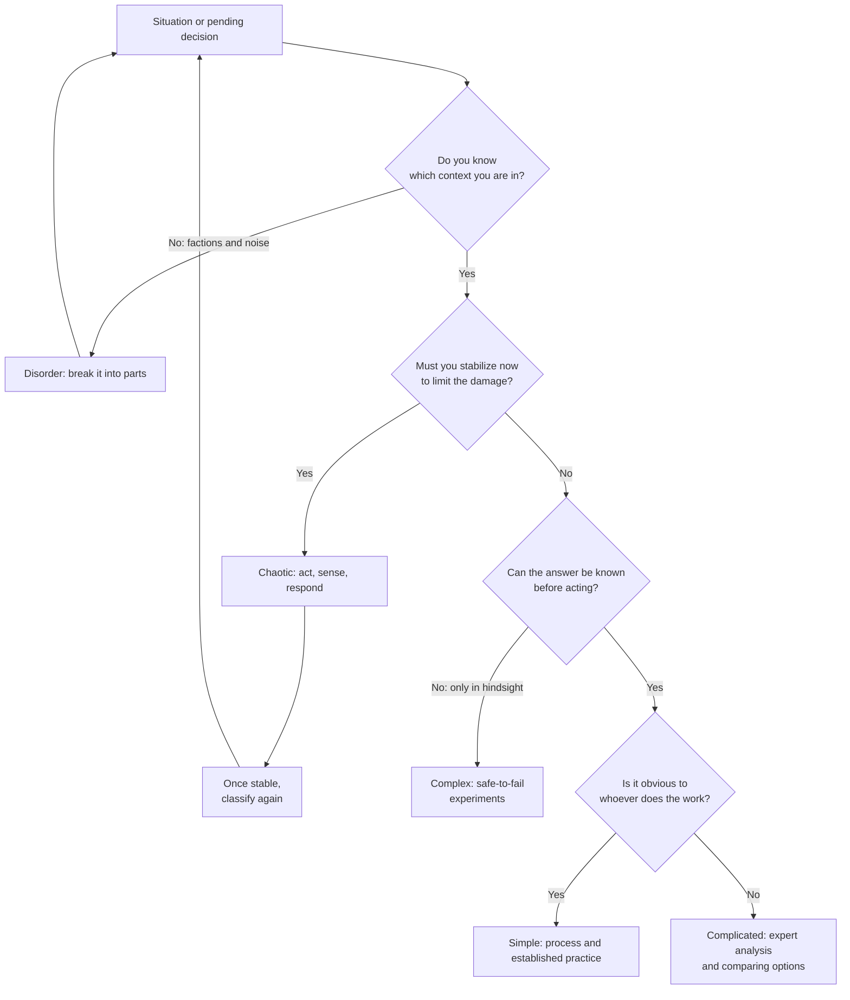
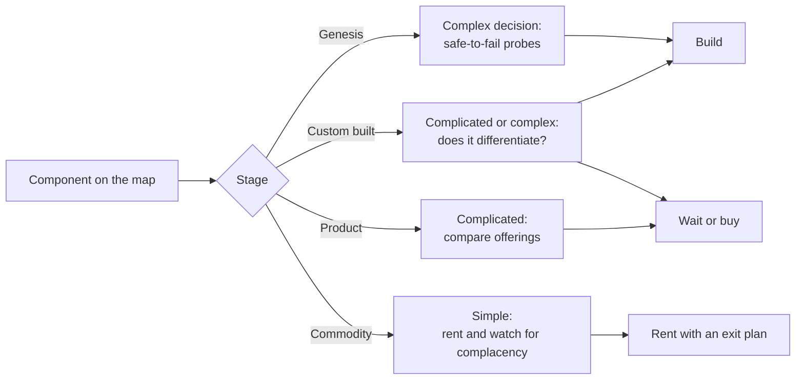

# Strategic decision frameworks: Cynefin and Wardley maps

A team has spent three weeks arguing about whether to rewrite its video-call module. Some want a spreadsheet with the cost of each option; others want a prototype before they commit to an opinion; someone suggests copying what another company in the sector did. Nobody is acting in bad faith and the arguments are sound, yet the discussion goes nowhere because each person is answering a different question. Some assume the problem has a right answer you can calculate, others that it can only be found by trying, and nobody has said how mature the component under discussion actually is.

**A strategic decision framework is a tool for classifying the situation before you choose a response: it does not tell you what to decide, it tells you which kind of method fits what is in front of you.**

This lesson covers two frameworks that complement each other. **Cynefin** answers "what kind of problem is this, and how should I act?". **Wardley maps** answer "what pieces make up what I offer, how mature are they, and what does that mean for building, buying or renting?". It ends with a worked example using four components of a product, presented as an illustrative case, not as a real map.

<Callout tone="info" title="Scope and cut-off date">
  Sources consulted in October 2026. This lesson does not cover prioritizing initiatives (see
  [prioritization frameworks](/docs/marcos-de-priorizacion)), the split between essential and
  accidental complexity ([its own lesson](/docs/complejidad-esencial-y-accidental)), or decision
  reversibility and general biases ([trade-offs and decisions](/docs/trade-offs-y-decisiones)). They
  are linked here, not repeated.
</Callout>

## The problem: applying the wrong method with conviction

Organizations tend to have a favorite way of deciding and apply it to everything. A team used to exhaustive analysis asks for upfront studies even when nobody can know the answer without trying; a team used to experimenting improvises even when a known procedure already works. The method is not the mistake. The mistake is never checking whether it fits the situation.

| Symptom                                                        | The question nobody asked                              |
| -------------------------------------------------------------- | ------------------------------------------------------ |
| A fixed plan is demanded for something nobody has done before  | Can cause and effect be known in advance?              |
| Experts are called in and the debate stalls for weeks          | Is information missing, or is experimentation missing? |
| The team custom-builds something every competitor simply buys  | How mature is this component in the market?            |
| A rented service locks you in where you differentiate the most | Which components are commodities and which are not?    |
| Strategy is presented as a list of initiatives with no context | Where is each piece, and which way is it moving?       |

The first two rows are Cynefin territory; the last three belong to Wardley maps.

## Cynefin: what kind of problem you have

David J. Snowden and Mary E. Boone published _A Leader's Framework for Decision Making_ in **Harvard Business Review in November 2007** (volume 85, issue 11). At the time Snowden was the founder and chief scientific officer of Cognitive Edge, and Boone was president of the consulting firm Boone Associates. The framework predates the article: Cynthia F. Kurtz and Snowden had described it in 2003 in the _IBM Systems Journal_, in _The new dynamics of strategy: Sense-making in a complex and complicated world_.

The central idea is that contexts differ in **the relationship between cause and effect**, and each kind of relationship calls for a different way of acting. The article defines five contexts: four in which you can diagnose the situation and act (simple, complicated, complex and chaotic) and a fifth, disorder, in which it is unclear which of the other four dominates. The first two make up what the authors call the ordered world; the next two, the unordered one.

<Callout tone="warning" title="Names and dates vary by source">
  This text uses the names from the 2007 article. In the 2003 paper, Kurtz and Snowden called the
  domains that became simple and complicated in 2007 _known_ and _knowable_. In later versions of
  the framework the simple domain appears as _obvious_ and later as _clear_, and disorder as
  _confusion_. Secondary source for this naming history, its dates and the claim that Snowden
  started developing the framework at IBM Global Services in 1999: the Wikipedia entry on Cynefin;
  no primary source among those consulted confirms it.
</Callout>

### The four contexts

| Context     | Cause and effect                                    | Response sequence          | What guides the response      | Software example (illustrative)                            |
| ----------- | --------------------------------------------------- | -------------------------- | ----------------------------- | ---------------------------------------------------------- |
| Simple      | Obvious to everyone; a right answer exists          | Sense, categorize, respond | Best practice                 | Renewing a certificate with a documented procedure         |
| Complicated | Exists, but takes expert analysis to see            | Sense, analyze, respond    | Good practice (several valid) | Sizing a database for a known workload                     |
| Complex     | Only understood in hindsight                        | Probe, sense, respond      | Emergent patterns             | Knowing which feature users will adopt in a new product    |
| Chaotic     | No perceivable relationship; everything is shifting | Act, sense, respond        | Rapid response                | A full outage with an unknown cause and customers affected |

The examples in the last column are adaptations to software; the article's own examples come from other fields: loan payment processing for the simple context, oil and mineral exploration for the complicated one, Apollo 13 for the complex one and September 11, 2001 for the chaotic one.

### What changes in each context

**Simple.** The answer is known and shared. The right move is to set up processes, delegate and apply established practice. The article warns of three risks: filing here something that has been oversimplified, thinking conditioned by past experience (what the authors call entrained thinking), and complacency. In their diagram the simple domain sits next to the chaotic one, and the authors argue that the most frequent collapses into chaos happen because success bred complacency. They also remind you that best practice is, by definition, past practice.

**Complicated.** There is at least one right answer, often several, but finding it takes experts. The risk runs the other way: experts dominate the conversation, dismiss ideas from non-experts, or get stuck in what the article calls analysis paralysis. The authors offer a useful test for telling it apart from the complex context: if the right answer stays elusive and you must decide on incomplete data, the problem is probably complex rather than complicated.

**Complex.** There is no right answer to find in advance; patterns emerge. The right move is safe-to-fail experiments: small probes whose failure is cheap, followed by watching what happens and deciding which patterns to reinforce. The risk is falling back on command and control and demanding plans with defined outcomes. The authors argue that this context is far more common in business than most leaders realize.

**Chaotic.** There is no time to analyze. You act first to stabilize, then sense where stability exists, and work to move the situation into the complex context. The risk comes after the crisis: keeping the directive style longer than needed.

**Disorder.** Several perspectives compete and nobody knows which context applies. The way out, according to the article, is to break the situation into parts and assign each part to one of the other four contexts.

### How to classify a decision



The diagram is a simplification for practical use. Cynefin is not a four-box matrix where each problem gets filed once: Kurtz and Snowden describe it as a sense-making device, and the 2007 article asks leaders to prepare their organizations to understand the transitions between contexts. The article opens with a case that shows this: in 1993, after a gunman killed seven people in Palatine, Illinois, Deputy Chief Walter Gasior had to handle a chaotic, a simple, a complicated and a complex front at the same time.

## Wardley maps: where each piece sits

In his book _Wardley Maps_, published chapter by chapter on Medium under a Creative Commons BY-SA 4.0 license, Simon Wardley describes drawing his first map in 2005, when he was CEO of an online photo service. He explains that he refined the technique in boardroom debates with James Duncan, the CIO at the time, whom he calls the co-inventor of mapping.

According to chapter 2 of the book, a map needs four elements: it is **visual**, it is **context specific** (one business at one point in time), it shows the **position** of components relative to an **anchor**, and it describes **movement**.

- **The anchor** is the user and their needs. It goes at the top.
- **The vertical axis is the value chain**: under each need sit the components that meet it and, under those, the components they in turn need. The top is what the user sees most; the bottom, what they do not see.
- **The horizontal axis is evolution**: each component sits according to its maturity, and all of them move from left to right, driven by supply and demand competition. That is why Wardley insists the map is not static.

### The four stages of evolution

| Stage                         | Characteristics according to Wardley                                 | Focus he proposes                                           |
| ----------------------------- | -------------------------------------------------------------------- | ----------------------------------------------------------- |
| Genesis                       | Unique, very rare, uncertain, constantly changing, newly discovered  | Exploration                                                 |
| Custom built                  | Uncommon, still being learned; made and tailored for one environment | Learning and craft                                          |
| Product (including rental)    | Increasingly common, made by a repeatable process, better understood | Refining and improving                                      |
| Commodity (including utility) | Standardized, defined, undifferentiated, run at scale                | Removing deviation, industrializing, operational efficiency |

Wardley admits that evolution cannot be measured over time, but it can be described through the characteristics of each stage. To place a component he suggests asking how ubiquitous and well defined it is, whether all your competitors use it, whether it is available as a product or a utility service, and whether it is something new.

### Drawing a map, step by step

1. **Set the scope and the user needs.** Wardley warns of a trap: describing your own needs (selling, growing) instead of the user's.
2. **List the components of the value chain.** Visible capabilities first; then their dependencies, until you reach what falls outside the scope, such as something you already consume as a service.
3. **Place each component on the evolution axis** using the questions above. Wardley warns that this step causes the most arguments.
4. **Share it and let others challenge it.** In his experience, sharing refines the map and spreads ownership of it.
5. **Add movement**: which components are evolving and where there is inertia against the change.

Two warnings from the same chapter are especially useful. First, do not describe a component by how you treat it but by what it is; his example is companies that in 2016 still custom-built their own CRM even though it was nearly ubiquitous. Second, if the group cannot agree on where a component sits, it may be several subcomponents, most of them commodities and maybe one that is genuinely novel.

If you want to version it alongside the code, a simple structure is enough. This is only the shape:

```yaml
# docs/strategy/map.yaml (indicative shape)
scope: appointment-booking
reviewed: 2026-10-12
anchor: patient who needs an appointment
components:
  - name: scheduling
    stage: custom # genesis | custom | product | commodity
    needs: [no-show-prediction, crm, video]
    movement: stable
  - name: video
    stage: custom
    movement: towards commodity # …
```

## From position to decision: build, buy or rent

In the chapters cited, Wardley does not offer a buying table, but chapter 3 of his book does tie the stage to the method. In the uncharted space (genesis and early custom-built) he uses a stripped-down agile approach; in the transition towards product the focus shifts to reducing waste and lean takes over; in the industrialized space Six Sigma and frameworks such as ITIL dominate. He says something similar about purchasing: a venture-capital approach in genesis, an outcome-based and off-the-shelf approach during the transition, and unit-based approaches in the industrialized space. He concludes that genesis is better suited to in-house development, while the industrialized can be safely outsourced.

That yields a starting rule, not a law:

| Component position | Default decision                           | Why                                                              | When to revisit it                                            |
| ------------------ | ------------------------------------------ | ---------------------------------------------------------------- | ------------------------------------------------------------- |
| Genesis            | Build, small and through experiments       | Nobody sells it yet; the value is in what you learn              | If it does not matter to your user, do not explore it         |
| Custom built       | Build if it differentiates; otherwise wait | It still changes a lot; buying now may freeze an immature design | When several comparable offerings appear                      |
| Product            | Buy and configure                          | Mature offerings exist; building repeats solved work             | If your use is so particular that the product gets in the way |
| Commodity          | Rent as a utility service                  | Standard, undifferentiated and run at scale by others            | If volume or regulation changes the cost equation             |

This rule meets two earlier lessons. Renting what is a commodity is exactly the case where lock-in is usually cheap to avoid, so isolate it behind a port and keep an exit plan, as explained in [locked in to one vendor](/docs/casado-a-un-proveedor). And buying something that is already a product cuts the accidental complexity of your system, the "buy it solved" argument in [essential and accidental complexity](/docs/complejidad-esencial-y-accidental).

### How the two frameworks combine

The two frameworks look at different things. Wardley places **components**; Cynefin classifies **situations and decisions**. A useful reading, which is not an equivalence the authors propose in the texts cited, goes like this: deciding about a component in genesis usually sits in the complex context, because nobody yet knows what will work; choosing between mature products is usually a complicated problem, solved by analysis; and running a commodity tends towards the simple context, with its risk of complacency.



## When to use them and when not to

**Cynefin helps when:**

- A team argues about methods (analyze more or try now) without agreeing on what kind of problem it has.
- You have to decide on incomplete information and someone demands certainty that does not exist.
- You are coming out of an incident and need to separate what was chaotic from what is now complex or complicated.

**Cynefin adds little when:**

- The decision is routine and the procedure works; classifying it is bureaucracy.
- It is used as a label to justify a decision already made ("it's complex, so we don't plan").

**A Wardley map helps when:**

- You must decide what to build, buy or rent in a system with many parts.
- Business and engineering need to discuss the same strategy over a shared artifact.
- You want to anticipate which components will become commodities and where inertia will show up.

**A Wardley map adds little when:**

- The scope is a single piece with no relevant dependencies.
- Nobody with knowledge of the market and of operations is available to place the components; the result would be an opinion shaped like a diagram.

## Common mistakes

- **Applying the simple-context response to a complex problem.** This is the mistake the 2007 article describes in most detail: asking for plans with defined outcomes, other people's best practices or condensed information for something that can only be understood by trying. The symptom is a detailed plan for a product nobody has validated.
- **Confusing complicated with complex.** Hiring more experts does not solve a problem whose behavior emerges from use. If the answer stays elusive and the data is always incomplete, try small probes.
- **Mapping without talking to the people who run the system.** Wardley insists that a group familiar with the business draws and challenges the map, and that mapping cannot be outsourced. The people who operate the system know which component causes trouble, which dependency is missing from the drawing and what is custom-built only out of habit.
- **Treating the map as a static document.** Every component moves to the right. A two-year-old map that nobody has revisited describes a market that no longer exists and can lead you to build what is now rented.
- **Placing a component by how you treat it.** Having custom-built it does not put it in that stage: its position depends on the market, not on your history.
- **Treating the build, buy or rent table as law.** Volume, regulation, latency or exit cost can justify building something that is a commodity. Do it on purpose and write it down in an [ADR](/docs/adr).
- **Ignoring complacency in what works.** Components that no longer cause trouble are the ones reviewed least, and Snowden and Boone place the risk of collapse into chaos right there.

## Worked example: an appointment-booking platform

This case is **illustrative**: the product, components and figures are assumptions meant to show the reasoning, not data from a real system or market prices.

### Context and assumptions

A booking platform for clinics has a team of 8 people, that is, a capacity of 96 person-months per year. The anchor user is a patient who needs an appointment. Today the team spends its capacity like this:

| Component                | What it does                                | Assumed stage      | Person-months per year |
| ------------------------ | ------------------------------------------- | ------------------ | ---------------------- |
| Scheduling               | Booking rules per specialty and clinic      | Custom built       | 30                     |
| No-show prediction (ML)  | Estimates which appointments will be missed | Genesis            | 12                     |
| CRM                      | Contact history with patients               | Product (bought)   | 6 for integration      |
| Video consultation       | In-house video-call server                  | Custom → commodity | 18                     |
| **Total on maintenance** |                                             |                    | **66**                 |

That leaves 30 person-months per year for new features. Assume that when video consultation was built no offering met the clinics' requirements, and that today several comparable pay-per-use services exist.

### The map and the context of each decision

The figure for this lesson shows that map: scheduling is the most visible component, the CRM sits in product, prediction in genesis, and video consultation moves from custom-built to commodity. Each decision falls into a different Cynefin context:

- **No-show prediction: complex.** Nobody knows which signals work. The decision is made through two four-week probes, each with a stop criterion written in advance. It is built, small.
- **Scheduling: complicated.** The rules exist and the clinics' experts know them; they need analysis, not experiments. It is what differentiates the product, so the team keeps building it.
- **CRM: simple.** It is a mature product and the integration follows a known procedure. It stays bought.
- **Video consultation: complicated.** Comparing providers on regulatory compliance, latency and data export is expert analysis. Its position on the map points to renting.

### The numbers for video consultation

Assume the subscription is equivalent to 7.5 person-months per year, that running the service and maintaining the adapter takes 1 person-month per year, and that the migration costs 4 person-months once.

| Item                               | Built (today) | Rented, year 1 | Rented, year 2 onwards |
| ---------------------------------- | ------------- | -------------- | ---------------------- |
| Maintenance or subscription        | 18            | 7.5            | 7.5                    |
| Operations and adapter             | —             | 1              | 1                      |
| Migration                          | —             | 4              | —                      |
| **Total (person-months per year)** | **18**        | **12.5**       | **8.5**                |

The saving is 5.5 person-months in the first year and 9.5 from the second year on. On top of that, the team's own work on video drops from 18 person-months to 5 in the first year and to 1 afterwards: it frees 13 person-months in year 1 and 17 in each following year for scheduling and prediction, where the differentiation is.

### Decision and consequences

Video consultation is rented behind the team's own port, with an ADR that records the estimated exit cost and the conditions that would reopen the decision (for example, a price change or new data-residency requirements). The map is reviewed every six months with the people who run the system, because no-show prediction may reach the product stage sooner than expected and turn its build decision into a buy decision.

## Checklist

- [ ] Before choosing a method, the team has agreed which Cynefin context the decision belongs to.
- [ ] If nobody agrees on the context, the problem has been broken into parts.
- [ ] Complex decisions are handled with small experiments with stop criteria, not fixed plans.
- [ ] The map starts from the user's needs, not the company's.
- [ ] Each component is placed by its characteristics in the market, not by how the team treats it.
- [ ] The people who run the system have reviewed and challenged the map.
- [ ] Whatever is rented because it is a commodity has a port and a recorded exit plan.
- [ ] The map has a review date and an owner.

## Sources

Consulted in October 2026.

- [A Leader's Framework for Decision Making (David J. Snowden and Mary E. Boone, Harvard Business Review, November 2007)](https://hbr.org/2007/11/a-leaders-framework-for-decision-making)
- [The new dynamics of strategy: Sense-making in a complex and complicated world (C. F. Kurtz and D. J. Snowden, IBM Systems Journal, 42(3), 2003)](https://research.ibm.com/publications/the-new-dynamics-of-strategy-sense-making-in-a-complex-and-complicated-world)
- [Wardley Maps, chapter 2: Finding a path (Simon Wardley, Medium, CC BY-SA 4.0)](https://medium.com/wardleymaps/finding-a-path-cdb1249078c0)
- [Wardley Maps, a faithful compilation of the Medium chapters, including chapter 3: Exploring the map (Andrew Harmel-Law's repository, CC BY-SA 4.0)](https://github.com/andrewharmellaw/wardley-maps-book)
- [Cynefin framework (Wikipedia)](https://en.wikipedia.org/wiki/Cynefin_framework): secondary source, used only for the history of the domain names and the framework's 1999 start at IBM
