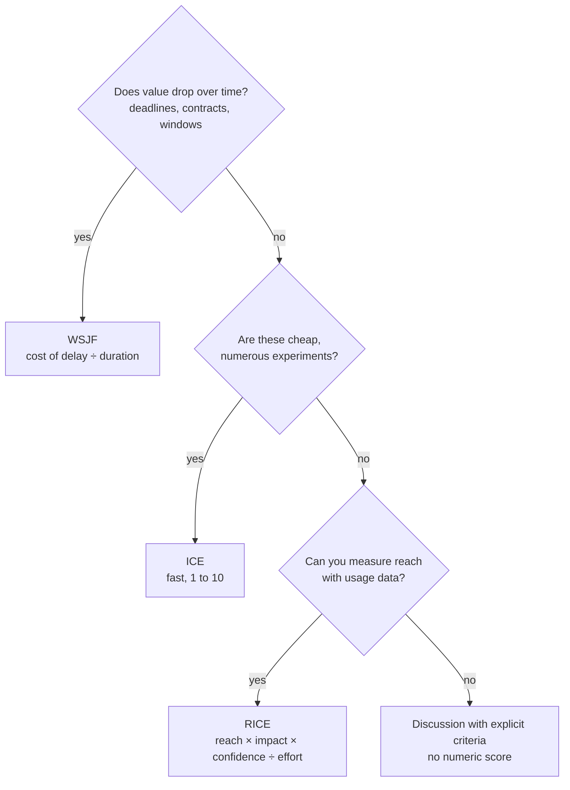
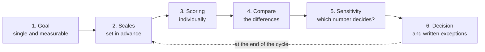

# Prioritization frameworks: RICE, WSJF, ICE

It is quarterly planning. There are twenty initiatives on the table and capacity for five. Sales wants the single sign-on a large customer asked for, product wants to redesign onboarding, the platform team wants to pay down debt in the cache, and someone remembers that invoice export has been promised for a year. Everything sounds important, everything has a champion, and the discussion goes in circles until the most senior person in the room decides.

Prioritizing is not sorting a wish list: it is deciding what will not get done now. **A prioritization framework is an explicit rule that turns a few estimates (value, urgency, confidence, effort) into an order, so the discussion is about those estimates rather than about who pushes hardest.** The framework does not decide for you. It structures the conversation, surfaces the assumptions and leaves a trail you can review later.

This lesson covers three widely used frameworks (RICE, ICE and WSJF) and the idea underneath the third one, cost of delay. It includes a worked example with five initiatives, when each framework misleads, and how to stop it from being used to justify a decision already made. The general approach to reasoning through a decision with explicit criteria lives in [Trade-offs and decision-making](/docs/trade-offs-y-decisiones); how to measure whether the decision worked, in [Measuring decisions: OKRs and KPIs](/docs/medir-decisiones-okr-kpi).

<Callout tone="info" title="Sources and cutoff date">
  Checked in October 2026. RICE rests on Intercom's original article; WSJF on the catalog record of
  Reinertsen's book and SAFe's documentation. Secondary source for ICE: ProductPlan's glossary. Sean
  Ellis's original text is not among the sources consulted, so the attribution is presented as
  secondary.
</Callout>

## Why you need a framework

Without a shared rule, each person prioritizes by a different criterion and does not say so. One looks at revenue, another at the number of users affected, another at a contract deadline, another at what would be interesting to build. The discussion cannot converge because nobody is answering the same question.

A framework forces three things:

- **Naming the factors.** What counts as value, what counts as cost, what to do with uncertainty.
- **Estimating each factor separately.** "How many users does this reach?" is easier to argue about than "is this more important than that?".
- **Combining them with the same rule for every initiative.** Anyone who wants to change the order has to change a specific estimate and explain why.

What a framework does not do is remove judgment. The estimates are still judgment calls; they are just visible now.

## RICE: reach, impact, confidence and effort

Sean McBride published RICE on the Intercom blog in January 2018. The article explains that the product team built it from first principles, after several iterations, because the scoring methods they had tried did not let them compare very different ideas consistently.

The score is reach times impact times confidence, divided by effort. Read the result as total impact per unit of work.

| Factor     | Question                                   | Scale in the original article                                      |
| ---------- | ------------------------------------------ | ------------------------------------------------------------------ |
| Reach      | How many people or events does it affect?  | Count per period (e.g. customers per quarter)                      |
| Impact     | How much does it move the goal per person? | 3 massive, 2 high, 1 medium, 0.5 low, 0.25 minimal                 |
| Confidence | How well supported are the other numbers?  | 100% high, 80% medium, 50% low                                     |
| Effort     | How much total work does it take?          | Person-months across product, design and engineering; 0.5 if small |
| **Score**  | **Reach × Impact × Confidence ÷ Effort**   | **No absolute unit: only useful for comparing within a list**      |

Three details of the original design tend to get lost:

- **Reach comes from real data whenever possible**, not a hunch. The article recommends taking it from product metrics.
- **Impact is a multiple-choice scale**, not a free number. Limiting the options removes the temptation to tune decimals nobody actually knows.
- **Confidence penalizes enthusiasm without data.** Below 50%, the article treats the idea as a moonshot.

The article itself warns that RICE is not a hard rule: there can be reasons to do a lower-scoring project first, such as a dependency or a feature needed to sell to a certain kind of customer. That nuance matters in the worked example.

## ICE: impact, confidence and ease

ICE scores each idea on three dimensions, usually from 1 to 10: **Impact** (how much it would move the target metric), **Confidence** (how much evidence backs that expectation) and **Ease** (how easy it is to execute). Ease plays the inverse role of effort: instead of dividing by the cost, you multiply by its opposite.

It comes from growth teams, where the items being ranked are cheap and numerous experiments rather than multi-month projects. Its advantage there is speed: scoring forty ideas in one session is reasonable with ICE and exhausting with RICE.

<Callout tone="warning" title="ICE's origin and formula per secondary sources">
  ICE is widely attributed to Sean Ellis, who founded GrowthHackers and popularized the term "growth
  hacking". Secondary source: ProductPlan's glossary; the original text in which Ellis introduced it
  is not among this lesson's sources. Secondary descriptions also disagree on how to combine the
  three factors: most multiply them, a few average them. If you use ICE, pick and document your
  combination rule.
</Callout>

The difference between multiplying and averaging is not cosmetic. With the product, an idea with ease 1 sinks even if its impact is 10; with the average, one high factor offsets a low one. Neither option is right in the abstract, but switching between them mid-quarter changes the order.

## Cost of delay

WSJF rests on an idea that needs explaining first. **Cost of delay is the value lost for every unit of time an initiative takes to become available.** A feature that would bring in 10,000 a month and ships three months late has cost 30,000, even though that number never appears on any invoice.

Donald Reinertsen developed this idea in _The Principles of Product Development Flow_ (Celeritas Publishing, 2009). SAFe attributes to him the advice that if you quantify only one thing in product development, it should be cost of delay.

A small example shows why order matters. Two jobs share the same team and cannot run in parallel:

| Job | Cost of delay per week | Duration |
| --- | ---------------------- | -------- |
| X   | 10,000                 | 4 weeks  |
| Y   | 2,000                  | 1 week   |

- **X first.** X finishes in week 4 and accumulates 40,000 of delay cost; Y finishes in week 5 and accumulates 10,000. Total: 50,000.
- **Y first.** Y finishes in week 1 and accumulates 2,000; X finishes in week 5 and accumulates 50,000. Total: 52,000.

X wins, but narrowly, and not because X is worth more: its cost of delay **per week of duration** (2,500) beats Y's (2,000). That ratio is exactly what WSJF computes.

## WSJF: weighted shortest job first

WSJF (_Weighted Shortest Job First_) orders jobs by **cost of delay divided by duration**. Reinertsen presents it in the same book as a sequencing rule for when both cost of delay and duration vary across jobs. If every job has the same cost of delay, the rule reduces to doing the shortest first; if every job takes the same time, to doing the one with the highest cost of delay first.

Black Swan Farming, a site devoted to cost of delay, uses the shorthand CD3 (_Cost of Delay Divided by Duration_) for this ratio when it is computed from economic estimates.

### The SAFe variant

SAFe (Scaled Agile Framework) adopted WSJF and cites Reinertsen as its source. Its variant does not estimate money but relative scores:

| Component                               | What it estimates                                             |
| --------------------------------------- | ------------------------------------------------------------- |
| User-business value                     | Relative value to users and the business                      |
| Time criticality                        | How much value drops if you wait (deadlines, windows, rivals) |
| Risk reduction / opportunity enablement | Risk it removes or future capabilities it unlocks             |
| **Cost of delay**                       | **Sum of the three above**                                    |
| Job size                                | Relative size, used as a proxy for duration                   |
| **WSJF**                                | **Cost of delay ÷ job size**                                  |

SAFe's documentation says to estimate with modified Fibonacci numbers, **one column at a time**, setting the smallest item in the column to 1 and scoring the rest relative to it. It also notes that size is a good proxy for duration only when resources are fixed; if people's availability changes, use actual duration.

For an architect, the third component is the interesting one: it gives explicit weight to enabling work (a migration, a cache, paying down [technical debt](/docs/deuda-tecnica-evolucion)) that in RICE usually ends up with low reach and impact because nobody outside the team sees it.

<Callout tone="warning" title="Adding relative scores has limits">
  SAFe's three components are ordinal scales that get added and then divided. That works as a
  heuristic for conversation, but the result is not an economic figure. Black Swan Farming argues
  that in simplifying cost of delay, SAFe made it less useful. If you can estimate cost of delay in
  money per week, even as ranges, the original ratio is more honest.
</Callout>

## The three frameworks compared

| Aspect              | RICE                                | ICE                                         | WSJF                                                      |
| ------------------- | ----------------------------------- | ------------------------------------------- | --------------------------------------------------------- |
| Verifiable origin   | Intercom, Sean McBride, 2018        | Attributed to Sean Ellis (secondary source) | Reinertsen, 2009; adapted by SAFe                         |
| Factors             | Reach, impact, confidence, effort   | Impact, confidence, ease                    | Cost of delay, duration                                   |
| Handles urgency     | No                                  | No                                          | Yes: it is the whole point                                |
| Handles uncertainty | Yes, through confidence             | Yes, through confidence                     | Not explicitly                                            |
| Enabling work       | Poorly: low direct reach and impact | Poorly                                      | Well, through risk reduction or opportunity               |
| Cost of applying it | Medium: needs reach data            | Low                                         | Medium to high: requires thinking in time                 |
| Best for            | Product features with usage data    | Fast, cheap experiments                     | Portfolios with deadlines, dependencies and platform work |

## Choosing a framework

You do not need one framework per team, nor one for the whole company. The useful question is which trait dominates your list of candidates.



The last branch is deliberate: if there is no data for any of the variables, a formula only adds the look of rigor. In that case a criteria-based comparison like the one in [Trade-offs and decision-making](/docs/trade-offs-y-decisiones) is the better tool.

## A six-step procedure

The framework pays off far more when the session has a fixed shape.



1. **One goal.** Impact is measured against something: conversion, retention, incidents, revenue. If each initiative is scored against a different goal, the numbers are not comparable.
2. **Scales before candidates.** Define what each impact or confidence value means before you see the list, so the scale does not get bent toward the favorite.
3. **Individual scoring.** Everyone scores on their own and then you compare, as in planning poker. This keeps the first number said out loud from anchoring all the others.
4. **Compare.** Large differences between people are the most valuable part of the session: they reveal different assumptions, not arithmetic mistakes.
5. **Sensitivity.** Ask which estimate would have to change for the top spot to change. If moving one shaky number is enough, that number deserves more research rather than more debate.
6. **Decision and exceptions.** The framework's output is a proposal. If you decide to depart from it, write down why; an [ADR](/docs/adr) or a note in the backlog itself is enough.

An anchored scale can take this shape; what matters is that each level describes evidence, not enthusiasm:

```yaml
confidence: # confidence-scale.yaml, illustrative shape
  1.0: own usage data or a previous experiment # …
  0.8: several matching qualitative signals # …
  0.5: team intuition or a single request # …
```

## Worked example: five initiatives, two frameworks

### Context and assumptions

A B2B product with a single team of six. The quarter's goal is to improve account retention. The numbers are assumptions for the example, not real data:

- **A.** Export invoices to CSV. An old and frequent request.
- **B.** Single sign-on with SAML. A large customer requires it to renew in two months.
- **C.** Onboarding redesign. A promising hypothesis, not validated with users.
- **D.** Search cache. Cuts latency and database load.
- **E.** In-app notifications. Validated through interviews.

### RICE scoring

Reach in users per quarter, effort in person-months, impact and confidence scales from the original article.

| Initiative | Reach | Impact | Confidence | R × I × C | Effort | RICE  |
| ---------- | ----- | ------ | ---------- | --------- | ------ | ----- |
| A          | 1,200 | 0.5    | 100%       | 600       | 0.5    | 1,200 |
| B          | 300   | 3      | 80%        | 720       | 4      | 180   |
| C          | 2,000 | 1      | 50%        | 1,000     | 3      | 333   |
| D          | 4,000 | 0.25   | 80%        | 800       | 1      | 800   |
| E          | 1,500 | 1      | 80%        | 1,200     | 2      | 600   |

Before dividing by effort, the order is E, C, D, B, A. After dividing, it is A, D, E, C, B. Initiative A goes from last to first: it delivers little per user, but costs half a person-month. That inversion is what the article's figure draws.

### WSJF scoring

The same five initiatives, using SAFe's relative variant: modified Fibonacci, 1 for the smallest item in each column.

| Initiative | Value | Urgency | Risk or opportunity | Cost of delay | Size | WSJF |
| ---------- | ----- | ------- | ------------------- | ------------- | ---- | ---- |
| A          | 3     | 1       | 1                   | 5             | 1    | 5.00 |
| B          | 8     | 13      | 5                   | 26            | 8    | 3.25 |
| C          | 8     | 3       | 2                   | 13            | 5    | 2.60 |
| D          | 1     | 1       | 3                   | 5             | 2    | 2.50 |
| E          | 5     | 2       | 1                   | 8             | 3    | 2.67 |

The order is A, B, E, C, D. Single sign-on climbs from last place to second because the contract renewal gives it an urgency that RICE has nowhere to record.

### Reading the result and deciding

- **A goes first under both frameworks.** It is cheap and does not compete with anything large for capacity. But its RICE lead hinges on a single number: if the real effort were 1 person-month instead of 0.5, its score would drop to 600 and fall behind D. Before committing, confirm that effort.
- **B is the disagreement that matters.** RICE puts it last, WSJF second. Neither is wrong: RICE does not model time. Intercom's own article admits that a feature needed to sell to a particular customer can justify breaking the order. The decision is to do B right after A and to write down that the reason is the renewal date.
- **C, D and E are effectively tied.** In WSJF they are 0.17 points apart on ordinal scales; treating that as a firm order would be false precision. Break the tie with other information: D is enabling work that lowers database load, and C needs validation before committing three person-months.
- **Act on the uncertainty.** A week of interviews on C could raise its confidence from 50% to 80%. Its RICE would go from 333 to 533, still below E. Knowing that up front saves you from debating C for the whole meeting.

## When it helps and when it misleads

### When to use it

- There are more candidates than capacity and the discussion keeps going in circles.
- The initiatives can be compared against the same goal.
- There is data for at least one of the variables (reach, duration, cost of delay).
- You want decisions to be reviewable when the outcome is not what you expected.

### When not to

- There is a non-negotiable constraint: a legal obligation, a critical vulnerability or an ongoing incident. You do not score that, you do it (see [Security by design](/docs/seguridad-por-diseno)).
- The options are few and very different: comparing three architectures is not a backlog problem but a [trade-off](/docs/trade-offs-y-decisiones) problem.
- There is no data at all and every number would be made up. The formula would only give the appearance of rigor.
- The list changes every week: the cost of scoring exceeds the cost of getting it wrong.

### How it misleads

- **Arbitrary scales treated as measurements.** An impact of 2 is not twice an impact of 1 unless the scale was built that way; multiplying and dividing ordinal scales produces numbers that look more precise than they are.
- **Inflated scores.** Whoever champions an initiative tends to push its impact up and its effort down. Without individual scoring and comparison, the framework just amplifies that pressure.
- **False precision.** 2.60 versus 2.67 is not a difference. Round or group into bands before presenting the order.
- **Optimistic effort.** Because effort divides, underestimating it by half doubles the score. Small tasks are the most sensitive to this error.

## Calibrating confidence

Confidence is the easiest factor to game and the most useful when done well. Three practices help:

- **Anchor each level to types of evidence**, as in the scale above. "It seems very likely" is not evidence; "three customers asked for it with the same use case" is.
- **Review predictions at the end of the cycle.** Record the expected impact and compare it with the actual one. If initiatives at 80% confidence miss half the time, the scale is inflated. How to define that measurement is covered in [Measuring decisions: OKRs and KPIs](/docs/medir-decisiones-okr-kpi).
- **Turn low confidence into research work.** An idea at 50% confidence and high effort does not need a better score; reduce the uncertainty first with a prototype or a cheap test.

## Keeping the framework from justifying a done deal

The most common failure mode is not the formula but how it is used: someone already knows what they want and tweaks the numbers until it comes out on top. Signs that this is happening and what to do about it:

| Sign                                                   | Countermeasure                                                |
| ------------------------------------------------------ | ------------------------------------------------------------- |
| Scales are defined after seeing the list               | Fix the scales at the start of the cycle and leave them alone |
| A single person scores everything                      | Several people score individually, then compare               |
| Scores get recalculated until the order matches a wish | Record the first score and every change with its reason       |
| Exceptions to the order go unwritten                   | Every exception gets a written reason and a review date       |
| Nobody compares prediction with outcome                | Review hits and misses at the end of each quarter             |

Deciding against the framework is legitimate. Dressing that decision up as the framework's output is not. The biases that feed this behavior, such as anchoring or sunk cost, are covered in [Systems thinking and biases](/docs/pensamiento-sistemico-y-sesgos).

## Common mistakes

- **Treating the framework as an oracle.** The order is a proposal to discuss, not an automatic decision.
- **Mixing goals.** Scoring one initiative's impact on revenue and another's on retention makes the numbers incomparable.
- **Ignoring time.** RICE and ICE do not know a contract expires in two months. If urgency matters, use WSJF or record the exception.
- **Penalizing enabling work.** Platform work and technical debt score low on direct reach. If they always end up last, the framework is measuring value badly.
- **Comparing scores across teams.** Each team calibrates its scales its own way; a RICE of 800 in one team does not equal 800 in another.
- **Switching frameworks every quarter.** You lose the ability to compare predictions with outcomes.
- **Never reviewing.** Without comparing estimate and outcome, confidence never gets calibrated and the same mistakes repeat.

## Checklist

- [ ] There is a single goal against which impact or value is measured.
- [ ] The scales for each factor are defined and anchored to evidence before you see the list.
- [ ] The chosen framework matches the dominant trait: urgency (WSJF), volume of experiments (ICE) or measurable reach (RICE).
- [ ] Several people score separately and large differences get discussed.
- [ ] You have checked which estimate decides the top spot and whether it is reliable.
- [ ] Close scores are treated as ties, not as a firm order.
- [ ] Every exception to the order has a written reason.
- [ ] At the end of the cycle, predictions are compared with outcomes.

## Sources

Checked in October 2026.

- [RICE: Simple prioritization for product managers (Sean McBride, Intercom, January 5, 2018)](https://www.intercom.com/blog/rice-simple-prioritization-for-product-managers/)
- Donald G. Reinertsen, _The Principles of Product Development Flow: Second Generation Lean Product Development_, Celeritas Publishing, 2009 (ISBN 978-1-935401-00-1). Record on [WorldCat](https://search.worldcat.org/title/435994279); the book's content is cited through SAFe and Black Swan Farming
- [Weighted Shortest Job First, SAFe](https://framework.scaledagile.com/wsjf/) (partial public version) and an [archived 2016 copy](https://webarchive.library.unt.edu/web/20161225132214mp_/http://www.scaledagileframework.com/wsjf) with the formula, components and estimation method
- [WSJF: Weighted Shortest Job First, Black Swan Farming](https://blackswanfarming.com/wsjf-weighted-shortest-job-first/)
- ICE. Secondary source: [ProductPlan's glossary](https://www.productplan.com/glossary/ice-scoring-model); Sean Ellis's original text is not among these sources
