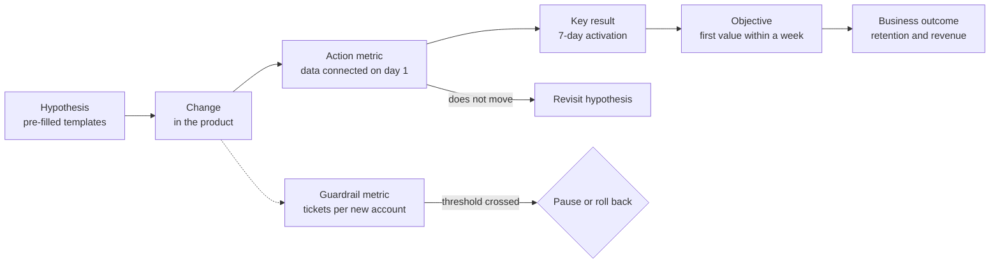

# Measuring decisions: OKRs, KPIs and guardrail metrics

You open the quarterly dashboard and find forty charts. Most go up, a few go down, and nobody knows which one matters. In the review someone asks what you will do differently, and the answer is "keep monitoring". The team hit its OKRs, yet customers complain more than before and support is overwhelmed. Measuring a lot is not the same as measuring to decide.

**A decision metric is a number with a definition, an owner and a threshold that, once crossed, changes what you are going to do.** If no possible value of the metric would change a decision, it is decoration: it may be useful context, but it does not deserve a slot in the review.

This article separates three tools that are often blended together (KPIs, OKRs and guardrail metrics), explains why metrics degrade once they become targets, and proposes a concrete way to write a metric and chain it from hypothesis to business outcome. It closes with a worked example using assumed numbers. Deciding what to tackle first is covered in [prioritization frameworks](/docs/marcos-de-priorizacion); experiment design, in [continuous improvement and experiments](/docs/mejora-continua-y-experimentos).

<Callout tone="info" title="Sources and cut-off date">
  Checked in October 2026. The origin of OKRs relies on John Doerr's account. Secondary source: the
  Wikipedia entry on OKRs; the full text of High Output Management is not among the sources
  consulted. Goodhart's wording comes from reference sources that cite his 1975 paper, and
  Campbell's from the reprint of his 1976 essay.
</Callout>

## Measure to decide, not to decorate

Before adding a metric to a dashboard, ask it three questions:

1. **Which decision does it inform?** Launch, pause, roll back, invest more, hire, change approach. If there is no answer, it is not a decision metric.
2. **Which value triggers that decision?** Without a threshold, any reading can be interpreted in favor of what you already believed.
3. **When does the reading arrive?** A metric that takes ninety days to move is useless for a decision you review every week.

These three questions rule out many popular figures: total visits, deployment counts without context, lines of code, hours worked. They are not worthless, but they rarely change a decision on their own.

Measuring also has a cost: instrumentation, keeping the definition stable, checking data quality and spending meeting time. That cost pays off when the metric prevents a wrong decision or brings it forward. For cheap, reversible decisions, trying and observing is often enough; the general criteria live in [trade-offs and decisions](/docs/trade-offs-y-decisiones).

## KPIs and OKRs: two different tools

KPIs and OKRs show up together in almost every slide deck, but they answer different questions. Mixing them up is behind many useless dashboards.

### KPIs: business health

A **key performance indicator** (KPI) tracks something that must stay healthy over time: recurring revenue, churn, margin, service availability, customer response time. The term cannot be traced to a single author; it is general-purpose management vocabulary.

A KPI works like a vital sign. It is not meant to change this quarter; it is meant to warn you when something drifts out of range. That is why a good KPI has an acceptable range rather than a target, and keeps the same definition for years so its history stays comparable.

### OKRs: objectives and key results

**OKRs** combine a qualitative **objective**, which states where you want to go, with a few measurable **key results**, which tell you whether you are getting there. They are time-boxed: set for a period, usually a quarter, and closed with a score.

The traceable origin goes like this:

- **Peter Drucker** popularized management by objectives (MBO) in the 1950s; the work usually cited is _The Practice of Management_ (1954).
- **Andy Grove**, at Intel in the 1970s, adapted that idea and added key results. According to Doerr's account as summarized in the Wikipedia entry on OKRs, the system was then called "iMBO" (Intel Management by Objectives). Grove described it in _High Output Management_ (1983) through two questions: where you want to go (the objective) and how you will pace yourself to know you are getting there (the key results).
- **John Doerr** attended an internal course taught by Grove at Intel in 1975, by his own account. Later, as an investor, he introduced the method to Google's founders in 1999 and spread it through his book _Measure What Matters_ (2018).

Google's OKR guide (re:Work) adds practical criteria: few objectives (three to five), about three key results per objective, and key results that describe **outcomes, not activities**. For ambitious goals, the same guide treats achieving between 60% and 70% as reasonable and warns that always hitting 100% suggests the goals are not demanding enough.

### Comparison

| Aspect            | KPI                      | OKR                                    | Guardrail metric                        |
| ----------------- | ------------------------ | -------------------------------------- | --------------------------------------- |
| Question          | Is the business healthy? | What do we want to change this period? | What must not break while we change?    |
| Horizon           | Ongoing, years           | One period (usually a quarter)         | As long as the change it protects lasts |
| Shape             | Acceptable range         | Objective + 3 key results with targets | Threshold that must not be crossed      |
| When out of range | Investigate and correct  | Revisit hypothesis or adjust ambition  | Pause or roll back the change           |
| Example           | Monthly churn 3%         | 7-day activation from 40% to 55%       | Tickets per new account ≤ 0.35          |

An OKR can take a KPI as a key result when the quarter's goal is to move it deliberately. What you should avoid is turning every KPI into an OKR: the quarter fills up with targets and focus disappears.

## Outcome metrics and action metrics

Not all metrics move at the same pace or sit equally close to what the team controls.

- **Outcome metrics** (often lagging): reflect the effect you are after. 90-day retention, revenue, churn. They matter, but they arrive late and many factors move them at once.
- **Action metrics** (leading or input metrics): reflect behaviors the team can influence and that you can read early. Share of accounts that connect a data source on day one, time to first report, teammate invitations.
- **Outputs**: what the team produces. Features shipped, campaigns sent. They are necessary, but they are not success metrics.

| Type    | Reading speed   | Team control   | Main risk                          |
| ------- | --------------- | -------------- | ---------------------------------- |
| Outcome | Weeks or months | Low            | Arrives too late to correct course |
| Action  | Days            | Medium or high | Does not predict the outcome       |
| Output  | Immediate       | Full           | Mistaking activity for progress    |

The link between an action metric and an outcome metric is a **hypothesis**, not a fact. Accounts that connect data on day one may retain better because of it, or simply because only the most motivated customers do so. Treat that link as something to validate with data and, where possible, with an experiment.

## When the metric becomes the target

### Goodhart's law

Economist Charles Goodhart wrote in 1975, in a paper on monetary policy in the United Kingdom published by the Reserve Bank of Australia, that any observed statistical regularity tends to collapse once pressure is placed on it for control purposes. The version that circulates today comes from anthropologist **Marilyn Strathern**, in a 1997 paper on audit in British universities: _"When a measure becomes a target, it ceases to be a good measure."_ Strathern credits that phrasing to a 1996 text by Keith Hoskin.

### Campbell's law

Social psychologist **Donald T. Campbell** stated a neighboring idea in his essay _Assessing the Impact of Planned Social Change_ (Dartmouth College, 1976): the more a quantitative indicator is used for social decision-making, the more exposed it is to corruption pressures and the more it tends to distort the process it was meant to monitor. Goodhart talks about the number losing its informational value; Campbell adds that the process itself gets bent.

In a product team it looks like this:

- Ticket closing time is rewarded, and tickets get closed without being solved.
- An activation target is set, and the definition of "active" gets loosened.
- Team velocity is measured, and estimates get inflated.

### How to protect yourself

No metric is immune, but some practices limit the damage:

- **Pair metrics** that pull in opposite directions: speed with quality, volume with satisfaction, activation with support cost.
- **Add guardrail metrics** with an explicit threshold (next section).
- **Freeze the definition** for the period: changing it mid-quarter is the quietest way to game it.
- **Review concrete cases**, not just aggregates: reading ten closed tickets tells you more than the average closing time.
- **Keep OKRs apart from performance reviews.** Google's guide states that OKRs are not synonymous with performance evaluation; if the score decides the bonus, the pressure to dress it up follows.

## Guardrail metrics: protect what you must not break

A **guardrail metric** does not measure what you want to improve; it measures what must not get worse while you improve something else. It has a threshold, not a target: while it stays inside, there is nothing to do; if it crosses, the change is paused or rolled back even if the key result looks good.

The term took hold in online experimentation. Ron Kohavi, Diane Tang and Ya Xu cover two families in _Trustworthy Online Controlled Experiments_ (Cambridge University Press, 2020): **organizational** guardrails, which protect the business (latency, errors, revenue), and **trust-related** guardrails, which detect whether the experiment itself is broken, such as an imbalance in how users are split between variants.

Outside experiments the idea works just as well. To choose them, ask: if this team hits its OKR in the cheapest possible way, what would it break? Typical answers:

- **Cost**: support, infrastructure, discounts. The [FinOps](/docs/finops-costo-como-atributo) article treats cost as an architecture attribute.
- **Perceived quality**: complaints, refunds, early cancellations.
- **Technical attributes**: latency, errors, availability. Here a guardrail looks a lot like a [fitness function](/docs/fitness-functions) or a service level objective from [quality attributes](/docs/atributos-de-calidad).
- **Other teams**: load pushed onto sales, operations or another product.

Two guardrails per OKR are usually enough. If you need five, the objective is probably poorly framed or the change is too broad.

## How to write a good metric

A metric without a spec gets reinterpreted in every meeting. The minimum spec has five fields:

| Field              | What it answers                                | Typical failure when missing                      |
| ------------------ | ---------------------------------------------- | ------------------------------------------------- |
| Definition         | Numerator, denominator, window and exclusions  | Two teams reporting different figures             |
| Data source        | Table, event or source system                  | Nobody can reproduce the number                   |
| Frequency          | How often it is read and on which cohort       | Reading incomplete cohorts as if they were closed |
| Owner              | Who answers for the definition and the reading | The metric breaks and nobody notices              |
| Decision threshold | Which value triggers which action              | Any figure "looks fine"                           |

A spec can be as simple as this (a template of fields, not a real configuration):

```yaml
metric: activation_7d
definition: accounts with >= 1 report sent within 7 days / sign-ups in cohort
source: product events # …
frequency: weekly, closed cohorts only
owner: onboarding PM
decision_threshold:
  green: '>= 50%' # continue
  amber: '45-50%' # revisit hypotheses
  red: '< 45%' # rethink the approach
guardrails: [tickets_14d <= 0.35, new_arpa >= 47.5]
```

Two details matter more than they seem. The **denominator** decides almost everything: activation over all sign-ups or over verified sign-ups gives very different figures. And the **window**: this week's cohort has not had seven days to activate yet, so mixing it with closed cohorts drags the figure down artificially.

If the decision the threshold triggers is significant, record it with its reasoning in an [ADR](/docs/adr) or in whatever decision document the team uses.

## From hypothesis to business outcome

A metric on its own explains nothing. What helps is the **chain**: which change you make, which behavior you expect it to cause, which key result it should move and why that matters to the business. Every link is a hypothesis that can break.



Read left to right, the chain states what you expect. Read right to left, it tells you where to look when something does not move: if the action metric rises but the key result does not, the link between them was false; if not even the action metric moves, the change did not produce the expected behavior. Cause and effect in systems with feedback loops are covered in [systems thinking and biases](/docs/pensamiento-sistemico-y-sesgos).

Software delivery metrics, such as the DORA metrics, are another branch of the same tree: they measure the capacity to deliver, not the effect of what is delivered. They are discussed alongside workflow in [value flow and bottlenecks](/docs/flujo-de-valor-y-cuellos-de-botella).

## When to use it and when not to

**When it is worth** setting up OKRs, KPIs and guardrails with full specs:

- When several teams need to align on the same outcome and need a common language.
- When the change has plausible side effects on cost, quality or other teams.
- When the decision is expensive to reverse and you want to agree up front on what evidence would change it.
- When the outcome is slow to show and you need action metrics that warn you earlier.

**When not to**, or not with the full apparatus:

- In a small team with one obvious goal: a single well-defined metric and a weekly conversation may be enough.
- In exploratory work where you do not yet know what to measure: learn first, set targets later.
- When data volume is so low that variation is noise: with twenty sign-ups a month, a move from 40% to 55% may be chance.
- For mandatory work (a regulatory change, a migration with a deadline): those are commitments, not key results.

## Common mistakes

- **Too many indicators.** Forty metrics are as good as none. If everything is on the dashboard, nothing has an owner. Limit the review to key results, health KPIs and their guardrails.
- **Metrics without thresholds.** Without a value that triggers an action, any reading can justify what was going to happen anyway.
- **OKRs that are task lists.** "Launch the new wizard" is an output. The key result is what you expect to change because of it. Google's guide flags verbs such as _consult_, _help_, _analyze_ or _participate_ as warning signs: they describe activity, not impact.
- **Measuring what is easy.** Teams measure what is already instrumented instead of what matters. If the relevant metric needs new instrumentation, that work belongs in the OKR.
- **Changing the definition mid-period.** It breaks comparability and, even in good faith, looks like gaming.
- **Key results you can only read at the end.** If all three key results are known on the last day of the quarter, there is no room to correct course. Pair at least one fast signal with the slow ones.
- **Ignoring the cost of measuring.** Instrumentation, data quality and review time. A metric nobody looks at should be retired.

## Worked example: activating new customers

**Assumed context.** A B2B reporting SaaS gets 2,000 sign-ups a month. Average revenue per account (ARPA) is 50 USD a month. Today 40% of accounts send their first report within seven days. Historical data (assumed) shows that after 90 days, 80% of activated accounts and 25% of non-activated accounts are retained.

**Current state per monthly cohort.** 800 activated accounts × 0.80 = 640 retained; 1,200 non-activated × 0.25 = 300 retained. Total: 940 out of 2,000, or 47% retention at 90 days.

**The quarter's OKR.**

```text
Objective: new customers get value in their first week
  KR1: 7-day activation from 40% to 55%
  KR2: median days to first report from 4 to 2
  KR3: 90-day retention of the first month's cohort from 47% to 55%
```

**Why those numbers.** At 55% activation: 1,100 × 0.80 = 880 retained; 900 × 0.25 = 225 retained. Total: 1,105, or 55% rounded. The difference is 165 more retained accounts per cohort, which at 50 USD means 8,250 USD of additional monthly recurring revenue for each cohort. KR3 depends on the link between activation and retention holding; it is the weakest hypothesis, which is exactly why it is measured.

**The three health KPIs** (not quarterly targets, just ranges):

| KPI                       | Current value | Acceptable range |
| ------------------------- | ------------- | ---------------- |
| Monthly recurring revenue | 400,000 USD   | Does not drop    |
| Monthly churn             | 3%            | ≤ 3.5%           |
| Gross margin              | 72%           | ≥ 70%            |

**The two guardrails.** To raise activation, the team tries three hypotheses: H1, pre-filled templates; H2, a wizard to connect data; H3, making data connection mandatory on first login. The cheapest way to hit the OKR would be to push customers at any cost, so two things are protected:

| Guardrail metric                          | Baseline | Threshold  | Action if crossed            |
| ----------------------------------------- | -------- | ---------- | ---------------------------- |
| Support tickets per new account (14 days) | 0.30     | ≤ 0.35     | Pause the responsible change |
| ARPA of new accounts                      | 50 USD   | ≥ 47.5 USD | Review discounts or plans    |

**Reading at week 6.** Activation for closed cohorts is at 49% (amber), median time to first report is down to 3 days, new-account ARPA is 49.80 USD, and tickets per new account have climbed to 0.42. The support guardrail has been crossed.

**Decision.** Broken down by variant, the tickets cluster in accounts that see H3: mandatory connection blocks people who do not have credentials at hand. H3 is removed and H1 and H2 stay. By week 9 activation reaches 53% and tickets drop back to 0.33. Without the guardrail, the team would have celebrated a rising 49% while shifting the cost onto support.

**End of quarter (assumed).** KR1 at 54% (0.93: it covered 14 of the 15 planned points), KR2 at 2 days (1.0) and KR3 still pending: the first month's cohort does not reach 90 days until the start of the next quarter. That delay was expected, and it is the reason KR1 and KR2 exist as early signals.

## Checklist

- [ ] Every metric on the dashboard states which decision it informs and which value triggers it.
- [ ] KPIs have an acceptable range; OKRs, a target and a period; guardrails, a threshold.
- [ ] Each OKR has at most three key results, and they describe outcomes, not tasks.
- [ ] At least one key result can be read in days, not only at the end of the period.
- [ ] Each OKR has one or two guardrails covering its most likely side effect.
- [ ] Each metric has a spec: definition, source, frequency, owner and threshold.
- [ ] The definition does not change during the period; if it does, the change is documented and history is recalculated.
- [ ] The chain from hypothesis to business outcome is written down and revisited when reading the data.

## Sources

- Andrew S. Grove, _High Output Management_ (Random House, 1983): bibliographic reference; its content is cited through Doerr and Wikipedia.
- John Doerr, _Measure What Matters_ (Portfolio, 2018) and the origin story on whatmatters.com ("The OKR Origin Story").
- Wikipedia, "Objectives and key results": Grove's 1975 course and the iMBO name.
- Google re:Work, "Set goals with OKRs": number of objectives, outcomes versus activities and indicative scoring.
- Charles A. E. Goodhart, "Problems of Monetary Management: The UK Experience", _Papers in Monetary Economics_, vol. 1, Reserve Bank of Australia, 1975.
- Marilyn Strathern, "'Improving ratings': audit in the British University system", _European Review_ 5(3), 1997, pp. 305–321.
- Donald T. Campbell, _Assessing the Impact of Planned Social Change_, Occasional Paper No. 8, Public Affairs Center, Dartmouth College, 1976 (reprinted in _Journal of MultiDisciplinary Evaluation_, 2011).
- Ron Kohavi, Diane Tang and Ya Xu, _Trustworthy Online Controlled Experiments_ (Cambridge University Press, 2020), chapters 7 and 21.
