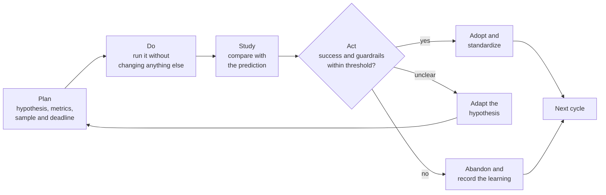

# Continuous improvement and experiments

A team decides to review code in pairs "because it will be faster". Nobody writes down how long reviews took before. Three months later, some people say it works and others say it doesn't, and the argument is settled by seniority. On another team, an A/B test of the checkout form is stopped on day three because the dashboard already showed a "significant" lift; a month later, conversion is back where it always was. Both cases share one flaw: something changed without anyone deciding in advance which result would confirm or refute the change.

**Continuous improvement is the practice of changing a system in small steps, each framed as a hypothesis that is tested against data before it becomes the new standard.** An experiment is the unit of that work: a bounded change with a prediction, a metric, a deadline and a decision agreed beforehand for every possible outcome.

This lesson covers the origin of the PDSA cycle (and its relative PDCA), kaizen and the improvement kata. It then explains how to design a product or process experiment, how to spot one that isn't worth running, and how to turn retrospectives into a real improvement loop. Choosing the metrics themselves is covered in [measuring decisions with OKRs and KPIs](/docs/medir-decisiones-okr-kpi); finding where work gets stuck, in [value flow and bottlenecks](/docs/flujo-de-valor-y-cuellos-de-botella); and the biases that distort how you read data, in [systems thinking and biases](/docs/pensamiento-sistemico-y-sesgos).

<Callout tone="info" title="Sources and cutoff date">
  Consulted in October 2026. The history of the cycle comes from Moen and Norman's article in
  Quality Progress (2010). Secondary source: what is summarized from the books by Rother, Kerth,
  Derby and Larsen, and Kohavi, Tang and Xu comes from the publisher or from published summaries,
  and is noted in each case.
</Callout>

## Where it comes from: PDSA, PDCA and kaizen

### The Shewhart and Deming cycle

In his 1939 book, _Statistical Method from the Viewpoint of Quality Control_, Walter Shewhart described three steps of mass production (specification, production and inspection) and compared them to the steps of the scientific method: forming a hypothesis, running an experiment and testing the hypothesis. W. Edwards Deming, who worked closely with those ideas, presented a version in 1950 at a seminar in Japan organized by the Union of Japanese Scientists and Engineers (JUSE): a wheel of design, production, sales and research.

According to Masaaki Imai, Japanese executives recast that wheel as the **plan-do-check-act (PDCA)** cycle. Moen and Norman date that Japanese version to 1951 and add that Kaoru Ishikawa expanded the planning step (setting goals and the methods to reach them), and that PDCA with his changes can be traced to S. Mizuno in 1959.

Deming never embraced PDCA. From 1986 he reintroduced the cycle in his seminars, and in 1993 he called it the "Shewhart cycle for learning and improvement": **plan-do-study-act (PDSA)**. In a 1990 letter to Ronald Moen he put it in writing: "Be sure to call it PDSA, not the corruption PDCA". His point was that _check_ suggests inspecting or holding back, while _study_ means comparing the result with the prediction and learning from the gap. In practice, many teams use the two names interchangeably; what matters is that the third step compares against a prediction made beforehand, rather than merely confirming that something was done.

| Phase | Question it answers                                       | What it produces                                            | Typical mistake                                       |
| ----- | --------------------------------------------------------- | ----------------------------------------------------------- | ----------------------------------------------------- |
| Plan  | What do we change, what do we expect, how will we see it? | Hypothesis, numeric prediction, metrics, deadline, decision | Planning the change without writing the prediction    |
| Do    | Was the change carried out as designed?                   | The change in place and the data collected                  | Changing other things at the same time                |
| Study | Does the result match the prediction? Why not?            | Comparison with the prediction and what was learned         | Asking only "did it improve?", with no prior forecast |
| Act   | Do we adopt, adapt or abandon?                            | New standard, new hypothesis or a record of the discard     | Not standardizing, so the system drifts back          |

### Kaizen: improvement as daily work

_Kaizen_ (改善) means "improvement" in Japanese. The term spread in the West with Masaaki Imai's book _Kaizen: The Key to Japan's Competitive Success_ (1986). On its official Toyota Production System page, Toyota describes kaizen as daily incremental improvement carried out by all employees and presents it as the foundation of _jidoka_ (automation with a human touch). Moen and Norman note that in Japan the PDCA cycle, the seven basic quality tools and the "QC story" format became the standard tools of kaizen.

Two traits set kaizen apart from a typical improvement program. The first is scale: small, frequent changes close to the work, not transformation projects. The second is who improves: the people doing the work, not a separate department. For a software team, this means improving its own delivery process every week, the same way it improves its code.

### The improvement kata

Mike Rother published _Toyota Kata_ (McGraw-Hill, 2009), based on his study of how Toyota teaches improvement. A _kata_ is a routine you practice until it becomes habit. The **improvement kata** has four steps:

1. **Understand the direction or challenge**: where you want to get to in the long run.
2. **Grasp the current condition**: how the process works today, from data and direct observation.
3. **Establish the next target condition**: how the process should work at a near date, a few weeks or months out.
4. **Move toward it through experiments**: pick one obstacle at a time and try a step, comparing what you expected with what happened.

Rother separates a **target** (an outcome, such as "pieces per hour") from a **target condition** (a description of how the process should operate); secondary source: published summaries of the book. The difference matters: "cut review time to 8 hours" is a target; "every pull request gets a first review in the morning or afternoon slot" is a condition you can observe and experiment with.

The **coaching kata** goes with it: a manager or lead asks the learner five short questions on a regular basis. The wording varies by source, but the structure is stable: what is the target condition, what is the actual condition now, which obstacles are in the way and which one you are working on, what is your next step and what you expect, and when can we go and see what you learned.

### How they relate

| Practice         | Unit of change                        | Typical cadence           | Who drives it                | What it leaves behind                     |
| ---------------- | ------------------------------------- | ------------------------- | ---------------------------- | ----------------------------------------- |
| PDSA / PDCA      | One change with a prediction          | As long as the experiment | Whoever proposes the change  | A new standard or a discarded hypothesis  |
| Kaizen           | Small improvements in daily work      | Continuous                | The team doing the work      | A slightly better process every week      |
| Improvement kata | One obstacle toward a condition       | Cycles of days or weeks   | Learner and coach            | The habit of experimenting, condition met |
| Retrospective    | Team agreements about its own process | End of every iteration    | The team, with a facilitator | One or two actions with an owner          |
| A/B experiment   | One variant against a control         | Whole weeks               | Product, with data           | A decision to ship or discard             |

All five share the PDSA core. What changes is scale and who decides. The culture that sustains them (continuous learning, blameless postmortems) is covered in [DevOps and its culture](/docs/devops-cultura).

## What turns a change into an experiment

A change becomes an experiment when, before running it, you can answer seven questions. Write them on a short card; the shape matters more than the tool:

```yaml
# experiment card (a shape, not a mandatory template)
hypothesis: 'If <change>, then <metric> moves from <baseline> to <value>, because <reason>'
success_metric: <exactly one>
guardrails: [<what must not get worse>, <threshold>]
min_sample: <units per variant>
duration: <start and end dates, whole weeks>
early_stop: <only if a guardrail crosses its threshold>
decision: { passes: <what we do>, fails: <what we do>, unclear: <what we do> }
owner: <one person>
```

### A testable hypothesis

A useful hypothesis names the change, the metric, the direction and size of the expected effect, and why you think it will happen. "Improve the checkout experience" isn't testable; "allowing guest checkout lifts checkout conversion from 10% to 11%, because 30% of people who abandon do so at the sign-up step" is. The reason matters: if the result doesn't arrive, it tells you which assumption to revisit.

Also write down the **minimum effect you care about**: the smallest change that would justify the cost of keeping the variant. One point of conversion may be worth it; a tenth of a point probably isn't. That number drives the sample size.

### Success metric and guardrails

Pick **one** success metric. With ten metrics, one of them will improve by chance, and the temptation to call it the winner is strong. Also add **guardrail metrics**, what must not get worse even if the main metric improves; what they are and which families Kohavi, Tang and Xu distinguish is explained in [measuring decisions with OKRs and KPIs](/docs/medir-decisiones-okr-kpi).

In an experiment, each guardrail needs a threshold written before you start: "the cancellation rate stays below 2.5%", not "it shouldn't get much worse". That threshold is also the only legitimate reason for an early stop, as shown below.

### Sample size without formulas

The intuition is this: every metric is noisy, and the smaller the effect, the more data you need to tell it apart from the noise. The relationship isn't linear: **detecting half the effect takes roughly four times the sample**. Evan Miller offers a rule of thumb for conversion rates that gives you the order of magnitude; with a 10% baseline conversion it comes out roughly like this:

| Minimum effect you want to detect | Approximate sample per variant |
| --------------------------------- | ------------------------------ |
| +2 points (from 10% to 12%)       | 3,600                          |
| +1 point (from 10% to 11%)        | 14,400                         |
| +0.5 points (from 10% to 10.5%)   | 57,600                         |

Use it to decide whether the experiment is feasible, not to compute the final number; sample size calculators exist for that. If your traffic can't reach the sample in a reasonable time, you have three honest options: look for a larger effect, measure a more sensitive metric closer to the change, or skip the controlled experiment and treat the change as a decision with follow-up monitoring.

### Duration and stopping rule

Set the duration before you start, from the sample and the traffic, and round it up to whole weeks: user and team behavior often differs between weekdays and weekends, and an experiment that sees only part of the weekly cycle ends up measuring the calendar. If the change is visible, a novelty effect can inflate the first few days; a longer run helps you see it.

The stopping rule has two parts. The **planned stop**: the experiment ends on the set date, whatever the numbers say. The **early stop**: only for harm, when a guardrail crosses its threshold. "It's already winning" is not a stopping rule.

### The cost of peeking too early

The usual significance calculations assume the sample size was fixed in advance. If you check the dashboard every day and stop as soon as something reads "significant", each look is one more chance for noise to cross the line. Evan Miller illustrated this in 2010 with a worst-case example in which a variant with no real effect was declared the winner in 26.1% of tests, against a nominal 5%.

There are two ways out. The simple one: fix the sample and the duration and don't decide until the end (looking to watch guardrails is fine; deciding is not). The technical one: use sequential or Bayesian designs built for interim looks, with their stopping rule written down before you start. What doesn't work is looking without a rule. The tendency to read data in favor of what you already believed is covered in [systems thinking and biases](/docs/pensamiento-sistemico-y-sesgos).

<Callout tone="warning" title="Looking is not deciding">
  Checking guardrail metrics daily is responsible. Stopping or shipping the variant because the main
  metric "already won" before the set date invalidates the result.
</Callout>

### Process experiments

Process changes (code review, meetings, on-call, work-in-progress limits) rarely allow random assignment: you can't route half of the pull requests to one way of working without the team cross-contaminating both. You can still experiment with discipline:

- **Measure the baseline before changing anything**: at least as many weeks as the trial will last.
- **Change one thing** and note anything else happening in parallel (holidays, a launch, a new hire).
- **Set a deadline and a rollback**: "four weeks; if it doesn't meet the bar, we go back".
- **Compare with a group that doesn't change** if a similar one exists, even an imperfect one.

The evidence will be weaker than an A/B test's, and you should say so when you present the result. Flow metrics (cycle time, work in progress, wait time) are the natural candidates; they are explained in [value flow and bottlenecks](/docs/flujo-de-valor-y-cuellos-de-botella). A process change that is cheap to undo is a two-way door, in the language of [trade-offs and decisions](/docs/trade-offs-y-decisiones): try it early instead of debating it.

## The full cycle

The experiment lives in the Do and Study phases, but what makes it useful sits at both ends: the prediction written in Plan and the decision made in Act.



All three exits are valid outcomes. An experiment that refutes the hypothesis saves you from investing more in an idea that doesn't work; the real failure is an experiment that ends without a decision.

## Experiments that aren't worth running

Before launching one, check that it meets the minimum. If it doesn't, it will probably burn time without changing any decision.

| Signal                                     | Why it doesn't work                                            | What to do instead                                  |
| ------------------------------------------ | -------------------------------------------------------------- | --------------------------------------------------- |
| No success metric defined                  | Any result can be read as a success                            | Write the metric and minimum effect before starting |
| No end date                                | It stops when convenient, which is peeking                     | Set the duration in whole weeks                     |
| No outcome would change the decision       | The decision is already made; the experiment is decor          | Make the decision and monitor                       |
| Traffic can't reach the sample             | The result will be noise, in either direction                  | Look for a larger effect or a more sensitive metric |
| The change is mandatory (legal, security)  | There is no alternative to compare                             | Do it and measure the impact to mitigate it         |
| The experiment costs more than being wrong | Building the variant costs more than shipping and rolling back | Ship behind a flag and watch the guardrails         |

## Retrospectives as an improvement loop

The last principle of the Agile Manifesto (2001) reads: "At regular intervals, the team reflects on how to become more effective, then tunes and adjusts its behavior accordingly." The retrospective is a common way to do that, and it fits PDSA: it is the Study and Act of the iteration that just ended and the Plan of the next one.

Norman Kerth described the practice in _Project Retrospectives: A Handbook for Team Reviews_ (2001), which includes the so-called _Prime Directive_: the premise that everyone did the best job they could given what they knew, their skills, the resources available and the situation at hand. Its job is to move the conversation from culprits to the conditions of the system. Esther Derby and Diana Larsen, in _Agile Retrospectives_ (2006), propose a five-phase agenda: set the stage, gather data, generate insights, decide what to do and close (secondary source: published summaries of the book).

For a retrospective to be an improvement loop, and not just a conversation, its actions should be treated as small experiments: one or two per iteration, each with an owner, an observable signal and a date to check whether it worked. The next retrospective starts there.

### Retrospective traps

- **Too many actions.** Ten agreements won't get done; one or two might.
- **Actions without an owner or date.** "Improve communication" isn't an action; "Ana proposes a handoff template on Monday and we try it for two weeks" is.
- **No data.** If only memories are shared, the most recent or the loudest wins; bring two or three numbers from the iteration.
- **The same complaint every time.** It is usually a problem the team can't solve alone; escalate it with evidence or stop spending the session on it.
- **Looking for culprits.** It breaks the safety the conversation needs; go back to Kerth's premise.
- **Not reviewing previous actions.** Without that step there is no Study or Act, just Plan on repeat.

## When to use it and when not to

**When to use it:** when the decision is uncertain and there is a cheap way to reduce the uncertainty; when the change affects many people or revenue and you want to know its real effect; when the team is arguing from opinions and one data point would settle it; when the change is reversible and can be tried small.

**When not to:** when there isn't enough traffic or cases to tell the effect from the noise; when the change is mandatory or ethical and doesn't allow a control group; when the decision has already been made; when setting up the experiment costs more than being wrong and rolling back. In those cases, decide, record the decision (an [ADR](/docs/adr) works if it is technical) and monitor.

## Common mistakes

- **Improvements without measurement.** The process changes with no baseline, and months later nobody can say whether it got better. Measure before you change, even with imperfect data.
- **Experiments nobody decides on.** The result is presented, discussed and filed; the variant stays on or gets switched off without an explicit agreement. Agree in Plan what you will do with each outcome and who decides.
- **Process changes without an owner.** "From now on we'll do X" without one person responsible for measuring and reviewing fades within weeks.
- **Choosing the metric afterwards.** With the data in front of you, some metric always improved. The metric goes on the card before you start.
- **Several changes at once.** If it improves, you don't know why; if it gets worse, you don't know either.
- **Not standardizing.** The experiment worked, but nobody updated the guide, the template or the automation, and the system slides back to where it was.
- **Mistaking a novelty spike for an effect.** The first days of a visible change don't represent steady behavior.

## Worked example: sign-up at checkout

**Context.** An online store requires creating an account before paying. Assumptions: about 2,100 visits a day reach the checkout step, checkout conversion is stable at 10%, and the order cancellation rate is 2%.

**Plan.** Hypothesis: "Allowing guest checkout lifts checkout conversion from 10% to 11%, because mandatory sign-up is the step with the most drop-offs." Success metric: checkout conversion. Guardrails: order cancellations below 2.5% and checkout page p95 latency below 800 ms. Minimum effect: +1 point, which by the table above needs about 14,400 visits per variant. With 2,100 daily visits split 50/50, each variant gets 1,050 a day: 14 days give 14,700 per variant. Duration: two whole weeks. Early stop: only if cancellations exceed 3% for two days in a row. Agreed decision: if conversion rises by at least one point with guardrails within threshold, adopt; if it rises less, adapt the hypothesis; if it drops, discard. Decision owner: the checkout product manager.

**Do.** Traffic is split 50/50. On day four the dashboard shows +2.5 points flagged as significant; the team doesn't stop, because the card says two weeks.

**Study.** Results on day 14:

| Metric               | Control (sign-up) | Variant (guest) | Threshold |
| -------------------- | ----------------- | --------------- | --------- |
| Checkout visits      | 14,700            | 14,700          | ≥ 14,400  |
| Orders               | 1,470             | 1,646           | —         |
| Checkout conversion  | 10.0%             | 11.2%           | ≥ 11.0%   |
| Cancelled orders     | 29 (2.0%)         | 35 (2.1%)       | < 2.5%    |
| Checkout p95 latency | 640 ms            | 655 ms          | < 800 ms  |

The difference is 1.2 points (176 more orders over two weeks). With these numbers, an approximate 95% confidence interval for the difference runs from 0.5 to 1.9 points: the effect is real, though it may be smaller than the day-four reading, which was largely noise. Both guardrails are within threshold and the split is exactly 50/50, so there is no sign of an assignment problem.

**Act.** The variant clears the minimum effect and respects the guardrails: it is adopted. The standard is updated (the variant becomes the default flow, the flag is removed and the change is documented). The learning feeds the next cycle: if sign-up was the barrier, the next hypothesis is offering account creation after payment, with the sign-up rate as the success metric and checkout conversion as a guardrail.

## Checklist

- [ ] The hypothesis names the change, the metric, the expected effect and the reason.
- [ ] There is one success metric, and each guardrail has a written threshold.
- [ ] Sample size and duration in whole weeks were set before starting.
- [ ] Early stopping is allowed only for harm on a guardrail.
- [ ] It is agreed what happens with each outcome and who decides.
- [ ] Every process change has an owner, a baseline and a review date.
- [ ] Retrospective actions are reviewed at the start of the next one.
- [ ] What is adopted gets standardized, and what is discarded gets recorded.

## Sources

Consulted in October 2026.

- [Circling Back: Clearing up myths about the Deming cycle (Ronald D. Moen and Clifford L. Norman, Quality Progress, November 2010)](https://qi.elft.nhs.uk/wp-content/uploads/2026/02/ron-cliff-circling-back.pdf): history of Shewhart (1939), the 1950 wheel, PDCA, PDSA (1993) and Deming's 1990 letter
- [PDCA on Wikipedia](https://en.wikipedia.org/wiki/PDCA)
- [Toyota Production System (Toyota, official page)](https://global.toyota/en/company/vision-and-philosophy/production-system/): kaizen and jidoka
- Masaaki Imai, _Kaizen: The Key to Japan's Competitive Success_ (1986). Secondary source: Moen and Norman
- [Toyota Kata on Wikipedia](https://en.wikipedia.org/wiki/Toyota_Kata): Mike Rother's book (McGraw-Hill, 2009) and the steps of the improvement kata
- [Coaching Kata Questions (UCSF)](https://pmo.ucsf.edu/node/331) and [AME Kata Resources](https://ame.org/kata-resources): the five questions. Secondary sources
- [Trustworthy Online Controlled Experiments (Kohavi, Tang and Xu, Cambridge University Press, 2020)](https://www.cambridge.org/core/books/trustworthy-online-controlled-experiments/sample-ratio-mismatch-and-other-trustrelated-guardrail-metrics/8DBB0F59AC7729D7BC6B94690DB9CCD5): chapter on guardrail metrics
- [How Not To Run an A/B Test (Evan Miller, April 18, 2010)](https://www.evanmiller.org/how-not-to-run-an-ab-test.html): the cost of peeking and the sample size rule of thumb
- [Principles behind the Agile Manifesto](https://agilemanifesto.org/principles.html)
- [The Prime Directive (Retrospective Wiki)](https://www.retrospectivewiki.org/index.php?title=The_Prime_Directive): Norman Kerth's text
- Esther Derby and Diana Larsen, _Agile Retrospectives: Making Good Teams Great_ (2006): the five phases. Secondary source: published summaries of the book
