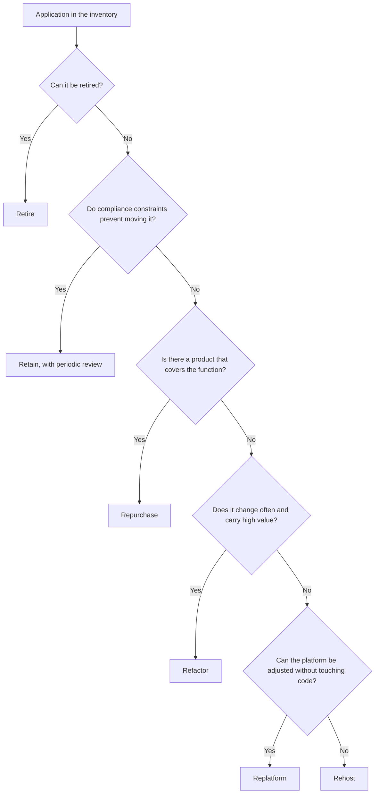

Migrating to the cloud is not a single decision about the whole portfolio. It is a collection of small
decisions, one per application, and each carries a different cost, risk and benefit. The thesis of this
article is that the choice of strategy should come from four questions about each application (what it
contributes to the business, how much it changes, how coupled it is and what it costs to keep running),
not from a general preference for "rewriting everything" or for "moving it as it is".

The six-strategy model, known as the six Rs, is widely used in industry and in cloud providers'
documentation. It works as a shared vocabulary: it lets the team, leadership and the provider talk about the
same thing. It is not a recipe, and it is best used as a list of options that each need a justification, not
as an automatic classification procedure.

<Callout tone="info" title="Migrating is not the same as modernising">
  A rehost can leave an application exactly as it was, with the same defects, on another machine.
  That has value if the goal was to leave a data centre by a deadline. If the goal was lower cost or
  faster delivery, rehosting does not solve that on its own.
</Callout>

## The six strategies in one sentence each

- **Rehost** (move as is, sometimes called _lift and shift_): the application moves to cloud infrastructure
  without code changes. It is the fastest path and introduces the least functional risk, and it offers the
  least improvement.
- **Replatform** (move with adjustments): platform components change without touching the business logic, for
  example moving from a database installed on a virtual machine to a managed database.
- **Repurchase** (replace with a product): the in-house application is dropped and a third-party service covers
  the same function, such as a hosted CRM instead of an internal one.
- **Refactor** or **re-architect** (redesign): the architecture changes to take advantage of the cloud, for
  example by splitting a monolith or adopting managed queues and storage. It is the most expensive option and
  the one that can add the most value if the application changes often.
- **Retire**: the application is switched off because nobody uses it or another system covers its function. It
  is the cheapest strategy and the least used, because it requires deciding that something is no longer needed.
- **Retain** (keep for now): it stays where it is. The reasons may be compliance constraints, a migration that
  does not pay back, or dependence on hardware that cannot move.

The six are not exclusive over time. An application can start as a rehost to leave a data centre within a
contract's term, and later move to replatform or refactor when the team has capacity. What matters is recording
the decision and its next step.

## Criterion 1: business value and rate of change

The first thing to know about an application is not its technology but how much it matters and how often it
changes. An application that carries revenue and changes every week justifies an investment in redesign. An
internal lookup tool that has not changed in two years probably only needs to move, or someone should decide to
retire it.

A simple way to sort the portfolio is to place each application on two axes: business value on one, frequency of
change on the other. Applications with high value and frequent change are candidates for refactor, because each
architectural improvement pays off over many deliveries. Those with low value and no change are candidates for
retirement or repurchase. The rest are split between rehost and replatform depending on coupling, which is the
next question.

A common mistake is deciding by age. An old application can be the most valuable one in the company, and a new
one can be a prototype nobody uses. Age tells you about technical risk, not value.

## Criterion 2: coupling and data

Coupling determines how hard it is to move an application without breaking it. An application that depends on a
specific network resource, on an internal directory or on a database shared with three other systems does not
move alone. It moves with everything around it, and the migration plan has to include those neighbours.

Data is the most delicate part. Moving a database means deciding when it is copied, how it stays in sync during
the transition and how you verify the result is correct. The strategy for
[database migrations without downtime](/docs/migraciones-bd-sin-downtime) describes the expand and contract
patterns that make that move possible without stopping the service. If the application cannot tolerate that
procedure, a rehost with a managed database may not be viable, and the decision leans towards retain or towards
a phased plan.

Mapping dependencies is a task that is often underestimated. A diagram of data flows and calls between systems,
even an approximate one, prevents a Monday migration from leaving a monthly report that nobody had documented
without its input data.

## Criterion 3: running cost and exit cost

Moving to the cloud changes the cost of operation, but not always downwards. Rehosting an underused machine can
cost more than the hardware it replaces, because the cloud charges for what is reserved, not only for what is
used. That is why each strategy should come with an estimate of monthly cost before and after, in the same units.

Exit cost also deserves attention. An application that uses very specific managed services from one provider is
cheaper to run, but more expensive to move later. That is not an argument against those services; it is an
argument for deciding with open eyes. The analysis in [exit from the cloud](/docs/salida-de-la-nube) and the one
on [cost as an attribute](/docs/finops-costo-como-atributo) help put that risk into numbers.

## Criterion 4: compliance, residency and risk

Some applications cannot move to any region or any provider for legal or contractual reasons. Personal data with
residency requirements, systems regulated by financial or health sectors, and contracts that forbid subcontracting
certain processing are constraints that decide the strategy before any technical criterion does.

These constraints must be known at the start, not at the end. An application discovered to be non-migratable in
the middle of a wave forces a rewrite of the plan. The way to avoid that is to include each application's compliance
obligations in the inventory, with the owner who confirms them.

## Wave order and dependencies

Moving the whole portfolio at once is not realistic. It is grouped into waves, and the order of the waves is set by
dependencies and risk, not by size. A good practice is to start with low-risk applications that let the team learn
the procedure (how the network is built, how secrets are handled, how monitoring works), and leave for later the
ones with many neighbours or critical data.

The diagram below summarises how the strategy is chosen for one application. It is a simplification: real questions
have nuances, but the order of decisions is what matters.

Branches that send an application to retain or rehost should carry a review date. An application that stays as a
rehost with no improvement plan turns, after a few years, into debt shaped like a data centre in the cloud.

## Measure before and after

A migration without comparable metrics proves nothing. Before moving an application, take a baseline: availability,
latency at the percentiles that matter, monthly cost, deployment time and number of incidents. After the move, the
same metrics over the same observation window decide whether the migration was worth it.

The usual trap is measuring only cost. A rehost can worsen latency or reliability while saving on the invoice, and
the balance would look positive until the incident count corrects it. Service metrics belong in the same table as
financial ones.

A fictional case shows how the criteria combine. Suppose a company with three applications. The first is an
invoice portal of high business value that changes rarely and depends on a shared file service used by four other
systems: a reasonable strategy is replatform, with the database moved to a managed service and the file service
migrated in the same wave as its neighbours, because moving the portal alone would break the reports. The second is
an internal satisfaction survey tool that a vendor offers as a service: the criteria point to repurchase, and the
decision depends on comparing the annual cost of the product with the cost of maintaining the in-house version,
measured in the same units. The third is a legacy bank reconciliation system that processes regulated data, and
whose contract requires the finance department to keep it in its own data centre. The decision here is retain, but
with a review date two years out, when it is reassessed whether the contract still applies and whether keeping it
outside the cloud still costs an acceptable amount.

What these three cases share is that the decision does not come from the technology but from the combination of
value, coupling, cost and constraints. Three applications on the same stack can have different strategies, and that
is correct.

Presenting the strategy to leadership means translating each decision into three quantities: annual cost before and
after, risk reduced or accepted, and time to benefit. A table with one row per application, its strategy, its justification
and its review date persuades more than a general speech about the cloud, because it allows concrete cases to be discussed.
It is also worth acknowledging what migration does not solve. Moving an application does not make it faster to change if its
code is still coupled, and it does not reduce cost if nobody reviews oversized instances after the move. Those two tasks,
optimising after migrating and reviewing sizing, belong in the plan with an owner, not as promises that appear only in the
final presentation.

## Tools

- **An application inventory** with owner, dependencies, data, compliance obligations and current cost. Without an
  inventory there is no judgement.
- **A dependency map** built from traces, network records or a survey with the teams, even if it is incomplete at
  first.
- **Cost estimators** from the provider, used with the same units as the current invoice.
- **A rollback plan** per wave, describing how to return to the previous environment if the migration fails.

Discovery tools help, but they do not replace the conversation with whoever knows the application. A complete
inventory without identified owners is just a list.

## Common mistakes

- **Migrating everything as a rehost by default.** It is quick and cheap to plan, and it leaves the portfolio as
  expensive and as hard to change as before, now with a new provider.
- **Deciding without a dependency inventory.** The first wave discovers neighbours nobody mentioned, and the plan is
  rewritten on the fly.
- **Ignoring exit cost.** Managed services save operations effort, but the cost of moving them later does not appear
  in the migration budget.
- **Treating retain as a failure.** Keeping an application where it is can be the right decision if moving it costs
  more than it is worth. What matters is that the decision has a review date.
- **Measuring only cost.** A migration that saves money and worsens reliability is not a success.
- **Forgetting compliance until the last wave.** A constraint found late forces a rewrite of the earlier waves that
  depended on the same region or provider.

## Checklist

- [ ] Each application has an owner, business value, rate of change and documented dependencies.
- [ ] Each application has a chosen strategy with a written justification, not only a label.
- [ ] Compliance and residency constraints are confirmed before the wave is planned.
- [ ] There is a baseline of cost, availability, latency and deployment before anything moves.
- [ ] Retain and rehost decisions carry a review date.
- [ ] Each wave has a rollback plan that has been rehearsed, and a named person who decides whether to proceed.
- [ ] The exit cost of managed services has been estimated and explicitly accepted.

## Sources

Checked in October 2026. The names and definitions of the six strategies were checked against secondary sources from
cloud providers and consultancies. We did not locate the original publication that introduced them or its date, so
this article does not attribute the model to a specific author. The definition of cloud and its deployment models
follows the NIST glossary.

- NIST SP 800-145, _The NIST Definition of Cloud Computing_ (2011), for the cloud vocabulary.
- Migration strategy documentation from the main cloud providers (consulted as secondary sources; check the current
  version before citing it).
