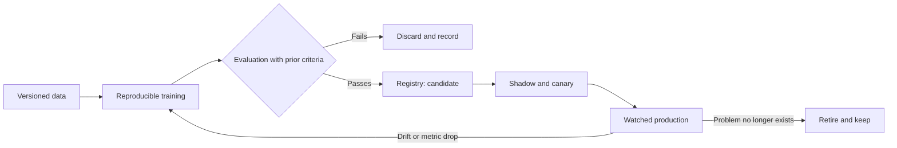

Training a model that works in a notebook is the easy part. The hard part is that it still works six months
later, when the data has changed, the code that feeds it has changed, and nobody remembers which version of
which dataset produced the result now in production. The thesis of this article is that a model in production
is a **published version of three things at once** (code, data and model), and that MLOps consists of treating
them that way: versioning them separately, deploying them with control, and watching them until they are retired.

The problem is not new. Sculley and his co-authors, in "Hidden Technical Debt in Machine Learning Systems"
(NIPS 2015), described how the modelling code is a small fraction of a real ML system, surrounded by configuration,
data collection, verification, serving and monitoring. That observation is the basis of nearly every practice that
follows.

<Callout tone="info" title="MLOps is not DevOps with another name">
  DevOps versions code and ships artefacts that behave the same way given the same code. A model can
  fail with unchanged code if its input data changes. That is why its lifecycle needs continuous
  watching of the data, not only of service errors.
</Callout>

## A model is code, data and configuration

A trained model is the output of a recipe: the code that transforms the data, the data itself (with its cut-off date
and filtering), the hyperparameters and the environment in which it was trained. If any of these is lost, the model
stops being reproducible. A model that cannot be reproduced cannot be debugged when something goes wrong.

The practical consequence is that every model in production must be able to answer three questions: which code
trained it, on which data and with which configuration. If the answer is "the notebook Ana had on her laptop", the
model is in production without being a published version.

Google Cloud's architecture guidance for MLOps makes the same point: a real ML system is a small part of model code
surrounded by components for configuration, automation, data validation, serving and monitoring. Its recommendation
is to automate a pipeline that trains, validates and deploys the model, rather than treating training as a manual step.

## Version data, code and model separately

Each of the three changes at a different pace. Code changes when the team decides to change it. Data changes when the
world changes or when the source changes. The model changes every time it is retrained. If they are versioned together,
any change forces a new version of everything, and the history stops explaining anything.

The practical separation looks like this:

- **Code**: the repository of the training pipeline, with reviews and tests, like any other production code.
- **Data**: datasets with their own identifier, cut-off date and schema. A new dataset is a new version; the previous one
  is not overwritten.
- **Model**: the trained artefact, linked to the exact code and data versions that produced it, its evaluation metrics and
  its state (candidate, approved, in production, retired).

The model registry is where the three versions meet. Without one, each team keeps its models in folders with names like
`final_v3_good.pkl`, and the question of what is in production has no reliable answer.

## From experiment to registry

An experiment is an exploration: variants are tried, metrics are compared and whatever does not work is discarded. A
candidate version is a model that deserves formal evaluation. The distinction matters because experiments produce many
results that must never reach production, and formal evaluation must be the same for every candidate.

The gate between the two states is an automatic evaluation with criteria written down before training: minimum quality
metrics, comparison with the model in production on the same test set, and a fairness or bias review when the model
affects people. If the criteria are defined after the results are seen, the evaluation confirms what the team wanted,
not what the model does.

Model cards are a standard way to document this information. Mitchell and co-authors proposed them in "Model Cards for
Model Reporting" (FAT\* 2019): each published model should come with its intended use, its evaluation conditions, its
metrics disaggregated by subgroup and its known limitations. Writing it at the end of the project is too late; the draft
is written alongside the registry entry.

## Deploy with shadow traffic and canaries

A new model should never replace the previous one all at once. There are two ways to reduce that risk, and they can be combined.

**Shadow deployment** runs the new model on real traffic without returning its answers to users. Its predictions are
logged and compared with those of the current model and, when they exist, with the real outcome. It measures behaviour
on real data without exposing anyone. Its limit is that it does not measure the effect of the prediction on the user,
because the user never sees it.

A **canary** sends a small fraction of real traffic to the new model and watches business and service metrics. If everything
stays within thresholds, the fraction grows; if not, it rolls back. It is the same pattern as
[progressive delivery](/docs/entrega-progresiva-flags-canary), with one difference: the decision metric here includes the
quality of the prediction, not only latency or errors.

One detail is often forgotten: the new model may depend on features that the service computes differently online than during
training. That difference, known as training-serving skew, produces good offline metrics and poor production results. The
defence is to compute features with the same code in both environments or, at least, to check that they produce the same
values for the same inputs before deployment.

## Watch for drift

A model degrades even when its code does not change. **Data drift** happens when the distribution of the inputs moves away
from what the model saw in training: customers, channels or behaviour change. **Concept drift** happens when the relationship
between inputs and outcome changes: a model that used to predict default no longer does because the credit policy changed.
Each needs a different kind of watching.

For data drift, it helps to compare the production input distribution with a reference one, variable by variable, with an agreed
distance metric and threshold. For concept drift you need the real outcome, which sometimes arrives days or months later. That
is why it is worth watching both: the first warns early, the second confirms whether the warning mattered.

Breck and co-authors, in "The ML Test Score" (IEEE BigData 2017), propose a rubric for judging whether an ML system is ready for
production, with tests for data, model, infrastructure and monitoring. It works as a checklist of what is missing before a model
can be trusted without supervision.

## Retrain or retire: decide with data

Retraining is not always the answer. A model that degrades may need new data, a new feature, a different architecture, or simply
someone checking whether the problem is still the same one. Retraining without a diagnosis produces an equally bad model, trained
on more recent data, with less validation time.

A reasonable policy defines three triggers: a business metric threshold breached for an agreed period, a data drift above the limit
on several variables, and a periodic review date that forces confirmation that the model still makes sense. Retraining runs through
the pipeline, with the same evaluation as any candidate, not as an informal decision.

Retiring a model is also a decision. A model that is no longer used, has been replaced, or whose business problem has disappeared
should be retired explicitly: marked as retired in the registry, disconnected from the service, and its version kept for audit. A model
forgotten in production, still receiving traffic and without an owner, is one of the most common risks.

A fictional case shows why monitoring must cover data and not only the service. A product recommendation model for
an online shop answers in under a hundred milliseconds, without errors, for a whole quarter. The service dashboards
are green. Yet the click-through rate on recommendations falls fifteen percent over six weeks. The investigation shows
that the catalogue changed its category taxonomy during the same period: a feature the model used as input now arrives
with different values for most products. No service alert would have caught it; the distribution of that variable,
compared with the training distribution, would have, from the first week. The lesson is that a model's monitoring must
look at what goes in, what comes out and what happens afterwards, not only at whether the service is alive.

There is an extra difficulty with real outcomes. In many cases they arrive late: a default is known months later, the
conversion of a campaign when the purchase cycle closes. During that interval, data drift is the only signal available.
It is worth documenting each label's delay in the model's registry entry, so that concept-drift alerts are not read as
failures when there is not yet enough data to measure them.

Governing a model also means deciding who can approve it and who answers for it. It helps to separate three roles: the
person who trains and proposes the candidate, the person who checks that it meets the written criteria, and the person who
accepts the risk of putting it into production, usually a business owner with visibility of the impact. When one person holds
all three, the review becomes a formality. That separation also defines the exception procedure: if a model that fails a
criterion must be deployed, the decision is signed, with its reason and a date to correct it. Unsigned exceptions accumulate
until the system in real production is one that nobody approved.

## Tools

- **A model registry** with versions, states, links to code and data, and evaluation metrics.
- **A dataset manager**, or at least storage with immutable versions and cut-off dates.
- **An orchestrated training pipeline** that can run without human intervention and with the same steps on every run.
- **Data and prediction monitoring**, with per-variable distributions and drift alerts, alongside service monitoring.
- **Model card tooling** or a template in the registry, so that the documentation is filled in alongside the model.

No tool solves the lack of owners. Every model in production needs a named person responsible for its performance, its
retraining and its retirement.

## Common mistakes

- **Storing models as loose files.** Without a registry, nobody can say what is in production or why.
- **Defining acceptance criteria after seeing the results.** The evaluation then confirms what was sought, not what the model does.
- **Deploying all at once.** A model that behaves well in tests can fail on real traffic with no quick way back.
- **Watching only service errors.** A model that responds fast and without errors can be wrong for months.
- **Retraining as the first response.** Without a diagnosis, the new model inherits the same problem with less validation.
- **Leaving models without owners.** A forgotten model keeps making decisions that nobody reviews.

## Checklist

- [ ] Each production model can be reproduced: code, data and configuration are versioned and linked in the registry.
- [ ] Acceptance criteria are written before training and applied identically to every candidate.
- [ ] Deployment uses shadow or canary, with decision metrics that include prediction quality.
- [ ] Features are computed the same way in training and serving, or their equivalence is checked.
- [ ] Data drift and concept drift are watched with agreed thresholds and with real outcomes when they arrive.
- [ ] Written triggers exist for retraining and for periodic review.
- [ ] Each model has a card with intended use, evaluation and limitations, and a named owner.
- [ ] Retired models are marked in the registry, disconnected, and their version is kept.

## Sources

Checked in October 2026. Sculley et al. (NIPS 2015) and Breck et al. (IEEE BigData 2017) were confirmed against their
proceedings and bibliographic records. Google Cloud's guidance on continuous delivery and ML pipelines was consulted in its
English version, last reviewed in August 2024, so check the current version. Mitchell et al. (FAT\* 2019) was confirmed against
the ACM record and the arXiv version.

- Sculley et al., "Hidden Technical Debt in Machine Learning Systems", NIPS 2015, vol. 28, pp. 2503–2511.
- Breck et al., "The ML Test Score: A Rubric for ML Production Readiness and Technical Debt Reduction", IEEE BigData 2017.
- Mitchell et al., "Model Cards for Model Reporting", FAT\* 2019 (arXiv:1810.03993).
- [Google Cloud Architecture Center: MLOps, continuous delivery and automation pipelines in machine learning](https://docs.cloud.google.com/architecture/mlops-continuous-delivery-and-automation-pipelines-in-machine-learning)
