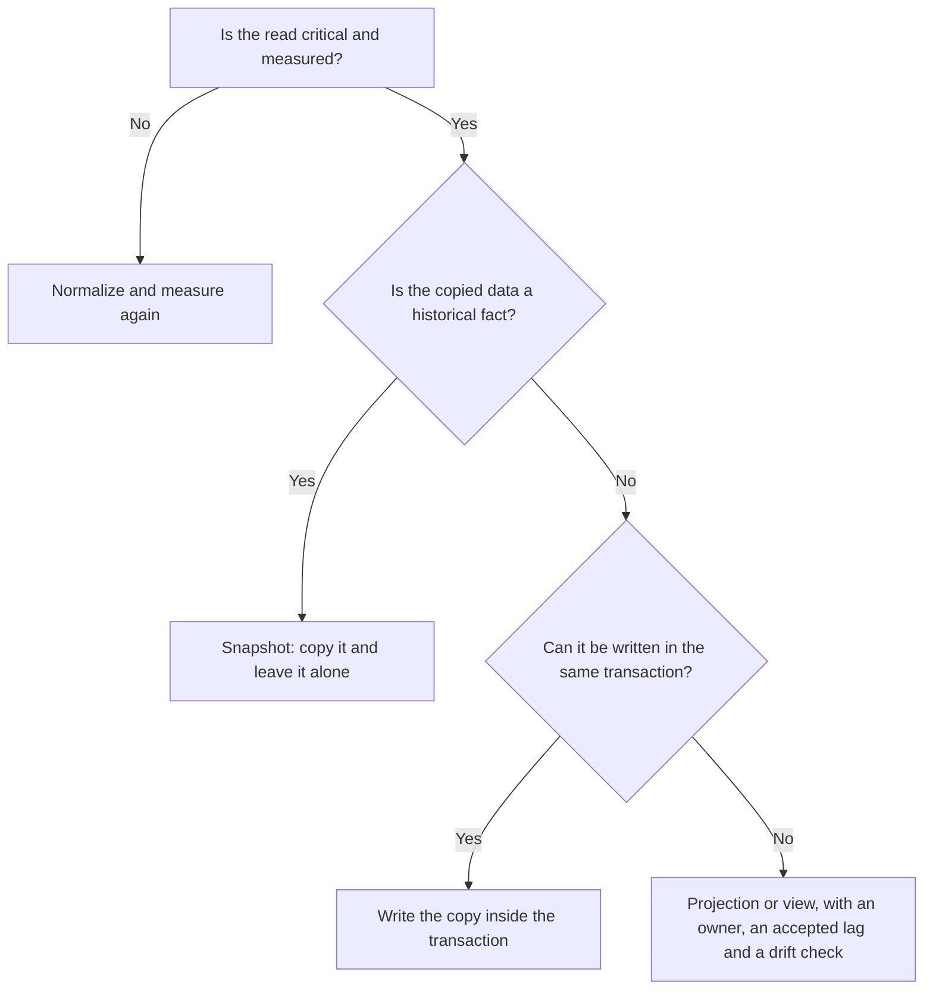

# Data modeling: normalize or denormalize

A data model answers two questions at once: which facts exist and where each one should live, and
how they will be read and written. The first question leads to normalization. The second decides
when it pays to copy a fact so that a read does not have to join it back together. Many problematic
models answer only the first question, or answer it with the intuition from some other system.

This article treats modeling as a cost decision: where you pay, on write or on read, and who answers
when a copy drifts. It does not repeat what the
[choice of store](/docs/persistencia-politica-elegir-bd),
[isolation levels](/docs/datos-acid-y-aislamiento) or
[DDD aggregates](/docs/domain-driven-design) already cover; it uses them as a starting point.

## Conceptual, logical and physical

It helps to separate three levels:

- **Conceptual:** the business entities, their relationships and the invariants written in the
  business's own language ("an order has at least one line"). No tables, types or indexes.
- **Logical:** tables, collections or documents, keys and constraints. This is where you decide which
  row or document holds each fact.
- **Physical:** indexes, partitions, column types, replicas. This is where you tune the cost without
  changing the facts.

The conceptual level lasts: it changes when the business changes. The physical level changes when
the load changes. The common mistake is to jump to the physical level, with the tables an ORM
generates or the schema of an API, before the invariants are written down. Then the database stores
the shape of the code instead of the shape of the domain.

## Entities, relationships and keys

The basics (entity, key, cardinality) are in the
[ACID and isolation article](/docs/datos-acid-y-aislamiento#entities-keys-and-cardinality). Here are
the decisions that change the model:

- **Cardinality decides where the foreign key goes.** In one-to-many, the key sits on the "many"
  side. Many-to-many needs a join table, and that table almost always has attributes of its own: an
  enrollment has a date and a grade, an order line has a quantity and a price. If the join table has
  no attributes at all, ask whether the relationship hides an entity nobody has named yet.
- **Surrogate key for identity, natural key for the rule.** A system-generated key is stable and
  convenient to reference from other tables. A natural key (an email, a registration number) expresses
  a business rule, but the business corrects, reassigns or shares it. Author's criterion: identify with
  a surrogate and declare the natural one as `UNIQUE`, so the rule holds without every reference
  depending on it.
- **Composite keys fit join tables.** `(order_id, product_id)` says a product appears once per order.
  Do not use it as the identity of an entity with its own life.

## Normalize: which anomaly you avoid

Normalizing means storing each fact in one place. The normal forms are criteria for checking that
each attribute depends on the right key. An example makes it
concrete. This flat table mixes orders, customers and products:

| order | customer | name       | email          | product  | quantity |
| ----- | -------- | ---------- | -------------- | -------- | -------- |
| 1001  | 17       | Ana Torres | ana@ejemplo.es | Keyboard | 1        |
| 1002  | 17       | Ana Torres | ana@ejemplo.es | Mouse    | 2        |
| 1003  | 17       | Ana Torres | ana@ejemplo.es | Monitor  | 1        |

Designed this way, it produces three classic anomalies:

- **Update.** Ana changes her email and the correction reaches two of the three rows. The database now
  states two different things at once.
- **Insert.** You cannot register a new customer without inventing an order, because her data lives
  inside the order row.
- **Delete.** If you cancel her orders and delete the rows, her name and email disappear too, although
  they are facts about the customer, not about the order.

Each normal form fixes one kind of incorrect dependency:

| Form | Plain-language rule                                       | Example it fixes                                                                          |
| ---- | --------------------------------------------------------- | ----------------------------------------------------------------------------------------- |
| 1NF  | Each cell holds a single value                            | A cell containing `Keyboard, Mouse`                                                       |
| 2NF  | Every non-key attribute depends on the whole key          | `product_name` in the lines table depends only on `product_id`, not on `(order, product)` |
| 3NF  | No non-key attribute depends on another non-key attribute | `city` depends on `postal_code`, which depends on the order                               |
| BCNF | Every functional dependency starts from a superkey        | Each teacher teaches one subject, but `teacher` is not a key: that dependency breaks BCNF |

Author's criterion: normalize to BCNF in the transactional core. Going further rarely buys anything
worth its cost.

**What it costs.** Normalizing moves the cost to reads: data from other tables is fetched with a
`JOIN`. In a well-indexed relational database this is cheap when the query touches few rows. It gets
expensive when a read crosses many tables, when the system spreads data across nodes, or when the
screen is the main operation and must answer in milliseconds at scale. Author's criterion: normalize
first, measure the real reads, and denormalize only what the numbers point to.

## Denormalize on purpose

Denormalizing means copying a fact for one specific read. It helps to distinguish two kinds of copy,
because they do not have the same problem:

- **Historical fact (snapshot).** The price a customer paid on an order line is not a duplicate: it is
  the correct value for that moment. Storing it on the line creates no drift, because nobody should
  update it.
- **State copy.** Ana's email in the billing view must follow Ana's email. Here drift is possible, and
  you must decide who corrects it.

State copies are the ones that cost. The diagram summarizes when they pay off and how to keep them:

When a state copy is maintained outside the transaction, the usual mechanisms are:

| Mechanism               | When it fits                                                     | What you pay                                                            |
| ----------------------- | ---------------------------------------------------------------- | ----------------------------------------------------------------------- |
| Same transaction        | The copy lives in the same store and the invariant must hold now | Write latency and coupling: the copy locks what it shares               |
| Materialized view       | The engine can recompute the projection inside the database      | Refresh cost; the drift is the interval between refreshes               |
| Event-driven projection | The copy lives in another store or service                       | Eventual consistency, idempotent consumers, rebuilds and lag monitoring |
| Trigger                 | The synchronization must sit next to the write in the database   | Logic hidden outside the application code, harder to test and version   |

Materialized views have a detail worth knowing. According to the PostgreSQL documentation, a
`REFRESH` without `CONCURRENTLY` can block reads of the view while it recomputes; with `CONCURRENTLY`
readers keep working, but the view needs at least one `UNIQUE` index that covers every row and uses
only plain column names, with no expressions and no `WHERE`. In other words, the synchronization
mechanism imposes requirements on the model.

### Who answers for the drift

A copy has no natural owner unless someone decides it. In practice there are three responsibilities:

- **The owner of the source** publishes every change to the fact and decides which copies exist.
- **The owner of the copy** sets how much lag that view accepts (for example, the support view may be
  at most one minute behind), knows how to rebuild it and watches it.
- **A drift check** compares a sample of the copy with the source and alerts when they diverge.
  Without it, the copy drifts silently and someone finds out in production.

## Relational, document and key-value

Each family of stores rewards a different model. Forcing one store's model onto another is a common
source of trouble.

| Dimension       | Relational                                      | Document                                       | Key-value                                            |
| --------------- | ----------------------------------------------- | ---------------------------------------------- | ---------------------------------------------------- |
| What it rewards | Ad hoc queries, joins and integrity across rows | Reading and writing a whole aggregate at once  | Access by key or prefix with predictable latency     |
| Starting point  | Normalize, then index                           | One aggregate per document, with copies inside | A known query, with a key designed for it            |
| Price           | Joins; a more rigid schema                      | Duplicates across documents; bounded size      | No queries on other fields without secondary indexes |
| Typical risk    | Slow joins caused by missing indexes            | Documents or arrays that grow without limit    | Needing a query the key cannot serve                 |

In a document store, the key decision is **embed or reference**. MongoDB's data-modeling guidance
suggests embedding when data is queried and updated together, and referencing when the child side has
high cardinality, can exist on its own, is written at different times, or grows without bound. A
document also has a verifiable ceiling: according to MongoDB's documentation, the maximum BSON document
size is 16 mebibytes, and large documents use more memory and bandwidth.

A document is not the same thing as a DDD aggregate, but it is often its most natural physical form.
The aggregate is the unit protected by an invariant; the document is the unit read and written at
once. If a business operation must modify three documents together, the aggregate boundary is probably
drawn in the wrong place, and it is worth revisiting before you change stores.

For key-value, AWS's DynamoDB guidance puts it this way: the first step is to identify the query
patterns the system must answer, and the schema is designed around them. Its guides also recommend
keeping as few tables as possible and grouping related items with the partition and sort keys. If a
query fits neither the key nor a secondary index, the guide warns that it is expensive and slow, so
it is better to change the model than to scan the table.

## Design from the queries

Order matters. Start with the operations, then the model, and only at the end the store:

1. **List the operations** with their type (read or write), their estimated frequency and the response
   time they need.
2. **For each write, write down its invariants**: what must be true afterwards, in the same transaction
   or in the same document.
3. **Give each fact an owner and one canonical row or document.**
4. **Add copies only for measured reads**, and decide their synchronization mechanism with the table
   above.
5. **Choose the store and design keys and indexes** for each query on the list.

An example list for an order system (illustrative values, not measurements):

| Operation                          | Type  | Frequency | Invariant or limit                                             |
| ---------------------------------- | ----- | --------- | -------------------------------------------------------------- |
| Place an order and decrement stock | Write | High      | Stock never drops below zero, in the same transaction          |
| View an order with its lines       | Read  | Very high | One access to the aggregate for the screen                     |
| Monthly billing per customer       | Read  | Daily     | May lag by a few minutes                                       |
| Change the customer's email        | Write | Low       | Reaches the billing and support copies within an agreed window |

The list is useful for more than choosing a store: each row is a query that, if it changes, forces a
review of the model.

## Indexes: the copy the engine keeps for you

An index is redundancy the engine maintains for you: a copy of some columns, sorted by a key. Every
insert and every update of an indexed column must touch all its indexes. That makes an index a cost on
writes and in storage, even though you never write it by hand.

Author's criterion: create indexes for measured queries, not "just in case", and periodically review
the ones nobody uses, using the usage statistics your engine provides. A normalized model with many
indexes can write more slowly than a denormalized one with a single well-designed read.

## Signs that the model is wrong

- **Joins that do not fit the latency budget**, even when every table is well indexed.
- **Two sources for the same fact** with no clear owner. It is the earliest sign of duplicates that
  diverge.
- **Business changes that touch many tables or collections.** If changing "the shipping address" means
  editing six places, the fact is spread out without need.
- **Documents or arrays that grow without a ceiling**: comments, events or audit trails inside the
  parent document.
- **Operations that need transactions across too many aggregates.** It hints at a wrong aggregate
  boundary, not at a store problem.
- **New queries that force a rewrite of the model** instead of adding an index or a view.
- **Constraints living in application code** because the database cannot express them (a unique
  combination, a forbidden overlap). An invariant that cannot be declared ends up failing in production.

## When to and when not to

**Normalize** when writes and integrity matter most: inventory, balances, bookings, any domain where a
stale copy has a real cost. Normalizing is the default for the transactional core.

**Denormalize** when a read is measured, critical, and the copy changes rarely or never. Choose a
document when the business operation always reads and writes the whole aggregate.

**Do not denormalize in advance**, or because your ORM or framework makes it convenient. Every copy adds
synchronization work that someone must maintain.

**Do not normalize to the point of absurdity** if the main screen needs eight joins to render. That
usually means the read is the important operation and the model should reflect it.

**Do not put high-cardinality relationships inside a document** just because they are convenient to
read.

## Common mistakes

- **Designing tables from the ORM or the API** before the operations and invariants.
- **Copying data without an owner or a synchronization mechanism.** An unowned copy is a deferred bug.
- **Confusing a snapshot with a duplicate.** Updating the historical price of an order line is an error,
  not normalization.
- **Unbounded arrays inside a document**, which grow until they hit the maximum size or make every read
  slow.
- **Indexes by intuition**, without measuring their write cost or their real use.
- **Solving a logical invariant in application code** when a unique constraint or a composite key would
  guarantee it in the database.
- **Modeling many-to-many relationships without thinking about their attributes**, and discovering them
  late in a migration.

## Checklist

- [ ] The business invariants are written in business language, not only in code.
- [ ] Each fact has one canonical row or document, and the copies are documented.
- [ ] Each state copy has an owner, a synchronization mechanism and an accepted lag.
- [ ] Keys are surrogate for identity and `UNIQUE` for the rules that require it.
- [ ] There is a list of operations with frequency and target response time.
- [ ] Documents have bounded size and growth, and large relationships are referenced.
- [ ] Each index answers a measured query and its write cost is accepted.
- [ ] There is a drift check between the copies and their source.

## Sources

- [MongoDB: Limits and Thresholds (maximum document size)](https://www.mongodb.com/docs/manual/reference/limits/)
- [MongoDB: Embedded vs. references (data modeling guide)](https://www.mongodb.com/docs/manual/data-modeling/concepts/embedding-vs-references/)
- [AWS: NoSQL design for DynamoDB](https://docs.aws.amazon.com/amazondynamodb/latest/developerguide/bp-general-nosql-design.html)
- [PostgreSQL: REFRESH MATERIALIZED VIEW](https://www.postgresql.org/docs/current/sql-refreshmaterializedview.html)
