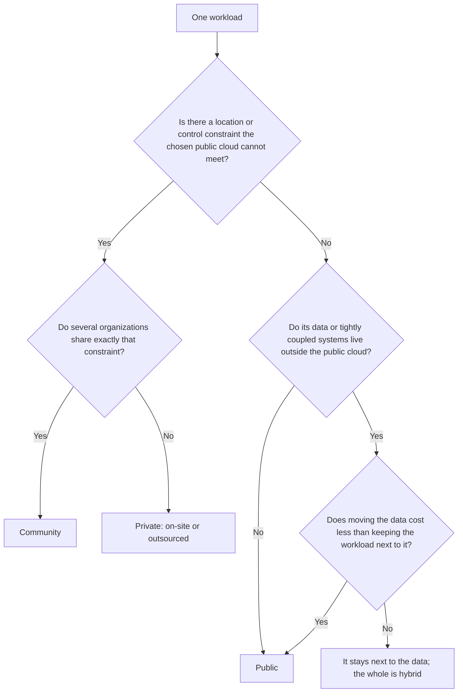

# Deployment models: public, private, hybrid

The meeting opens with a slide: "2027 strategy: everything to the cloud." Six months later the web portal runs in a public region, the core database is still in the company's data center, and every quote takes a second longer than before because each query crosses a WAN link. Nobody decided that outcome; someone decided where "the whole site" should go without looking at where the data lived or who would run each piece. The deployment model is exactly that decision, made on purpose: **a cloud deployment model defines who the infrastructure is provisioned for, who owns and operates it, and where it sits; an architect chooses one per workload based on the control, data location and cost that workload needs**.

This lesson starts from the NIST definitions, explains what actually changes from one model to the next, compares the four with a criteria table, looks at two commercial labels you will find in proposals (sovereign cloud and dedicated cloud), and ends with a method for deciding per workload plus a worked example. Code here is a guide to shape, not a recipe.

<Callout tone="info" title="Cutoff date and sources">
  Checked in October 2026. The definitions come from the text of NIST SP 800-145 (September 2011)
  and the scenarios from NIST SP 800-146 (May 2012), both read in the official PDFs. ISO/IEC
  22123-1:2023 also defines the four models, and its foreword states that this edition changed the
  definition of hybrid cloud; the standard's text is paywalled and is not quoted here. Vendor
  offerings are described as examples, using what their official pages say, not as recommendations.
</Callout>

## The problem it solves

People use "cloud" as if it were a place. It isn't: it is a delivery model with specific characteristics (on-demand self-service, broad network access, resource pooling, rapid elasticity and measured service, in NIST's terms), and that model can be deployed in several ways. Blurring those ways leads to decisions nobody made explicitly:

| Symptom in a real project                                                    | Decision that was made without a name                                             |
| ---------------------------------------------------------------------------- | --------------------------------------------------------------------------------- |
| The migrated application is slower than the original                         | Splitting the application from its data with a network boundary in between        |
| An auditor asks which country the backups are in and nobody knows            | Not stating data location as a requirement of each workload                       |
| The "private cloud" needs a platform team nobody budgeted for                | Treating "private" as "no operating cost"                                         |
| The monthly bill grows because of data transfer between environments         | Designing a data flow that crosses a boundary on every request                    |
| Two "hybrid" environments cannot move a single application between them      | Calling two environments hybrid without portability or shared governance          |
| The "sovereign cloud" contract does not cover the logs that support collects | Accepting a commercial label without asking which data and which people it covers |

## The four NIST definitions

The most cited reference is NIST Special Publication 800-145, _The NIST Definition of Cloud Computing_, by Peter Mell and Timothy Grance (September 2011). It defines cloud computing as a model for on-demand network access to a shared pool of configurable resources that can be provisioned and released with minimal management effort, made up of five essential characteristics, three service models and four deployment models. The service models (IaaS, PaaS, SaaS) are covered in the [previous lesson](/docs/servicios-nube-para-arquitectos); this one is about deployment. Faithfully paraphrased:

| Model     | Provisioned for                                                                      | Who may own and operate it                                        | Where it may be            |
| --------- | ------------------------------------------------------------------------------------ | ----------------------------------------------------------------- | -------------------------- |
| Private   | Exclusive use by a single organization, which may have several internal consumers    | The organization itself, a third party or a combination           | On or off premises         |
| Community | Exclusive use by a community of organizations with shared concerns                   | One or more community members, a third party or a combination     | On or off premises         |
| Public    | Open use by the general public                                                       | A business, academic or government organization, or a combination | On the provider's premises |
| Hybrid    | A composition of two or more distinct infrastructures (private, community or public) | Each part keeps its owner; they remain separate entities          | Wherever each part is      |

Three details of the original text often get lost:

- **Private does not mean "in my data center."** NIST says explicitly that a private cloud may be on or off premises and may be operated by a third party. What defines it is exclusivity, not the street address.
- **Community is a model in its own right.** The community shares a mission, security requirements, policy or compliance considerations. Think of several organizations in the same sector sharing one platform.
- **Hybrid requires a binding.** The parts remain distinct, but they are tied together by standardized or proprietary technology that enables data and application portability; NIST's example is cloud bursting for load balancing between clouds. A data center and a provider account with nothing joining them does not fit that definition.

In the figure, each zone is a boundary and its tag counts organizations: many on the same infrastructure (public), exactly one (private), a group with shared concerns (community), and a composition of a private part with a public one (hybrid). Inside the hybrid zone sits the idea that runs through this whole lesson: the application lives next to its data, on the same side of the boundary.

### The NIST SP 800-146 scenarios

In May 2012 NIST published SP 800-146, _Cloud Computing Synopsis and Recommendations_ (Lee Badger, Tim Grance, Robert Patt-Corner and Jeff Voas). For an architect it is more useful than the definition, because it analyzes each model by its **security perimeter**, that is, which part the consumer controls. Its main contribution is splitting private and community into two variants, **on-site** and **outsourced**, because they have different performance, reliability and security properties. With that split, a hybrid cloud is a composition of any of five variants.

| Scenario (SP 800-146) | Perimeter the consumer controls                                        | Traits the document highlights                                                                |
| --------------------- | ---------------------------------------------------------------------- | --------------------------------------------------------------------------------------------- |
| On-site private       | Its own, around both its resources and the cloud                       | Significant-to-high up-front cost, fixed capacity, the consumer chooses where everything runs |
| Outsourced private    | Two perimeters (its own and the provider's) joined by a protected link | Security depends on both perimeters and on the link                                           |
| On-site community     | Each member's own, connected through links between their boundaries    | At least one member provides services; access and identity policy across members gets complex |
| Outsourced community  | Its own plus the provider's, which separates the community from others | Like outsourced private, plus a sharing policy among members that the provider enforces       |
| Public                | Only the one around its own facilities                                 | Near-unlimited elasticity, public network, workload location hidden unless restricted         |

Two observations from the document still work as questions, even though the products have changed. On outsourced private, it warns that if the separation between customers relies only on the same mechanisms that separate customers in a public cloud, the scenario essentially becomes the public cloud scenario. On public, it notes that default service agreements limit what the provider promises and that the real obligations live in the contract, not in the marketing material. Keep in mind that it is a 2012 text: provider location and audit controls have moved a long way since, so use it for its reasoning, not for its market diagnosis.

## What actually changes between models

Labels matter less than four questions. Ask them for each workload and the model almost falls out.

### Who operates the infrastructure

Operating means patching, refreshing hardware, watching capacity, answering incidents at three in the morning and maintaining the perimeter. In a public cloud the provider does it for everything below the service you buy; in an on-site private cloud your team does it, even if you run cloud software. That difference weighs most on total cost and is the one most often underestimated: an on-site private cloud needs a platform team with cloud skills and, according to SP 800-146, traditional IT skills as well while legacy systems remain.

### Who controls the physical layer and the control plane

It helps to separate two layers. The **physical layer** is buildings, power, servers and network. The **control plane** is the software that creates, changes and destroys resources: the APIs, the console, the identity that authorizes them, the telemetry the provider uses to operate. You can have physical servers in your building whose control plane lives in a provider region, and the other way round, hardware dedicated to you inside the provider's data center. For security, sovereignty and continuity, what usually matters is who can act on the control plane and from where.

| Model or variant                     | Physical layer                   | Control plane                                     | Who operates                |
| ------------------------------------ | -------------------------------- | ------------------------------------------------- | --------------------------- |
| Public                               | Provider                         | Provider                                          | Provider (below your layer) |
| On-site private                      | Your organization                | Your organization                                 | Your organization           |
| Outsourced private                   | Third party, dedicated to you    | Third party or shared, per contract               | Third party                 |
| Provider infrastructure on your site | Your building, provider hardware | Usually the provider, tied to a region            | Provider                    |
| Community                            | Members or a third party         | Members or a third party, under shared governance | Per the agreement           |

### Where the data lives

Data location covers more than the primary database: backups, replicas, logs, search indexes, caches, support data and telemetry. In 2012 SP 800-146 explained that in a public cloud the provider may move a workload anywhere unless it offers location restrictions and the customer configures them, and that those restrictions tended to be coarse grained. Picking a region is routine today, but the question has not changed: which copies of which data leave the chosen region, and who can see them?

### Which forces push toward a model

| Force              | What it pushes                                                                         | Question for the workload                                              |
| ------------------ | -------------------------------------------------------------------------------------- | ---------------------------------------------------------------------- |
| Regulation         | May require controls, audit or cleared staff; does not always require a specific model | What does the rule actually demand: a place, a control or evidence?    |
| Data residency     | Limits which jurisdiction the data and its copies may sit in                           | Which data is in scope and which is not?                               |
| Latency            | Brings compute closer to the user, the plant or the data                               | How many round trips does a request make, and within what time budget? |
| Data gravity       | Pulls applications toward where large data already lives                               | Which costs more: moving the data or moving the application?           |
| Legacy systems     | Pin workloads to a place because of hardware, licenses or integrations                 | What depends on this system through synchronous calls?                 |
| Demand variability | Rewards the elasticity of the public model                                             | Does the workload have seasonal peaks or is it steady?                 |

Be careful with the first row: it is common to hear "regulation forces us into a private cloud" when what the rule requires is a control (encryption, segregation, access logging) or evidence (an audit) that several models can satisfy. Read the rules for your sector with your legal team; this lesson does not go into any country's legislation.

## Data gravity

Dave McCrory coined the term _data gravity_ in a blog post on December 7, 2010. His metaphor is a planet: as a dataset grows it attracts services and applications, the way a large mass attracts objects, and the more mass it accumulates the harder it is to move. McCrory describes latency and throughput as accelerators of that pull: whatever sits close to the data gets more throughput and less latency, and so ends up depending on it even more.

For an architect, the practical consequence is a design rule: **place the application on the same side of the boundary as its data, or design the interaction so it crosses the boundary rarely and in batches**. The figure for this lesson shows it: the application that talks to the database inside the same data center crosses no boundary; the one left in the public region pays the link's round-trip time (RTT) on every query.

An example with assumed numbers makes it concrete. Picture a request that makes 25 sequential database queries. If a round trip inside the same data center takes 0.5 ms, the queries add up to 12.5 ms. If the application moves to a region 30 ms away round trip, the same queries add up to 750 ms, without a single line of logic changing. Typical latency figures and how to reason with them are in [performance numbers and laws](/docs/numeros-y-leyes-de-rendimiento).

Gravity has an economic side too. Public providers charge for data transferred out to the internet (AWS states this on its EC2 pricing page), so a design that pulls a lot of data out of a region on every operation pays for that boundary on the bill as well. How to measure and allocate that cost is covered in the [FinOps](/docs/finops-costo-como-atributo) lesson.

## Comparison by criterion

The table summarizes tendencies, not guarantees: a well-automated private cloud can be more agile than a poorly governed public one.

| Criterion                  | Public                                                             | On-site private                                        | Outsourced private                                   | Community                                       | Hybrid                                                                     |
| -------------------------- | ------------------------------------------------------------------ | ------------------------------------------------------ | ---------------------------------------------------- | ----------------------------------------------- | -------------------------------------------------------------------------- |
| Control                    | Over your layer; physical and control plane belong to the provider | Full, including physical                               | Contractual over physical, technical over your layer | Shared according to community governance        | Different in each part; the challenge is one common policy                 |
| Elasticity                 | High; the advantage SP 800-146 attributes to it                    | Limited to purchased capacity                          | Limited to contracted capacity                       | Limited to the community's pool                 | That of the public part, if the workload is portable                       |
| Up-front vs. variable cost | Low up-front, variable with usage                                  | High up-front (equipment, space, people), low variable | Moderate up-front, fee for reserved capacity         | Up-front shared among members                   | The sum of both plus integration                                           |
| Compliance                 | Depends on the provider's controls, regions and certifications     | You demonstrate it with your own controls and audits   | Split: contract, third-party audit and your controls | Designed around the group's common requirements | That of the strictest part, plus rules for what crosses over               |
| Operational complexity     | Low for infrastructure, high for account and cost governance       | High: you run an entire platform                       | Medium: you manage the contract and the link         | High for cross-organization governance          | The highest: identity, network, observability and data across environments |



## Sovereign cloud and dedicated cloud

Commercial proposals use two labels that are neither NIST models nor terms with a common normative definition. Each provider gives them different content, so treat them as a bundle of promises to verify one by one.

### Sovereign cloud

It usually promises some combination of: infrastructure located inside a jurisdiction, operation by staff resident there, a local legal entity with its own governance, independence from the provider's global control plane, and key management under customer control. One published example: in January 2026 AWS announced the availability of its AWS European Sovereign Cloud, with a first region in Brandenburg, Germany; its official site describes it as physically and logically separate from other AWS Regions, operated by EU residents located in the EU, and governed by a new parent company with subsidiaries incorporated in Germany.

Questions worth asking:

- **Control plane:** where does it live, who can act on it, and from which countries?
- **Data beyond the workload:** what happens to metadata, logs, telemetry, backups and support case attachments?
- **Keys:** who holds the encryption keys, and can the provider use them without your involvement?
- **Catalog:** which services are missing compared with a standard region, and when do new features arrive?
- **Disconnection:** what keeps working if the link to the rest of the provider is cut?
- **Evidence:** which certifications and audit rights cover exactly this offering, rather than the standard region?

### Dedicated cloud

Very different things go by this label. Some dedicate **hardware inside the public region**: according to Microsoft's documentation, Azure Dedicated Host provides physical servers assigned to a single subscription, with no other customers' VMs, yet deployed in the same data centers and sharing the underlying network and storage with non-isolated hosts. Others bring **provider infrastructure into your building**: according to AWS's user guide, Outposts is compute and storage capacity installed at the customer site that AWS operates and manages as part of a Region, connected to it through a service link. In the first case physical isolation changes; in the second, location does. In neither do you take over the control plane.

Questions worth asking:

- **What is dedicated:** the server, the rack, the network, the storage, the control plane or the people?
- **Who operates:** who patches and replaces hardware, and under which maintenance windows?
- **Link dependency:** if the infrastructure is on your site, which operations need connectivity to the region?
- **Capacity:** what happens when it fills up? The region's elasticity is not included.

<Callout tone="warning" title="A label is not a control">
  Neither "sovereign" nor "dedicated" guarantees compliance with a rule on its own. Turn each
  promise into a verifiable control (where, who, what evidence) and record it in an [ADR](/docs/adr)
  along with what the offering does not cover.
</Callout>

## Decide per workload, not for the whole site

The starting mistake is asking "which model are we moving to?" The useful question is "where should each workload live?" A workload is a set of components that are deployed and scaled together and share data: the portal, the quoting engine, the analytics warehouse, the document archive. SP 800-146 already gave examples like this in 2012, such as processing payroll in an outsourced private cloud and using a public one for development and testing.

A five-step method:

1. **Inventory the workloads** and, for each one, its main data, its volume, and which other workloads it talks to synchronously.
2. **Classify the data** by sensitivity and location constraints. Often only part of the data is in scope.
3. **Measure the coupling**: how many calls per request each workload makes to each data store and each legacy system. Group whatever cannot be split by a network boundary.
4. **Assign a model per group** with the decision diagram above, weighting the criteria table by the [quality attributes](/docs/atributos-de-calidad) the business prioritized.
5. **Design the boundaries**: what crosses between models, how often, in which format and with which controls. That is the subject of the next lesson.

How you record the decision matters more than the tool. One entry per workload is enough:

```yaml
# placement/quoting.yaml — one entry per workload
workload: quoting
data:
  primary: policy-core # where it lives today and its volume
  classification: confidential
  residency: operating-jurisdiction
coupling:
  sync_calls_per_request: 25 # measured, not estimated
  legacy: [policy-mainframe]
model: private-on-site # public | private-* | community
crossings: [events-to-analytics] # what crosses the boundary and how
review: 2027-04 # … and what would change the decision
```

The normal outcome of this exercise is an architecture that combines models. That does not automatically make it a good hybrid cloud: a mix with no shared identity, no designed network and no rules about which data crosses over is just a collection of environments. Joining them properly is the topic of [the next lesson](/docs/nube-hibrida-en-detalle).

## When to use each and when not to

| Model              | When it fits                                                                                          | When it does not                                                           |
| ------------------ | ----------------------------------------------------------------------------------------------------- | -------------------------------------------------------------------------- |
| Public             | Variable demand, managed services that save operations, a small team, no incompatible data constraint | The workload depends synchronously on data that cannot leave another place |
| On-site private    | Physical control requirements, large steady workloads, legacy systems that cannot move                | There is no team or budget to run a platform, or demand is highly variable |
| Outsourced private | You need exclusivity without running buildings or hardware                                            | You expect public-region elasticity at the same cost                       |
| Community          | Several organizations with the same requirements and credible shared governance                       | Members cannot agree on who operates, who pays or how to exit              |
| Hybrid             | Workloads with different needs that must exchange data under clear rules                              | It is used to postpone the decision, or "so we are not tied to anyone"     |

The fear of depending on one provider has its own lesson, [locked in to one vendor](/docs/casado-a-un-proveedor); mixing models is not the cheapest way to address it.

## Common mistakes

- **Deciding by fashion.** "Everything to the cloud" and "everything back to the data center" are the same lack of analysis with opposite signs. Decide per workload and write down why.
- **Ignoring data gravity.** Planning the migration of applications without looking at where the data they query lives, how large it is and what it costs to move.
- **Moving only the application tier to the cloud.** The application sits in a public region and the database stays in the data center: every query crosses the WAN, latency multiplies and the transfer shows up on the bill.
- **Confusing private with "in my building."** NIST defines it by exclusivity; it can be off premises and run by a third party.
- **Calling any mix hybrid.** Without data or application portability and shared governance, you have separate environments, not a hybrid cloud.
- **Treating regulation as a synonym for a model.** Rules usually require controls and evidence, not a specific model.
- **Forgetting the copies.** Backups, replicas, logs and telemetry also have a location and also count for residency.
- **Underestimating the cost of running private.** Hardware is the cheap part; the platform team, the patching and the spare capacity are the expensive part.

## Worked decision example

A regional insurer (a hypothetical case) has four workloads: a customer portal, a quoting engine, an analytics warehouse and an archive of medical claim files. The policy core runs on a legacy system in its data center, and its regulator requires the medical files to stay in the country with access logged.

| Workload            | Data and coupling                                                         | Chosen model                             | Reason                                                                 |
| ------------------- | ------------------------------------------------------------------------- | ---------------------------------------- | ---------------------------------------------------------------------- |
| Customer portal     | Content and sessions; requests quotes through an API, one call per screen | Public, in-country region                | Demand peaks at renewal time; few calls cross the boundary             |
| Quoting engine      | 25 synchronous queries per request to the policy core                     | On-site private, next to the core        | Data gravity: moving it to the public region adds 750 ms per request   |
| Analytics warehouse | Receives core events in nightly batches; heavy, occasional queries        | Public, in-country region                | Elasticity for large queries; the crossing is asynchronous and batched |
| Medical files       | Sensitive data with a residency requirement and access logging            | Outsourced private with a local provider | Exclusivity and verifiable location without running its own hardware   |

The 750 ms comes from the assumed figures in the data gravity section: 25 queries at 30 ms round trip, against 12.5 ms if the engine stays next to the core. The team ruled out moving the policy core because migrating the legacy system is a project of its own, and wrote in the [ADR](/docs/adr) what would change the decision: if the core is replaced, the quoting engine is re-evaluated with it. The result combines three models, with two designed crossings (portal to quoting through an API, core to analytics in batches) and no synchronous query crossing the WAN.

## Checklist

- [ ] Every workload has an assigned deployment model and a written reason.
- [ ] For each workload you know who operates the physical layer and who can act on the control plane.
- [ ] Data is classified, and location constraints also cover copies, logs and telemetry.
- [ ] No frequent synchronous path crosses a network boundary between models without a measured latency budget.
- [ ] Flows that cross boundaries are listed, with frequency, format and controls.
- [ ] "Sovereign" or "dedicated" promises are translated into verifiable controls in the contract.
- [ ] The cost of running any private component, people included, is in the business case.
- [ ] The decision is in an ADR with the conditions that would trigger a review.

## Next lesson

If your architecture combines models, the challenge becomes joining them well: identity, network, data and operations across environments; continue with [hybrid cloud in detail](/docs/nube-hibrida-en-detalle).

## Sources

Checked in October 2026.

- [The NIST Definition of Cloud Computing, SP 800-145 (Peter Mell and Timothy Grance, NIST, September 2011)](https://nvlpubs.nist.gov/nistpubs/Legacy/SP/nistspecialpublication800-145.pdf)
- [Cloud Computing Synopsis and Recommendations, SP 800-146 (Lee Badger, Tim Grance, Robert Patt-Corner and Jeff Voas, NIST, May 2012)](https://nvlpubs.nist.gov/nistpubs/Legacy/SP/nistspecialpublication800-146.pdf): chapter 4, sections 4.1 to 4.7
- [ISO/IEC 22123-1:2023, Information technology — Cloud computing — Part 1: Vocabulary](https://www.iso.org/standard/82758.html): foreword of the public preview
- [Data Gravity – in the Clouds (Dave McCrory, Data Gravitas, December 7, 2010)](https://datagravitas.com/2010/12/07/data-gravity-in-the-clouds/)
- [AWS European Sovereign Cloud (official site)](https://aws.eu/)
- [Overview of Azure Dedicated Hosts (Microsoft Learn)](https://learn.microsoft.com/en-us/azure/virtual-machines/dedicated-hosts/overview)
- [What is AWS Outposts? (AWS user guide)](https://docs.aws.amazon.com/outposts/latest/userguide/what-is-outposts.html)
- [Amazon EC2 On-Demand Pricing, data transfer section (AWS)](https://aws.amazon.com/ec2/pricing/on-demand/)
