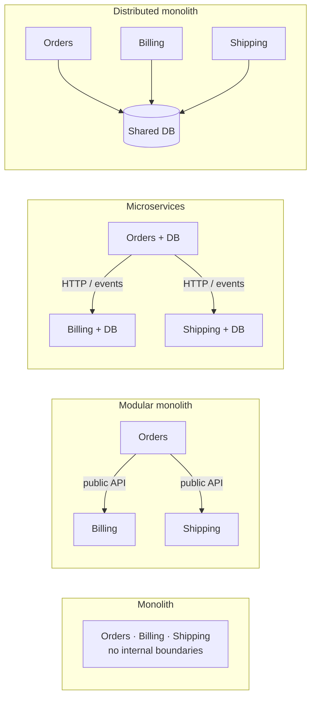
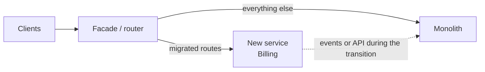
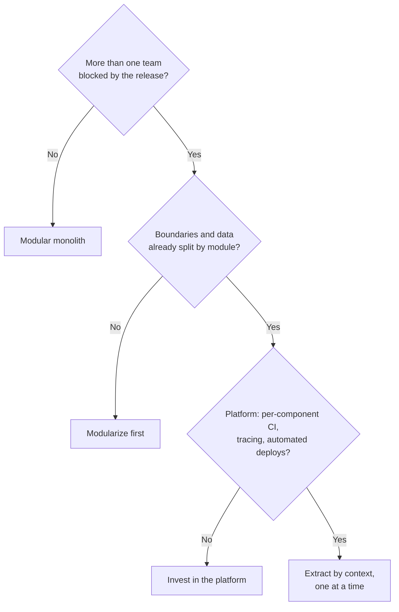

# Monolith, modular monolith or microservices

You have probably seen this one: the monolith takes forty minutes to get through CI, two teams trip over each other on every release, and someone suggests "moving to microservices". Six months later there are twelve services, one shared database, a tracing dashboard nobody can read and a person whose full-time job is deciding what ships with what. The problem was never the number of processes; it was the boundaries. That is the thesis of this article: **the decision that matters is not how many processes you deploy but where you draw the boundaries and how you enforce them; independent deployment is a cost you pay only when what it buys is worth it**.

The article defines the four styles (including the anti-pattern nobody picks on purpose), lays out their costs honestly, revisits the "monolith first" debate, explains how a modular monolith keeps its boundaries, reviews two public case studies for what they do and do not say, and closes with migration paths, a worked decision and a checklist. The code is only a guide to structure and naming.

<Callout tone="info" title="Cutoff date and verification">
  Sources checked in October 2026. Dates and quotes from Fowler, Tilkov and Shopify come from the
  original texts; the Prime Video case comes from trade-press coverage, and each claim says which.
  The original Prime Video post is no longer at its address (it redirects elsewhere), so what is
  said about it comes from InfoQ and other outlets that quoted it.
</Callout>

## Four ways to split a system

### Monolith

A single **unit of deployment**: all the code is built, tested and released together, and calls between parts are in-process function calls. Sam Newman put it this way at QCon London 2020 (per InfoQ's report): a monolith is defined by its unit of deployment, not by being legacy code. A monolith can be well or badly structured; the term says nothing about its internal quality.

### Modular monolith

A monolith whose inside is split into **modules with explicit boundaries**: each module exposes a public API, hides its implementation, owns its data and declares which other modules it depends on. It is still one unit of deployment. In the same talk Newman called its ideas "cutting edge ideas from the 1970s", a nod to the fact that modularity is old news; what is new is taking it seriously inside a single deployable.

### Microservices

Services that are **independently deployable**, talk over the network and manage their own data. James Lewis and Martin Fowler, in their article of March 25, 2014, described nine common characteristics, among them componentization via services, organization around business capabilities, decentralized data management, infrastructure automation and design for failure. It is not a formal definition but a portrait of the systems they were seeing.

### Distributed monolith: the anti-pattern

Several services in separate processes that **cannot be deployed separately**: they share a database or schema, call each other in synchronous chains or need coordinated versions. You get the operational complexity of microservices with the coupling of a monolith. Newman called it "the worst of the monoliths" and offered a practical tell: if someone's full-time job is release coordination, you probably have a distributed monolith.



What separates the two middle columns is the unit of deployment; what separates microservices from a distributed monolith is whether the boundaries are real. Notice that a modular monolith and well-built microservices share the same logical picture, which is exactly why the former is a good starting point for the latter.

## The trade-offs, without the sales pitch

In 2015 Fowler summarized the benefits of microservices in three points (strong module boundaries, independent deployment and technology diversity) and their costs in three more (distribution, eventual consistency and operational complexity). The table translates those costs into what a team feels day to day:

| Dimension                | Monolith                                     | Modular monolith                         | Microservices                                                           |
| ------------------------ | -------------------------------------------- | ---------------------------------------- | ----------------------------------------------------------------------- |
| Unit of deployment       | One                                          | One                                      | One per service                                                         |
| Team autonomy            | Low: everyone touches everything             | Medium: module owners, shared release    | High, if the boundaries are drawn well                                  |
| Data consistency         | Local transactions                           | Local transactions; ownership per module | Eventual consistency, sagas, idempotency                                |
| Latency between parts    | Function call                                | Function call                            | Network: serialization, retries, timeouts                               |
| Observability            | Logs and a profiler for one process          | Same, tagged by module                   | Distributed tracing, correlation, per-service metrics                   |
| Testing                  | Simple integration, slow suite as it grows   | Per module, plus one suite for the whole | Contracts between services and integration environments                 |
| Local development        | One process                                  | One process                              | Several services, test doubles or a remote environment                  |
| Moving a boundary        | Cheap, but nobody can see it                 | A refactoring the compiler helps with    | A coordinated change across repos, APIs and data                        |
| Scaling                  | Everything together                          | Everything together (identical replicas) | Per service, by load profile                                            |
| Fault isolation          | An out-of-memory error takes down everything | Same as the monolith                     | Containable, given circuit breakers and graceful degradation            |
| Technology diversity     | One stack                                    | One stack                                | Possible, but every new stack is a platform cost                        |
| Upfront operational cost | Low                                          | Low                                      | High: platform, per-service CI, networking, service-to-service security |

Two points the table does not capture:

- **The cost of a wrong boundary is asymmetric.** In a modular monolith, moving a responsibility between modules is a refactoring; between services it is a project with data migration and API versioning. That is why boundaries should settle before they turn into network calls.
- **Consistency is the biggest bill.** As soon as a piece of data lives in two services, every operation that spans them needs a strategy: eventual consistency, compensations, idempotent retries. We go deeper in [CAP and PACELC](/docs/cap-pacelc) and in [quality attributes](/docs/atributos-de-calidad).

## "Monolith first" and its rebuttal

In 2015 Fowler published three pieces that framed the debate:

- **MicroservicePremium** (May 13, 2015): microservices charge a complexity "premium", and you should not even consider them unless the system is too complex to manage as a monolith.
- **MonolithFirst** (June 3, 2015): he observes that almost all successful microservice stories started with a monolith that grew too big and was broken up, and that systems built as microservices from scratch often ended up in serious trouble. The core argument is that stable boundaries are hard to get right early, and refactoring across services is far more expensive than inside a monolith. He even suggests accepting a "sacrificial" monolith you later throw away.
- **Microservice Trade-Offs** (July 1, 2015): the list of benefits and costs cited above.

Fowler himself notes in MonolithFirst that the position is not unanimous and links to **Stefan Tilkov**'s rebuttal, "Don't start with a monolith" (June 9, 2015). Tilkov argues that starting with a monolith is usually the wrong move because internal coupling (shared domain objects, one database, in-process calls) makes it very hard to split later. His argument applies mainly to large systems whose domain you already understand, and he himself warns against architectural recipes that are too simple.

Read side by side, the two positions agree more than they seem to: both say the problem is coupling without boundaries. The modular monolith takes what matters from each: explicit boundaries from day one (Tilkov) without paying the network premium until you need to (Fowler).

Fowler's 2014 note **MicroservicePrerequisites** still holds: before you run microservices you need rapid provisioning, basic monitoring (technical and business) and rapid application deployment, plus close collaboration between development and operations. Without those three capabilities, what you will build is a distributed monolith.

## Conway's Law and team topology

Melvin Conway wrote it in "How Do Committees Invent?" (Datamation, April 1968): an organization that designs a system will produce a design whose structure copies the organization's communication structure. Fowler's bliki entry (October 2022) describes the **Inverse Conway Maneuver**: deliberately changing the team structure to encourage the architecture you want.

For this decision the consequences are direct:

- With **a single team**, microservices buy no autonomy: the same people maintain every service and pay for the network without getting independence in return.
- With **several teams aligned to business streams**, module or service boundaries should match team boundaries. If they do not, every change crosses teams and the architecture bends toward the org chart.
- **Team Topologies** (Matthew Skelton and Manuel Pais, 2019) proposes four team types (stream-aligned, platform, enabling and complicated-subsystem) and puts **cognitive load** at the center. A stream-aligned team that must also run the networking, messaging and observability for ten services carries a load that someone, usually a platform team, has to absorb.

The useful question is not "monolith or microservices?" but "how many teams need to deploy without asking another team for permission, and which part of the domain does each one own?". The answer usually comes from a [DDD](/docs/domain-driven-design) context map.

## Enforcing boundaries in a modular monolith

A modular monolith without executable rules decays into a plain monolith within months: all it takes is one "temporary" import of another module's internal class. Boundaries are held by mechanisms, not good intentions.

### Structure and public API

Each module is a folder (or a package) with a small public surface and everything else marked internal:

```text
src/modules/
  orders/
    index.ts              # public API: the only thing importable from outside
    internal/             # domain, use cases, persistence
    events.ts             # events the module publishes
  billing/
    index.ts
    internal/
  shipping/
    index.ts
    internal/
  shared-kernel/          # minimal, stable types everyone shares
```

The public API speaks the language of the business and returns plain data, not internal entities. Shape only:

```typescript
// src/modules/billing/index.ts
export type InvoiceSummary = Readonly<{ invoiceId: string; total: Money; status: InvoiceStatus }>;

export type BillingApi = {
  issueInvoice(orderId: string): Promise<InvoiceSummary>;
  findInvoice(invoiceId: string): Promise<InvoiceSummary | undefined>;
};
// the implementation lives in ./internal and is not exported
```

This is the same port idea explained in [hexagonal architecture](/docs/arquitectura-hexagonal), applied between modules instead of between the core and infrastructure.

### Mechanisms that enforce the boundary

| Mechanism             | What it prevents                                      | Examples of the family                                                       | Limit                                                 |
| --------------------- | ----------------------------------------------------- | ---------------------------------------------------------------------------- | ----------------------------------------------------- |
| Language visibility   | Using non-exported types                              | Package-private in Java, `internal` in C#, the language's own module system  | Often too coarse, or easy to bypass via reflection    |
| Build modules         | Importing something not declared as a dependency      | Separate packages in a monorepo, projects or subprojects in the build system | Adds per-module configuration                         |
| Static analysis rules | Forbidden cross-folder imports and cycles             | Linter import rules, dependency-cruiser, Packwerk in Ruby                    | Rules must be maintained as modules are added         |
| Architecture tests    | Forbidden dependencies, expressed as one more test    | ArchUnit on the JVM, equivalents in other ecosystems                         | Only catches what someone thought to write down       |
| Data ownership        | One module reading or writing another module's tables | A schema or prefix per module, database users with different permissions     | Cross-module reporting queries need deliberate design |

Shopify is a documented example of this family: its **Packwerk** tool (open source, introduced in September 2020) statically analyzes references between packages and reports two kinds of violation, dependency violations (using an undeclared package) and privacy violations (using something non-public from another package). Each package is declared with a `package.yml` file.

### Executable rules in CI

One rule covers the most important boundary: no module imports another module's internals. With dependency-cruiser, group references (`$1`) let you write it once for every module:

```javascript
// .dependency-cruiser.cjs (excerpt)
module.exports = {
  forbidden: [
    {
      name: 'public-api-only-between-modules',
      severity: 'error',
      from: { path: '^src/modules/([^/]+)/' },
      to: { path: '^src/modules/[^/]+/internal/', pathNot: '^src/modules/$1/' },
    },
  ],
};
```

It is a [fitness function](/docs/fitness-functions): it fails the pipeline when someone breaks the boundary. If existing code already violates it, freeze the current violations with a baseline and block new ones.

### Data is a boundary too

The rule that costs the most and pays the most: **every table has exactly one owning module**. Other modules get that data through the public API or react to events. In 2020 Newman proposed a modular monolith with multiple databases as a path that keeps the option of extracting services open, because separating the data tier is the hardest step. If two modules write to the same table, you do not have two modules: you have one module in two folders. Whether a boundary is in the right place is measured by the [coupling and cohesion](/docs/acoplamiento-cohesion) on each side of it.

## Public case studies: what they say and what they do not

### Prime Video, 2023

Marcin Kolny, an engineer at Prime Video, wrote in March 2023 about how the Video Quality Analysis team redesigned its stream-monitoring tool, which detects problems such as frozen video or audio/video desynchronization. Per InfoQ's report (May 3, 2023):

- The first version was distributed on serverless components: AWS Step Functions orchestrated Lambda functions, intermediate frames went through S3 and results went out through SNS.
- The bottlenecks were the volume of orchestration state transitions (they hit the account limit) and the S3 reads and writes; the system hit a hard scaling limit at around 5% of the expected load.
- The redesign merged the components into a single process on ECS and EC2, kept the data in memory and scaled horizontally by cloning that process. The team reported an infrastructure cost reduction of over 90%.
- The post itself scoped the conclusion: the distributed approach was not bringing many benefits "in our specific use case".

What the case does **not** say: that Prime Video as a whole abandoned microservices. It is about one specific tool. Adrian Cockcroft argued in May 2023 that the result is really a single long-running microservice and that the team followed a sensible "serverless first, then optimize" path. Werner Vogels, Amazon's CTO, wrote "Monoliths are not dinosaurs" the same month: he cites the case, insists there is no one-size-fits-all answer and recommends revisiting your architecture with every order of magnitude of growth.

### Shopify

Kirsten Westeinde published "Deconstructing the Monolith" on February 21, 2019. Shopify described its codebase as one of the largest Ruby on Rails codebases in existence, worked on for over a decade by more than a thousand developers, and with no internal boundaries. The team considered microservices and rejected them over per-service pipelines and infrastructure, network latency and reliability, data not being where it is needed, and the difficulty of large refactorings. It chose a **modular monolith**: code was reorganized by business concept (orders, shipping, inventory, billing) instead of by Rails layer.

Philip Müller's follow-up, "Under Deconstruction" (September 16, 2020), reports that the ideas held but almost every detail had changed: the runtime call-graph tool was replaced by Packwerk, components were moving toward Rails Engines, there were 37 components, and the focus widened from decoupling alone to improving cohesion too. Shopify extracted services only deliberately, with examples such as storefront rendering (read-heavy) and credit card vaulting (sensitive data).

<Callout tone="warning" title="What I could not verify">
  I found no clarification published by the authors of the Prime Video post: the nuances that
  circulate come from third parties (Cockcroft) and from Vogels. I could not open Vogels's post
  directly (HTTP 403); what is cited comes from search results that reproduce it. The Shopify
  figures are from 2019 and 2020 and may have changed since.
</Callout>

## Migration paths

### Strangler fig: replace piece by piece

Fowler first published the pattern on June 29, 2004 as "Strangler Application", renamed it "Strangler Fig Application" in April 2019 and published an expanded version in August 2024. The metaphor comes from the strangler figs he saw in Queensland, which grow on a host tree until they can stand on their own. In software, the new system grows alongside the old one, a facade reroutes each capability once its new version is ready, and the legacy code is retired piece by piece. Fowler explicitly accepts transitional code as a cost in exchange for lower risk and earlier value.



### Extract by bounded context

The unit of extraction is not a table or a technical layer but a **bounded context** with its own language and data. The order that keeps risk down:

1. **Modularize inside the monolith first.** If the module does not already have a public API and its own data, extracting it moves the coupling onto the network.
2. **Separate the data** inside the same deployable: its own schema, no writes from anyone else.
3. **Put the facade in place** and shift traffic gradually, with a way back.
4. **Retire the old code** once the new path has been in production for a while. A strangler that never removes anything leaves you with two systems to maintain.

Good candidates: a module with a load profile very different from the rest, isolation requirements (payment data, regulatory compliance), or a team that needs its own release cadence and already owns that part of the domain.

### When not to extract

- **The boundary is still moving.** If the model in that context changes every few weeks, the network freezes a mistake in place.
- **The module shares transactions with others.** If a business operation needs atomicity across two modules, extracting one turns a transaction into a saga.
- **The motivation is CI speed.** There are cheaper fixes: per-module tests, build caching and running only what the change affects.
- **Nobody can run it.** Without Fowler's prerequisites (provisioning, monitoring, fast deployment), the extracted service becomes the weakest link.
- **There is only one team.** Deployment autonomy has nobody to benefit.

## When to and when not to

| Situation                                                          | Reasonable decision                                                      |
| ------------------------------------------------------------------ | ------------------------------------------------------------------------ |
| New product, domain still being discovered, one team               | Modular monolith; light boundaries and executable rules from day one     |
| Several teams blocked by a shared release                          | Modularize and assign owners first; extract only if the blockage remains |
| One part with a very different load (spikes, heavy reads, compute) | Extract that part, not the whole system                                  |
| Data with isolation or compliance requirements (payments, health)  | A separate service with its own security perimeter                       |
| Large organization, stable domain, mature platform                 | Microservices aligned to teams and contexts                              |
| Services that are always deployed together                         | Merge them: it is a distributed monolith                                 |
| Team without observability or automated deployment                 | Do not distribute until you have both                                    |

## A worked decision

A hypothetical case to show the reasoning. A booking platform for clinics has a five-year-old monolith, 28 developers in four teams (scheduling, patients, billing and notifications), a coordinated weekly release and a data-protection audit coming up. The initial proposal is "move everything to microservices".

| Criterion                | Observation                                                                  | Signal                                   |
| ------------------------ | ---------------------------------------------------------------------------- | ---------------------------------------- |
| Team size and shape      | Four teams, but the code has no owners: everyone touches the same packages   | Modularity is missing, not network calls |
| Domain stability         | Scheduling and billing are stable; patients is changing under new regulation | Do not extract patients yet              |
| Scaling profile          | Notifications spike hard first thing in the morning; the rest is flat        | Notifications is an extraction candidate |
| Isolation and compliance | Clinical data needs an audited perimeter and restricted access               | Isolate patient data, at least in the DB |
| Operational maturity     | CI exists, but no distributed tracing or per-component deployment            | No foundation for ten services           |

Decision: **turn the monolith into a modular one** (one module per team, a public API, a database schema per module and a CI rule that forbids importing another module's internals), **isolate patient data** in its own schema with separate permissions, and **extract only notifications** as a service, with a queue in front of it and after investing in tracing. Review in six months with explicit criteria: if releases are still blocked across teams, evaluate extracting billing. The decision and its review criteria go into an [ADR](/docs/adr), following the approach in [trade-offs and decisions](/docs/trade-offs-y-decisiones).



## Common mistakes

- **Distributing to fix coupling.** If the code is tangled, splitting it into services moves the tangle onto the network and makes it more expensive to change.
- **A database shared between services.** The fastest route to a distributed monolith: any schema change forces a lockstep release.
- **Services per technical layer.** A "data service" and a "logic service" separate things that change together. Cut along business capabilities.
- **Long synchronous chains.** If a request crosses five services in series, overall availability is the product of all five and latency is the sum.
- **A modular monolith without rules.** Folders are not boundaries. Without a CI check, the first emergency breaks them.
- **Copying a big company's architecture.** Their organization, platform and scale are part of the decision; without them the pattern does not transfer.
- **Extracting without retiring.** A strangler that never deletes the old code leaves two systems to maintain.
- **Deciding without recording why.** Two years from now nobody will know whether a boundary was deliberate; write it down and track the [technical debt](/docs/deuda-tecnica-evolucion) it creates.

## Checklist

- [ ] The decision starts from how many teams need to deploy without coordinating, not from a trend.
- [ ] Every module has a small public API and everything else is internal.
- [ ] An executable CI rule forbids importing another module's internals.
- [ ] Every table has exactly one owning module; nobody writes to someone else's data.
- [ ] Before extracting a service, rapid provisioning, monitoring and automated deployment are in place.
- [ ] Every extraction is justified by load profile, isolation or the autonomy of a specific team.
- [ ] No pair of services is always deployed together or shares a database.
- [ ] The decision, its alternatives and its review date are recorded in an [ADR](/docs/adr).

## Sources

Checked in October 2026. The original Prime Video post is no longer available at its address; it is cited through InfoQ and The Stack. Vogels's post returned HTTP 403 and is cited from search results.

- [Microservices (James Lewis and Martin Fowler, March 25, 2014)](https://martinfowler.com/articles/microservices.html)
- [MicroservicePrerequisites (Martin Fowler, August 28, 2014)](https://martinfowler.com/bliki/MicroservicePrerequisites.html)
- [MicroservicePremium (Martin Fowler, May 13, 2015)](https://martinfowler.com/bliki/MicroservicePremium.html)
- [MonolithFirst (Martin Fowler, June 3, 2015)](https://martinfowler.com/bliki/MonolithFirst.html)
- [Don't start with a monolith (Stefan Tilkov, June 9, 2015)](https://martinfowler.com/articles/dont-start-monolith.html)
- [Microservice Trade-Offs (Martin Fowler, July 1, 2015)](https://martinfowler.com/articles/microservice-trade-offs.html)
- [Original Strangler Fig Application (Martin Fowler, June 29, 2004)](https://martinfowler.com/bliki/OriginalStranglerFigApplication.html) and [Strangler Fig (August 22, 2024)](https://martinfowler.com/bliki/StranglerFigApplication.html)
- [Conway's Law (Martin Fowler, October 2022)](https://martinfowler.com/bliki/ConwaysLaw.html) and [How do committees invent? (The Morning Paper summary)](https://blog.acolyer.org/2019/12/13/how-do-committees-invent/)
- [Team Topologies (Martin Fowler, July 25, 2023)](https://martinfowler.com/bliki/TeamTopologies.html)
- [Sam Newman on monolith decomposition at QCon London 2020 (InfoQ, May 13, 2020)](https://www.infoq.com/news/2020/05/monolith-decomposition-newman/)
- [Prime Video moving from serverless to ECS (InfoQ, May 3, 2023)](https://www.infoq.com/news/2023/05/prime-ec2-ecs-saves-costs/) and [The Stack's coverage (May 4, 2023)](https://www.thestack.technology/amazon-prime-video-microservices-monolith/)
- [Adrian Cockcroft's response (The Stack, May 9, 2023)](https://www.thestack.technology/prime-video-monolith-architecture-debate-bad-takes-adrian-cockcroft/)
- [Monoliths are not dinosaurs (Werner Vogels, May 2023)](https://www.allthingsdistributed.com/2023/05/monoliths-are-not-dinosaurs.html): no direct access
- [Deconstructing the Monolith (Kirsten Westeinde, Shopify, February 21, 2019)](https://shopify.engineering/deconstructing-monolith-designing-software-maximizes-developer-productivity)
- [Under Deconstruction: The State of Shopify's Monolith (Philip Müller, September 16, 2020)](https://shopify.engineering/shopify-monolith)
- [Enforcing Modularity in Rails Apps with Packwerk (Maple Ong, Shopify, September 23, 2020)](https://shopify.engineering/enforcing-modularity-rails-apps-packwerk)
